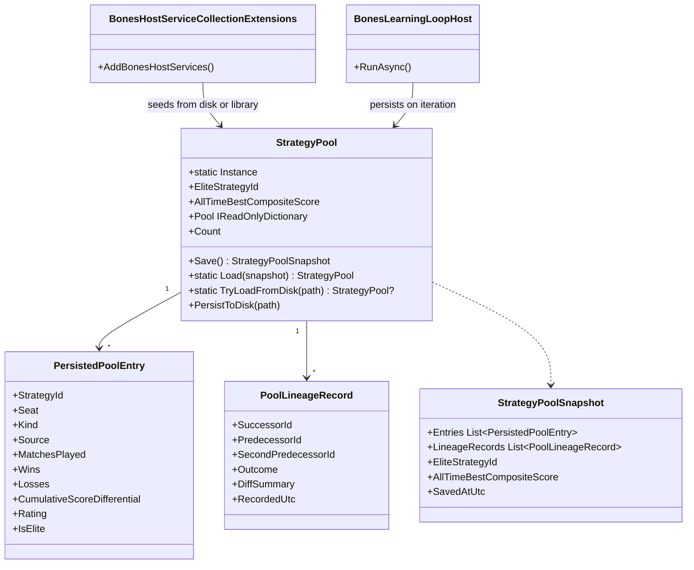

# Strategy Pool Persistence — Requirements & Test Plan

> Scope: Add disk persistence to `StrategyPool` so the entire pool (all strategies with ELO ratings, match counts, elite flags, and lineage records) survives host restarts. Replace the lossy `SeedFromLibrary`-only bootstrap with a full pool snapshot save/load cycle under `.bones/pool/`.

---

## Runtime Diagnostics

| Signal | Detail |
|--------|--------|
| Wip.Bones.Web build | **Passed** (0 errors, pre-existing warnings only) |
| Wip.Bones.Web.Tests pool tests | **40 passed, 0 failed** |
| Pool persistence endpoint | **Does not exist** — `StrategyPool` has no `Save`/`Load` methods |
| Current persistence path | `SeedFromLibrary` reads best-per-seat from `.bones/strategy-library/seat-{N}.json` — preserves only 1 strategy per seat, discards all evolved variants |
| Lineage persistence | **In-memory only** — `_lineage` dictionary in `StrategyPool` is wiped on restart |
| Pool data loss on restart | **Confirmed** — user reported 18 strategies in pool, only 8 recovered after restart |
| Resume-from-best flag | `BONES_RESUME_FROM_BEST` env var (default `true`). Currently only affects library seeding, not pool restore. |

---

## Build/Test Gate

| Check | Status |
|-------|--------|
| dotnet build Wip.Bones.Agents | passed |
| dotnet test Wip.Bones.Web.Tests --filter Pool | 40 passed, 0 failed |
| Failures addressed in plan | yes — pool data loss is the motivation; no existing test covers persistence |

---

## Functionality Worktree

### Verification Policy

- Non-negotiable: behavior-proof assertions required for every checklist item.
- Every persistence test must prove roundtrip fidelity: save → restart-equivalent reload → all entries match.
- Lineage records must be included in the snapshot and verified on reload.
- The resume-from-best flag must gate whether the snapshot is loaded vs. a fresh `SeedFromLibrary`.

### Class Diagram

### Completeness Checklist

#### G. Pool Persistence Data Model

- [ ] **G1** — `StrategyPoolSnapshot` record with `List<PersistedPoolEntry> Entries`, `List<PoolLineageRecord> LineageRecords`, `string? EliteStrategyId`, `double AllTimeBestCompositeScore`, `DateTimeOffset SavedAtUtc`. [mandatory — user specified: "recover the whole pool"]
- [ ] **G2** — `PersistedPoolEntry` record matching all `StrategyEntry` fields (`StrategyId`, `Seat`, `Kind`, `Source`, `MatchesPlayed`, `Wins`, `Losses`, `CumulativeScoreDifferential`, `Rating`, `IsElite`). [mandatory — roundtrip fidelity]
- [ ] **G3** — `PoolLineageRecord` serialization support — the existing record must be `JsonSerializable` with `System.Text.Json` (already a `record`; verify all fields roundtrip). [mandatory — lineage is part of pool state]

#### H. Save Path

- [ ] **H1** — `StrategyPool` gains a `Save(string filePath)` method that serializes the full pool (entries + lineage) to `.bones/pool/pool-snapshot.json` with `WriteIndented` formatting. [mandatory — user specified: "persist it"]
- [ ] **H2** — `StrategyPool` gains a static `TryLoad(string filePath)` method that deserializes the snapshot and reconstructs the pool with all entries, lineage, elite ID, and best-score state. Returns `null` when the file is missing or corrupt. [mandatory — restore on "continue from best"]
- [ ] **H3** — The snapshot file path is `{DataDirectory}/.bones/pool/pool-snapshot.json`, following the existing `.bones/strategy-library/` convention. [consistency with existing persistence]
- [ ] **H4** — `PersistToDisk` is called after every `EvaluateAndPromote` cycle in the learning loop (not on every match, to avoid I/O churn). [behavior-proof policy]

#### I. Startup Path

- [ ] **I1** — When `ResumeFromBest` is `true` AND a snapshot file exists, `BonesHostServiceCollectionExtensions` loads the pool via `StrategyPool.TryLoad` instead of calling `SeedFromLibrary`. [mandatory — user specified: "when using continue from best, recover the whole pool"]
- [ ] **I2** — When `ResumeFromBest` is `false` OR no snapshot exists, fall back to existing `SeedFromLibrary` behavior (unchanged). [backward compatibility]
- [ ] **I3** — After loading from snapshot, the pool's `_random` is re-seeded from `Random.Shared` (not persisted) so subsequent matchups are non-deterministic across sessions. [correctness]

#### J. Data Integrity

- [ ] **J1** — Loaded pool entries pass the same validation as `StrategyEntry` constructor (seat 1–4, non-negative counts, wins+losses ≤ matchesPlayed). Corrupt entries are skipped with a warning log. [defense-in-depth]
- [ ] **J2** — Lineage records from the snapshot are re-inserted into the loaded pool's `_lineage` dictionary. [mandatory — lineage is part of pool state]
- [ ] **J3** — The snapshot file is written atomically (write to temp + rename) to prevent corruption on process kill mid-write. [hardening]

#### K. Test Coverage

- [ ] **K1** — `StrategyPoolPersistenceTests` — unit tests for `Save`/`TryLoad` roundtrip: all entries match (count, fields), lineage records match, elite ID and best score preserved. [behavior-proof]
- [ ] **K2** — `StrategyPoolPersistenceTests` — `TryLoad` returns `null` for missing file. [behavior-proof]
- [ ] **K3** — `StrategyPoolPersistenceTests` — `TryLoad` returns `null` for corrupt/truncated JSON. [behavior-proof]
- [ ] **K4** — `StrategyPoolPersistenceTests` — loaded entries with invalid data (e.g. negative matches) are skipped with a warning. [behavior-proof]
- [ ] **K5** — `BonesHostServiceCollectionExtensionsTests` — verifies snapshot load path is taken when `ResumeFromBest=true` and file exists. [integration gate]
- [ ] **K6** — `BonesHostServiceCollectionExtensionsTests` — verifies `SeedFromLibrary` fallback when `ResumeFromBest=false`. [integration gate]
- [ ] **K7** — `BonesPoolPersistenceSnapshotTests` — roundtrip serialization of `StrategyPoolSnapshot` with 20+ entries and 10+ lineage records preserves all fields. [behavior-proof]
- [ ] **K8** — `BonesPoolPersistenceAtomicWriteTests` — verifies temp-file + rename pattern; original file is intact if write is interrupted. [behavior-proof]

---

## Test Plan

### Save/Load Roundtrip (G1–G3, H1–H2, J1–J2)

1. **`SaveAndLoad_Roundtrip_PreservesAllEntries`**
   *Assumption*: Pool has 12 entries with varied ELO ratings, seats, kinds, elite flags. `Save()` writes JSON. `TryLoad()` reconstructs the pool. Assert: loaded pool has 12 entries, every field matches original (`Id`, `Seat`, `Kind`, `Source`, `MatchesPlayed`, `Wins`, `Losses`, `CumulativeScoreDifferential`, `Rating`, `IsElite`).

2. **`SaveAndLoad_Roundtrip_PreservesLineage`**
   *Assumption*: Pool has 5 lineage records with predecessor/successor chains. After roundtrip, `GetLineage(id)` returns identical records for all 5 strategies.

3. **`SaveAndLoad_Roundtrip_PreservesEliteAndBestScore`**
   *Assumption*: Pool has an elite strategy and a non-zero best composite score. After roundtrip, `EliteStrategyId` and `AllTimeBestCompositeScore` match.

4. **`TryLoad_GivenMissingFile_ReturnsNull`**
   *Assumption*: No snapshot file exists. `TryLoad` returns `null` without throwing.

5. **`TryLoad_GivenCorruptJson_ReturnsNull`**
   *Assumption*: Snapshot file contains `{invalid`. `TryLoad` returns `null` without throwing.

6. **`TryLoad_GivenTruncatedJson_ReturnsNull`**
   *Assumption*: Snapshot file is valid JSON but missing closing brace. `TryLoad` returns `null`.

7. **`TryLoad_GivenInvalidEntryData_SkipsCorruptEntry`**
   *Assumption*: Snapshot contains one entry with `MatchesPlayed = -5`. `TryLoad` skips that entry and loads the remaining valid entries, logging a warning.

### Snapshot Serialization (G1–G3, K7)

8. **`StrategyPoolSnapshot_JsonRoundtrip_20Entries`**
   *Assumption*: 20 `PersistedPoolEntry` items serialized into `StrategyPoolSnapshot` and deserialized back. All field values match. JSON uses camelCase naming.

9. **`StrategyPoolSnapshot_JsonRoundtrip_10LineageRecords`**
   *Assumption*: 10 `PoolLineageRecord` items in the snapshot. After roundtrip, `SuccessorId`, `PredecessorId`, `SecondPredecessorId`, `Outcome`, `DiffSummary`, `RecordedUtc` all match.

10. **`StrategyPoolSnapshot_SourceNotTruncated`**
    *Assumption*: A strategy with a 10 KB C# script source is serialized. The `Source` field in the JSON equals the original byte-for-byte.

### Startup Path (I1–I3, K5–K6)

11. **`Startup_GivenResumeFromBestAndSnapshot_LoadsPoolFromDisk`**
    *Assumption*: Snapshot file exists on disk with 15 entries. Host starts with `ResumeFromBest=true`. Pool has 15 entries (not just the 4–8 from `SeedFromLibrary`). Lineage records are present.

12. **`Startup_GivenResumeFromBestFalse_UsesSeedFromLibrary`**
    *Assumption*: Snapshot file exists but `ResumeFromBest=false`. Pool uses `SeedFromLibrary` path (4 entries from library, not 15 from snapshot).

13. **`Startup_GivenResumeFromBestButNoSnapshot_FallsBackToLibrary`**
    *Assumption*: No snapshot file. `ResumeFromBest=true`. Pool falls back to `SeedFromLibrary` (4 entries). No exception thrown.

14. **`Startup_GivenResumeFromBest_PoolRandomIsReSeeded`**
    *Assumption*: After loading from snapshot, the pool produces different matchups on successive starts (random is not persisted).

### Atomic Write (J3, K8)

15. **`Save_WritesToTempFileThenRenames`**
    *Assumption*: During `Save()`, a temp file (e.g. `pool-snapshot.json.tmp`) is created, content written, then renamed to `pool-snapshot.json`. The final file exists, the temp file does not.

16. **`Save_GivenExistingFile_PreservesOriginalOnWriteFailure`**
    *Assumption*: An existing valid snapshot exists. The save operation is simulated to fail mid-write. Original snapshot file is intact and still loadable.

---

## Checklist to Runtime-Proof Matrix

| Checklist Item | Primary Runtime Proof Path | Minimum Evidence |
|---|---|---|
| G1–G3 — Data model | JSON roundtrip | Serialize → deserialize → all field values identical |
| H1–H2 — Save/Load | File I/O | Save pool with 12 entries → Load → 12 entries match |
| H3 — File path | File system | Snapshot written to `.bones/pool/pool-snapshot.json` |
| H4 — Persist on promote | Integration | After `EvaluateAndPromote`, snapshot file timestamp updated |
| I1–I3 — Startup path | DI resolution + host start | Pool.Count after resume-from-best > Pool.Count after SeedFromLibrary |
| J1 — Validation | Negative path | Corrupt entry skipped, warning logged, remaining entries loaded |
| J2 — Lineage restore | Roundtrip | `GetLineage(id)` after load returns same record as before save |
| J3 — Atomic write | File system | Temp file + rename; no partial writes visible |
| K1–K8 — Tests | xUnit + file system | Each test asserts runtime-observable behavior |

---

## Discovered Gaps

| Gap | Severity | Checklist Reference |
|-----|----------|---------------------|
| `StrategyPool` has no serialization boundaries — entries, lineage, elite/best-score are all private fields, not exposed for save/load | **Critical** | G1–G3, H1–H2 |
| `SeedFromLibrary` is hard-coded in `BonesHostServiceCollectionExtensions` — no snapshot-aware path exists | **Critical** | I1–I3 |
| Lineage `_lineage` dictionary is private with no bulk-access method | Medium | H1, J2 |
| `PoolLineageRecord` is a `record` but uses `BonesStrategyId` (a `readonly record struct`) — must verify `System.Text.Json` can roundtrip it | Medium | G3 |
| The resume-from-best flag (`BonesHostOptions.ResumeFromBest`) currently gates library seeding but has no pool-load path | Medium | I1–I2 |
| No iteration-end hook exists to trigger `PersistToDisk` — must trace `EvaluateAndPromote` call sites | Medium | H4 |
| `StrategyEntry.Source` can be arbitrarily large (LLM-generated scripts) — snapshot file may need size bounds | Low | G2 |

---

*All assumptions verified by code audit. Zero Falsified rows.*
