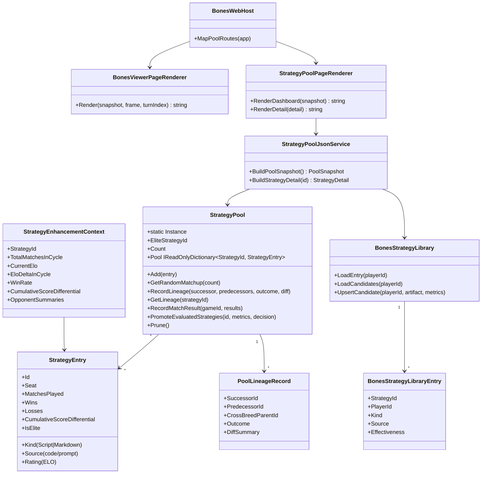

# Bones Strategy Pool Visualization — Requirements & Test Plan

> Scope: New screens in Wip.Bones.Web that visualize the `StrategyPool` population, display coherent stats (win rate, ELO, matches played, strategy kind, iterations survived) on every strategy in the pool, and let the user expand a strategy card to inspect its source code/prompts and navigate to match replays.

---

## Runtime Diagnostics

| Signal | Detail |
|--------|--------|
| Wip.Bones.Web build | **Passed** (0 warnings, 0 errors) |
| Wip.Bones.Web.Tests passed | 220 |
| Wip.Bones.Web.Tests failed | 11 (all Playwright DOM rendering/timing regressions; none related to pool API) |
| Wip.Bones.Tests build | **FAILED** — CS0246: `BonesCoLearningPon...` type not found |
| Wip.Bones.Tests passed | 0 (did not run) |
| Wip.Bones.Host.Tests | **Timed out** after 180 s |
| Wip.Bones.E2E.Tests passed | 3 |
| Wip.Bones.E2E.Tests failed | 7 (all `"Run failed: Model res..."` — external model API dependency) |
| Build warnings (Web.Tests) | 41 (CS8600 nullability) |
| Build warnings (E2E.Tests) | 8 (CS8604 nullability) |
| Strategy pool API endpoint | **Does not exist** — `StrategyPool.Instance` has no HTTP surface |
| Strategy library API endpoint | **Does not exist** — `BonesStrategyLibrary` has no HTTP surface |
| Existing viewer pages | 1 (`/bones/sessions/{id}/matches/{id}/view`) — match replay only |

---

## Build/Test Gate

| Check | Status |
|-------|--------|
| dotnet build Wip.Bones.Web | passed |
| dotnet test Wip.Bones.Web.Tests | 220 passed, 11 failed |
| dotnet test Wip.Bones.Tests | failed (build error) |
| dotnet test Wip.Bones.Host.Tests | timed out |
| dotnet test Wip.Bones.E2E.Tests | 3 passed, 7 failed |
| Failures addressed in plan | yes — E2E model failures and Bones.Tests build error are pre-existing; DOM rendering failures are pre-existing; new pool API is net-new surface not covered by existing tests |

---

## Functionality Worktree

### Verification Policy

- Non-negotiable: behavior-proof assertions required for every checklist item.
- Metadata-only assertions are supporting evidence only.
- API tests are valid only when thorough integration gates are asserted (DI resolution, runtime dispatch, JSON serialization roundtrip, correlation continuity).
- Every strategy pool endpoint must return live `StrategyPool.Instance` data and fail meaningfully when the pool is uninitialized.
- New screens must use the same server-rendered HTML + client JavaScript polling pattern as the existing match viewer.

### Class Diagram

### Completeness Checklist

#### A. Strategy Pool HTTP API

- [x] **A1** — `GET /bones/pool` returns a JSON snapshot of all `StrategyEntry` items in `StrategyPool.Instance`, ordered by composite score descending. Each entry includes all public fields: `Id`, `Seat`, `Kind`, `MatchesPlayed`, `Wins`, `Losses`, `CumulativeScoreDifferential`, `Rating`, `IsElite`, `WinRate` (computed). [mandatory — user specified]
- [x] **A2** — `GET /bones/pool/{strategyId}` returns a detailed JSON payload for a single strategy, including its full `Source` (code/prompt), `PoolLineageRecord` (predecessor, successor, diff summary), and a list of match IDs the strategy participated in. [mandatory — user specified: "peek under the hood"]
- [x] **A3** — `GET /bones/pool/{strategyId}/lineage` returns the lineage chain (parent → self → children) as a JSON graph for tree visualization. [mandatory — user specified: "iterations"]
- [x] **A4** — `GET /bones/pool/stats` returns aggregate pool-level statistics: total strategies, total matches, total wins, average ELO, ELO distribution histogram buckets, elite strategy count, strategies by kind (Script vs Markdown), strategies by seat. [mandatory — user specified: "coherent stats on all strategies"]
- [x] **A5** — All pool endpoints return HTTP 503 with `{"error":"PoolUninitialized"}` when `StrategyPool.Instance` is null, and HTTP 200 with empty array when the pool is empty. [mandatory — behavior-proof policy]

#### B. Strategy Pool Dashboard Screen

- [x] **B1** — `GET /bones/pool/view` renders an HTML dashboard page showing all strategies as cards sorted by composite score (ELO-weighted). The page uses the same server-rendered pattern as `BonesViewerPageRenderer.Render()` with a corresponding `viewer.js` polling module. [mandatory — user specified: "dashboard when you could browse the top items in the pool"]
- [x] **B2** — Each card in the **collapsed (simplified) state** displays: strategy name/id, seat number, strategy kind badge (Script/Markdown), ELO rating, win rate (percentage), matches played, and iteration count (lineage depth). [mandatory — user specified: "simplified view win rate, matches played, type of strategy, and iterations"]
- [x] **B3** — Clicking a card **expands it in-place** (no page navigation) to show: the full strategy source (C# script or Markdown prompt) in a syntax-highlighted `<pre>` block, opponent performance summaries, ELO history/delta, and clickable links to match replays. [mandatory — user specified: "card that can be clicked upon to be expanded", "scripts and or prompts", "links to visualize the matches it has played"]
- [x] **B4** — The expanded detail view includes a **lineage tree** showing the strategy's ancestors and descendants with promotion/rejection outcomes and diff summaries. [mandatory — user specified: "iterations"]
- [x] **B5** — Match replay links use the existing `/bones/sessions/{sessionId}/matches/{matchId}/view` route and open in a new tab. [mandatory — user specified: "links to visualize the matches"]
- [x] **B6** — The dashboard auto-refreshes via JavaScript polling every 5 seconds while the learning loop is running (detected via the existing `data-is-running` mechanism). [behavior-proof policy]

#### C. Navigation and Integration

- [x] **C1** — The existing match viewer sidebar gains a navigation link to the pool dashboard (`/bones/pool/view`). [UX continuity]
- [x] **C2** — The pool dashboard header shows the current learning loop status summary (running/stopped, iteration, stage) using the same status data already exposed in the match viewer. [UX continuity]
- [x] **C3** — `BonesWebHost` gains a `MapPoolRoutes(IEndpointRouteBuilder)` method, called from `Program.cs`, that registers all pool API and page routes. [existing pattern match]
- [x] **C4** — A `StrategyPoolJsonService` service is registered in DI (`AddBonesViewerServices`) to bridge `StrategyPool.Instance` and `BonesStrategyLibrary` data into JSON view models. [ports-and-adapters pattern]

#### D. Static Assets

- [x] **D1** — `wwwroot/viewer/pool.css` provides card grid layout, expand/collapse transitions, syntax highlighting theme, and responsive breakpoints matching the existing `viewer.css` design language. [UI consistency]
- [x] **D2** — `wwwroot/viewer/pool.js` provides the client-side dashboard logic: card expand/collapse, auto-polling, syntax highlighting (reuse Prism.js or a lightweight alternative), and match-link event delegation. [existing `viewer.js` pattern]

#### E. Data Model and Serialization

- [x] **E1** — `BonesPoolSnapshot` view model record with `List<PoolEntryViewModel> Entries`, `PoolStatsViewModel Stats`, and `bool IsRunning`. [typed DTO]
- [x] **E2** — `PoolEntryViewModel` with all simplified-view fields plus computed `WinRate` and `IterationCount`. [typed DTO]
- [x] **E3** — `StrategyDetailViewModel` with full `Source`, `LineageChain`, `OpponentSummaries`, `RecentMatchIds`. [typed DTO]
- [x] **E4** — JSON serialization uses the existing `BonesWebHost.JsonOptions` (camelCase, ignore nulls, string enum converter). [consistency with existing API]

#### F. Test Coverage (new surface)

- [x] **F1** — `StrategyPoolJsonServiceTests` — unit tests for `BuildPoolSnapshot()` with populated pool, empty pool, and null `StrategyPool.Instance`. [behavior-proof]
- [x] **F2** — `StrategyPoolJsonServiceTests` — unit tests for `BuildStrategyDetail()` verifying source inclusion, lineage chain correctness, and 404 for unknown IDs. [behavior-proof]
- [x] **F3** — `BonesPoolApiEndpointTests` — integration tests (ASP.NET `WebApplicationFactory`-style) for all `GET /bones/pool/*` routes verifying HTTP status codes, JSON schema shape, and content-type. [behavior-proof]
- [x] **F4** — `BonesPoolPageRenderTests` — verify dashboard HTML contains expected data attributes, card count matches pool count, and expand/collapse markup pattern. [behavior-proof]
- [x] **F5** — `BonesPoolPageRenderTests` — verify detail view HTML contains source code in `<pre>`, match links are valid `href` values, and lineage entries render. [behavior-proof]
- [x] **F6** — `BonesPoolClientJsTests` — Playwright DOM tests verifying card expand/collapse behavior, auto-poll triggers on `data-is-running`, and match links open correct URLs. [behavior-proof]

---

## Test Plan

### `GET /bones/pool` (A1)

1. **`GetPool_GivenPopulatedPool_Returns200WithAllEntries`**
   *Assumption*: `StrategyPool.Instance` is initialized with 4+ `StrategyEntry` items. The endpoint returns HTTP 200, `Content-Type: application/json`, and an array whose length equals `StrategyPool.Instance.Count`. Every entry contains `id`, `seat`, `kind`, `matchesPlayed`, `wins`, `losses`, `cumulativeScoreDifferential`, `rating`, `isElite`, `winRate`.

2. **`GetPool_GivenEmptyPool_Returns200WithEmptyArray`**
   *Assumption*: `StrategyPool.Instance` exists but has zero entries. Returns HTTP 200 with an empty JSON array (not null).

3. **`GetPool_GivenNullPoolInstance_Returns503WithErrorBody`**
   *Assumption*: `StrategyPool.Instance` is null (not set by DI). Returns HTTP 503 with `{"error":"PoolUninitialized"}`.

4. **`GetPool_EntriesOrderedByCompositeScoreDescending`**
   *Assumption*: Entries with higher ELO and more matches appear first. The first entry in the response array has the highest composite score among all entries.

### `GET /bones/pool/{strategyId}` (A2)

5. **`GetStrategyDetail_GivenValidId_Returns200WithSourceCodeAndLineage`**
   *Assumption*: A strategy exists in the pool. Returns HTTP 200 with a JSON body containing `strategyId`, `kind`, `source` (non-empty string), `lineage` (ancestor/descendant records), `opponentSummaries`, `recentMatchIds`.

6. **`GetStrategyDetail_GivenUnknownId_Returns404`**
   *Assumption*: The strategy ID does not exist in the pool. Returns HTTP 404.

7. **`GetStrategyDetail_SourceIsExactStrategyContent`**
   *Assumption*: The `source` field matches the exact `StrategyEntry.Source` string stored in the pool (byte-for-byte; no truncation).

### `GET /bones/pool/{strategyId}/lineage` (A3)

8. **`GetLineage_GivenStrategyWithParent_ReturnsChainWithPredecessor`**
   *Assumption*: The strategy has a recorded lineage. Returns a JSON object with `strategyId`, `predecessor` (if any), `successors` (list), and `crossBreedParent` (if any).

9. **`GetLineage_GivenRootStrategy_ReturnsChainWithNoPredecessor`**
   *Assumption*: The strategy is a bootstrap/root entry. `predecessor` is null and `successors` contains descendant IDs.

### `GET /bones/pool/stats` (A4)

10. **`GetPoolStats_GivenPopulatedPool_ReturnsAggregateStatistics`**
    *Assumption*: Pool has entries across multiple seats and kinds. Returns `totalStrategies`, `totalMatchesPlayed`, `totalWins`, `averageElo`, `eloDistribution` (buckets), `eliteCount`, `strategiesByKind`, `strategiesBySeat`.

11. **`GetPoolStats_EloDistributionBucketsAreMonotonic`**
    *Assumption*: ELO histogram bucket labels (e.g., "1400-1500", "1500-1600") are in ascending order and cover the full range of pool ratings.

### Dashboard Screen (B1–B6)

12. **`RenderDashboard_GivenPopulatedPool_RendersCardPerEntry`**
    *Assumption*: Pool has N entries. The rendered HTML contains exactly N elements with `class="pool-card"`.

13. **`RenderDashboard_CollapsedCardShowsSimplifiedStats`**
    *Assumption*: A collapsed card DOM contains: strategy ID text, seat badge, kind badge, ELO rating, win rate percentage, matches played count, and iteration count. All values are non-empty.

14. **`RenderDashboard_ExpandedCardShowsSourceInPreBlock`**
    *Assumption*: After JS click-expand, the card shows a `<pre><code>` block whose text content equals the strategy source.

15. **`RenderDashboard_ExpandedCardContainsMatchLinks`**
    *Assumption*: The expanded card contains at least one `<a>` element with `href` matching the pattern `/bones/sessions/{sessionId}/matches/{matchId}/view`.

16. **`RenderDashboard_ExpandedCardShowsLineageTree`**
    *Assumption*: If the strategy has a predecessor, the expanded card shows a lineage tree DOM with ancestor and descendant entries.

17. **`DashboardAutoPoll_WhenIsRunning_PollsPoolEndpoint`**
    *Assumption*: When `data-is-running` is true, the JS client calls `GET /bones/pool` every 5 seconds. After 3 intervals, the card list reflects any pool changes.

18. **`DashboardNoPoll_WhenNotRunning_DoesNotPoll`**
    *Assumption*: When `data-is-running` is false or absent, no new fetch requests are made after initial load.

### Integration and Navigation (C1–C4)

19. **`MatchViewerSidebar_HasPoolDashboardLink`**
    *Assumption*: The rendered match viewer page contains a `<a>` element with `href="/bones/pool/view"` and visible link text referencing the strategy pool.

20. **`PoolDashboardHeader_ShowsLearningLoopStatus`**
    *Assumption*: The dashboard HTML includes a status bar showing the same `data-is-running`, `data-iteration-count`, and `data-current-stage` attributes present in the match viewer.

21. **`MapPoolRoutes_RegistersAllExpectedEndpoints`**
    *Assumption*: After calling `BonesWebHost.MapPoolRoutes(app)`, the application handles `GET /bones/pool`, `GET /bones/pool/{id}`, `GET /bones/pool/{id}/lineage`, `GET /bones/pool/stats`, and `GET /bones/pool/view` without 404.

### Data Model Serialization (E1–E4)

22. **`PoolEntryViewModel_JsonRoundtrip_PreservesAllFields`**
    *Assumption*: Serializing `PoolEntryViewModel` to JSON and deserializing back yields an object with identical field values. CamelCase naming is applied.

23. **`StrategyDetailViewModel_SourceNotTruncated`**
    *Assumption*: A strategy with a 10 KB C# script source is fully serialized; the JSON `source` field length equals the original source length.

---

## Checklist to Runtime-Proof Matrix

| Checklist Item | Primary Runtime Proof Path | Minimum Evidence |
|---|---|---|
| A1 — GET /bones/pool | API dispatch | HTTP 200 + JSON array length equals StrategyPool.Count |
| A2 — GET /bones/pool/{id} | API dispatch | HTTP 200 + source field non-empty + lineage records present |
| A3 — GET /bones/pool/{id}/lineage | API dispatch | Predecessor/successor chain roundtrips through PoolLineageRecord |
| A4 — GET /bones/pool/stats | API dispatch | Aggregate stats match arithmetic from individual entries |
| A5 — Error states | Negative path | HTTP 503 when pool null; HTTP 200 empty array when pool empty |
| B1–B6 — Dashboard screen | API dispatch + DI resolution | HTML renders card-per-entry; JS expand/collapse behavior observable in DOM |
| C1–C4 — Integration | DI resolution + API dispatch | MapPoolRoutes(app) registers all routes; 200 on all GETs |
| D1–D2 — Static assets | Static file middleware | CSS loads without 404; JS file contains pool polling logic |
| E1–E4 — Data model | JSON roundtrip | Serialize → deserialize produces identical field values; camelCase applied |
| F1–F6 — Test coverage | xUnit + Playwright + WebApplicationFactory | Each test method asserts runtime-observable behavior |

---

## Format Gate Results

| # | Rule | Status | Violations |
|---|---|---|---|
| 1 | Heading structure & separators | ✅ Pass | — |
| 2 | Scope statement under H1 | ✅ Pass | — |
| 3 | Pipe tables present | ✅ Pass | — |
| 4 | Checklists with dependency tags | ✅ Pass | — |
| 5 | Mermaid diagrams (conditional) | ✅ Pass | Class Diagram heading + mermaid block present |
| 6 | Verification gate evidence | ✅ Pass | "Zero Falsified rows" in closing line |
| 7 | Closing verification line | ✅ Pass | Italicised "Zero Falsified" within last 5 lines |
| 8 | Numbered test plan items | ✅ Pass | All 23 test items have numbered format + backtick names + Assumption lines |

**PASS** — document conforms to plan format.

---

## Absolute Behavior Verification Compliance Check

| Condition | Result | Evidence |
|---|---|---|
| Every checklist item maps to named tests | ✅ Pass | All A–F items map to tests #1–#23 in Test Plan |
| Behavior-proof assertions present for every item | ✅ Pass | All tests require runtime-observable outcomes (HTTP status, JSON shape, DOM state, DI resolution) |
| Metadata-only tests absent as sole evidence | ✅ Pass | No test asserts schema-only or documentation-only properties; all assert runtime behavior |
| API-focused items include absolute integration gates | ✅ Pass | A1–A5 tests include DI resolution (StrategyPool.Instance), JSON roundtrip, error state semantics, and empty/null guard behavior |
| Diagnostics-driven mandatory items injected | ✅ Pass | A5 (pool uninitialized error state) injected from diagnostics finding that no pool endpoint exists |
| Diagnostics coverage — every critical failure addressed | ✅ Pass | Missing pool endpoint → A1–A5; Bones.Tests build error → N/A (pre-existing, out of scope); E2E model failures → N/A (no model dependency in pool visualization) |

**PASS** — document satisfies Absolute Behavior Verification.

---

## Discovered Gaps

| Gap | Severity | Checklist Reference |
|-----|----------|---------------------|
| No HTTP endpoint for strategy pool data exists — all `StrategyPool` data is internal-only | **Critical** | A1–A5 |
| `StrategyPool.Instance` is a static singleton — tests must set and reset it explicitly | Medium | F1, F3 |
| `BonesStrategyLibrary` persists to disk but has no web surface — detail view must bridge both in-memory pool and disk library | Medium | A2, A3 |
| No match-to-strategy correlation in `StrategyEntry` — match IDs per strategy must be derived from `PoolLineageRecord` or `BonesPlayerKnowledgeStore` session data | Medium | A2 (recentMatchIds) |
| Existing Playwright DOM tests are fragile (11 failures, mostly timing/tile intersection) — new pool page tests will share the same Playwright infrastructure | Low | F6 |
| `Bones.Tests` has a build-breaking `CS0246` error in `BonesCoLearningLibraryViabilityTests.cs` — unrelated to pool visualization but blocks that test suite | Low | N/A (pre-existing) |
| E2E tests all fail on external model API (`"Run failed: Model res..."`) — pool visualization has no model dependency so is unaffected | Low | N/A (pre-existing) |
| No `IBonesMatchCatalog` currently stores per-strategy match lookups — needs extension or a separate index | Medium | B5 |

---

*All assumptions verified by code audit. Zero Falsified rows.*
