# WIP Implementation Plan

**From governed runtime to trusted agent platform: phased execution plan for the findings in `WIP-REQ-ARCH-001`**

| Field | Value |
|---|---|
| Plan ID | WIP-IMPL-001 |
| Version | 1.0 — Proposed |
| Date | 2026-11-02 |
| Baseline | Branch `WIP`, commit `d6b895f` plus the current working tree (308 changed paths) |
| Inputs | [`WIP-Requirements-and-Architecture-Report.md`](WIP-Requirements-and-Architecture-Report.md) |
| Scope | All P0, P1, and P2 recommendations in the report, through a releasable 1.0 |
| Out of scope | Multi-tenant/distributed operation, non-DeepSeek production providers beyond the new abstraction, Bones game-rule changes, viewer redesign |
| Team assumption | 3 engineers (runtime, platform/security, agent/LLM), 0.5 QA, 0.3 security reviewer, 0.2 product owner |
| Duration | 13 weeks indicative, 142 engineer-days plus 20% contingency |
| Status | Proposed; execution starts only after Gate G0 |

> **How to use this plan.** Phase 0 and Phase 1 are non-negotiable. Phase 3 (generic agent runtime) is in scope under the assumption that general autonomy is a product goal; if Gate G1 decides otherwise, drop Phase 3 and release WIP as a governed coding/domain-agent runtime. Every work package has an acceptance criterion and a mapped report finding in Appendix A.

> **Definition of “until the end”.** The plan is complete only when WIP 1.0 is released, the release has been verified in production-like use, and the post-release checklist in §9.3 and sign-off in §9.4 are complete. There is no “phase 3 stops here” exit.

## Contents

Executive summary · 1. Planning basis · 2. Target state · 3. Phase plan · 4. Dependencies, schedule, and resourcing · 5. Execution governance · 6. Test and quality strategy · 7. Migration, rollout, and rollback · 8. Risk register · 9. Definition of done and release · 10. First 10 working days · Appendices A–D.

---

## Executive summary

WIP already has the hard part of a trustworthy agent platform: typed capability contracts, a session authority, Git worktree isolation, evidence-bound validation/review/approval/merge, policy-gated tool execution, and a real LLM-in-the-loop application in Bones. What it lacks is **truthful build/test gates, host-managed DI, explicit workflow contracts, isolation for model-authored code, enforced permissions, and a reusable agent loop**.

This plan fixes those in a deliberate order:

1. **Make the truth visible** (Phase 0). Freeze the baseline, put every project in a solution, run every offline test in CI, commit the in-flight governance guard, add architecture tests, and record the decisions that cannot be inferred from code.
2. **Isolate and authorize** (Phase 1). Move model-authored C# into a worker process with resource limits and hostile-code tests; define and enforce capability permissions.
3. **Make the runtime coherent** (Phase 2). Resolve capabilities from the host DI scope, remove static singleton workarounds, replace the misleading workflow contract with a definition/executor model, make stage maps explicit, isolate plugins, and decouple the shell host from Bones.
4. **Build the reusable agent runtime** (Phase 3). Add model-agnostic chat/tool contracts, a permission-aware tool invoker, an agent loop with budgets and memory, streaming, and a sample agent that proves the stack end to end.
5. **Unify requirements and operations** (Phases 4–5). One requirements tree, registered compliance docs, OpenTelemetry, redaction/retention, versioning, and a security review.
6. **Harden and release** (Phase 6). Full regression, release packaging, rollout/rollback, handover, and post-release verification.

### Critical path

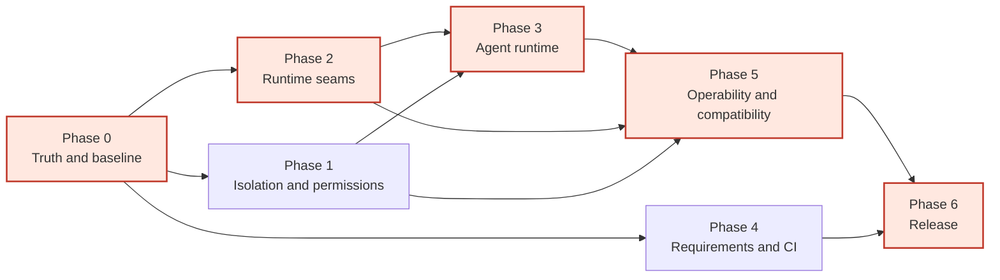

The red path is the schedule-critical chain: **truth → coherent runtime → agent runtime → operability → release**. Security isolation and requirements are parallel release gates, not optional side quests. If Phase 1 slips, the release date slips even if the critical path is on time.

### Plan at a glance

| Phase | Theme | Indicative window | Effort (ED) | Exit gate |
|---|---|---|---:|---|
| 0 | Truth and baseline | Week 1 | 12 | G0: baseline accepted |
| 1 | Isolation and permissions | Weeks 2–5 | 28 | G2: sandbox approved; G3: permission model approved |
| 2 | Runtime seams | Weeks 4–6 | 27 | G4: workflow/DI contracts accepted |
| 3 | Agent runtime | Weeks 6–9 | 31 | Agent loop E2E accepted |
| 4 | Requirements and CI | Weeks 2–9 | 13 | One authoritative requirements tree |
| 5 | Operability and compatibility | Weeks 10–11 | 19 | Security review and operability sign-off |
| 6 | Hardening and release | Weeks 12–13 | 14 | G5: release approved |
| **Total** | | **13 weeks** | **142 + 20%** | **WIP 1.0** |

### Success measures

| Measure | Baseline | Target |
|---|---|---|
| Projects in the WIP build graph | 24 of 37 at `HEAD` | 37 of 37 in `Wip.slnx` |
| WIP test projects run in CI | 1 of 17 | 17 of 17, with documented live/Playwright waivers |
| `BuildServiceProvider` calls in `Wip.Runtime` | 1 per workflow run | 0 |
| `StrategyPool.Instance` references | Multiple | 0 |
| `Wip.ShellHost → Wip.Bones.*` references | 1 in working tree | 0, enforced by architecture test |
| Model-authored code execution | In-process | Worker process, resource-limited, killable |
| Permission enforcement | Metadata only | Enforced at dispatch/tool/plugin boundaries |
| Agent loop | None | Reusable loop with tool calls, memory, budgets, streaming |
| Requirements traceability | 3 trees, unregistered docs | 1 tree, all active docs registered, gate in CI |
| Release blockers | Unknown | 0 open P0/P1, security sign-off |

---


## 1. Planning basis

### 1.1 Inputs and traceability

This plan is derived directly from the requirements-lifting report. The report’s finding IDs are the plan’s traceability anchors:

| Report area | Report IDs | Plan phase |
|---|---|---|
| Truthful build/test gates | P0-02, P0-03, P0-04, P2-03 | Phase 0, Phase 4 |
| Sandbox and untrusted code | P0-01, NFR-SEC-06, FR-BONES-09 | Phase 1 |
| Permission enforcement | P0-05, FR-CAP-06, FR-PLG-06 | Phase 1 |
| Host-managed DI and static state | P1-01, P2-06, NFR-DI-01 | Phase 2 |
| Workflow contract and stage maps | P1-02, P1-03, FR-WF-02, FR-WF-07 | Phase 2 |
| Shell/Bones coupling | P1-04, FR-EXT-02 | Phase 2 |
| Plugin isolation | P1-07, FR-PLG-04 | Phase 2 |
| Generic agent runtime | P1-05, FR-AGT-05..08, FR-LLM-04 | Phase 3 |
| Requirements unification | P1-06, NFR-TEST-01 | Phase 4 |
| Observability, privacy, versioning | P2-01, P2-02, P2-04, NFR-OBS-01, NFR-PRIV-01, NFR-COMP-01 | Phase 5 |
| Naming/docs/cleanup | P2-05, FR-CAP-03 | Phase 4 |
| Release hardening | All P0/P1/P2 | Phase 6 |

The full mapping is in Appendix A.

### 1.2 Scope

**In scope**

- All 37 WIP projects: 24 core solution projects, `Wip.Shell.E2E`, 11 Bones projects, and `BonesLibraryRecovery`.
- Build, CI, test, and release infrastructure.
- Runtime, workflow, DI, agent runtime, sandbox, permissions, plugin isolation, observability, privacy, and compatibility.
- Documentation, requirements consolidation, engineering handover, and post-release verification.

**Out of scope**

- Multi-tenant hosting, distributed scheduling, external databases, or a queue.
- A production model provider other than DeepSeek; the new abstraction must make one possible, but adding it is a separate project.
- Bones game rules, strategy quality, viewer visual redesign, or benchmark science.
- A web UI for the shell or a general agent workbench.
- Organization-wide security certification (the plan targets an internal security review and sign-off).

### 1.3 Assumptions

| ID | Assumption | If false |
|---|---|---|
| A-01 | Three engineers are available for 13 weeks, with part-time QA/security/product support. | Stretch to 17–19 weeks with two engineers; descope Phase 3 or streaming first. |
| A-02 | General autonomy is a product goal, so Phase 3 is in scope. | Gate G1 descopes Phase 3; release is positioned as a governed coding/domain-agent runtime. |
| A-03 | Model-authored code is untrusted and must be isolated. | If all strategies are trusted, Phase 1 shrinks to a documented trust boundary and a kill switch. |
| A-04 | Windows and Linux are both supported developer platforms. | If Windows-only, the sandbox can use Windows Job Objects only and CI can drop the Linux matrix. |
| A-05 | DeepSeek remains the production provider during the plan. | The new `IChatModel` abstraction still lands; provider-specific work moves to a follow-up. |
| A-06 | Breaking changes to WIP contracts are acceptable pre-1.0, with a one-release obsolete adapter. | If not, add a compatibility layer and extend Phase 2 by 2–3 weeks. |
| A-07 | The current working tree is the intended baseline pending review. | Re-baseline at Phase 0 and re-estimate; the plan’s structure remains valid. |

### 1.4 Team and responsibilities

| Role | Responsibility | Allocation |
|---|---|---|
| Product owner | Scope, priority, G1/G5 decisions, release communication | 0.2 FTE |
| Tech lead / architect | ADRs, design reviews, cross-phase consistency, final technical sign-off | 0.6 FTE |
| Runtime engineer | DI, workflow model, runtime, permissions integration | 1.0 FTE |
| Platform/security engineer | Sandbox, plugin ALC, CI, observability, security tests | 1.0 FTE |
| Agent/LLM engineer | Chat/tool contracts, agent loop, memory, streaming, sample agent | 1.0 FTE |
| QA engineer | Test strategy, E2E, flaky-test control, release verification | 0.5 FTE |
| Security reviewer | Threat model, sandbox review, permission review, pen-test sign-off | 0.3 FTE |

The three engineers are not siloed. The platform/security engineer pairs with the runtime engineer on DI/permissions, and the agent engineer pairs with QA on E2E.

### 1.5 Estimation method

- Estimates are in **engineer-days (ED)** for one engineer, including implementation, tests, and documentation.
- Estimates exclude meetings, review latency, and release management; those are covered by the 20% contingency.
- A work package is not “done” until its acceptance test is merged and green in CI.
- Unknowns are spikes, not hidden work: any work package with an unknown mechanism gets a timeboxed spike in Phase 0 or at the start of its phase.
- The total is **142 ED + 20% contingency = 170 ED**. With three engineers, that is about **11.3 working weeks**; the 13-week calendar includes review, integration, and buffer.

### 1.6 Definition of done

A work package is done when:

1. The implementation is merged behind a feature flag if it changes behavior.
2. Unit, contract, and integration tests cover the new behavior; security-sensitive code has negative tests.
3. The acceptance criterion in this plan is demonstrated by a command, test, or artifact.
4. Documentation and the requirements registry are updated in the same PR.
5. Architecture tests pass and no forbidden reference is introduced.
6. The change is observable: it emits a log, metric, trace, or artifact that an operator can use.
7. A rollback path exists and is described in the PR.

The overall program is done when the release checklist in §9 is complete and signed off.

### 1.7 Planning principles

- **Truth before capability.** Do not add agent features on a build/test graph that cannot see them.
- **Security before autonomy.** Do not let a model execute code in the host and then add more tools to that host.
- **One owner per seam.** DI, workflow, sandbox, permissions, and agent loop each have one design owner and one acceptance test.
- **Parallel only where independent.** Security and runtime seams run in parallel; agent runtime waits for both.
- **No orphan work.** Every work package maps to a report finding; every finding maps to a phase.
- **Reversible changes.** Feature flags, obsolete adapters, and rollback plans are part of the design, not an afterthought.

---


## 2. Target state

### 2.1 Design principles

The target state keeps WIP’s strengths and removes the four structural weaknesses the report identified:

1. **One build graph.** The WIP family is a first-class solution with every project represented and every offline test runnable from one command.
2. **One DI owner.** The host builds the service provider; the runtime receives a scope and never builds a second container.
3. **One workflow contract.** A workflow is either a declarative plan or an explicit executor. It is never a public `ExecuteAsync` that the runtime ignores.
4. **One trust boundary.** Model-authored code runs outside the host process, in a killable, resource-limited worker with no host DI and no ambient authority.
5. **One permission model.** Declared permissions are enforced, audited, and visible in manifests.
6. **One agent loop.** The generic executor owns model turns, tool calls, observations, memory, budgets, and termination. Domain agents implement prompts and tools, not their own loop.
7. **One source of requirements truth.** Active docs are registered, stale docs are archived, and the compliance gate runs in CI.
8. **Operable by default.** Every session, stage, tool call, model call, and worker execution emits correlated telemetry.

### 2.2 Target architecture

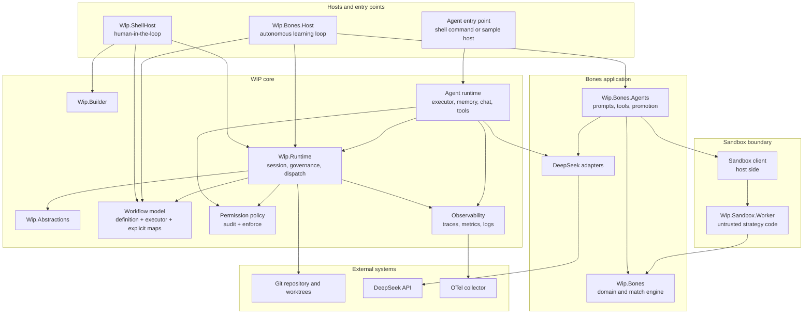

The important changes from today are visible at a glance:

- `Wip.ShellHost` has **no path to a `Wip.Bones.*` assembly**.
- Model-authored code reaches the host only through `Sandbox client → Worker`, never through `Assembly.Load` in the host.
- `Agent runtime` is a first-class core component, not a set of app-specific loops.
- `Permission policy` sits between the runtime/agent and the capabilities they invoke.
- `Observability` is a cross-cutting component with one correlation model.

### 2.3 Target DI topology

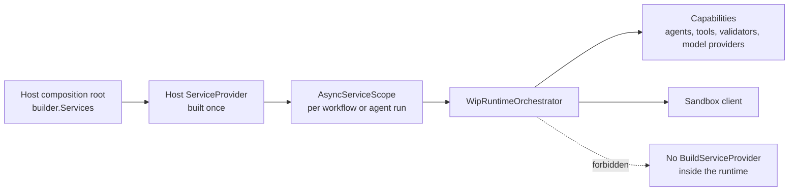

The host owns composition. A run receives a scope, resolves capabilities from that scope, and disposes the scope at the end. Singleton identity is stable across host and runtime; the `StrategyPool.Instance` workaround is deleted, not replaced with another static.

### 2.4 Target workflow model

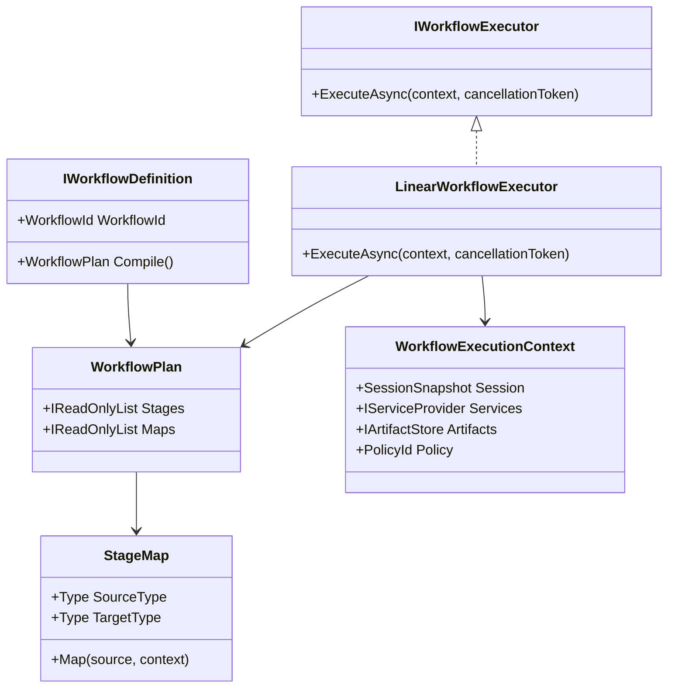

A workflow is now one of two explicit shapes:

- **Declarative:** implement `IWorkflowDefinition`, return a `WorkflowPlan` with typed stages and explicit `StageMap` delegates. `LinearWorkflowExecutor` runs it.
- **Custom:** implement `IWorkflowExecutor` when the workflow needs branching, loops, or a different control flow. The executor receives the host scope, session, artifacts, and policy; it is responsible for calling the stage runner and recording evidence.

`IWorkflow` is retained for one release as an obsolete adapter that maps to `IWorkflowDefinition`. The adapter is removed in the release after 1.0.

### 2.5 Target sandbox execution

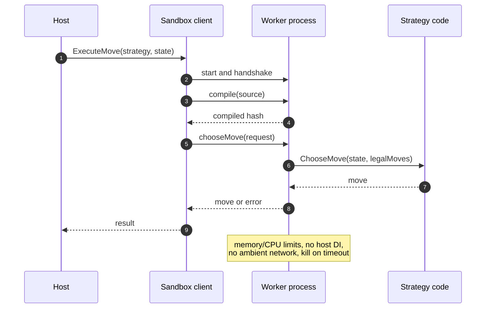

The host never loads the model-authored assembly. The worker receives only the strategy source/assembly, the serialized game state, and the legal moves; it returns a move or an error. The client owns startup, handshake, timeout, kill, and restart.

### 2.6 Target agent loop

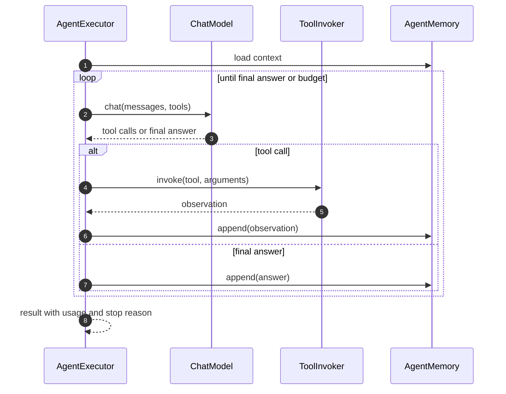

The loop is model-agnostic. `ChatModel` is a new abstraction over messages, tool definitions, tool calls, and streaming chunks. `ToolInvoker` is permission-aware and timeout-bounded. `AgentMemory` is session-scoped and artifact-backed by default. Domain agents supply prompts and tool catalogs; they do not implement the loop.

### 2.7 What changes versus today

| Concern | Today | Target | Work package |
|---|---|---|---|
| Build graph | 24 core projects in solutions; Bones outside at `HEAD` | 37 projects in `Wip.slnx`; CI builds all | WP-0.3, WP-0.4 |
| Test gate | 1 of 17 WIP test projects run | All offline suites; live/E2E categories explicit | WP-0.4, WP-4.3 |
| Governance guard | Working-tree only | Committed, tested, in CI | WP-0.2 |
| Model code | In-process Roslyn, allowlist only | Worker process, resource limits, hostile tests | WP-1.1..1.6 |
| Permissions | Metadata only | Enforced, audited, surfaced in manifests | WP-1.7 |
| DI | Nested `BuildServiceProvider` per run | Host-owned provider + scope | WP-2.1 |
| Static state | `StrategyPool.Instance` workaround | DI singleton, no static | WP-2.2 |
| Workflow contract | `IWorkflow.ExecuteAsync` never called | `IWorkflowDefinition` + `IWorkflowExecutor` | WP-2.3, WP-2.5 |
| Stage maps | Global registry + property heuristics | Explicit, plan-scoped delegates | WP-2.4 |
| Shell/Bones | Working-tree compile reference | No reference; test-only plugin/host | WP-2.6 |
| Plugins | Default `Assembly.LoadFrom` | Collectible `AssemblyLoadContext` per plugin | WP-2.7 |
| Agent runtime | None | Loop, tools, memory, budgets, streaming | WP-3.1..3.7 |
| Requirements | 3 trees, unregistered docs | 1 tree, registered, CI gate | WP-4.1..4.5 |
| Telemetry | Logs/status/journal | OTel traces, metrics, correlated logs | WP-5.1 |
| Privacy | No redaction/retention policy | Classified, redacted, retained/purged | WP-5.2 |
| Versioning | `CapabilityVersion` metadata only | Negotiated compatibility + deprecation policy | WP-5.3 |

---


## 3. Phase plan

### 3.1 Phase map

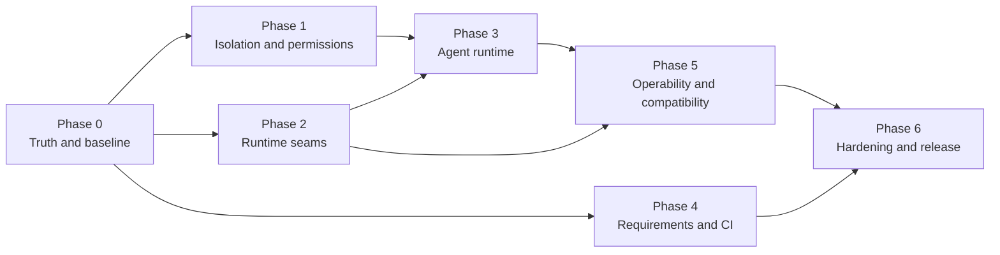

Phases 1 and 2 run in parallel after Phase 0. Phase 3 starts only when the security boundary and the runtime seams are stable enough to build on. Phase 4 runs alongside the code phases and finishes before release. Phase 5 consumes stable runtime/agent telemetry. Phase 6 is a hard gate, not a buffer for unfinished work.

---

### 3.2 Phase 0 — Truth and baseline

**Goal:** Make the repository’s build, test, and governance truth match the code. Freeze a baseline, put every project in a solution, run every offline test in CI, commit the in-flight governance guard, add architecture fitness tests, and record the decisions that cannot be inferred from code.

**Duration:** Week 1. **Effort:** 12 ED. **Owner:** tech lead + platform engineer.

| ID | Work package | Key tasks | Acceptance | Depends | ED |
|---|---|---|---|---|---:|
| WP-0.1 | Baseline freeze and inventory | Commit/stash the 308-path working tree after review; tag `wip-baseline-2026-11-02`; record HEAD, test inventory, known failures, and waivers in `docs/plan/baseline-test-status.md`; move scratch files out of the repo. | Working tree clean except intentional untracked files; baseline tag exists; inventory reviewed. | — | 1 |
| WP-0.2 | Governance guard commit | Rebase the working-tree `ResolveRunAdvancementTarget` guard and regression tests; add assertions that `run` never sets `ValidationStatus=Passed` or `ApprovalStatus=Approved`; add a shell E2E that tries to reach `Merged` via `run`. | `run` stops at `Editing`/`Checkpointed`; test fails if the guard is removed; test runs in CI. | WP-0.1 | 2 |
| WP-0.3 | Solution topology | Make [`Wip.slnx`](../WIP.slnx) the full WIP family solution (37 projects, including Bones, Benchmark, Recovery, `Wip.Shell.E2E`); keep [`Modus.slnx`](../Modus.slnx) as the Modus product solution; add a coverage check that every `WIP/**/*.csproj` is in `Wip.slnx`. | `dotnet build Wip.slnx` compiles all 37; coverage check fails on an orphan project; no project is absent from both solutions. | WP-0.1 | 2 |
| WP-0.4 | CI truth gate | Restructure [`.github/workflows/tests-ci.yml`](../.github/workflows/tests-ci.yml) into `build`, `architecture`, `unit`, `integration`, `e2e`, `security`, and `bones-offline` jobs; add `Category` traits (`Unit`, `Integration`, `Live`, `Playwright`, `Security`); run Windows and Ubuntu where practical; fail on zero tests discovered. | All offline suites run; live/Playwright jobs are explicit and optional; a project removal or zero-test run fails CI. | WP-0.2, WP-0.3 | 4 |
| WP-0.5 | Architecture fitness tests | Add `WIP/Wip.Architecture.Tests` (or `tests/Wip.Architecture.Tests`) with rules: Abstractions → no implementations; Runtime → no Shell/ShellHost/Bones; ShellHost → no Bones; Builder → no Runtime/Host; Bones.Host → no Shell; Bones domain → no Agents/Host/Web. | A forbidden reference fails the test; all current violations are fixed or explicitly waived with an ADR. | WP-0.1 | 2 |
| WP-0.6 | Decision log and ADRs | Write ADR-IMPL-01..06: solution topology, sandbox mechanism, permission model, workflow contract, agent scope, compatibility policy. Record owners and reversal triggers. | ADRs reviewed and accepted at G0; open questions have owners. | WP-0.1 | 1 |

#### Phase 0 notes

**The baseline may already be red.** The report documents failing compliance gates and a flaky Bones test. Phase 0 must not hide them. The inventory records each failure, the owning test, whether it is a product bug or a stale test, and a waiver with an expiry date. A waiver is a tracked issue, not a skipped test. `dotnet test` is never allowed to pass by discovering zero tests.

**Solution topology is a decision, not a rename.** The recommended topology is:

- `Wip.slnx` — full WIP family, the release gate, all 37 projects.
- `Modus.slnx` — Modus product solution; it may include WIP core for host integration, but it is not the WIP release gate.

This keeps `Wip.slnx` honest without forcing Modus consumers to build Bones. A project may appear in both solutions; it may not appear in neither.

**CI must be fast enough to be used.** Split jobs by category, cache NuGet, upload TRX, and quarantine only infrastructure flakiness. A 30-minute monolith job will be bypassed by developers; a 10-minute unit job plus a 20-minute integration job will not.

**Exit criteria**

- [ ] Baseline tag and clean working tree.
- [ ] `Wip.slnx` includes all 37 projects; coverage check passes.
- [ ] CI runs all offline suites; known failures are waived with owners and expiry.
- [ ] Governance guard committed and tested in CI.
- [ ] Architecture tests exist and run.
- [ ] ADR-IMPL-01..06 accepted.
- [ ] **Gate G0 passed.**

---

### 3.3 Phase 1 — Isolation and permissions

**Goal:** Remove in-process execution of untrusted model code; make capability permissions explicit, auditable, and enforceable.

**Duration:** Weeks 2–5. **Effort:** 28 ED. **Owner:** platform/security engineer + runtime engineer.

| ID | Work package | Key tasks | Acceptance | Depends | ED |
|---|---|---|---|---|---:|
| WP-1.1 | Threat model and worker protocol | Define assets, trust boundaries, attack paths, and guarantees; specify JSON-lines protocol (`handshake`, `compile`, `chooseMove`, `ping`, `shutdown`), versioning, message limits, correlation IDs, and error taxonomy. | Threat model reviewed by security; protocol versioned and documented; abuse cases mapped to tests. | WP-0.6 | 2 |
| WP-1.2 | Worker host | Add `Wip.Sandbox.Worker` console host; read/write JSON lines over stdio; compile strategy source with Roslyn in the worker; load the assembly only in the worker; cache by source hash; no host DI, no file/network dependencies. | Worker compiles and executes a sample strategy; malformed input returns deterministic errors; protocol tests pass. | WP-1.1 | 5 |
| WP-1.3 | Move execution to worker | Add `IScriptExecutor` abstraction (or `IStrategyRuntime`); implement `WorkerScriptExecutor` and an `InProcessScriptExecutor` for tests/trusted fallback; route `BonesStrategyScriptHost` / player-slot calls through the executor; keep the public `IBonesPlayerSlot` contract. | Bones tests pass with the worker; the host never loads a model-authored assembly; no behavior change in move legality. | WP-1.2 | 5 |
| WP-1.4 | Resource limits and kill | Windows Job Object (memory/CPU/process count) and Linux `prlimit`/cgroup adapter; process-tree kill; startup/handshake/compile/move timeouts; stdout/stderr caps; temp directory cleanup; worker restart after crash. | Infinite loop killed within 2× timeout; memory bomb capped; no orphan processes; output flood bounded. | WP-1.2 | 4 |
| WP-1.5 | Hostile-code test suite | Add security tests: file read/write, network connect, `Process.Start`, reflection to blocked assemblies, infinite loop, memory allocation, huge output, worker crash, malformed protocol. Run in the `Security` CI job. | Every attack is contained or fails closed; no host file/network access; tests are deterministic on Windows and Linux. | WP-1.3, WP-1.4 | 5 |
| WP-1.6 | Feature flag and docs | Add `ScriptHost:Mode=Worker|InProcess`; default `Worker`; `InProcess` logs a warning and is restricted to tests/trusted use; update Bones host, benchmark README, security docs, and operator runbook. | Flag switches modes; default is worker; docs describe the trust boundary and residual risk. | WP-1.3 | 2 |
| WP-1.7 | Permission model | Define permission catalog (`workspace.read/write`, `artifact.read/write`, `model.invoke`, `network`, `process`, `plugin.load`); add `IPermissionEvaluator` and `PermissionContext`; enforce at dispatcher, `RuntimeToolGateway`, plugin load, and model-provider invocation; add `Audit` vs `Enforce` mode; surface grants/denials in manifests. | Denied capability/tool is blocked; audit mode logs would-be denials; built-ins work without manual grants; tests cover allow/deny/audit. | WP-0.6 | 5 |

#### Phase 1 notes

**Isolation is a boundary, not a code review.** The current namespace/reference allowlist is a useful defense-in-depth filter, but it is bypassable through fully qualified names and reflection. The worker must be the security boundary. The plan accepts that a local developer tool cannot achieve perfect sandboxing, but it can achieve:

- no host DI or host assembly loading,
- no inherited handles or environment secrets,
- a separate process with a killable lifetime,
- memory/CPU/process limits,
- no network by default (where the OS allows),
- an explicit residual-risk statement for what the OS sandbox does not cover.

**Start with the protocol, not the process API.** A versioned JSON-lines protocol with correlation IDs lets the host, tests, and future out-of-process workers share one contract. Do not couple the protocol to `BonesRoundState` internals; define stable DTOs and map them in the worker.

**Permission enforcement has a migration cost.** Run `Audit` mode for at least one iteration of Bones and the shell E2E before `Enforce`. The audit log must answer “which capability would have been denied, for which session, and why?” If built-ins fail audit, fix the catalog before enforcing.

**Exit criteria**

- [ ] Threat model and protocol approved (Gate G2).
- [ ] Worker is the default execution mode for model-authored strategies.
- [ ] Host never loads a model-authored assembly.
- [ ] Hostile-code suite passes on Windows and Linux.
- [ ] Permission model approved (Gate G3) and enforced in `Enforce` mode.
- [ ] Audit-mode report for Bones and shell E2E has zero unexplained denials.
- [ ] Rollback flag `InProcess` documented and tested.

---


### 3.4 Phase 2 — Runtime seams

**Goal:** Make the runtime coherent: host-managed DI, no static singleton workarounds, an explicit workflow contract, explicit stage maps, isolated plugins, and a domain-agnostic shell host.

**Duration:** Weeks 4–6. **Effort:** 27 ED. **Owner:** runtime engineer + platform engineer.

| ID | Work package | Key tasks | Acceptance | Depends | ED |
|---|---|---|---|---|---:|
| WP-2.1 | Host-managed DI | Change `RunWorkflowAsync` to accept `IServiceProvider` or an `AsyncServiceScope`; remove `builder.Services.BuildServiceProvider()`; hosts create a scope per run and dispose it; update all tests and hosts; add a grep/architecture test for `BuildServiceProvider` in `Wip.Runtime`. | Host and runtime resolve the same singleton instance; a reference-equality test passes; no `BuildServiceProvider` in runtime. | WP-0.3 | 4 |
| WP-2.2 | Remove `StrategyPool.Instance` | Register `StrategyPool` in host DI; inject it into `BonesHostServiceCollectionExtensions`, `StrategyPoolJsonService`, pool routes, and agents; delete the static property and the snapshot-path workaround; update tests. | No `StrategyPool.Instance` references; status API and agents see the same pool; tests pass. | WP-2.1 | 3 |
| WP-2.3 | Workflow definition/executor | Add `IWorkflowDefinition`, `WorkflowPlan`, `IWorkflowExecutor`, `LinearWorkflowExecutor`, and `WorkflowExecutionContext`; make `RunWorkflowAsync` resolve a definition and executor from DI; keep `IWorkflow` as an `[Obsolete]` adapter for one release. | Declarative and custom workflows both run; obsolete adapter works; tests cover both paths. | WP-2.1 | 5 |
| WP-2.4 | Explicit stage maps | Replace `WorkflowStageMapAdapterRuntime` static lists with plan-scoped `StageMap` delegates; update `TypedLinearWorkflowBuilder.Map<TSource,TTarget>(Func<...>)`; keep default maps for governance stages; remove property-name/string-constructor fallback. | Two plans with the same source/target types do not collide; a non-heuristic payload maps correctly; no process-global map state. | WP-2.3 | 5 |
| WP-2.5 | Migrate Bones workflow | Implement `BonesLearningWorkflowDefinition` (or executor) with explicit Observe→Ponder→Play→Enhance maps; remove the fake `ExecuteAsync`; keep stage artifacts and status reporting; update host composition. | Bones iteration works end to end; no fake IDs; tests pass; status stage names remain stable. | WP-2.3, WP-2.4 | 3 |
| WP-2.6 | Decouple shell from Bones | Move `WIP_BONES_E2E` registration out of `Wip.ShellHost` into a test-only plugin/host or `Wip.Bones.Host.Tests`; remove the `Wip.Bones.Agents` project reference; add an architecture test. | `Wip.ShellHost` has no `Wip.Bones.*` reference; shell E2E still passes via the test host; architecture test fails on regression. | WP-0.5 | 2 |
| WP-2.7 | Plugin ALC isolation | Add a collectible `AssemblyLoadContext` per plugin; resolve dependencies per plugin; load contracts from the shared context; unload on stop; report load/unload diagnostics. | Two plugins with conflicting dependency versions load; unload releases the assembly; host remains healthy on plugin fault. | WP-0.5 | 5 |

#### Phase 2 notes

**DI first.** The nested provider is the root cause of several workarounds, including `StrategyPool.Instance`. Fix it before touching workflow or pool code. The target signature is:

```csharp
ValueTask<WorkflowExecutionResult> RunWorkflowAsync(
    SessionId sessionId,
    WipBuilder builder,
    WorkflowId? selectedWorkflowId,
    IServiceProvider services,
    CancellationToken cancellationToken,
    IArtifactStore? artifactStore = null);
```

The host creates an `AsyncServiceScope`, resolves the orchestrator and capabilities from it, and disposes it after the run. The runtime never constructs a provider. Tests use a real `ServiceCollection` provider and assert reference equality for a stateful singleton.

**Workflow compatibility.** `IWorkflow` is kept for one release as an adapter:

- `AddWorkflow<TWorkflow,TRequest,TResult>` remains, marks the registration as legacy, and wraps the workflow in a `LegacyWorkflowDefinition`.
- `RunWorkflowAsync` resolves the new definition/executor path; the legacy adapter produces a linear plan from the old `CompileLinearStages` or the default stages.
- `IWorkflow.ExecuteAsync` is no longer called. The adapter is removed in the release after 1.0.

This gives plugin authors a migration window without preserving a misleading contract forever.

**Stage maps are code, not metadata.** A `StageMap` carries a delegate:

```csharp
public sealed record StageMap<TSource, TTarget>(
    Func<TSource, WorkflowContext, TTarget> Map);
```

The plan owns its maps. There is no static registry, no property-name heuristic, and no reflection-based string constructor. Built-in governance stages get default maps from the session; app workflows must declare their maps explicitly.

**Plugin ALC is not a sandbox.** Collectible load contexts solve dependency conflicts and unloadability, not malicious code. Plugins are still trusted code under the permission model; the sandbox is for model-authored strategies. Document that distinction.

**Exit criteria**

- [ ] No `BuildServiceProvider` in `Wip.Runtime`.
- [ ] No `StrategyPool.Instance`.
- [ ] No `Wip.ShellHost → Wip.Bones.*` reference.
- [ ] Declarative and custom workflows run through the new contract.
- [ ] Bones workflow uses explicit maps and no fake `ExecuteAsync`.
- [ ] Plugin ALC load/unload tests pass.
- [ ] Gate G4: workflow/DI contracts accepted.

---

### 3.5 Phase 3 — Agent runtime

**Goal:** Add a reusable, model-agnostic agent loop with tool calls, memory, budgets, streaming, permissions, and a sample agent that proves the stack end to end.

**Duration:** Weeks 6–9. **Effort:** 31 ED (G1: streaming kept + write-capable sample agent). **Owner:** agent/LLM engineer + runtime engineer.

| ID | Work package | Key tasks | Acceptance | Depends | ED |
|---|---|---|---|---|---:|
| WP-3.1 | Chat and tool contracts | Add `ChatMessage`, `ChatRole`, `ChatRequest`, `ChatResponse`, `ToolDefinition`, `ToolCall`, `ToolResult`, `StreamingChunk`, and `IChatModel`; implement a DeepSeek adapter; keep `IModelProvider` for backward compatibility. | Contract tests; DeepSeek mock tests; agent layer contains no DeepSeek-specific types. | WP-2.1 | 5 |
| WP-3.2 | Permission-aware tool invoker | Add `IToolInvoker` over `RuntimeToolGateway`; enforce permissions; enforce per-tool timeout; truncate observations; return deterministic tool errors; record artifacts. | Tool call by name succeeds; denied permission blocks; timeout returns a tool error; tests. | WP-1.7, WP-2.1 | 3 |
| WP-3.3 | Agent executor loop | Add `IAgentExecutor`, `AgentExecutionRequest/Result`, `AgentLoopOptions`; loop model turn → tool calls → observations → repeat; stop on final answer, max steps, max tokens, timeout, cancellation, or repeated tool failure. | Fake model/tool loop succeeds; budget exhaustion stops; cancellation stops; malformed tool call is handled; tests. | WP-3.1, WP-3.2, WP-2.3 | 7 |
| WP-3.4 | Agent memory | Add `IAgentMemory` with load/append/summarize; implement `ArtifactAgentMemory` (session-scoped JSON artifacts); isolate sessions; add retention hooks. | Memory survives turns; sessions are isolated; artifacts are inspectable; tests. | WP-3.3 | 4 |
| WP-3.5 | Streaming | Add `IChatModel.StreamAsync` and streaming chunks; DeepSeek SSE adapter; agent executor emits deltas; shell/status can display progress; cancellation closes the stream. | Incremental output observed; cancellation stops the stream; tests. | WP-3.1, WP-3.3 | 3 |
| WP-3.6 | Runtime integration and sample agent | Add `RunAgentAsync` to the runtime; add an `AgentExecutorTool` capability for workflows; implement a **write-capable repository agent** (search, read file, git status, shell under policy, and worktree-confined edit/delete under `workspace.write`) that can modify the harness itself; add E2E. **G1 decision (2026-11-04):** write-capable is required, not read-only. | Sample agent answers a repository question and makes a scoped edit inside its isolated worktree using tools and memory; the edit is validated/reviewed but never auto-merged; artifacts/telemetry; E2E passes. | WP-3.3, WP-3.4, WP-3.5, WP-1.7 | 6 |
| WP-3.7 | Agent safety tests | Prompt injection, data exfiltration via tools, tool-loop, permission denial, budget exhaustion, oversized observations, model error, cancellation, **worktree escape/traversal writes, injection-driven deletion, self-approval attempt**. | Every abuse case fails closed or is bounded; tests run in `Security`/`Agent` jobs. | WP-3.3, WP-3.6 | 4 |

#### Phase 3 notes

**The loop is deliberately small.** It is not a workflow engine. It owns one agent’s turn loop:

1. Build a `ChatRequest` from the system prompt, task, memory, and tool catalog.
2. Call `IChatModel`.
3. If the response contains tool calls, invoke each through `IToolInvoker`, append observations, and continue.
4. If the response is a final answer, append it to memory and return.
5. Stop on `MaxSteps`, `MaxTokens`, wall-clock timeout, cancellation, or a hard tool failure policy.

Branching, multi-agent collaboration, and long-running planning belong in a workflow executor or a higher-level orchestrator, not in the loop.

**The sample agent is write-capable (G1 decision 2026-11-04).** The product owner requires the harness to be able to work on itself: the sample agent may edit the repository, but only inside its isolated Git worktree, only with the `workspace.write` permission enforced by the tool invoker, and only through the validation → review → approval → merge boundary. It cannot self-approve or auto-merge, and every write is audited and diffable. This supersedes the earlier read-only default; the write path is a first-class 1.0 capability covered by WP-3.7 and the G5 security review.

**Memory is not a vector database.** The first implementation is session-scoped artifact memory with append and summarize. It is enough for multi-turn tool use and auditability. RAG/vector memory is a later feature, not a release blocker.

**Streaming is a UX feature, not a correctness feature.** If it slips, release without it and keep the non-streaming loop. Do not let streaming delay the security boundary or the DI/workflow fixes.

**Exit criteria**

- [ ] Agent loop runs with a fake model and a real tool in CI.
- [ ] Permission denial, budget, timeout, and cancellation are tested.
- [ ] Memory is session-scoped and inspectable.
- [ ] Streaming works or is explicitly descoped by G1.
- [ ] Sample `RepoResearchAgent` E2E passes.
- [ ] Agent safety tests pass.

---


### 3.6 Phase 4 — Requirements and CI

**Goal:** Replace three overlapping requirement trees with one authoritative baseline, register every active document in the compliance gate, make the gate run in CI, and align the front-door documentation with the real repository.

**Duration:** Weeks 2–9, parallel. **Effort:** 13 ED. **Owner:** tech lead + QA.

| ID | Work package | Key tasks | Acceptance | Depends | ED |
|---|---|---|---|---|---:|
| WP-4.1 | Requirements authority | Inventory every requirement/design doc in `WIP/requirements`, `.github/requirements`, and `harness/requirements`; classify active, historical, proposal, duplicate; choose `harness/requirements` as the active tree; move active docs with stable names; archive historical docs under `.github/requirements/archive/`; update links. | One active tree; a requirements index names owner, status, and registry entry for every doc; no active doc exists only outside the tree. | WP-0.1 | 3 |
| WP-4.2 | Registry coverage | Register every active doc in `BehaviorProofComplianceRegistry`; add a check that fails when an active doc is unregistered; reconcile stale open items with code and either implement, re-scope, or archive; fix stale paths such as `tests/Wip.*`. | Registry covers 100% of active docs; unregistered-doc check passes; stale items have owners/waivers. | WP-4.1 | 3 |
| WP-4.3 | CI compliance gate | Add `Wip.Shell.E2E.Tests` and the compliance gates to CI; add a waiver file with issue IDs and expiry; publish a compliance report artifact; fail on unwaived open items. | CI fails on a non-compliant active doc; report is uploaded; waivers expire loudly. | WP-0.4, WP-4.2 | 2 |
| WP-4.4 | Documentation and naming | Update root `README.md` and `AGENTS.md` to describe WIP, its boundary, `Wip.slnx`, test commands, and the sandbox trust model; fix solution naming, stale paths, and broken links; align contributor READMEs. | A new contributor can find the stack, build it, test it, and locate the authoritative requirements from the root. | WP-4.1 | 3 |
| WP-4.5 | Traceability automation | Add a small tool/test that extracts `[Trait("ChecklistItem", ...)]` bindings and generates a requirements→test matrix; fail on duplicate or missing bindings; publish the matrix as a CI artifact. | Matrix generated in CI; missing/duplicate bindings fail; artifact retained. | WP-4.2, WP-4.3 | 2 |

#### Phase 4 notes

**Do not move documents without moving the registry.** The compliance registry stores relative paths. A move without a registry update breaks the gate silently. Move one document family at a time, update the registry in the same PR, and run the compliance gate.

**Archive, do not delete.** Historical design docs are useful evidence of why the architecture changed. Move them to an archive with a README explaining that they are not active and are not expected to pass the compliance gate.

**The front door matters as much as the gate.** The report’s finding is not only that CI misses tests; it is that a new contributor cannot tell what WIP is or where to start. Phase 4 fixes both.

**Exit criteria**

- [ ] One active requirements tree with an index.
- [ ] Every active doc registered; unregistered-doc check in CI.
- [ ] Compliance gate runs in CI with expiring waivers.
- [ ] Root README/AGENTS describe WIP and the build/test commands.
- [ ] Traceability matrix generated in CI.

---

### 3.7 Phase 5 — Operability and compatibility

**Goal:** Make WIP observable, privacy-aware, versioned, and cost-bounded before release.

**Duration:** Weeks 10–11. **Effort:** 19 ED. **Owner:** platform engineer + tech lead; security reviewer.

| ID | Work package | Key tasks | Acceptance | Depends | ED |
|---|---|---|---|---|---:|
| WP-5.1 | OpenTelemetry | Add `ActivitySource`/`Meter`; spans for session, workflow, stage, tool, model call, worker start/stop, permission decision; metrics for duration, errors, tokens/cost, active workers, queue depth; OTLP exporter; correlation IDs in logs. | A trace shows session → workflow → stage → tool/model → worker; metrics exported; tests use in-memory exporter. | WP-2.1, WP-3.3, WP-1.3 | 5 |
| WP-5.2 | Privacy and retention | Classify prompt/transcript/artifact data; add redaction for secrets and configured patterns; add retention config and a purge command; ensure status/logs do not leak keys or prompts by default. | Secret redaction test; retention/purge test; data classification documented. | WP-1.3, WP-3.4 | 4 |
| WP-5.3 | Versioning and compatibility | Add capability/workflow contract version negotiation; manifest `apiVersion`/compatibility range; deprecation policy; compatibility tests for old manifests and old plugins; document the 1.0 contract. | Old manifest/plugin loads with a warning or is rejected deterministically; policy documented; tests. | WP-2.7, WP-4.2 | 4 |
| WP-5.4 | Performance and cost | Define SLOs for session/stage/agent latency and per-iteration token/game budget; add benchmarks for worker startup, agent loop, and 2,000-game run; add cost metrics; document capacity. | SLOs documented; benchmarks run in CI or nightly; regressions flagged. | WP-3.3, WP-5.1 | 3 |
| WP-5.5 | Security review | External/independent review of sandbox, permissions, plugin ALC, prompt/artifact handling, and approval/merge boundary; pen-test hostile scripts and plugin scenarios; fix or waive findings. | Security review report; no open critical/high findings without accepted risk; sign-off. | WP-1.5, WP-1.7, WP-2.7, WP-5.2 | 3 |

#### Phase 5 notes

**Telemetry is part of the product, not a debugging add-on.** The status API and event journal remain, but traces/metrics answer “why was this slow/failed/expensive?” across session, stage, tool, model, and worker. The correlation ID is the same one already used in artifacts.

**Redaction is not optional once prompts include repository context.** A prompt can contain secrets from source, configuration, or transcripts. Redact at the boundary (before logging/persisting) and document what is intentionally retained for audit.

**Compatibility is a contract.** `CapabilityVersion` exists but is not negotiated. The 1.0 release must define what a version bump means, how manifests express compatibility, and how old plugins fail (deterministically, with a diagnostic).

**Exit criteria**

- [ ] Traces and metrics visible in the chosen backend.
- [ ] Redaction/retention/purge implemented and tested.
- [ ] Version negotiation and deprecation policy documented.
- [ ] SLOs/benchmarks recorded.
- [ ] Security review signed off.

---

### 3.8 Phase 6 — Hardening and release

**Goal:** Prove the system is releasable, package it, roll it out safely, and verify it after release.

**Duration:** Weeks 12–13. **Effort:** 14 ED. **Owner:** tech lead + QA + product.

| ID | Work package | Key tasks | Acceptance | Depends | ED |
|---|---|---|---|---|---:|
| WP-6.1 | Regression and stabilization | Run all suites repeatedly on Windows and Ubuntu; fix flaky tests or quarantine with owner/expiry; run a 24-hour Bones stub soak; run a 2,000-game benchmark; verify no orphan worker/process leaks. | Three consecutive green runs; soak clean; no P0/P1 defects; flaky list ≤ agreed threshold. | All prior phases | 4 |
| WP-6.2 | Release packaging | Define version 1.0; pack NuGet packages or host artifacts; produce release notes, migration guide, support matrix, and checksums. | Packages/artifacts build reproducibly; install from clean machine; docs reviewed. | WP-6.1 | 3 |
| WP-6.3 | Rollout and rollback | Run dev → CI → internal dogfood (Bones + shell) → release candidate; exercise feature-flag rollback and worker kill switch; document rollback procedure. | Rollback rehearsed in under 15 minutes; no data loss; flags work. | WP-6.2 | 2 |
| WP-6.4 | Documentation and handover | Update architecture diagrams, runbooks, operator guide, security notes, contributor onboarding, and on-call playbook; record a 60-minute handover session. | Docs complete; handover signed off; on-call can triage a failed session/iteration. | WP-6.2 | 3 |
| WP-6.5 | Post-release verification | Smoke test install/start/run/stop; verify telemetry, artifacts, sandbox, permissions, and rollback; collect first-week metrics; open follow-ups. | Post-release checklist complete; no release-blocking regression; follow-ups tracked. | WP-6.4 | 2 |

#### Phase 6 notes

**Release candidate is a code freeze, not a suggestion.** After WP-6.2, only fixes for release-blocking defects are allowed. New features go to the next milestone.

**Rollback must be exercised, not documented.** The plan requires a rehearsal: flip `ScriptHost:Mode=InProcess`, disable `Wip:Agent:Enabled`, revert the solution/CI change, and restore the previous release. A rollback that has never been run is a hypothesis.

**Post-release is part of the plan.** The first week of telemetry is the only real evidence that the sandbox, permissions, and agent loop behave under actual use.

**Exit criteria**

- [ ] Three consecutive green runs across the matrix.
- [ ] 24-hour soak clean.
- [ ] 2,000-game benchmark within agreed tolerance.
- [ ] Release artifacts installed from clean.
- [ ] Rollback rehearsed.
- [ ] Handover and post-release checklist complete.
- [ ] **Gate G5 passed; WIP 1.0 released.**

---


## 4. Dependencies, schedule, and resourcing

### 4.1 Workstream dependency graph

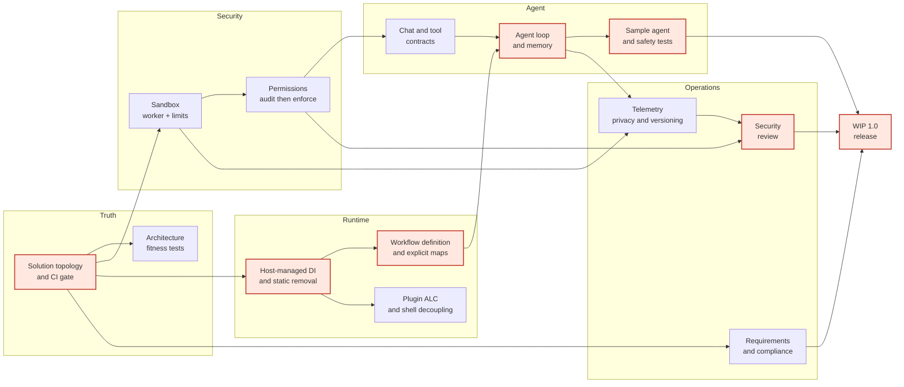

This is a workstream view; each phase table has the full per-work-package dependency list. The red nodes are the schedule-critical chain: **truth → host DI → workflow/maps → agent loop → sample agent → security review → release**. Security isolation and requirements are parallel release gates; they are not optional side quests.

### 4.2 Indicative schedule

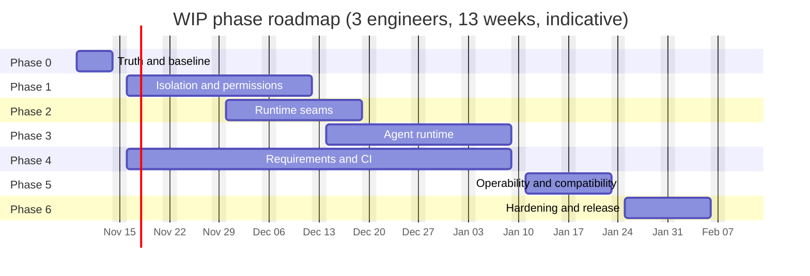

The bars are phase-level; the work-package tables in §3 carry the detailed estimates and dependencies. The phase windows are deliberately overlapped: security and runtime seams run in parallel, requirements work runs throughout, and operability starts only after the agent loop is stable.

The dates are indicative and should be re-baselined after Gate G0. They assume three engineers, no major scope change, and a stable DeepSeek API. A two-engineer team should plan for 17–19 weeks; a four-engineer team can compress to 10–11 weeks, but the security and DI work should not be parallelized beyond two owners.

### 4.3 Critical path and buffers

| Item | Detail |
|---|---|
| **Critical path** | WP-0.1 → WP-0.3 → WP-0.4 → WP-2.1 → WP-2.3 → WP-2.4 → WP-3.3 → WP-3.6 → WP-6.1 → WP-6.2 → WP-6.5 |
| **Release gates on the path** | G0 after Phase 0; G4 after Phase 2; G5 after Phase 6 |
| **Parallel release gates** | Sandbox + permissions (Phase 1), requirements + CI (Phase 4), observability/privacy/security review (Phase 5) |
| **Schedule buffer** | 20% contingency (≈28 ED) plus a 3-day integration buffer before G5 |
| **Hard external dependencies** | DeepSeek API stability, Windows/Linux runner availability, security reviewer availability |
| **Do not compress** | Sandbox, permissions, DI, workflow model. Compressing these creates rework in Phase 3 and 6. |
| **Can compress** | Streaming (drop to post-1.0), non-DeepSeek provider work (out of scope), viewer polish (out of scope). |

### 4.4 Resourcing scenarios

| Scenario | Engineers | Calendar | Trade-off |
|---|---|---:|---|
| Recommended | 3 (runtime, platform/security, agent) | 13 weeks | All P0/P1/P2 in scope; security and runtime seams overlap |
| Constrained | 2 (runtime + platform/security) | 17–19 weeks | Agent loop/streaming starts later; Phase 3 compresses or slips |
| Accelerated | 4 (add second runtime engineer) | 10–11 weeks | More integration overhead; security review still gates release |
| Minimum | 1 | 28+ weeks | Not recommended; security and runtime work cannot overlap safely |

### 4.5 Milestones

| Milestone | Date (indicative) | Evidence | Gate |
|---|---|---|---|
| M0 — Baseline accepted | Week 1 | Clean tag, all-project solution, CI inventory, ADRs | G0 |
| M1 — Sandboxed and authorized | Week 5 | Worker default, hostile tests green, permission audit clean | G2, G3 |
| M2 — Runtime coherent | Week 6 | No nested provider, workflow definition/executor, explicit maps | G4 |
| M3 — Agent loop proven | Week 9 | Fake model + real tool + sample agent E2E | — |
| M4 — Requirements and telemetry done | Week 11 | One requirements tree, compliance gate, OTel, security review | — |
| M5 — Release candidate | Week 12 | Three green runs, soak, rollback rehearsal | — |
| M6 — WIP 1.0 | Week 13 | Release artifacts, handover, post-release verification | G5 |

---

## 5. Execution governance

### 5.1 Decision gates

| Gate | When | Decision | Owner | Pass criteria | If failed |
|---|---|---|---|---|---|
| **G0** | End of Phase 0 | Accept baseline, solution topology, and ADRs | Tech lead + product | Clean baseline, all projects in `Wip.slnx`, CI inventory, architecture tests, ADRs | Re-baseline; do not start Phase 1/2 |
| **G1** | Before Phase 3 | Is general autonomy a product goal? Is streaming in scope? | Product owner | **PASSED 2026-11-04** — autonomy yes, streaming yes, write-capable sample agent; see `docs/execution/evidence/G1/decision-2026-11-04.md` | Descope Phase 3/streaming; reposition as governed runtime |
| **G2** | Before WP-1.3 | Approve sandbox mechanism and residual risk | Security reviewer + tech lead | Threat model, protocol, OS limits, fallback plan | Do not execute model code outside host; restrict to trusted strategies |
| **G3** | Before WP-1.7 enforcement | Approve permission catalog and enforcement points | Security reviewer + runtime lead | Catalog, audit report, built-in grants | Stay in audit mode; do not claim least privilege |
| **G4** | End of Phase 2 | Accept DI and workflow contracts | Tech lead + runtime lead | No nested provider, definition/executor, explicit maps, compatibility adapter | Keep legacy path; delay Phase 3 |
| **G5** | End of Phase 6 | Release WIP 1.0 | Product + tech lead + security | Release checklist, security sign-off, rollback rehearsal | Release candidate remains; fix and re-gate |

### 5.2 RACI

| Activity | Product | Tech lead | Runtime eng | Platform/security | Agent eng | QA | Security |
|---|---|---|---|---|---|---|---|
| Scope and gates | A | R | C | C | C | I | C |
| Architecture/ADRs | C | A/R | C | C | C | I | C |
| Sandbox | I | A | C | R | I | C | C |
| Permissions | I | A | R | C | C | C | C |
| DI/workflow | I | A | R | C | C | C | I |
| Agent runtime | C | A | C | C | R | C | C |
| CI/test strategy | I | A | C | R | C | R | I |
| Security review | I | A | C | C | C | C | R |
| Release | A | R | C | C | C | C | C |

`R` = responsible, `A` = accountable, `C` = consulted, `I` = informed.

### 5.3 Engineering workflow

- **Branching:** short-lived feature branches off `WIP`; one work package per PR where possible; no direct commits to `WIP` after G0 except release fixes.
- **PR size:** target ≤ 400 changed lines excluding tests/generated; larger PRs require a design note and a second reviewer.
- **Review:** one runtime reviewer for core changes; one security reviewer for sandbox/permissions; one architecture reviewer for DI/workflow.
- **Tests:** every PR adds or updates a test that fails without the change. Security-sensitive PRs add a negative test.
- **Docs:** every PR updates the requirement registry and the relevant README in the same change.
- **Feature flags:** behavior-changing work lands behind a flag; default remains current behavior until the phase exit.
- **ADRs:** decisions with a reversal cost are recorded; ADR status is `Proposed`, `Accepted`, `Superseded`, or `Rejected`.

### 5.4 Tracking cadence

| Cadence | Purpose | Output |
|---|---|---|
| Daily 15-minute stand-up | Blockers, work-package status, dependency changes | Updated board; escalated blockers |
| Weekly gate review | Phase progress, risk register, estimate variance | Gate readiness note; re-baseline if > 15% variance |
| Bi-weekly architecture review | ADRs, cross-cutting design, security findings | Accepted/superseded ADRs |
| Phase exit review | Exit criteria, demo, evidence | Signed phase exit; next phase unlocked |
| Release readiness review | Checklist, rollback rehearsal, security sign-off | G5 decision |

### 5.5 Change control

- A change to scope, a gate criterion, or a phase exit requires a written change note approved by the tech lead and product owner.
- A schedule slip greater than 15% triggers a re-baseline, not silent overtime.
- A new P0 finding discovered mid-plan pauses the affected workstream and is triaged within 24 hours.
- A security finding from the review is fixed before release unless the security reviewer accepts the risk in writing.

---


## 6. Test and quality strategy

### 6.1 Test pyramid

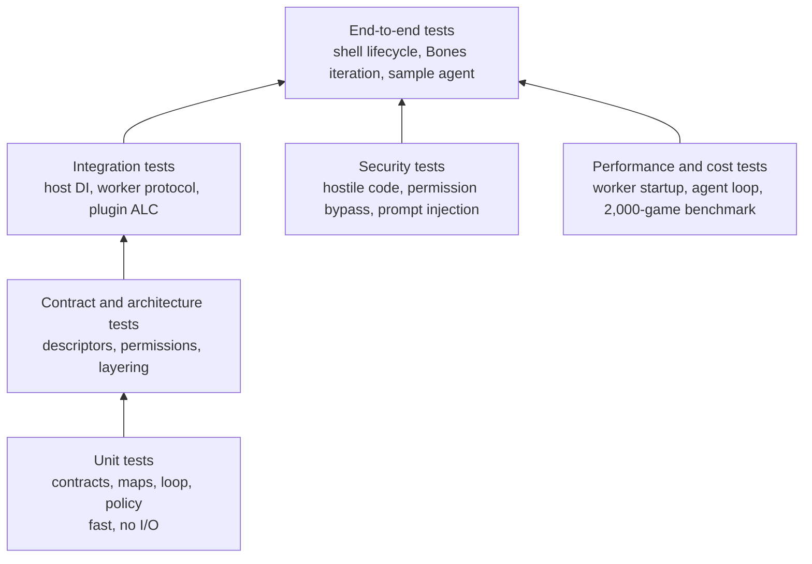

The pyramid is intentionally bottom-heavy. Security and performance are not “phase 6” activities; they are test categories that run alongside the layers they protect.

### 6.2 CI pipeline

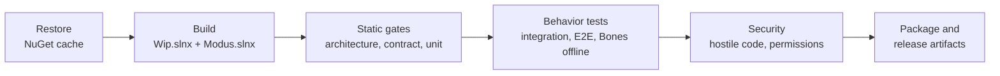

The workflow runs on **Windows and Ubuntu**. Unit/contract/architecture jobs run on every PR. Integration/E2E/security run on every PR if the runtime is under 25 minutes; otherwise they run on merge and nightly, with a required pre-release run. Live DeepSeek and Playwright jobs are separate and never block a PR.

### 6.3 Test categories

| Category | Scope | Trigger | Runtime target | Blocking |
|---|---|---|---|---|
| Unit | Contracts, descriptors, maps, loop, policy, formatters | Every PR | ≤ 5 min | Yes |
| Contract | Capability/workflow/permission contracts, serialization | Every PR | ≤ 5 min | Yes |
| Architecture | Forbidden references, layering, solution coverage | Every PR | ≤ 2 min | Yes |
| Integration | Host DI, worker protocol, plugin ALC, artifact store, Git workspace | Every PR or merge | ≤ 20 min | Yes |
| E2E | Shell start→merge, Bones stub iteration, sample agent | Merge + nightly | ≤ 30 min | Yes before release |
| Security | Hostile scripts, permission bypass, prompt injection, path traversal | Every PR or nightly | ≤ 20 min | Yes before release |
| Performance | Worker startup, agent loop, benchmark, soak | Nightly/weekly | ≤ 60 min | Release gate only |
| Live | Real DeepSeek, Playwright viewer | Nightly/manual | Variable | No, unless release sign-off requires |

### 6.4 Security test catalog

| Attack | Expected result | Test location |
|---|---|---|
| `System.IO.File.ReadAllText` from strategy | Blocked or fails; no host file content returned | `Wip.Sandbox.Security.Tests` |
| Fully qualified `System.IO` call | Blocked by worker boundary, not just `using` scan | `Wip.Sandbox.Security.Tests` |
| `HttpClient` / socket connect | No network access or connection fails | `Wip.Sandbox.Security.Tests` |
| `Process.Start` | Process creation denied or contained | `Wip.Sandbox.Security.Tests` |
| Reflection to load a blocked assembly | Load fails or assembly unavailable | `Wip.Sandbox.Security.Tests` |
| Infinite loop | Worker killed within 2× timeout; host continues | `Wip.Sandbox.Security.Tests` |
| Memory bomb | Worker capped; host continues | `Wip.Sandbox.Security.Tests` |
| Output flood | Output capped; protocol remains valid | `Wip.Sandbox.Security.Tests` |
| Worker crash | Host reports deterministic error; restart works | `Wip.Sandbox.Tests` |
| Tool call without permission | Denied before execution; audit event emitted | `Wip.Permissions.Tests` |
| Prompt injection asks for a forbidden tool | Permission/tool policy denies; no data exfiltration | `Wip.Agent.Tests` |
| Tool loop / repeated failure | Loop stops at budget; no infinite retries | `Wip.Agent.Tests` |
| Oversized observation | Observation truncated; loop continues | `Wip.Agent.Tests` |
| Shell path escape / symlink | Policy denies; no outside write | `Wip.Policy.LocalSafe.Tests` |
| Stale approval after code change | Merge rejects; approval marked stale | Existing governance tests |

### 6.5 Performance and cost tests

These are proposed targets; Phase 0 records the current baseline and Phase 5 confirms or adjusts them.

| Metric | Proposed target | Measurement |
|---|---|---|
| Worker cold start | ≤ 1 s p95 | Sandbox benchmark |
| Warm move latency | ≤ 100 ms p95, excluding strategy compute | Sandbox benchmark |
| Session start (excluding Git) | ≤ 2 s p95 | Runtime benchmark |
| Stage dispatch overhead | ≤ 100 ms p95 | Runtime benchmark |
| Agent loop overhead per step | ≤ 250 ms p95, excluding model/tool latency | Agent benchmark |
| Tool timeout default | 30 s; configurable | Tool tests |
| Bones 2,000-game benchmark | Within ±10% of baseline wall clock | Benchmark job |
| Host RSS growth over 24 h soak | ≤ 200 MB | Soak test |
| Per-iteration token budget | Configurable; default bounded | Cost metrics |

### 6.6 Flaky-test policy

- **No retries for logic failures.** A test that fails because the code is wrong must fail.
- **Infrastructure retries:** at most two retries for network/Playwright/browser issues, with the retry count visible in the report.
- **Quarantine:** a flaky test gets a `Quarantined` trait, an owner, a linked issue, and a 14-day expiry. After expiry it fails the build.
- **No silent skips:** skipped tests are reported separately; a suite that discovers zero tests fails CI.
- **Nightly stability:** the E2E/security suites run nightly; three consecutive failures trigger a stop-the-line review.

### 6.7 Coverage expectations

- New production code: **≥ 80% line and branch coverage** in the owning test project.
- Security-sensitive paths (sandbox protocol, permission checks, approval/merge, path boundary): **explicit negative tests**, not just line coverage.
- Contract changes: at least one test that fails if the descriptor/type/version changes unexpectedly.
- No coverage target for generated code, trivial DTOs, or viewer markup; those are covered by contract/E2E tests.

---


## 7. Migration, rollout, and rollback

### 7.1 Compatibility strategy

WIP is pre-1.0, so the plan allows breaking changes with a one-release compatibility window. The compatibility surface is deliberately small:

| Surface | Strategy | Removal |
|---|---|---|
| `IWorkflow` / `AddWorkflow` | Obsolete adapter maps to `IWorkflowDefinition`; runtime uses the new path | Release after 1.0 |
| `IModelProvider<,>` | Kept; `IChatModel` is additive | No removal planned |
| `CapabilityDescriptor` | Additive fields only (`apiVersion`, permission grant metadata) | No removal |
| Session snapshots | Additive `schemaVersion`; old snapshots load with defaults | No destructive migration |
| Strategy library / pool snapshots | Reader accepts current files; writer adds version; no static `Instance` | No data loss |
| Plugin manifests | Add `apiVersion` and compatibility range; old manifests load with a warning | Next major |
| Stage maps | Old `Map<TSource,TTarget>()` descriptor remains only through the legacy adapter; new maps require a delegate | Release after 1.0 |

### 7.2 Feature flags

| Flag | Values | Default at start | Default at release | Purpose |
|---|---|---|---|---|
| `Wip:Sandbox:Mode` | `Worker`, `InProcess` | `Worker` | `Worker` | Kill switch for the worker; `InProcess` only for tests/trusted fallback |
| `Wip:Permissions:Mode` | `Audit`, `Enforce` | `Audit` | `Enforce` | Safe rollout of permission enforcement |
| `Wip:Runtime:UseHostProvider` | `true`, `false` | `false` | `true` | Roll back the DI change if a host integration breaks |
| `Wip:Workflow:Model` | `Legacy`, `Definition` | `Legacy` | `Definition` | Roll back the workflow contract |
| `Wip:Agent:Enabled` | `true`, `false` | `false` | `true` | Disable the agent runtime if an incident occurs |
| `Wip:Streaming:Enabled` | `true`, `false` | `false` | `true` | Descope streaming without reverting the loop |
| `Wip:Telemetry:Enabled` | `true`, `false` | `false` | `true` | Disable exporter in constrained environments |
| `Wip:Plugin:Isolation` | `Default`, `Collectible` | `Default` | `Collectible` | Roll back plugin ALC if a loader regression appears |

Flags are configuration, not a second architecture. Each flag has an owner, a removal milestone, and a test that exercises both values. A flag that survives two releases becomes debt.

### 7.3 Rollout stages

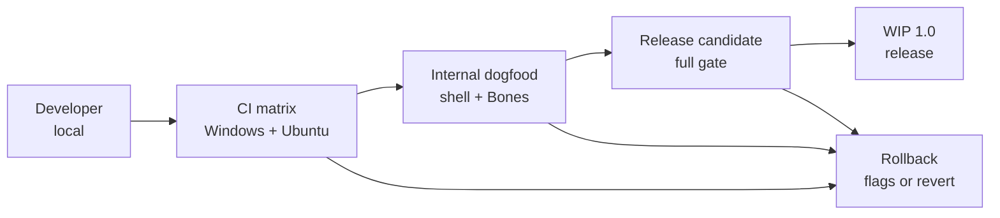

| Stage | Duration | Entry criteria | Exit criteria |
|---|---|---|---|
| Developer | Continuous | Feature branch, unit/contract tests | PR reviewed, CI green |
| CI matrix | Every PR | Build + architecture + unit | All required jobs green |
| Internal dogfood | 1–2 weeks | Phase 3 sample agent, Phase 2 runtime | No P0/P1 incidents for 5 working days |
| Release candidate | 1 week | All phases complete, security review | Three green matrix runs, soak clean, rollback rehearsed |
| Release | — | G5 | Post-release checklist started |

### 7.4 Rollback plan

Rollback is ordered from least to most disruptive:

1. **Flag rollback:** set `Wip:Sandbox:Mode=InProcess` (only for trusted strategies), `Wip:Permissions:Mode=Audit`, `Wip:Agent:Enabled=false`, `Wip:Streaming:Enabled=false`, or `Wip:Workflow:Model=Legacy`.
2. **Worker kill switch:** stop accepting new worker jobs, kill the worker pool, drain in-flight matches, and fall back to a deterministic first-legal-move policy if configured.
3. **Deployment rollback:** redeploy the previous release artifact; session/artifact files are additive and remain readable.
4. **Code revert:** revert the merge commit; the obsolete adapter keeps old plugin/workflow registrations working for one release.
5. **Data recovery:** restore the last known-good strategy library/pool snapshot; artifacts are append-only, so no destructive migration is required.

Rollback is rehearsed in WP-6.3. The target is **under 15 minutes** from decision to a running previous version, with no loss of session evidence.

### 7.5 Data migration

The plan avoids a database migration by keeping the local file model:

- Add `schemaVersion` to session snapshots, artifacts, and pool snapshots.
- Readers accept the current version and the previous version; writers emit the new version.
- The first read of an old snapshot upgrades in memory; it does not rewrite the file until the next save.
- A `wip migrate --dry-run` command reports what would change; `--apply` writes backups first.
- No secrets or prompts are added to artifacts by the migration.

### 7.6 Communication

| Audience | Message | Channel | Timing |
|---|---|---|---|
| Maintainers | Scope, phases, gates, PR rules | Kickoff + weekly note | Start and weekly |
| Plugin authors | `IWorkflow` adapter, permission changes, manifest version | Migration guide + release notes | Phase 2 and release |
| Operators | Sandbox mode, flags, rollback, telemetry | Runbook + handover | Phase 5–6 |
| Security | Threat model, review findings, residual risk | Review report | Phase 1 and Phase 5 |
| Users | What changed, what is safer, what is still trusted-only | Release notes | Release |

---

## 8. Risk register

| ID | Risk | Likelihood | Impact | Trigger | Mitigation | Owner |
|---|---|---|---|---|---|---|
| R-01 | Sandbox worker is not portable or performant enough | Medium | Critical | Worker cannot start/execute on Windows or Linux; latency > 2× baseline | Phase 0 spike; protocol-first design; fallback to trusted-only + explicit risk | Platform/security |
| R-02 | DI refactor breaks Bones or external plugins | High | High | Singleton identity failures; host startup errors | Feature flag; adapter; reference-equality tests; dogfood | Runtime |
| R-03 | Workflow contract migration breaks custom workflows | Medium | High | Plugin workflow no longer runs; map missing | Obsolete adapter; migration guide; compatibility tests | Runtime |
| R-04 | Agent runtime scope creep | High | Medium | Loop grows into a workflow engine; Phase 3 slips | Gate G1; MVP loop; defer RAG/multi-agent to post-1.0 | Agent/LLM |
| R-05 | CI matrix too slow or flaky | High | Medium | PR feedback > 30 min; flaky E2E | Test categories; sharding; quarantine; nightly live jobs | QA/platform |
| R-06 | Permission enforcement breaks built-ins/plugins | Medium | High | Audit shows false denials | Audit mode; default grants; staged enforcement | Security/runtime |
| R-07 | Requirements archaeology takes longer than planned | Medium | Medium | More docs than expected; conflicting owners | Timebox WP-4.1; archive aggressively; one owner per doc | Tech lead |
| R-08 | Security review finds a release blocker | Medium | High | Critical/high finding | Early review; fix window in Phase 5; G5 can slip | Security |
| R-09 | Two-engineer resourcing | High | High | Key person unavailable | Cross-training; pair on sandbox/DI; 17–19 week plan | Product/tech lead |
| R-10 | Windows/Linux sandbox behavior diverges | High | High | Tests pass on one OS only | CI matrix; platform adapters; hostile tests on both | Platform |
| R-11 | Current working tree hides a regression | Medium | High | Baseline tests fail unexpectedly | Phase 0 inventory; fix/waive before G0; no silent skip | Tech lead |
| R-12 | Scope expands to multi-tenant/distributed | Low | High | “While we’re here” requests | Explicit non-goals; change control; G1 | Product |

### 8.1 Risk response rules

- **Critical/High risks** are reviewed weekly; a trigger opens a decision note within 24 hours.
- **Schedule risk** is handled by descoping Phase 3 streaming or the non-DeepSeek provider, never by weakening the sandbox, permissions, or DI gates.
- **Security risk** is handled by the security reviewer; accepted risk must be written, time-bounded, and approved by the tech lead.
- **Resourcing risk** is handled by reducing scope, not by parallelizing the same work package across owners.

---


## 9. Definition of done and release

### 9.1 Program definition of done

The program is done when every row below is true and evidenced in the release checklist.

| Report finding | Done when | Evidence | Work packages |
|---|---|---|---|
| P0-01 Isolate model code | Model-authored code runs in a worker; hostile tests pass; host never loads the assembly | Security job green; worker protocol tests; code grep | WP-1.1..1.6 |
| P0-02 Honest build graph | All 37 projects in `Wip.slnx`; zero orphan projects | `dotnet build Wip.slnx`; coverage check | WP-0.3 |
| P0-03 Test gate | All offline suites run in CI; live/Playwright explicit | CI matrix; TRX artifacts; zero-test guard | WP-0.4 |
| P0-04 Governance guard | `run` cannot advance governance; test in CI | Regression test; E2E | WP-0.2 |
| P0-05 Permission model | Permissions enforced or explicitly metadata; test proves denial | Permission tests; audit report | WP-1.7 |
| P1-01 Host-managed DI | No `BuildServiceProvider` in runtime; singleton identity test | Grep/architecture test; reference equality | WP-2.1 |
| P1-02 Workflow contract | Definition/executor is the only runtime path; `IWorkflow` obsolete adapter | Tests for declarative/custom; no dead `ExecuteAsync` | WP-2.3 |
| P1-03 Explicit maps | No global map registry or property heuristics | Map tests; two-plan isolation test | WP-2.4 |
| P1-04 Shell/Bones | ShellHost has no Bones reference | Architecture test; csproj grep | WP-2.6 |
| P1-05 Agent runtime | Loop, tools, memory, budgets, streaming, sample agent | Agent E2E; safety tests | WP-3.1..3.7 |
| P1-06 Requirements | One active tree; all docs registered; gate in CI | Registry check; CI artifact | WP-4.1..4.4 |
| P1-07 Plugin isolation | Collectible ALC per plugin; unload works | ALC tests; diagnostics | WP-2.7 |
| P2-01 Observability | Traces/metrics for session/stage/tool/model/worker | Trace screenshot; metric export test | WP-5.1 |
| P2-02 Privacy | Redaction, retention, purge | Redaction test; retention test | WP-5.2 |
| P2-03 Architecture tests | Forbidden references fail CI | Architecture job | WP-0.5 |
| P2-04 Versioning | Negotiation, manifest compatibility, deprecation policy | Compatibility tests; policy doc | WP-5.3 |
| P2-05 Naming/docs | Root docs describe WIP and commands; stale paths gone | Link check; onboarding dry run | WP-4.4 |
| P2-06 Static/global state | No `StrategyPool.Instance`; no static map registry | Grep; tests | WP-2.2, WP-2.4 |

### 9.2 Release checklist

**Build and test**

- [ ] `dotnet build Wip.slnx` succeeds on Windows and Ubuntu.
- [ ] `dotnet build Modus.slnx` succeeds on Windows and Ubuntu.
- [ ] All offline test projects run; zero-test guard passes.
- [ ] Architecture tests pass.
- [ ] Security tests pass on both OSes.
- [ ] Three consecutive full runs are green.
- [ ] 24-hour Bones stub soak is clean.
- [ ] 2,000-game benchmark is within agreed tolerance.

**Security and governance**

- [ ] Sandbox is the default; hostile tests pass; residual risk documented.
- [ ] Permission enforcement is on; audit report has no unexplained denials.
- [ ] Approval/merge boundary tests pass; no run bypass.
- [ ] Plugin ALC load/unload tests pass.
- [ ] Security review signed off; no open critical/high findings.
- [ ] Secrets are not present in status, logs, or release artifacts.

**Runtime and agent**

- [ ] No `BuildServiceProvider` in `Wip.Runtime`.
- [ ] No `StrategyPool.Instance`.
- [ ] No `Wip.ShellHost → Wip.Bones.*` reference.
- [ ] Workflow definition/executor path is the default.
- [ ] Agent loop sample E2E passes with a real tool and fake model.
- [ ] Streaming works or is explicitly descoped by G1.
- [ ] Memory is session-scoped and inspectable.

**Requirements and docs**

- [ ] One active requirements tree with index.
- [ ] Every active doc registered; compliance gate in CI.
- [ ] Root `README.md` and `AGENTS.md` describe WIP and the build/test commands.
- [ ] Migration guide, release notes, runbook, and security notes complete.
- [ ] Link check passes.

**Release and rollback**

- [ ] Packages/artifacts install from clean.
- [ ] Rollback rehearsal completed in under 15 minutes.
- [ ] Feature flags documented with owners and removal milestones.
- [ ] Support matrix documented.
- [ ] Post-release monitoring configured.

### 9.3 Post-release checklist

**First 24 hours**

- [ ] Install/start/stop smoke test from the release artifact.
- [ ] Verify telemetry reaches the collector.
- [ ] Verify sandbox starts and kills a hostile script in the released build.
- [ ] Verify permissions deny a deliberately unauthorized tool.
- [ ] Verify no error spike in host logs.

**First week**

- [ ] Review traces for session/stage/tool/model/worker latency.
- [ ] Review token/cost metrics and budget stops.
- [ ] Review any permission denials or sandbox kills.
- [ ] Confirm rollback flags still work.
- [ ] Collect operator feedback and open follow-ups.

**Exit**

- [ ] No release-blocking regression.
- [ ] Follow-ups have owners and milestones.
- [ ] Release retro completed.

### 9.4 Sign-off

| Role | Name | Decision | Date |
|---|---|---|---|
| Product owner | | Approve / reject | |
| Tech lead | | Approve / reject | |
| Security reviewer | | Approve / reject | |
| QA lead | | Approve / reject | |

---

## 10. First 10 working days

| Day | Focus | Concrete output |
|---|---|---|
| 1 | Baseline freeze | Review and commit/stash the working tree; tag `wip-baseline-2026-11-02`; start `docs/plan/baseline-test-status.md` |
| 2 | Solution topology | Add all 37 projects to `Wip.slnx`; add coverage check; `dotnet build Wip.slnx` |
| 3 | CI build/unit | Split CI into build/architecture/unit; add zero-test guard; upload TRX |
| 4 | CI integration/security inventory | Add integration job skeleton; inventory failing tests; create waiver list |
| 5 | Governance guard + G0 | Commit guard/tests; run G0 review; approve ADR-IMPL-01..06 |
| 6 | Threat model | Draft assets/trust boundaries/attack paths; choose worker protocol |
| 7 | Protocol spike | JSON-lines handshake/compile/move prototype; measure cold start |
| 8 | Worker skeleton | `Wip.Sandbox.Worker` console; sample strategy compile/move |
| 9 | DI design | Draft `RunWorkflowAsync` signature and host scope changes; review with runtime owner |
| 10 | Phase 1/2 kickoff | Confirm owners, gates, and first two PRs; update board |

The first 10 days deliberately do not start the agent runtime. If the build graph and governance guard are not trustworthy by Day 5, Gate G0 is not passed and the rest of the plan should not start.

---

## Appendix A. Report finding → work package mapping

| Report finding | Plan work packages |
|---|---|
| P0-01 Isolate model-authored code | WP-1.1, WP-1.2, WP-1.3, WP-1.4, WP-1.5, WP-1.6 |
| P0-02 Make the build graph honest | WP-0.3 |
| P0-03 Run the offline test surface in CI | WP-0.4, WP-4.3 |
| P0-04 Commit and verify the governance guard | WP-0.2 |
| P0-05 Decide and enforce the permission model | WP-1.7 |
| P1-01 Remove the per-run service provider | WP-2.1 |
| P1-02 Resolve `IWorkflow` | WP-2.3 |
| P1-03 Replace heuristic stage maps | WP-2.4 |
| P1-04 Break the shell/Bones coupling | WP-2.6 |
| P1-05 Add a generic agent executor | WP-3.1..3.7 |
| P1-06 Unify requirements | WP-4.1..4.5 |
| P1-07 Make plugin loading isolatable | WP-2.7 |
| P2-01 Add metrics/traces | WP-5.1 |
| P2-02 Data classification/retention | WP-5.2 |
| P2-03 Architecture fitness tests | WP-0.5 |
| P2-04 Versioning/compatibility | WP-5.3 |
| P2-05 Naming/docs cleanup | WP-4.4 |
| P2-06 Static singleton/global registry removal | WP-2.2, WP-2.4 |

## Appendix B. Commands and CI jobs

| Purpose | Command or job |
|---|---|
| Build full WIP family | `dotnet build Wip.slnx --configuration Release` |
| Build Modus product | `dotnet build Modus.slnx --configuration Release` |
| Architecture tests | `dotnet test WIP/Wip.Architecture.Tests --configuration Release --no-build` |
| Core unit tests | `dotnet test Wip.slnx --configuration Release --no-build --filter "Category=Unit"` |
| Contract tests | `dotnet test Wip.slnx --configuration Release --no-build --filter "Category=Contract"` |
| Integration tests | `dotnet test Wip.slnx --configuration Release --no-build --filter "Category=Integration"` |
| E2E/compliance | `dotnet test WIP/Wip.Shell.E2E.Tests --configuration Release --no-build` |
| Bones offline | `dotnet test WIP/Wip.Bones.Tests --configuration Release --no-build` plus `Wip.Bones.Host.Tests` offline filter |
| Security | `dotnet test WIP/Wip.Sandbox.Security.Tests --configuration Release --no-build` |
| Benchmark | `WIP/Wip.Bones.Benchmark/bin/Release/net10.0/Wip.Bones.Benchmark.exe arena ...` |
| Solution coverage | `pwsh tools/verify-solution-coverage.ps1` (new in WP-0.3) |
| Forbidden reference check | Architecture tests + `grep` guard in CI |

## Appendix C. Metrics and alerts

| Metric | Type | Alert |
|---|---|---|
| `wip.session.duration` | Histogram | p95 > 30 min |
| `wip.stage.duration` | Histogram | p95 > 10 min for a stage |
| `wip.tool.duration` | Histogram | p95 > 30 s |
| `wip.tool.errors` | Counter | Error rate > 5% over 15 min |
| `wip.model.tokens` | Counter | Daily budget > 80% |
| `wip.model.errors` | Counter | Error rate > 5% over 15 min |
| `wip.agent.steps` | Histogram | p95 > configured max steps × 0.8 |
| `wip.agent.budget_exhausted` | Counter | Any sustained increase |
| `wip.sandbox.workers` | Gauge | Pool > configured max or zero when expected |
| `wip.sandbox.kills` | Counter | Unexpected spike |
| `wip.permission.denials` | Counter | New denial pattern after a release |
| `wip.plugin.load_failures` | Counter | Any increase |
| `wip.worker.startup_ms` | Histogram | p95 > 1 s |

## Appendix D. Open decisions

| ID | Decision | Owner | Needed by | Default if undecided |
|---|---|---|---|---|
| D-01 | Is general autonomy a product goal? | Product | G1 | **Approved 2026-11-04: yes — Phase 3 in scope.** |
| D-02 | Is streaming in 1.0? | Product | G1 | **Approved 2026-11-04: yes — streaming ships in 1.0.** |
| D-03 | Windows-only or Windows+Linux? | Tech lead | G0 | Both; CI matrix |
| D-04 | Worker OS isolation level | Security | G2 | Process + job object/cgroup; no full AppContainer |
| D-05 | Permission enforcement vs metadata | Security + runtime | G3 | Enforce for plugins/tools; built-ins granted |
| D-06 | Keep `IWorkflow` adapter for one release? | Tech lead | G4 | Yes, obsolete for one release |
| D-07 | DeepSeek-only for 1.0? | Product | G1 | Yes; `IChatModel` enables later providers |
| D-08 | Data retention default | Security + product | G5 | 30 days for prompts/transcripts; artifacts per session policy |

---

*End of plan.*
