# WIP Requirements Lifting and Architecture Report

**Reverse-engineered requirements baseline, current-state assessment, and design views for the WiP stack**

| Field | Value |
|---|---|
| Document ID | WIP-REQ-ARCH-001 |
| Version | 1.0 — Baseline |
| Date | 2026-11-02 |
| Repository | `C:\Users\ricar\dev\Modus` |
| Branch / commit | `WIP` / `d6b895f` |
| Working tree | 308 changed paths: 148 modified, 160 untracked |
| Scope | WIP core (24 solution projects + `Wip.Shell.E2E`), Bones application (11 projects), Modus bridge |
| Out of scope | Modus core internals, Bones game rules, DeepSeek API internals, production telemetry |
| Audience | Maintainers, architects, product owners, security reviewers, CI owners |
| Method | Evidence-based requirements lifting from docs, contracts, tests, and build metadata |

> **Status of this document.** This is a reverse-engineered baseline, not a product sign-off. A requirement marked **Stated** comes from an explicit requirement or contributor contract. **Derived** means it was inferred from public contracts, code paths, or tests. **Operational** means it comes from build, CI, configuration, or repository structure. Status and confidence are assigned per requirement. Where the working tree differs from committed `HEAD`, the difference is called out explicitly.

> **Reading “WIP”.** In this report, WIP means the WiP stack under `WIP/` — the “WiP Shell + Agentic Builder MVP” — not “work in progress”.

---

## Executive summary

WIP is a substantial, well-factored **agent runtime and governance substrate** that is being used as if it were a general agent framework. It is not one yet. The core is stronger than its documentation and build gates suggest; the agent layer is weaker than its names suggest.

### What is working

1. **The core contracts are genuinely typed.** `ICapability<TRequest,TResult>` and its agent/tool/validator specializations preserve concrete request and result types, reject `object` payloads, and register through a single builder. This is a real foundation for safe composition, not a metadata-only facade.
2. **The governance model is the strongest part of the system.** Git worktrees isolate changes; normalized diff hashes bind validation, review, and approval; target-branch drift is detected before merge; merge requires passing validation, review evidence, and an approval token; shell commands run inside the worktree with a denylist, policy gates, and timeouts.
3. **Bones is a real LLM-in-the-loop application, not a demo.** It runs Observe → Ponder → Play → Enhance continuously, has the model author compilable C# strategies with compile retry, evaluates candidates against incumbents with paired seeds and a confidence gate, persists a strategy library, exposes a status API and viewer, and has a deterministic held-out benchmark.
4. **The project conventions inside `WIP/` are consistent.** All 37 projects target `net10.0` with nullable and implicit usings; namespaces track folders; semantic identifiers are typed; most capability areas have a dedicated test project. By raw C# line count, WIP is roughly three-quarters of the repository.
5. **The test surface is large and unusually traceable.** There are 17 WIP test projects and roughly 1,300 `[Fact]`/`[Theory]` declarations. The behavior-proof compliance registry binds checklist items to executable xUnit tests through traits, which is a stronger traceability model than most repositories have.

### What is not working

1. **The flagship application is outside the standard build gate.** At `HEAD`, both `Modus.slnx` and `WIP.slnx` contain the same 24 WIP projects and **zero** `Wip.Bones.*` projects. Bones has 11 projects and roughly 890 test declarations. The working tree adds 9 of the 11 Bones projects to `Modus.slnx`, but still omits `Wip.Bones.Tests` and `Wip.Bones.Benchmark`. `dotnet build Modus.slnx` at `HEAD` never compiles the application that proves WIP can build agents.
2. **CI does not exercise the test surface.** The workflow builds `Modus.slnx` and runs `Wip.ShellHost.Tests` among WIP projects. It does not run `Wip.Abstractions.Tests`, `Wip.Builder.Tests`, `Wip.Runtime.Tests`, `Wip.Shell.Tests`, `Wip.Shell.E2E.Tests`, or any Bones suite. That is one of 17 WIP test projects. A green CI badge is not evidence that WIP works.
3. **The agent abstraction is thinner than the name.** `IAgent<TRequest,TResult>` adds no behavior to `ICapability`: it is a single typed `ExecuteAsync`. There is no agent loop, no message history, no step budget, no model-driven tool selection, no memory abstraction, and no streaming. `PlanOnlyAgent` returns four hard-coded steps; `PatchAgent` returns a comment block. `RuntimeToolGateway` exists but is constructed only in its own tests.
4. **The workflow contract is half-real.** `IWorkflow<TRequest,TResult>` advertises `ExecuteAsync`, and `AddWorkflow` registers a singleton, but `RunWorkflowAsync` never resolves or calls it. The runtime compiles a static stage list, dispatches capabilities by `(Kind, RequestType, ResultType)`, and maps payloads through a process-global registry plus property-name heuristics. `BonesLearningWorkflow.ExecuteAsync` returns fake `"workflow-dispatch"` identifiers.
5. **The runtime builds a second service provider per run.** `RunWorkflowAsync` calls `builder.Services.BuildServiceProvider()` and creates a new scope. Host singletons and workflow-scope singletons are different instances. Bones works around this with `StrategyPool.Instance` and an explicit comment that the second provider previously caused the status API to report `poolSize=0`. This is architectural debt, not a minor implementation detail.
6. **Requirements are fragmented and partly stale.** WIP requirements live in `WIP/requirements`, `.github/requirements`, and `harness/requirements`. There are about 124 open checklist entries across the 24 `Wip.Bones.*` requirement documents alone, although several documents are clearly historical and contradict current code. The behavior-proof registry does not cover several of those documents.
7. **The security boundary has a hole.** Bones compiles and executes model-authored C# in-process. A syntax-based namespace/reference allowlist blocks obvious `System.IO`, `System.Net`, and process APIs, but it is not a sandbox: fully qualified names, reflection, and allowed core assemblies can bypass it. The benchmark README explicitly says not to run untrusted scripts until process isolation lands. Plugin assemblies load into the default load context via `Assembly.LoadFrom`; capability permissions are declared and reported but never enforced. For a trusted single-user workstation this may be acceptable; for an agent platform it is a critical gap.

### Verdict

| Question | Answer |
|---|---|
| Is WIP used consistently inside its own boundary? | **Yes, largely.** Project conventions, namespace layout, typed contracts, and test pairing are coherent. |
| Is WIP used consistently as the repository architecture? | **No.** There are two stacks (Modus plugin host and WIP agent layer), two solution views, three requirement trees, and a CI gate that does not cover the flagship app. |
| Is WIP requirements-complete? | **No.** The governance core is largely implemented; the general-agent and operational requirements are partial or missing. |
| Can WIP build AI agents? | **Yes for governed, domain-specific LLM agents.** Bones is the proof. **No for a general agent framework** without adding the loop, tool protocol, memory, and streaming. |
| Is WIP production-ready? | **Not for untrusted model output or untrusted plugins.** It is credible for a trusted, single-user, local coding/ops agent. |
| What is the single biggest risk? | **In-process execution of model-authored C#.** A malicious or runaway strategy can reach host filesystem, network, and process capabilities; the namespace allowlist is a filter, not a sandbox. |
| What is the single biggest process risk? | **The build and test gates do not match the footprint.** The flagship app and most WIP tests can regress without CI noticing. |

### Recommendation in one sentence

Keep WIP as the governed runtime, make its build/test/requirements gates tell the truth, isolate model-authored code before calling it safe, and only then add a generic agent-executor layer if general autonomy is actually a product goal.

---

## 1. Scope, method, and evidence

### 1.1 What this report covers

This report covers the WIP stack as it exists in the repository:

- **WIP core:** `Wip.Abstractions`, `Wip.Builder`, `Wip.Runtime`, `Wip.Shell`, `Wip.ShellHost`, `Wip.Policy.LocalSafe`, `Wip.Tools.Shell`, `Wip.Workspaces.Git`, `Wip.Artifacts.Local`, `Wip.Validation.DotNet`, `Wip.Modus`, and `Wip.Agent.Basic`.
- **Bones application:** `Wip.Bones`, `Wip.Bones.Agents`, `Wip.Bones.Host`, `Wip.Bones.Web`, `Wip.Bones.ModelProviders.DeepSeek`, `Wip.Bones.Benchmark`, and their test projects.
- **Operational surface:** solutions, CI, configuration, requirement documents, and contributor READMEs.

It does **not** cover the internal design of `Modus.Core` or `Modus.Host` except where WIP depends on them through `Wip.Modus`. It does not re-derive the rules of Block Dominoes or the DeepSeek API.

### 1.2 Questions the report answers

1. What requirements is WIP actually satisfying, as opposed to what its documents claim?
2. Which requirements are stated, derived, operational, missing, or in conflict?
3. How is the system designed, and where does the implementation diverge from the stated design?
4. What are the highest-risk gaps for using WIP as an AI-agent platform?
5. What should be fixed first, and what would “done” look like?

### 1.3 Evidence sources

| ID | Source | What it contributes | Confidence |
|---|---|---|---|
| S1 | [`WIP/requirements/WiP.Bootstrap.Requirements.md`](../WIP/requirements/WiP.Bootstrap.Requirements.md) | Explicit MVP scope, checklist, and test plan for the WIP core | High for intent; dated |
| S2 | [`.github/requirements`](../.github/requirements) | WIP contributor, shell host, validation, next-steps, and layout requirements | Medium; actively edited and partly historical |
| S3 | [`harness/requirements`](../harness/requirements) | Bones requirements for host, DeepSeek, scripts, promotion, viewer, co-learning, and reliability | Medium; 24 Bones docs, many open/stale |
| S4 | Per-project `README.md` files | Contributor-facing behavior contracts, command surfaces, configuration precedence, and limits | High for intended behavior |
| S5 | [`src/WIP.Contributor-Architecture.README.md`](../src/WIP.Contributor-Architecture.README.md) | Ownership map, runtime roles, extension seams, policy examples | High for core; excludes Bones |
| S6 | Public contracts and implementation under [`WIP/`](../WIP) | Actual behavior, type signatures, state transitions, failure paths | High |
| S7 | xUnit tests under `WIP/*.Tests` | Executable evidence and `[Trait("ChecklistItem", ...)]` bindings | High where runnable |
| S8 | [`Modus.slnx`](../Modus.slnx), [`WIP.slnx`](../WIP.slnx), [`.github/workflows/tests-ci.yml`](../.github/workflows/tests-ci.yml) | Build/test graph, solution membership, CI coverage | High |
| S9 | `appsettings.json`, options types, `.wip/config.json` handling | Operational defaults, precedence, bounded-run behavior | High |
| S10 | Git commit `d6b895f` and working-tree status | Committed baseline versus in-flight changes | High for snapshot |

### 1.4 Lifting procedure

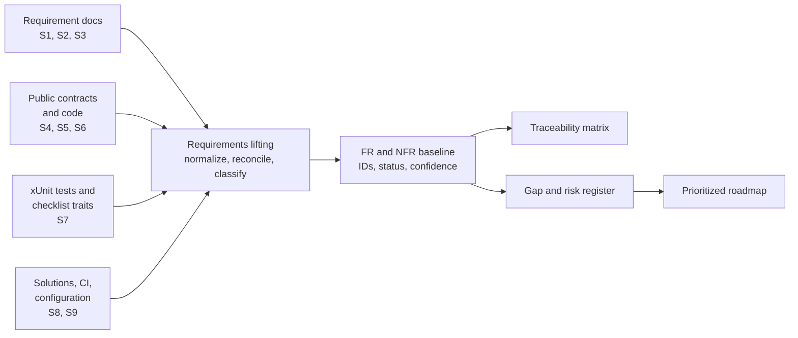

The procedure was:

1. **Collect stated requirements** from S1–S3 and the per-project READMEs (S4).
2. **Derive behavioral requirements** from public contracts, state machines, configuration, and tests (S5–S7).
3. **Derive operational requirements** from solutions, CI, and deployment assumptions (S8–S9).
4. **Normalize** each requirement into a single `shall` statement with an ID and a domain.
5. **Reconcile conflicts** between docs, code, and tests; mark the losing statement as `Ambiguous`, `Stale`, or `Contradicted`.
6. **Trace** each requirement to code and test evidence where it exists.
7. **Classify gaps** by severity and recommend an acceptance criterion.

### 1.5 Status and confidence definitions

| Status | Meaning |
|---|---|
| **Implemented** | A public contract and a matching implementation exist, and at least one test or executable end-to-end path exercises the requirement. |
| **Partial** | An implementation exists but is incomplete, narrow, unenforced, or only covered by unit-level tests. |
| **Missing** | No implementation was found in the repository. |
| **Ambiguous** | The contract or documentation says one thing and the runtime does another. |
| **Stale** | The document describes a repository state that no longer matches the code. |
| **Unverified** | A claim exists in documentation or a design note, but it has no traceable implementation or test in this snapshot. |

| Confidence | Meaning |
|---|---|
| **High** | Public code path and a matching test or executable scenario agree. |
| **Medium** | Code path exists but tests are partial, or tests exist but the behavior is not exercised end to end. |
| **Low** | Documentation or design intent only; not verified in code. |

### 1.6 Limitations

- The working tree is **308 changed paths** (148 modified, 160 untracked). Findings are separated into committed `HEAD` behavior and current-tree behavior where the difference matters.
- Some requirement documents are visibly historical. An unchecked box is treated as a **declared** gap, not proof that the code is missing; where possible the code was checked.
- The full test suite was not executed for this report. Test claims describe what the code and test inventory contain, not a fresh pass/fail result.
- There is no production telemetry, so performance, cost, and reliability statements are architectural rather than measured.
- Requirements were lifted from repository evidence, not from stakeholder interviews. Product intent that is not written down cannot be recovered.

---

## 2. System context, stakeholders, and use cases

### 2.1 System context

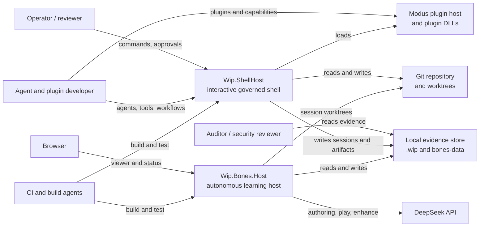

The important context boundary is that WIP is **local and process-centric**. It assumes a Git repository on a local filesystem, a trusted operator, and a shell or host process that owns the session. It is not a distributed agent service.

### 2.2 Stakeholders and concerns

| Stakeholder | Primary concern | What they rely on |
|---|---|---|
| Operator / reviewer | Safe, explicit progression from change to merge | Shell commands, policy gates, validation/review/approval evidence |
| Agent developer | Typed extension points without host edits | `IAgent`, `ITool`, `IValidator`, `IWorkflow`, `WipBuilder` |
| Plugin author | Discoverable, versioned capabilities with diagnostics | `ModusWipBridge`, `IPluginContract`, manifest |
| Runtime maintainer | Deterministic state machine and failure isolation | `WipRuntimeOrchestrator`, stage dispatcher, session store |
| Security reviewer | No unreviewed or unisolated execution | Policy, approval, worktree boundary, process isolation |
| Auditor | Reconstructable evidence for every decision | Event journal, artifacts, correlation IDs, diff hashes |
| Bones researcher | Reproducible experiments and promotion decisions | Strategy library, benchmark, paired evaluation, budget |
| CI owner | A gate that fails when the product regresses | Solutions, CI workflow, behavior-proof gates |

### 2.3 Product goals (lifted)

| ID | Goal | Evidence | Status |
|---|---|---|---|
| PG-1 | Provide a portable, typed agentic builder and runtime inside Modus without shell-only coupling | [`WiP.Bootstrap.Requirements.md`](../WIP/requirements/WiP.Bootstrap.Requirements.md) scope statement | Stated; partially contradicted by in-flight ShellHost coupling |
| PG-2 | Make agent, tool, validator, policy, and workflow composition explicit, deterministic, and DI-based | [`Wip.Builder/README.md`](../WIP/Wip.Builder/README.md) | Stated; largely implemented |
| PG-3 | Enforce safe, evidence-backed code changes with human approval and merge gates | [`Wip.Runtime/README.md`](../WIP/Wip.Runtime/README.md), [`LocalSafePolicy.cs`](../WIP/Wip.Policy.LocalSafe/LocalSafePolicy.cs) | Stated; strongly implemented |
| PG-4 | Support memoryful interactive operator workflows | [`Wip.Shell/README.md`](../WIP/Wip.Shell/README.md) | Stated; implemented |
| PG-5 | Integrate Modus plugin discovery, lifecycle, and diagnostics | [`ModusWipBridge.cs`](../WIP/Wip.Modus/Hosting/ModusWipBridge.cs) | Stated; implemented with logical, not physical, isolation |
| PG-6 | Enable an autonomous, self-improving LLM agent application | [`Wip.Bones.Host/README.md`](../WIP/Wip.Bones.Host/README.md) | Stated; substantially implemented |
| PG-7 | Keep behavior testable through executable proof rather than metadata | [`BehaviorProofComplianceRegistry.cs`](../WIP/Wip.Shell.E2E/Compliance/BehaviorProofComplianceRegistry.cs) | Stated; partial in coverage and CI |

### 2.4 Non-goals and not-evidenced scope

The following are **not** stated goals in the repository evidence, even though “agent framework” language sometimes implies them:

- A general conversational agent SDK with chat history, streaming, function calling, and memory.
- A multi-tenant or distributed agent service.
- A process-isolated or sandboxed execution environment for model-authored code.
- A model-agnostic provider suite; DeepSeek is the only production provider.
- A graphical authoring environment beyond the Bones viewer and pool dashboard.
- A compatibility or deprecation policy for capability contracts beyond the `CapabilityVersion` value object.

This distinction matters: many of the “missing” capabilities later in this report are missing **relative to an agent-framework expectation**, not necessarily relative to the original bootstrap scope.

### 2.5 Key use cases

| ID | Use case | Actor | Main flow | Requirements |
|---|---|---|---|---|
| UC-01 | Start a governed change session | Operator | `session start` → worktree/branch → snapshot → attach prompt | FR-SES-01, FR-WS-01, FR-SHELL-01 |
| UC-02 | Plan and execute a workflow | Operator / agent developer | `plan` → `run` → stage dispatch → artifacts → state stays execution-only | FR-WF-01..05, FR-AGT-01 |
| UC-03 | Validate, review, approve, merge | Operator / reviewer | `validate` → `review` → `approve` → `merge` with drift and hash checks | FR-GOV-01..06, FR-VAL-01..05 |
| UC-04 | Load plugins and inspect diagnostics | Operator / plugin author | `plugins` → discovery → manifest → load diagnostics | FR-PLG-01..05 |
| UC-05 | Run autonomous learning | Bones operator | host boot → Observe → Ponder → Play → Enhance → promote | FR-BONES-01..07 |
| UC-06 | Evaluate a promotion rule | Researcher | benchmark history → dev/held-out arena → gate study | FR-BONES-08 |
| UC-07 | Resume after restart | Operator | load library/pool/session → continue iteration | FR-BONES-03, FR-SES-03, NFR-REL-03 |

### 2.6 Glossary

| Term | Meaning in this repository |
|---|---|
| **Capability** | A typed executable unit with a request, a result, a kind, permissions, and a descriptor. Agents, tools, validators, policies, and model providers are capabilities. |
| **Agent** | A capability with `CapabilityKind.Agent`. In the current core it is a single `ExecuteAsync`, not an autonomous loop. |
| **Tool** | A capability with `CapabilityKind.Tool`; invoked by the runtime or by a host-specific agent. |
| **Validator** | A capability with `CapabilityKind.Validator`; used for validation stages and reports. |
| **Policy** | A capability that returns `PolicyDecision` for an operation, worktree, and session. |
| **Workflow** | A typed registration that compiles to a linear list of stages and stage map descriptors. The registered `IWorkflow.ExecuteAsync` is not invoked by the runtime. |
| **Stage** | One of `Plan`, `Run`, `Validate`, `Review`, `RequireApproval`, `Merge` in the core pipeline. Bones also uses `Plan`/`Run` for Ponder/Enhance and Observe/Play. |
| **Map adapter** | A descriptor that names a source and target contract for a stage transition. At runtime, payloads are mapped by registered functions or heuristics. |
| **Session** | The unit of authority: repository, worktree, branch, target commit, state, validation status, approval status, artifacts, and events. |
| **Worktree** | A Git worktree created for a session branch so edits do not mutate the primary working directory. |
| **Artifact** | A persisted JSON, Markdown, or patch file with an ID, producer, version, timestamp, and relative path. |
| **Approval token** | Evidence bound to session, diff hash, target branch/commit, workflow, and validation report. |
| **Champion** | The current best strategy for a Bones seat, persisted in the strategy library. |
| **Promotion** | The paired evaluation that decides whether a candidate replaces the incumbent. |
| **Pool** | The Bones population of strategies with ELO ratings, lineage, and elite tracking. |

---

## 3. Requirements baseline

### 3.1 How to read the requirement tables

- **Basis** is `Stated` (explicit document or README), `Derived` (inferred from contracts/tests), or `Operational` (build, CI, configuration, deployment).
- **Status** uses the definitions in §1.5.
- **Evidence** is a category, not a file path. Exact file and test paths are in the traceability matrix (§6) and source inventory (Appendix A).
- Requirements are written as “shall” statements even when lifted from code, so they can be tested and reviewed. A derived requirement is still a requirement if the code and tests consistently enforce it.

### 3.2 Functional requirements: contracts and capabilities

| ID | Requirement | Basis | Status | Evidence |
|---|---|---|---|---|
| FR-CAP-01 | The system shall expose typed capability contracts for agents, tools, validators, policies, model providers, and workflows, preserving concrete request and result types at runtime. | Stated | Implemented | Contracts + abstraction tests |
| FR-CAP-02 | Capability descriptors shall reject `object` request/result payloads and reject implementations that do not match the declared type. | Stated | Implemented | Descriptor code + tests |
| FR-CAP-03 | Semantic identifiers (`CapabilityId`, `SessionId`, `WorkflowId`, `PolicyId`, `ArtifactId`) shall be typed value objects rather than raw strings in cross-boundary contracts. | Stated | Partial | Typed IDs exist; several stage/agent DTOs still use raw strings |
| FR-CAP-04 | The capability taxonomy shall cover agent, tool, validator, workflow, policy, workspace provider, artifact store, model provider, context provider, and reviewer. | Derived | Partial | `ContextProvider` and `Reviewer` exist only as enum values, with no contract or implementation |
| FR-CAP-05 | Model-provider requests and responses shall carry model ID, provider ID, correlation ID, and token usage. | Derived | Implemented | Contracts + DeepSeek tests |
| FR-CAP-06 | Capabilities shall declare required permissions, and those permissions shall be available in descriptors and plugin manifests. | Stated | Partial | Permissions are declared and reported; no runtime authorization check was found |

### 3.3 Functional requirements: builder and composition

| ID | Requirement | Basis | Status | Evidence |
|---|---|---|---|---|
| FR-BLD-01 | A single builder shall register typed agents, tools, validators, policies, and workflows into the service collection. | Stated | Implemented | `WipBuilder` + builder tests |
| FR-BLD-02 | Duplicate capability IDs shall be rejected by default, with explicit and deterministic replacement when enabled. | Stated | Implemented | Builder tests |
| FR-BLD-03 | Inference overloads shall resolve exactly one generic capability signature and fail fast on zero or multiple matches. | Stated | Implemented | Builder tests |
| FR-BLD-04 | Workflow registration shall preserve a typed descriptor, request/result types, and display name. | Stated | Implemented | Builder + runtime tests |
| FR-BLD-05 | An external package shall be able to register agents, validators, and workflows through the builder without editing the shell host. | Stated | Implemented | `Samples.TodoApp.WipAgents` + package-split tests |
| FR-BLD-06 | Registration and manifest ordering shall be deterministic (ordinal ordering, stable IDs). | Derived | Implemented | Builder/bridge code + tests |

### 3.4 Functional requirements: session lifecycle

| ID | Requirement | Basis | Status | Evidence |
|---|---|---|---|---|
| FR-SES-01 | Starting a session shall create a persisted snapshot with session, workflow, repository, worktree, branch, target commit, artifact, and task metadata. | Stated | Implemented | Runtime + persistence tests |
| FR-SES-02 | Session state transitions shall be linear and invalid skips or reorderings shall be rejected with deterministic errors. | Stated | Implemented | State machine + tests |
| FR-SES-03 | Attaching a session shall restore the persisted snapshot and route subsequent commands to the same session context. | Stated | Implemented | Runtime + E2E tests |
| FR-SES-04 | Every session mutation shall append an event-journal record with kind, state, timestamp, correlation ID, diagnostics, and artifact references. | Derived | Implemented | Runtime + artifact tests |
| FR-SES-05 | Session mutation shall be serialized through a single-process authority gate. | Derived | Implemented | Orchestrator semaphore |
| FR-SES-06 | Archive and abort shall be explicit terminal operations that preserve evidence and reject invalid states. | Stated | Implemented | Runtime + shell tests |

### 3.5 Functional requirements: Git workspace and merge safety

| ID | Requirement | Basis | Status | Evidence |
|---|---|---|---|---|
| FR-WS-01 | Session start shall create an isolated Git worktree and a dedicated session branch. | Stated | Implemented | Workspace tests |
| FR-WS-02 | The system shall compute a stable normalized diff hash that ignores line-ending noise and non-semantic diff output. | Stated | Implemented | Workspace tests |
| FR-WS-03 | The system shall detect target-branch commit drift relative to the session baseline. | Stated | Implemented | Workspace tests |
| FR-WS-04 | Merge preview shall require a non-drifted target and a fast-forwardable session branch. | Stated | Implemented | Workspace tests |
| FR-WS-05 | Merge shall reject missing passing validation, missing review, missing approval, stale approval diff hash, target drift, and aborted sessions. | Stated | Implemented | Workspace + governance tests |
| FR-WS-06 | All writes through the workspace provider shall be confined to the worktree boundary. | Stated | Implemented | Workspace tests |

### 3.6 Functional requirements: workflow orchestration

| ID | Requirement | Basis | Status | Evidence |
|---|---|---|---|---|
| FR-WF-01 | Workflows shall be registered with typed request/result contracts and a stable workflow ID. | Stated | Implemented | Builder + workflow tests |
| FR-WF-02 | The runtime shall compile a workflow into a linear sequence of typed stages and map adapters. | Stated | Partial | Linear compile exists; runtime maps are heuristics/global bindings, not typed functions |
| FR-WF-03 | Stage dispatch shall resolve a capability by kind and exact request/result types, and fail deterministically when no match exists. | Derived | Implemented | Dispatcher + tests |
| FR-WF-04 | Each dispatched stage shall persist an execution artifact with mapped input evidence and correlation ID. | Derived | Implemented | Dispatcher + runtime tests |
| FR-WF-05 | Workflow `run` shall be execution-only and shall not advance governance states (`Validating`, `AwaitingApproval`, `Approved`, `Merged`). | Stated | Partial | Guard exists in the working tree; `HEAD` lacks it and the regression test is not in CI |
| FR-WF-06 | A workflow may override the default linear compilation through a static `CompileLinearStages` method. | Derived | Implemented | Reflection-based compiler + Bones |
| FR-WF-07 | The registered workflow instance’s `ExecuteAsync` shall be the executable workflow contract. | Stated by interface | Ambiguous | Runtime never resolves or calls it; Bones returns fake IDs |
| FR-WF-08 | The orchestration model shall support branching, loops, parallel stages, retries, or compensation for general agent workflows. | Derived from agent expectation | Missing | Linear list only |

### 3.7 Functional requirements: artifacts and evidence

| ID | Requirement | Basis | Status | Evidence |
|---|---|---|---|---|
| FR-ART-01 | Artifacts shall support JSON, Markdown, and patch kinds with ID, session, producer, version, timestamp, and relative path. | Stated | Implemented | Artifact contracts + store tests |
| FR-ART-02 | Artifact writes and descriptor writes shall be atomic and tolerate transient file contention. | Derived | Implemented | Local store implementation + tests |
| FR-ART-03 | The artifact store shall list artifacts by session and load content by artifact ID where supported. | Stated | Implemented | Store tests |
| FR-ART-04 | Session events shall reference the artifacts they produced. | Derived | Implemented | Runtime + event tests |

### 3.8 Functional requirements: .NET validation

| ID | Requirement | Basis | Status | Evidence |
|---|---|---|---|---|
| FR-VAL-01 | Validation shall run `dotnet restore`, `dotnet build`, and `dotnet test` in the session worktree and capture exit codes, output summaries, and timeouts. | Stated | Implemented | Validator + tests |
| FR-VAL-02 | Validation shall produce a report artifact bound to the session, diff hash, correlation ID, and worktree path. | Stated | Implemented | Validator + tests |
| FR-VAL-03 | Optional Roslyn AST validation shall run with a bounded timeout and report diagnostics. | Stated | Implemented | AST contracts + tests |
| FR-VAL-04 | A progression policy shall determine whether restore/build/test/AST outcomes permit later stages. | Derived | Implemented | Validator + tests |
| FR-VAL-05 | Every external command shall be bounded by a configurable timeout. | Stated | Implemented | Validator + shell tool |

### 3.9 Functional requirements: review, approval, and merge governance

| ID | Requirement | Basis | Status | Evidence |
|---|---|---|---|---|
| FR-GOV-01 | Review shall produce a Markdown report from the current diff and validation evidence, and detect stale validation relative to the current diff hash. | Stated | Implemented | Review generator + tests |
| FR-GOV-02 | Approval shall create a token bound to session, workflow, diff hash, target branch, target commit, and validation report. | Stated | Implemented | Approval factory + tests |
| FR-GOV-03 | Approval shall reject stale reviews, mismatched validation diff hashes, and failed validation. | Stated | Implemented | Approval tests |
| FR-GOV-04 | Merge shall require passing validation, review evidence, explicit approval, matching diff hash, and a non-drifted target. | Stated | Implemented | Merge tests |
| FR-GOV-05 | Approval and merge decisions shall record artifact references in the event journal. | Derived | Implemented | Runtime code + tests |
| FR-GOV-06 | `run` shall never set `ApprovalStatus=Approved` or `ValidationStatus=Passed` without the corresponding governance operation. | Stated | Partial | Working-tree guard; `HEAD` gap |

### 3.10 Functional requirements: controlled tool execution and policy

| ID | Requirement | Basis | Status | Evidence |
|---|---|---|---|---|
| FR-TOOL-01 | Shell commands shall execute inside the active worktree with a default timeout. | Stated | Implemented | Shell tool + tests |
| FR-TOOL-02 | Dangerous command patterns shall be denied before execution. | Stated | Implemented | Denylist + policy tests |
| FR-TOOL-03 | Policy shall deny commands outside the worktree, out-of-worktree mutation targets, privileged merge commands on the generic tool path, and operations missing validation/approval evidence. | Stated | Implemented | Policy tests |
| FR-TOOL-04 | Tool execution shall capture stdout, stderr, exit code, timeout state, and a log artifact; blocked calls shall return a deterministic payload and guidance. | Stated | Implemented | Tool tests |
| FR-TOOL-05 | A timed-out command shall not leave the host blocked indefinitely. | Derived | Implemented | Process kill path + tests |

### 3.11 Functional requirements: plugin bridge and diagnostics

| ID | Requirement | Basis | Status | Evidence |
|---|---|---|---|---|
| FR-PLG-01 | Plugin discovery shall scan repository and user plugin paths in deterministic precedence order. | Stated | Implemented | Bridge + tests |
| FR-PLG-02 | Plugin loading shall occur once per process and invoke `Load`/`Start`, then `Stop`/`Unload` in reverse order on shutdown. | Stated | Implemented | Bridge + lifecycle tests |
| FR-PLG-03 | The run manifest shall capture plugin ID, name, version, assembly name/version, capabilities, permissions, and registered workflows. | Stated | Implemented | Bridge + tests |
| FR-PLG-04 | Plugin discovery, load, and activation failures shall be isolated and surfaced as diagnostics rather than aborting the host. | Stated | Partial | Logical try/catch isolation; assemblies load into the default context |
| FR-PLG-05 | The shell shall expose `plugins` and `workflows` diagnostics from the bridge. | Stated | Implemented | Shell + E2E tests |
| FR-PLG-06 | Declared capability/plugin permissions shall be enforced at execution time. | Derived from security expectation | Missing | No authorization check found; permissions are reported only |

### 3.12 Functional requirements: interactive shell

| ID | Requirement | Basis | Status | Evidence |
|---|---|---|---|---|
| FR-SHELL-01 | The shell shall be a long-lived, memoryful loop with global and session-scoped prompts until `exit`. | Stated | Implemented | Shell + process tests |
| FR-SHELL-02 | The shell shall expose the documented command surface for init, repo, sessions, session start/attach, use workflow, plan, run, diff, checkpoint, validate, review, approve, merge, status, artifacts, detach, archive, abort, plugins, workflows, help, and exit. | Stated | Implemented | Command semantics + tests |
| FR-SHELL-03 | Effective configuration shall follow deterministic precedence: defaults, then `.wip/config.json`, then explicit CLI overrides. | Stated | Implemented | Options + E2E tests |
| FR-SHELL-04 | Graceful shutdown shall stop plugins and exit with code 0. | Stated | Implemented | Lifecycle E2E tests |
| FR-SHELL-05 | Failure messages for unknown commands, missing sessions, invalid syntax, and out-of-order lifecycle commands shall be deterministic. | Stated | Implemented | Command semantics + tests |
| FR-SHELL-06 | When a model provider is registered, `plan` may use it; when unavailable, it shall fall back deterministically to the local plan path. | Derived | Implemented | Shell code + tests |

### 3.13 Functional requirements: model providers and LLM access

| ID | Requirement | Basis | Status | Evidence |
|---|---|---|---|---|
| FR-LLM-01 | A model provider shall be a typed capability with model ID, provider ID, correlation ID, and usage. | Stated | Implemented | Contracts + tests |
| FR-LLM-02 | A DeepSeek adapter shall map chat-completion requests/responses over HTTP with bearer auth and response parsing. | Stated | Implemented | Provider + tests |
| FR-LLM-03 | The provider shall enforce a timeout, support transient retries, resolve `env:` API keys, and never leak secrets in status output. | Stated | Implemented | Provider + options tests |
| FR-LLM-04 | The model layer shall support streaming and model-driven function/tool calls for general agent use. | Derived from agent expectation | Missing | Request/response only; no tool schema |
| FR-LLM-05 | The model layer shall be provider-agnostic at the agent boundary. | Derived | Partial | Generic `IModelProvider`; DeepSeek types leak into shell and runtime |

### 3.14 Functional requirements: agents

| ID | Requirement | Basis | Status | Evidence |
|---|---|---|---|---|
| FR-AGT-01 | An agent shall be a typed capability with a single `ExecuteAsync` and a capability context. | Derived | Implemented | `IAgent` contract + tests |
| FR-AGT-02 | Agent execution context shall carry session, workflow, task, repository, worktree, tool descriptors, validator descriptors, and policy ID. | Stated | Implemented | Context record + tests |
| FR-AGT-03 | A baseline `PlanOnlyAgent` shall produce a plan artifact and deterministic actionable steps. | Stated | Implemented | Agent + tests |
| FR-AGT-04 | A deterministic `PatchAgent` sample shall produce a patch plan from a diff hash and changed files. | Stated | Partial | Package exposure and type presence are tested; no dedicated behavior test found |
| FR-AGT-05 | A generic agent executor shall own the model loop, tool selection, observations, step budget, and termination. | Derived from agent expectation | Missing | No loop exists |
| FR-AGT-06 | A generic memory/retrieval abstraction shall persist and retrieve agent context across turns and sessions. | Derived | Missing | No generic memory; Bones has a domain store |
| FR-AGT-07 | Agents shall be able to delegate to sub-agents or other agents with timeout and fallback. | Derived | Partial | Bones delegation exists but is not a core primitive and is documented as partly unwired |
| FR-AGT-08 | Agents shall invoke tools through the runtime tool gateway rather than direct service resolution. | Derived | Missing | Gateway exists but is only used in tests |

### 3.15 Functional requirements: Bones application

| ID | Requirement | Basis | Status | Evidence |
|---|---|---|---|---|
| FR-BONES-01 | The Bones host shall start the learning loop automatically on boot and run Observe → Ponder → Play → Enhance without an external trigger. | Stated | Implemented | Host loop + integration tests |
| FR-BONES-02 | Ponder shall ask the model for a compilable C# strategy and retry with compiler diagnostics when compilation fails. | Stated | Implemented | Ponder agent + tests |
| FR-BONES-03 | Each seat’s champion shall persist in a strategy library and be loaded on restart when resume is enabled. | Stated | Implemented | Library + host tests |
| FR-BONES-04 | Promotion shall use paired evaluation, a composite confidence gate, hard floors, and a minimum evidence count. | Stated | Implemented | Evaluator + tests |
| FR-BONES-05 | The loop shall enforce a hard game budget, require explicit opt-in for unbounded runs, and stop gracefully when exhausted. | Stated | Implemented | Budget + startup guard tests |
| FR-BONES-06 | DeepSeek shall be the production default; stub mode shall be available offline; per-stage model overrides shall be supported. | Stated | Implemented | Options + host tests |
| FR-BONES-07 | The host shall expose health, status, stop/start, viewer, and pool API surfaces. | Stated | Implemented | Host/web + tests |
| FR-BONES-08 | The benchmark shall use deterministic seed derivation and separate dev/held-out arenas for promotion studies. | Stated | Implemented | Benchmark + README |
| FR-BONES-09 | Model-authored code shall execute in an isolated, killable environment with no ambient filesystem/network authority. | Derived from security expectation | Missing | In-process Roslyn; syntax-based using/reference allowlist is bypassable; benchmark README warns |
| FR-BONES-10 | All four seats shall co-learn adversarially, with partial failures isolated and the iteration continuing. | Stated | Partial | Co-learning agents exist; several requirement docs are open/stale |
| FR-BONES-11 | Champion reconciliation, archived-candidate replay, demotion, and cross-seat floor shall be implemented. | Stated | Partial | Champion promotion requirements are open; code status mixed |

### 3.16 Functional requirements: extensibility and portability

| ID | Requirement | Basis | Status | Evidence |
|---|---|---|---|---|
| FR-EXT-01 | A separate project shall package capabilities and workflows without changing the shell host. | Stated | Implemented | Sample package + package tests |
| FR-EXT-02 | WIP core and shell shall remain portable and free of application-specific coupling. | Stated | Partial | Working tree adds `Wip.ShellHost → Wip.Bones.Agents`; `HEAD` was clean |
| FR-EXT-03 | Host startup composition shall be explicit and DI-based, with plugin loading isolated to the host. | Stated | Implemented | Shell host factory + bridge |
| FR-EXT-04 | Capability and workflow contracts shall have a compatibility/versioning policy. | Derived | Partial | `CapabilityVersion` exists; no negotiation or deprecation policy |

### 3.17 Non-functional requirements

| ID | Requirement | Basis | Status | Evidence |
|---|---|---|---|---|
| NFR-DET-01 | Registration, manifest ordering, dispatch selection, and stage compilation shall be deterministic. | Stated | Implemented | Ordinal sorting + tests |
| NFR-DET-02 | Bones experiments shall use deterministic seed derivation and reproducible benchmarks. | Stated | Implemented | Seed derivation + benchmark |
| NFR-SEC-01 | No write shall escape the active worktree boundary. | Stated | Implemented | Workspace + policy tests |
| NFR-SEC-02 | Dangerous commands and privileged merge paths shall be denied on generic tool paths. | Stated | Implemented | Denylist + policy tests |
| NFR-SEC-03 | Approval shall be cryptographically/structurally bound to the candidate diff and target commit. | Stated | Implemented | Approval token + merge tests |
| NFR-SEC-04 | Capability and plugin permissions shall be enforced, not merely reported. | Derived | Missing | No enforcement found |
| NFR-SEC-05 | API keys shall be supplied by environment reference and shall not be emitted in status diagnostics. | Stated | Implemented | `env:` resolution + status tests; broader prompt/artifact leakage is NFR-PRIV-01 |
| NFR-SEC-06 | Untrusted model/plugin code shall be isolated from the host process and its filesystem/network. | Derived | Missing | In-process execution; default assembly context |
| NFR-AUD-01 | Every governance operation shall leave reconstructable evidence (state, correlation, artifact, diff hash). | Stated | Implemented | Event journal + artifacts + tests |
| NFR-REL-01 | Artifact and state writes shall be atomic and tolerate transient contention. | Derived | Implemented | Atomic move + retries |
| NFR-REL-02 | Iteration failures shall be bounded by max failures and exponential backoff. | Stated | Implemented | Host loop + tests |
| NFR-REL-03 | Sessions, libraries, pools, and champions shall survive restart. | Stated | Implemented | Persistence + resume tests |
| NFR-PERF-01 | Long-running learning shall be bounded by game budgets and concurrency throttles. | Stated | Implemented | Budget + options |
| NFR-PERF-02 | Parallel sessions, games, and promotion matches shall be supported without corrupting shared state. | Stated | Partial | Concurrency exists; shared static pool/provider identity is fragile |
| NFR-PORT-01 | The stack shall build on .NET 10 and run on the supported developer platforms. | Operational | Implemented | All projects `net10.0`; CI Ubuntu; Windows docs |
| NFR-TEST-01 | Every checklist item shall bind to executable runtime proof, and compliance gates shall run in the standard gate. | Stated | Partial | Registry exists; several docs unregistered; shell E2E gates not in CI |
| NFR-OBS-01 | Operators shall have status, health, diagnostics, event journal, and artifact-based observability. | Stated | Partial | Status/journal present; no metrics/traces/OpenTelemetry |
| NFR-MAINT-01 | Contracts shall avoid primitive obsession and cross-layer leakage. | Stated | Partial | Typed IDs exist; raw strings remain in stage/agent DTOs |
| NFR-DI-01 | The runtime shall resolve capabilities from the host-managed DI scope; singleton identity shall be stable across host and runtime. | Derived | Missing | `RunWorkflowAsync` builds a second provider; Bones works around it with a static singleton |
| NFR-COMP-01 | Capability and workflow versions shall be negotiated or explicitly declared compatible. | Derived | Partial | `CapabilityVersion` is metadata only |
| NFR-PRIV-01 | Prompts, transcripts, and artifacts shall have a data-classification/redaction policy. | Derived from security/privacy expectation | Missing | No redaction or retention policy found |

### 3.18 Constraints, assumptions, and dependencies

| Type | ID | Statement | Impact |
|---|---|---|---|
| Constraint | C-01 | .NET 10 / C# with xUnit and Microsoft.Extensions DI/hosting/logging | Determines the available concurrency, DI, and test model |
| Constraint | C-02 | Git CLI and Git worktrees are required for session isolation and merge | Hosts on filesystems without worktrees cannot use the full flow |
| Constraint | C-03 | Local filesystem stores sessions, artifacts, libraries, and pools | Single-node, local-disk assumptions; no multi-writer guarantee |
| Constraint | C-04 | DeepSeek is the only production model provider | API key, network, rate limits, and model behavior are external dependencies |
| Constraint | C-05 | Plugins are .NET assemblies loaded into the host process | No process isolation, no assembly unload, dependency-conflict risk |
| Constraint | C-06 | The shell host is single-process and interactive | No distributed session ownership; Ctrl+C is the primary shutdown path |
| Assumption | A-01 | Operators and plugin authors are trusted | Permission enforcement and plugin isolation are treated as optional |
| Assumption | A-02 | Model output is trusted enough to compile and execute | This is the critical unvalidated assumption behind FR-BONES-09 |
| Assumption | A-03 | One operator/agent works in a repository at a time | No cross-process session locking or merge arbitration |
| Assumption | A-04 | DeepSeek is reachable and its API shape is stable | Provider failures are handled, but schema drift is not |
| Assumption | A-05 | Requirement documents are authoritative | Contradicted by stale/open docs and unregistered compliance gates |

### 3.19 Requirement conflicts and ambiguities

| ID | Conflict | Evidence | Consequence | Resolution |
|---|---|---|---|---|
| RC-01 | `IWorkflow.ExecuteAsync` is advertised but never invoked | Contract vs `RunWorkflowAsync`; Bones returns fake IDs | Agent developers implement a method that never runs | Either invoke it or replace it with `IWorkflowDefinition` |
| RC-02 | “WIP” is both a core framework and the whole `Wip.*` family | `WIP.slnx` excludes Bones; docs call Bones part of WIP | Build boundary and ownership are unclear | Define and document the product boundary |
| RC-03 | Root docs omit WIP while WIP is most of the code | README scope; AGENTS.md | New contributors cannot find the stack | Add WIP to the front door |
| RC-04 | Requirements docs claim states that code has moved past | Strategy-pool doc says no persistence; host now persists | Requirements cannot be trusted as a current baseline | Reconcile docs; mark historical |
| RC-05 | “Behavior-proof” gate is not in CI | Registry tests live in `Wip.Shell.E2E.Tests`; CI runs ShellHost only | Green CI despite compliance failures | Add compliance gate to CI |
| RC-06 | Permissions are declared but not enforced | Descriptors/manifest vs no authorization check | False sense of least privilege | Enforce or rename to metadata |
| RC-07 | `IAgent` implies autonomy but is a one-shot capability | Contract vs no loop/tool/memory | Users overestimate capability | Rename or add an executor |
| RC-08 | “Typed stage maps” are mostly reflection/heuristics | `WorkflowStageMapAdapterRuntime` property-name fallback | Silent wrong mapping or runtime failure | Require explicit map functions |
| RC-09 | In-process model code contradicts safety posture | Benchmark README warning | Host compromise via model output | Process isolation or safe DSL |
| RC-10 | Shell portability is contradicted by in-flight Bones coupling | `Wip.ShellHost.csproj` working tree | Generic host depends on domain app | Move legacy E2E registration out |

### 3.20 Coverage summary

| Domain | Coverage | Summary |
|---|---|---|
| Contracts and capabilities | **Green** | Typed contracts and descriptors are real and tested; taxonomy has two aspirational kinds. |
| Builder and composition | **Green** | Registration, duplicate handling, inference, and external packages are implemented. |
| Session lifecycle | **Green** | Persistence, events, transitions, attach/detach, archive, and abort are implemented. |
| Git workspace and merge safety | **Green** | Worktree isolation, diff hashing, drift detection, and merge gates are implemented. |
| Validation and governance | **Green** | Restore/build/test, AST, review, approval, and merge evidence are implemented; CI coverage is the caveat. |
| Tool execution and policy | **Green** | Denylist, worktree boundary, policy gates, timeouts, and evidence are implemented. |
| Plugin bridge | **Amber** | Discovery, lifecycle, manifest, and diagnostics work; isolation is logical and permissions are unenforced. |
| Shell | **Green** | Command surface, configuration, prompts, and deterministic failures are implemented. |
| Model access | **Amber** | DeepSeek adapter is solid; provider-agnostic chat/tool schema and streaming are absent. |
| Agent runtime | **Red** | No generic loop, tool selection, memory, or streaming. |
| Bones application | **Green/Amber** | Real autonomous LLM system; security isolation and some promotion/co-learning requirements are incomplete. |
| Requirements and test operations | **Red** | Fragmented docs, many open/stale items, unregistered docs, and a CI gate that does not run the proof suites. |
| Build and CI | **Red** | Flagship app outside solutions at `HEAD`; one of 17 test projects run. |

### 3.21 Acceptance criteria convention

To keep 113 requirements readable, acceptance criteria are expressed at two levels:

- **Implemented / Partial requirements:** the acceptance criterion is the behavior described in the `shall` statement, evidenced by the code path and test suite named in §6. A requirement marked `Partial` has a narrower acceptance gap described in its evidence cell.
- **Missing / Ambiguous requirements:** the acceptance criterion is defined in the roadmap (§7), because there is no current behavior to test.

This convention is deliberate. Repeating a bespoke acceptance sentence for every row would triple the size of the baseline without adding traceability; the evidence and roadmap carry that information instead.

---

## 4. Current-state assessment

### 4.1 Maturity matrix

| Area | Maturity | Why |
|---|---|---|
| Typed contracts | **Strong** | Public contracts are generic, `object` payloads are rejected, and descriptors preserve concrete types. |
| Builder and DI composition | **Strong** | Registration, duplicate rejection, inference, and external packages are implemented and tested. |
| Session lifecycle | **Strong** | Linear state machine, persistence, events, attach/detach, archive, and abort are implemented. |
| Git workspace | **Strong** | Worktree isolation, normalized diff hash, drift detection, fast-forward preview, and gated merge. |
| Validation | **Strong** | Restore/build/test, report artifacts, AST validation, timeouts, and progression policy. |
| Governance | **Strong** | Review, approval binding, stale rejection, merge evidence, and event journal are implemented. |
| Tool execution and policy | **Strong** | Worktree boundary, denylist, privileged-merge denial, timeout, log artifacts, deterministic block payloads. |
| Plugin bridge | **Medium** | Discovery, precedence, lifecycle, manifest, and diagnostics work; no physical isolation or permission enforcement. |
| Shell | **Strong** | Long-lived loop, full command surface, config precedence, deterministic failure text, graceful shutdown. |
| Model access | **Medium** | One solid HTTP adapter; no streaming, tool schema, or provider-agnostic chat contract. |
| Agent runtime | **Early** | `IAgent` is a one-shot capability; no loop, tool selection, memory, or step budget. |
| Bones application | **Substantial but experimental** | Real autonomous LLM loop, library, promotion, viewer, benchmark; security isolation and some requirements incomplete. |
| Requirements management | **Weak** | Three trees, many open/stale items, unregistered docs, no single baseline. |
| Build and CI | **Weak** | Flagship app outside solutions at `HEAD`; one of 17 WIP test projects run. |
| Observability | **Medium** | Status API, health, event journal, artifacts, debug bridge; no metrics/traces. |

### 4.2 What works, with evidence

**The core safety story is real, not aspirational.** The workspace provider creates a Git worktree and session branch, computes a normalized SHA-256 diff hash, detects target-commit drift, and refuses merge when validation, review, approval, or hash evidence is missing. `ShellCommandTool` denies dangerous commands before policy evaluation, checks the worktree boundary, runs with a timeout, and persists a log artifact. `LocalSafePolicy` adds target-path escape checks, privileged-merge denial, and validation/approval gates. This is the part of WIP that most deserves to be productized.

**Session evidence is reconstructable.** Every session mutation persists `session-state.json` and appends `event-journal.ndjson`; artifacts have descriptors with producer and version; governance operations attach artifact references and correlation IDs. An auditor can follow a session from creation to merge without reading process memory.

**The builder is a genuine composition boundary.** Typed registration, duplicate ID rejection, explicit replacement, inference ambiguity checks, and external package tests mean a plugin author can add capabilities without editing the runtime. The `Wip.Modus` bridge then loads those plugins and produces a run manifest with plugin and workflow metadata.

**Bones is a working LLM-in-the-loop system.** Its Ponder agent asks the model for a C# strategy, compiles it, and retries with compiler diagnostics. Its Play tool simulates matches. Its Enhance agent asks the model to improve the strategy. Its promotion evaluator compares candidate and incumbent with paired seeds and a confidence gate. Its host runs the loop continuously, enforces a game budget, exposes status, and resumes from a library. This is a meaningful proof that the WIP substrate can carry a real agent application.

### 4.3 What is missing or weak

| ID | Gap | Severity | Evidence | Why it matters |
|---|---|---|---|---|
| GAP-01 | No process isolation for model-authored C# | **Critical** | Bones compiles and executes scripts in-process; a syntax-based using/reference allowlist exists but is bypassable; benchmark README warns against untrusted scripts | A malicious or runaway strategy can reach host filesystem/network/process capabilities |
| GAP-02 | Bones outside the standard build/test gate at `HEAD` | **High** | Both solutions list 24 WIP projects; zero Bones; working tree adds 9/11 Bones but not `Wip.Bones.Tests` | The flagship app can fail to compile without CI noticing |
| GAP-03 | CI runs one of 17 WIP test projects | **High** | CI runs `Wip.ShellHost.Tests`; no runtime/builder/abstractions/shell E2E/Bones tests | Green CI does not mean WIP works |
| GAP-04 | No generic agent loop, tool selection, memory, or streaming | **High** | `IAgent` is one `ExecuteAsync`; `RuntimeToolGateway` only used in tests | WIP cannot be a general agent framework without substantial additions |
| GAP-05 | Workflow `ExecuteAsync` is dead and maps are heuristic | **High** | Runtime compiles static stages; map runtime uses global registry/property names | Custom agent orchestration is misleading and fragile |
| GAP-06 | Runtime builds a second service provider per run | **High** | `RunWorkflowAsync` calls `BuildServiceProvider`; Bones uses static `StrategyPool.Instance` workaround | Singleton identity, lifecycle, and shared state are unreliable |
| GAP-07 | Capability permissions are not enforced | **High** | Permissions are descriptors/manifest only; no authorization check | Least privilege is documentation, not a control |
| GAP-08 | Plugin assemblies load into the default context | **Medium/High** | `Assembly.LoadFrom`; no `AssemblyLoadContext` isolation or unload | Plugin dependency conflicts and faults affect the host |
| GAP-09 | Shell host is being coupled to Bones | **Medium** | Working tree adds `Wip.ShellHost → Wip.Bones.Agents` | Generic shell loses portability; violates the bootstrap scope |
| GAP-10 | Requirements docs are fragmented and stale | **Medium/High** | Three trees; ~124 open Bones checklist entries; unregistered docs | No reliable single source of truth for scope or completion |
| GAP-11 | Behavior-proof compliance gate is not in CI | **Medium/High** | `Wip.Shell.E2E.Tests` not run by CI | The strongest testability mechanism is bypassed by the standard gate |
| GAP-12 | Governance guard is only in the working tree | **Medium** | `HEAD` advances all workflow stages; working tree adds `ResolveRunAdvancementTarget` | If not committed and tested, `run` can bypass governance |
| GAP-13 | Timeout abandons a background thread | **Medium** | `ExecuteChooseMoveDirect` starts a thread and `Join`s; no kill | Infinite scripts leak threads and keep consuming CPU |
| GAP-14 | No metrics/traces/OpenTelemetry | **Medium** | Status/journal/logs only | Production operation cannot correlate cost, latency, or failures |
| GAP-15 | No data classification/redaction for prompts/transcripts | **Medium** | Prompts include repository and match context; artifacts persist them | Secrets or sensitive code can leak into evidence stores |
| GAP-16 | Capability taxonomy has unimplemented kinds | **Low** | `ContextProvider`, `Reviewer` enum values have no contract | Users may plan around capabilities that do not exist |
| GAP-17 | Raw strings remain in some cross-boundary DTOs | **Low** | `PlanStageRequest(string SessionId)`, `AgentExecutionContext` strings | Inconsistent with the repository’s typed-ID rule |
| GAP-18 | Solution naming/build boundary is misleading | **Low/Medium** | `WIP.slnx` is a core subset; Bones has no solution | New contributors cannot infer the real build graph |

### 4.4 Test and CI coverage analysis

| Test project | Approx. `[Fact]`/`[Theory]` declarations | In `HEAD` solutions? | Run in CI? | Notes |
|---|---:|---|---|---|
| `Wip.Abstractions.Tests` | 22 | Yes | No | Core contract tests |
| `Wip.Artifacts.Local.Tests` | 4 | Yes | No | Artifact persistence |
| `Wip.Builder.Tests` | 32 | Yes | No | Registration and workflow maps |
| `Wip.Modus.Tests` | 19 | Yes | No | Plugin bridge and docs |
| `Wip.Policy.LocalSafe.Tests` | 12 | Yes | No | Policy gates |
| `Wip.Runtime.Tests` | 72 | Yes | No | Session, governance, dispatch |
| `Wip.Shell.Tests` | 32 | Yes | No | Command loop |
| `Wip.ShellHost.Tests` | 47 | Yes | **Yes** | Only WIP suite in CI |
| `Wip.Shell.E2E.Tests` | 101 | Yes | No | Behavior-proof gates and process E2E |
| `Wip.Tools.Shell.Tests` | 4 | Yes | No | Tool execution |
| `Wip.Validation.DotNet.Tests` | 52 | Yes | No | dotnet validation |
| `Wip.Workspaces.Git.Tests` | 12 | Yes | No | Worktree and merge |
| `Wip.Bones.Tests` | 346 | **No** | No | Core Bones agents and engine |
| `Wip.Bones.Host.Tests` | 241 | **No** | No | Host integration |
| `Wip.Bones.Web.Tests` | 252 | **No** | No | Viewer and pool |
| `Wip.Bones.ModelProviders.DeepSeek.Tests` | 42 | **No** | No | Provider mapping |
| `Wip.Bones.E2E.Tests` | 10 | **No** | No | End-to-end Bones |

The counts are declaration counts, not executed test cases; theories can expand. The important pattern is clear: **17 WIP test projects, one run in CI.** The behavior-proof gate, which is the repository’s most distinctive quality mechanism, is not part of the standard gate.

At `HEAD`, `Modus.slnx` and `WIP.slnx` contain exactly the same 24 WIP projects: 12 core source projects and 12 core test projects. The `Wip.Shell.E2E` library is referenced transitively by tests but is not listed in either solution at `HEAD`. Bones has 11 projects and no solution. The working tree adds 9 Bones projects to `Modus.slnx` (all except `Wip.Bones.Tests` and `Wip.Bones.Benchmark`), which is an improvement but still leaves the main Bones test suite outside the build graph.

### 4.5 Security assessment

| Threat | Control today | Residual risk |
|---|---|---|
| Model-authored code exfiltrates files or calls the network | Best-effort `using`/reference allowlist (`System.IO`, `System.Net`, process APIs blocked) | **Critical**; fully qualified APIs/reflection can bypass the filter, and code runs in the host process |
| Infinite loop in a strategy | Direct-execution timeout (checked-in host enables 5s) | Thread is abandoned, not killed; CPU continues |
| Shell command writes outside the worktree | Policy boundary plus target-path checks | Symlink/TOCTOU and platform-specific path normalization not proven |
| Dangerous shell command | Denylist before policy, privileged-merge denial | Denylist is pattern-based; obfuscation and shell-specific syntax are residual risks |
| Stale approval reused against new code | Diff hash and target commit binding | Strong, provided the hash normalization is correct and the approval artifact is not tampered with |
| Malicious plugin | Load diagnostics and try/catch | In-process `Assembly.LoadFrom`; no permission enforcement; no unload |
| Secret leakage in status/artifacts | `env:` key source; status reports source only | Prompts/transcripts may still contain secrets from repository context |
| Prompt injection from repository or match data | No dedicated control | Model output is compiled/executed; prompt injection is effectively code execution |

The critical security conclusion is that **WIP’s governance is strong for human-reviewed changes but not for autonomous model output.** The trust boundary is the host process, and model-authored code is inside it.

### 4.6 Requirements health

| Signal | Observation |
|---|---|
| Requirement trees | Three locations: `WIP/requirements`, `.github/requirements`, `harness/requirements` |
| Bones requirement docs | 24 `Wip.Bones.*` documents; about 124 open checklist entries |
| Staleness | Several docs describe states that no longer match code, e.g., strategy-pool persistence is now implemented despite a doc saying it is absent |
| Compliance registry | 23 registered document kinds; several Bones docs are not registered (champion promotion, aggressive evaluation, strategy-pool integration, library persistence, DeepSeek strategy iteration) |
| CI coverage of requirements | The compliance gate lives in `Wip.Shell.E2E.Tests`, which CI does not run |
| Traceability | Strong where `[Trait("ChecklistItem", ...)]` is used; weak for unregistered docs and operational requirements |

The repository has the **machinery** for excellent requirements traceability, but it is not applied consistently and is not enforced by the standard build gate. That is a process gap, not a tooling gap.

---

## 5. Architecture

### 5.1 Architectural principles (lifted and evaluated)

| Principle | Statement | Adherence |
|---|---|---|
| P-01 | **Contract-first.** Extension points are typed interfaces in `Wip.Abstractions`; implementations depend on contracts, not host internals. | **Strong** |
| P-02 | **Explicit composition.** The builder owns registration; the host owns startup; modules do not mutate the runtime directly. | **Strong**, with a DI-scope exception |
| P-03 | **Deterministic pipeline.** Discovery, registration, stage order, and manifest ordering are stable and observable. | **Strong** |
| P-04 | **Session as authority.** One process owns a session; state transitions are linear and persisted. | **Strong** |
| P-05 | **Evidence-first.** Artifacts, journals, diff hashes, and approval tokens make decisions reconstructable. | **Strong** |
| P-06 | **Safety by default.** Worktree boundary, denylist, policy gates, bounded budgets, and human approval. | **Strong for human-reviewed work; weak for model-authored code** |
| P-07 | **Portability.** The core and shell should not depend on a specific application such as Bones. | **Partial**; working-tree ShellHost coupling |
| P-08 | **Behavior-proof testing.** Every checklist item maps to executable proof. | **Partial**; registry exists, CI does not run it, several docs unregistered |

### 5.2 Container view

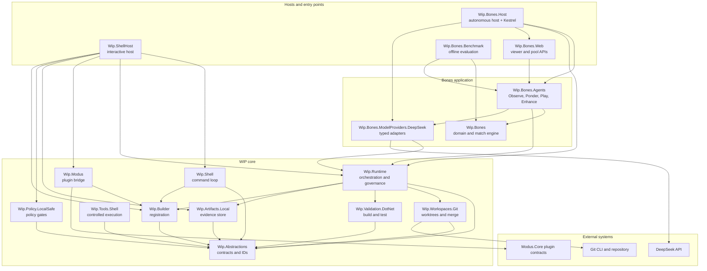

The container view exposes the central architectural fact: **there is no single “WIP host.”** The core is a library stack consumed by two different hosts with different lifecycles. `Wip.ShellHost` is an interactive, human-in-the-loop host. `Wip.Bones.Host` is an autonomous, long-running host with a web server. Sharing the same runtime and governance contracts is the intended design; sharing the same process assumptions is not.

### 5.3 Runtime component view

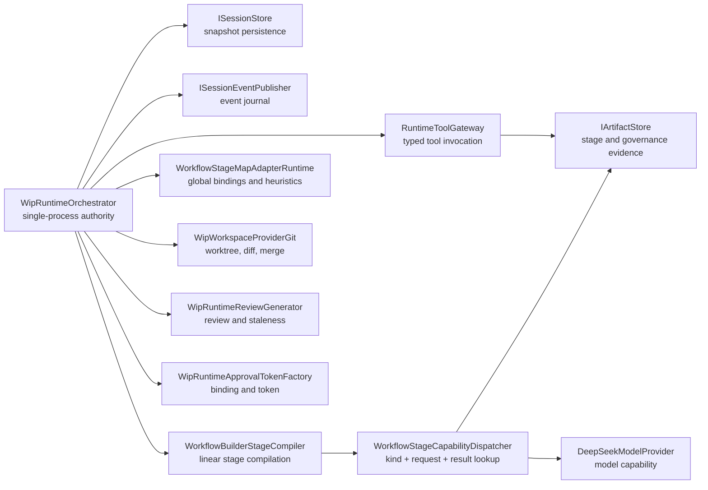

Two components deserve special attention:

- **`WorkflowStageMapAdapterRuntime` is process-global.** Its custom map bindings and initial request factories are static lists (`CustomMapBindings`, `InitialRequestFactories`) with a test-only reset method. Registration is idempotent per application, but multiple hosts or test collections in one process share the same registry. This is a hidden coupling and a test-order risk.
- **`WorkflowStageCapabilityDispatcher` resolves exactly one capability per `(Kind, RequestType, ResultType)` tuple.** If two tools share the same signature, only the ordinally first descriptor runs. This is deterministic, but it is not a tool-selection model; it is a type-based dispatch table.

### 5.4 Current DI topology and the nested-provider problem

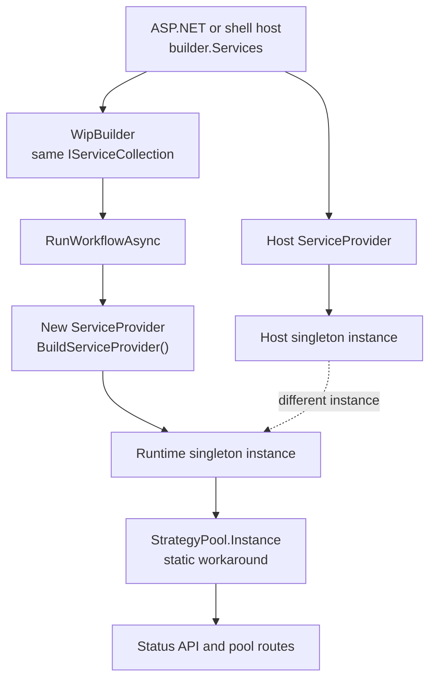

`RunWorkflowAsync` builds a new service provider from `builder.Services` for every run. The host also has a provider built from the same service collection. Singletons are therefore constructed twice. Bones works around this by making `StrategyPool.Instance` the shared identity and explicitly reusing it when the snapshot path matches:

> “A second service provider (host vs. workflow/agent container) must share the same pool. Creating a fresh instance per provider made status report poolSize=0 while the co-learning agent mutated a different pool.”
> — `BonesHostServiceCollectionExtensions.cs`

This is a **design defect**, not a workaround to celebrate. It affects any stateful capability: artifact stores, libraries, caches, model clients, and policies. It also makes lifetime semantics untestable in the way the builder tests imply.

**Intended requirement:** the runtime should receive the host's `IServiceProvider` or an `AsyncServiceScope` from the caller, and should never call `BuildServiceProvider`. Singleton identity should be testable with a reference-equality assertion across host and runtime resolution.

### 5.5 Shell host component view

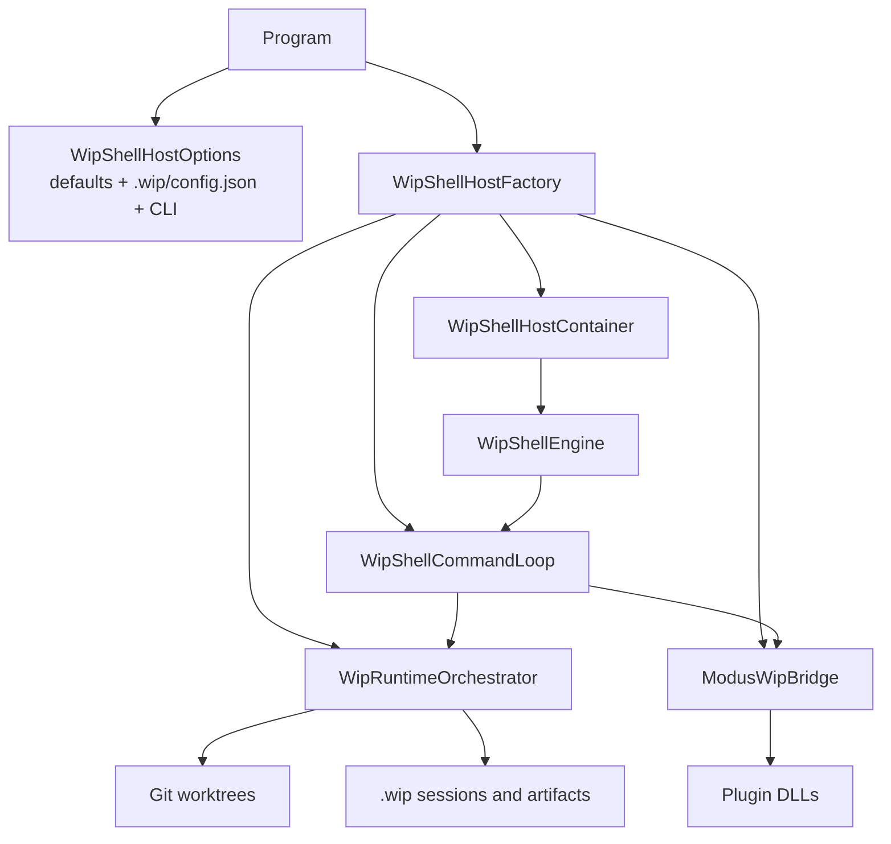

The shell host is the clearest expression of the intended architecture: a thin composition root, a command loop, a runtime, and a bridge. The in-flight change that adds a `Wip.Bones.Agents` reference to this project violates the same separation the host was designed around.

### 5.6 Bones component view

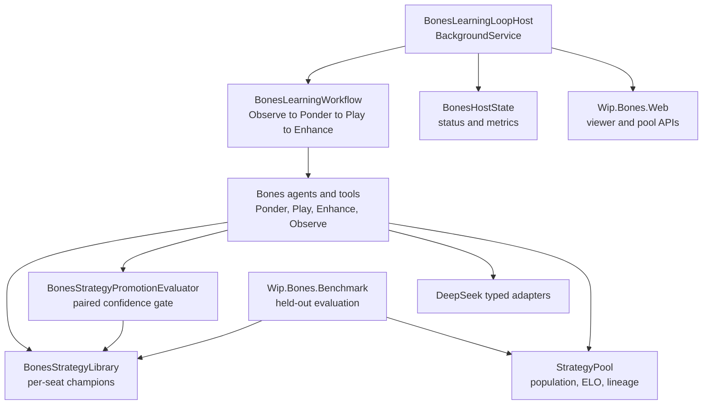

Bones is a **domain application**, not a reusable agent framework. Its value is proof: it demonstrates that the WIP contracts, workflow stages, model provider, artifact store, and session runtime can carry a real autonomous LLM system. Its cost is that most of the intelligence — prompts, compile retry, match simulation, promotion, co-learning, viewer — lives in application code, not in the core.

### 5.7 Session lifecycle

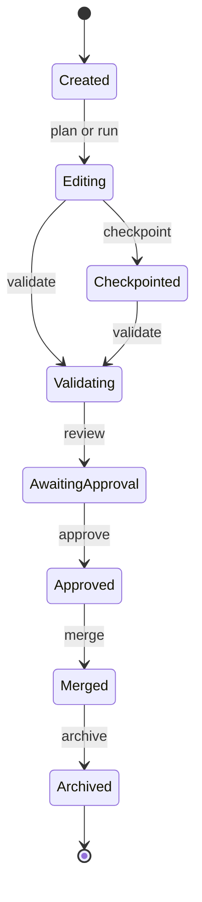

The main path is linear: `Created → Editing → Checkpointed → Validating → AwaitingApproval → Approved → Merged → Archived`. `Aborted` is a terminal escape from any active state from `Created` through `Approved`; it is omitted from the diagram for readability. `run` may self-advance only within `Editing` and `Checkpointed`; it must not advance into `Validating`, `AwaitingApproval`, `Approved`, or `Merged`. That guard exists in the working tree and is absent at `HEAD`.

### 5.8 Dynamic view: start session and run workflow

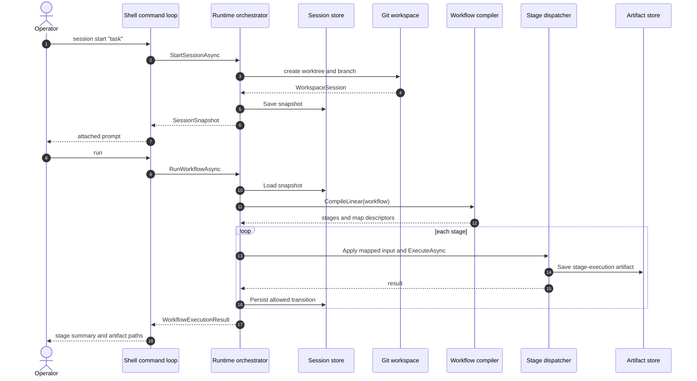

The runtime does not execute a workflow object. It compiles a stage list, finds a capability by type, maps the previous stage output to the next request, invokes the capability, writes an execution artifact, and applies only the state transition allowed for `run`. The workflow registration is effectively a **descriptor plus a static compile hook**.

### 5.9 Dynamic view: validation, review, approval, merge

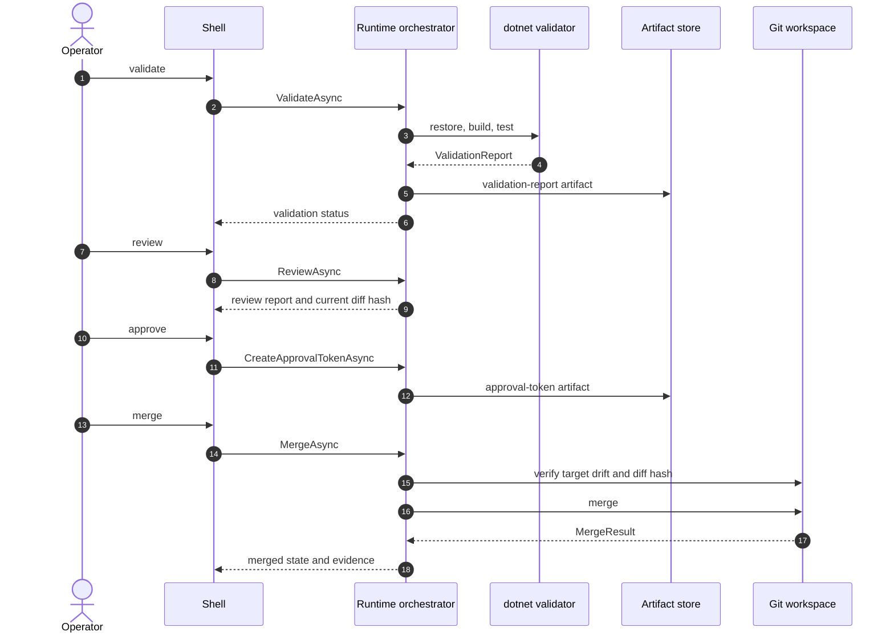

The governance sequence is where the architecture is strongest. Validation, review, and approval are separate artifacts bound to the same diff hash; merge re-checks the target commit and the hash before acting. The design deliberately makes “run” insufficient to merge.

### 5.10 Dynamic view: plugin discovery

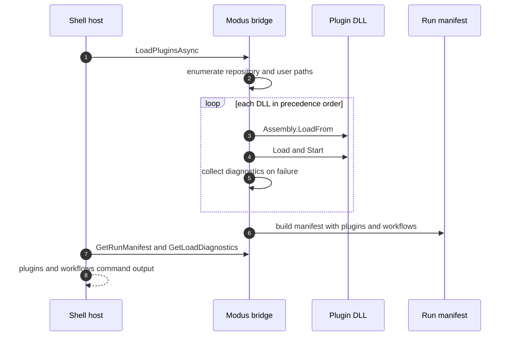

Plugin loading is deterministic and fault-tolerant at the logical level: failed assemblies become diagnostics, duplicate plugin IDs are resolved by path precedence, and lifecycle stop/unload runs in reverse order. It is not isolation: assemblies are loaded into the default context and cannot be unloaded cleanly.

### 5.11 Dynamic view: Bones learning iteration

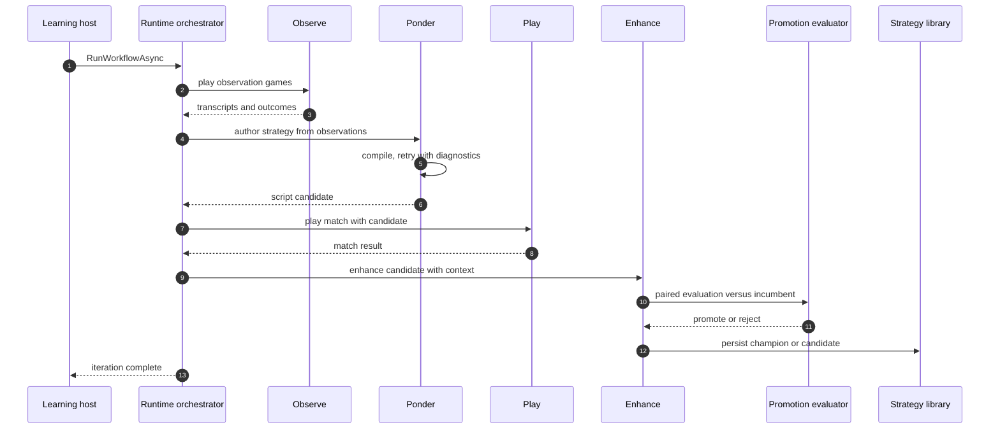

The Bones flow is a domain-specific orchestration of the same primitives: stage capabilities, artifacts, model providers, and a promotion gate. The workflow stage names are borrowed from the code-change lifecycle (`Plan` for Ponder/Enhance, `Run` for Observe/Play), which is a sign that the core stage vocabulary does not fit agent workflows.

### 5.12 Data model

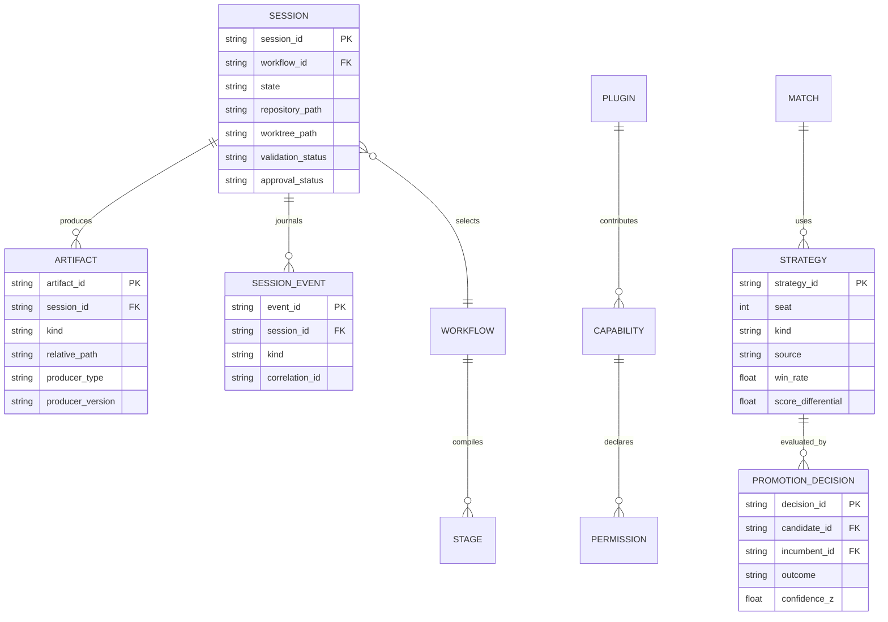

The persisted model is intentionally simple: JSON snapshots, descriptor sidecars, NDJSON events, and per-seat strategy files. There is no database, transaction log, or cross-process lock. That is appropriate for a local developer tool and inappropriate for a multi-tenant service.

### 5.13 Deployment view

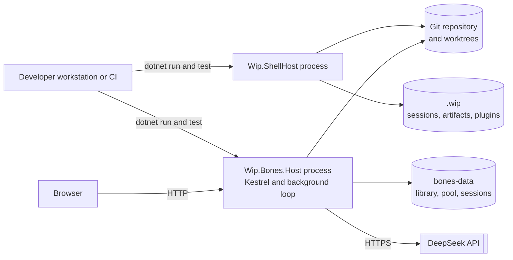

Deployment is single-node. The shell host and Bones host are separate processes with separate stores and lifetimes. There is no shared session store, scheduler, queue, or distributed lock. Running both against the same repository is possible but not coordinated by the architecture.

### 5.14 Design decisions and trade-offs

| ID | Decision | Rationale | Consequence | Status |
|---|---|---|---|---|
| ADR-01 | Typed capability contracts instead of `object` payloads | Compile-time safety and DI-friendly descriptors | More boilerplate; reflection at descriptor construction | Accepted, good |
| ADR-02 | Builder owns the `IServiceCollection` | Single composition surface for external packages | Runtime must not rebuild the provider; current code does | Accepted, implementation debt |
| ADR-03 | Linear stage compilation with static `CompileLinearStages` | Extensibility without changing the runtime | No branching/loops; workflow body unused | Accepted, needs contract cleanup |
| ADR-04 | Git worktree plus fast-forward merge | Strong isolation with simple merge semantics | No three-way merge or conflict resolution | Accepted, scope constraint |
| ADR-05 | In-process Roslyn compilation and execution with a syntax-based allowlist | Fast iteration and simple deployment | Critical untrusted-code risk; allowlist is not a sandbox | **Needs revisit** |
| ADR-06 | Local filesystem evidence store | Portable, inspectable, no infrastructure | Single-node, no multi-writer guarantee | Accepted for local tool |
| ADR-07 | DeepSeek-specific chat types in `Wip.Runtime` | Fast first provider integration | Provider lock-in and leaky abstraction | Accepted, needs generalization |
| ADR-08 | Behavior-proof gates through test traits | Strong traceability from requirement to test | Heavy, fragile, and not run in CI | Accepted, incomplete |
| ADR-09 | Static singleton fallback for `StrategyPool` | Works around nested provider identity | Hidden global state; testability and lifetime risk | **Workaround, remove** |
| ADR-10 | Separate Bones host | Avoids shell coupling; autonomous lifecycle | Duplicate composition and operational surface | Accepted, good direction |

### 5.15 Technical debt register

| ID | Debt | Impact | Priority |
|---|---|---|---|
| TD-01 | Per-run `BuildServiceProvider` in `RunWorkflowAsync` | Duplicate singletons, inconsistent state, lifetime bugs | P1 |
| TD-02 | Process-global `WorkflowStageMapAdapterRuntime` bindings | Test-order coupling, multi-host contamination | P1 |
| TD-03 | `StrategyPool.Instance` static workaround | Hidden global state, DI opacity | P1 |
| TD-04 | In-process model-authored C# execution | Host compromise, resource exhaustion | P0 |
| TD-05 | `Assembly.LoadFrom` default load context | No unload, dependency conflicts, plugin faults | P1 |
| TD-06 | `IWorkflow.ExecuteAsync` never invoked | Misleading extension point | P1 |
| TD-07 | Map adapters use property-name heuristics and string constructors | Silent wrong mapping; runtime failures | P1 |
| TD-08 | Permissions declared but not enforced | False least-privilege posture | P0/P1 |
| TD-09 | Working-tree `Wip.ShellHost → Wip.Bones.Agents` | Generic host coupled to domain app | P1 |
| TD-10 | Three requirement trees and unregistered docs | No reliable baseline | P1 |
| TD-11 | No metrics/traces/OpenTelemetry | Cost, latency, and failure correlation are manual | P2 |
| TD-12 | Raw strings in stage/agent DTOs | Inconsistent with typed-ID rule | P2 |
| TD-13 | Abandoned timeout thread for scripts | CPU leak and non-killable code | P1 |
| TD-14 | No architecture tests for WIP layering | Coupling regressions are caught only by review | P2 |

---

## 6. Traceability matrix

The matrix below maps the highest-value requirements to code and executable evidence. It is deliberately selective: a full row per requirement would duplicate §3. “Test evidence” names the test project or suite that contains the behavior; it does not imply the suite runs in CI.

| Requirement | Code evidence | Test / operational evidence | Status |
|---|---|---|---|
| FR-CAP-01 typed capability contracts | [`CapabilityContracts.cs`](../WIP/Wip.Abstractions/Capabilities/CapabilityContracts.cs) | `Wip.Abstractions.Tests/Contracts` | Implemented |
| FR-CAP-02 reject `object` payloads | [`CapabilityDescriptor.cs`](../WIP/Wip.Abstractions/Descriptors/CapabilityDescriptor.cs) | `Wip.Abstractions.Tests/Contracts/MetadataContractsTests.cs` | Implemented |
| FR-CAP-03 typed semantic IDs | [`Identifiers.cs`](../WIP/Wip.Abstractions/Identifiers/Identifiers.cs) | `Wip.Abstractions.Tests` | Partial |
| FR-CAP-06 permission metadata | [`CapabilityMetadata.cs`](../WIP/Wip.Abstractions/Capabilities/CapabilityMetadata.cs) | `Wip.Abstractions.Tests`, `Wip.Modus.Tests` | Partial |
| FR-BLD-01 typed registration | [`WipBuilder.cs`](../WIP/Wip.Builder/WipBuilder.cs) | `Wip.Builder.Tests/Builder/WipBuilderExplicitRegistrationTests.cs` | Implemented |
| FR-BLD-02 duplicate ID rejection | [`WipBuilder.cs`](../WIP/Wip.Builder/WipBuilder.cs) | `WipBuilderExplicitRegistrationTests.cs` | Implemented |
| FR-BLD-05 external package | [`WipBuilder.cs`](../WIP/Wip.Builder/WipBuilder.cs) | `Wip.Shell.E2E.Tests/E2E/SamplesTodoAppPackageSplitTests.cs` | Implemented |
| FR-SES-01 session snapshot | [`WipRuntimeOrchestrator.cs`](../WIP/Wip.Runtime/Runtime/WipRuntimeOrchestrator.cs) | `Wip.Runtime.Tests/Runtime/WipRuntimeOrchestratorTests.cs` | Implemented |
| FR-SES-02 linear transitions | [`WipRuntimeOrchestrator.cs`](../WIP/Wip.Runtime/Runtime/WipRuntimeOrchestrator.cs) | `WipRuntimeOrchestratorTests.cs` | Implemented |
| FR-SES-04 event journal | [`WipRuntimeOrchestrator.cs`](../WIP/Wip.Runtime/Runtime/WipRuntimeOrchestrator.cs) | Runtime + E2E tests | Implemented |
| FR-WS-01 worktree creation | [`WipWorkspaceProviderGit.cs`](../WIP/Wip.Workspaces.Git/WipWorkspaceProviderGit.cs) | `Wip.Workspaces.Git.Tests` | Implemented |
| FR-WS-02 normalized diff hash | [`WipWorkspaceProviderGit.cs`](../WIP/Wip.Workspaces.Git/WipWorkspaceProviderGit.cs) | `Wip.Workspaces.Git.Tests` | Implemented |
| FR-WS-05 merge gates | [`WipWorkspaceProviderGit.cs`](../WIP/Wip.Workspaces.Git/WipWorkspaceProviderGit.cs) | `Wip.Workspaces.Git.Tests`, `Wip.Runtime.Tests` | Implemented |
| FR-WF-02 linear stage compilation | [`WorkflowExecutionPipeline.cs`](../WIP/Wip.Runtime/Runtime/WorkflowExecutionPipeline.cs) | `Wip.Builder.Tests/Builder/WipBuilderTypedWorkflowMapRuntimeProofTests.cs` | Partial |
| FR-WF-03 capability dispatch | [`WorkflowStageCapabilityDispatcher.cs`](../WIP/Wip.Runtime/Runtime/WorkflowStageCapabilityDispatcher.cs) | `Wip.Runtime.Tests/Runtime/WorkflowStageCapabilityDispatcherTests.cs` | Implemented |
| FR-WF-05 execution-only run | [`WorkflowExecutionPipeline.cs`](../WIP/Wip.Runtime/Runtime/WorkflowExecutionPipeline.cs) | `WipRuntimeOrchestratorTests.cs` (working tree) | Partial |
| FR-WF-07 workflow `ExecuteAsync` | [`WorkflowContracts.cs`](../WIP/Wip.Abstractions/Workflows/WorkflowContracts.cs) | No runtime invocation test | Ambiguous |
| FR-ART-01 artifact descriptor | [`ArtifactContracts.cs`](../WIP/Wip.Abstractions/Artifacts/ArtifactContracts.cs) | `Wip.Artifacts.Local.Tests` | Implemented |
| FR-ART-02 atomic writes | [`WipArtifactStoreLocal.cs`](../WIP/Wip.Artifacts.Local/Artifacts/WipArtifactStoreLocal.cs) | `Wip.Artifacts.Local.Tests` | Implemented |
| FR-VAL-01 dotnet validation | [`DotNetValidationValidator.cs`](../WIP/Wip.Validation.DotNet/DotNet/DotNetValidationValidator.cs) | `Wip.Validation.DotNet.Tests` | Implemented |
| FR-VAL-03 AST validation | [`AstValidationContracts.cs`](../WIP/Wip.Validation.DotNet/DotNet/AstValidationContracts.cs) | `Wip.Validation.DotNet.Tests` | Implemented |
| FR-GOV-02 approval binding | [`WipRuntimeApprovalTokenFactory.cs`](../WIP/Wip.Runtime/Runtime/WipRuntimeApprovalTokenFactory.cs) | `Wip.Runtime.Tests`, `Wip.Shell.E2E.Tests` | Implemented |
| FR-GOV-04 merge evidence | [`WipWorkspaceProviderGit.cs`](../WIP/Wip.Workspaces.Git/WipWorkspaceProviderGit.cs) | `Wip.Workspaces.Git.Tests` | Implemented |
| FR-TOOL-01 worktree-scoped command | [`ShellCommandTool.cs`](../WIP/Wip.Tools.Shell/Shell/ShellCommandTool.cs) | `Wip.Tools.Shell.Tests` | Implemented |
| FR-TOOL-03 policy gates | [`LocalSafePolicy.cs`](../WIP/Wip.Policy.LocalSafe/LocalSafePolicy.cs) | `Wip.Policy.LocalSafe.Tests` | Implemented |
| FR-PLG-01 plugin discovery | [`ModusWipBridge.cs`](../WIP/Wip.Modus/Hosting/ModusWipBridge.cs) | `Wip.Modus.Tests` | Implemented |
| FR-PLG-06 permission enforcement | No enforcement path | No test | Missing |
| FR-SHELL-01 interactive loop | [`WipShellCommandLoop.cs`](../WIP/Wip.Shell/Interactive/WipShellCommandLoop.cs) | `Wip.Shell.Tests`, `Wip.Shell.E2E.Tests` | Implemented |
| FR-SHELL-03 config precedence | [`WipShellHostOptions`](../WIP/Wip.ShellHost/Hosting/WipShellHostOptions.cs) | `Wip.Shell.E2E.Tests` | Implemented |
| FR-LLM-02 DeepSeek adapter | [`DeepSeekModelProvider.cs`](../WIP/Wip.Runtime/Runtime/DeepSeekModelProvider.cs) | `Wip.Runtime.Tests`, DeepSeek tests | Implemented |
| FR-AGT-01 one-shot agent contract | [`CapabilityContracts.cs`](../WIP/Wip.Abstractions/Capabilities/CapabilityContracts.cs) | `Wip.Abstractions.Tests` | Implemented |
| FR-AGT-05 generic agent executor | No implementation | No test | Missing |
| FR-AGT-08 tool gateway integration | [`RuntimeToolGateway.cs`](../WIP/Wip.Runtime/Runtime/RuntimeToolGateway.cs) | `Wip.Runtime.Tests/Runtime/RuntimeToolGatewayTests.cs` only | Missing in production |
| FR-BONES-01 autonomous host | [`BonesLearningLoopHost.cs`](../WIP/Wip.Bones.Host/BonesLearningLoopHost.cs) | `Wip.Bones.Host.Tests` | Implemented |
| FR-BONES-02 compile retry | [`BonesPonderAgent.cs`](../WIP/Wip.Bones.Agents/Ponder/BonesPonderAgent.cs) | `Wip.Bones.Tests` | Implemented |
| FR-BONES-04 promotion gate | [`BonesStrategyPromotionEvaluator.cs`](../WIP/Wip.Bones.Agents/Knowledge/BonesStrategyPromotionEvaluator.cs) | `Wip.Bones.Tests` | Implemented |
| FR-BONES-09 process isolation | No implementation | No test; benchmark README warns | Missing |
| NFR-DI-01 host-managed DI | [`WipRuntimeOrchestrator.cs`](../WIP/Wip.Runtime/Runtime/WipRuntimeOrchestrator.cs) | No test; Bones static workaround | Missing |
| NFR-TEST-01 behavior-proof gate | [`BehaviorProofComplianceRegistry.cs`](../WIP/Wip.Shell.E2E/Compliance/BehaviorProofComplianceRegistry.cs) | `Wip.Shell.E2E.Tests` (not in CI) | Partial |
| NFR-SEC-06 untrusted code isolation | No implementation | No test | Missing |

---

## 7. Recommendations and roadmap

### 7.1 Priority 0 — make the system tell the truth and stop the critical risk

| ID | Action | Acceptance criterion | Effort |
|---|---|---|---|
| P0-01 | **Isolate model-authored code.** Run compiled strategies in a separate worker process or a restricted interpreter with no ambient filesystem/network access, CPU/memory limits, and a hard kill. If isolation is out of scope, explicitly restrict Bones to trusted strategies and remove the claim that it is safe for untrusted output. | A deliberately hostile strategy cannot read a host file, open a socket, or survive a kill. The benchmark’s “do not run untrusted scripts” caveat is either removed or enforced. | High |
| P0-02 | **Make the build graph honest.** Add a single `Wip.slnx` that includes all core and Bones projects, or add a `Bones.slnx` with an explicit CI job. Include `Wip.Bones.Tests` and `Wip.Bones.Benchmark`. | `dotnet build` on the chosen solution compiles every shipped project; zero projects are orphaned. | Low/Medium |
| P0-03 | **Run the offline test surface in CI.** Add `Wip.Abstractions.Tests`, `Wip.Builder.Tests`, `Wip.Runtime.Tests`, `Wip.Shell.Tests`, `Wip.Shell.E2E.Tests`, `Wip.Bones.Tests`, `Wip.Bones.Host.Tests` (filtered for offline), `Wip.Bones.Web.Tests` (excluding Playwright if needed), and the DeepSeek mock tests. | CI fails when a core runtime or Bones unit test regresses; the behavior-proof gate runs in the standard gate. | Medium |
| P0-04 | **Commit and verify the governance guard.** The working-tree `ResolveRunAdvancementTarget` fix must be committed with the regression test, and the test must run in CI. | `run` cannot reach `Validating`, `AwaitingApproval`, `Approved`, or `Merged`; the test is in the default CI job. | Low |
| P0-05 | **Decide the permission model.** Either enforce `CapabilityPermission` at dispatch/tool/plugin boundaries, or rename it to metadata and remove least-privilege claims from docs and manifests. | A test proves a denied permission blocks execution, or docs explicitly state permissions are advisory. | Medium |

### 7.2 Priority 1 — fix the architecture seams

| ID | Action | Acceptance criterion | Effort |
|---|---|---|---|
| P1-01 | **Remove the per-run service provider.** Pass the host `IServiceProvider` or an `AsyncServiceScope` into `RunWorkflowAsync`; resolve capabilities from that scope. Delete `BuildServiceProvider` from the runtime. | Host and runtime resolve the same singleton instance; a reference-equality test passes. | Medium |
| P1-02 | **Resolve `IWorkflow`.** Either make `RunWorkflowAsync` call the registered workflow’s `ExecuteAsync` with stage helpers, or replace `IWorkflow` with `IWorkflowDefinition` and document that orchestration is capability-stage based. | No public contract advertises a method the runtime never calls. | Medium |
| P1-03 | **Replace heuristic stage maps.** Require an explicit `Func<TSource,SessionSnapshot,TTarget>` per map, scoped to the workflow/builder rather than a process-global registry. | A map with a non-heuristic payload works without string constructors or property-name fallback; two hosts in one process do not share bindings. | Medium |
| P1-04 | **Break the shell/Bones coupling.** Move the `WIP_BONES_E2E` registration out of `Wip.ShellHost` into a test-only plugin, a dedicated test host, or `Wip.Bones.Host.Tests`. | `Wip.ShellHost` has no reference to any `Wip.Bones.*` assembly; an architecture test enforces it. | Low |
| P1-05 | **Add a generic agent executor if general autonomy is a goal.** Define an `IAgentExecutor` with a model turn, tool-call parsing, tool dispatch through `RuntimeToolGateway`, observation feedback, step budget, cancellation, and memory. Otherwise rename/position `IAgent` as a one-shot capability and stop implying autonomy. | A minimal ReAct-style loop can call a tool, consume the result, and terminate on budget or answer. | High |
| P1-06 | **Unify requirements.** Pick one authoritative tree, register every active requirement doc in the compliance registry, archive historical docs, and add a CI check that registered docs have no stale/unbound open items without an explicit waiver. | One baseline, one registry, one CI gate; no active doc is silently outside traceability. | Medium |
| P1-07 | **Make plugin loading isolatable.** Use an `AssemblyLoadContext` per plugin (or a worker process) and define unload semantics. | A plugin dependency conflict does not break the host; unload releases the assembly. | High |

### 7.3 Priority 2 — productization and operability

| ID | Action | Acceptance criterion | Effort |
|---|---|---|---|
| P2-01 | Add metrics/traces for session duration, stage duration, model tokens/cost, tool timeouts, merge rejections, and plugin failures. | A dashboard or trace can answer “why did this session fail?” without reading logs. | Medium |
| P2-02 | Define data classification, retention, and redaction for prompts, transcripts, and artifacts. | Secrets are redacted; retention is configurable; evidence stores are safe to share. | Medium |
| P2-03 | Add architecture fitness tests for WIP layering: ShellHost must not reference Bones; Runtime must not reference Shell; App must not reference Host; abstractions must not reference implementations. | The tests fail on a forbidden reference. | Low |
| P2-04 | Define a versioning/compatibility policy for capabilities and workflows. | Breaking changes require a version bump and a migration note; manifests expose compatibility. | Medium |
| P2-05 | Clean up naming and layout: `WIP.slnx` vs `Wip.*` vs `.wip/`; stale `tests/Wip.*` paths; root README and AGENTS.md coverage. | A new contributor can find the stack, the build command, and the authoritative docs from the root. | Low |
| P2-06 | Replace static singleton fallbacks and process-global registries with scoped services. | No `StrategyPool.Instance`; no static map registry; tests do not need reset hooks. | Medium |

### 7.4 Roadmap sequence

```mermaid
flowchart LR
    P0A["P0: isolate model code"]
    P0B["P0: solution and CI truth"]
    P0C["P0: governance guard"]
    P0D["P0: permission decision"]
    P1A["P1: host-managed DI"]
    P1B["P1: workflow contract and maps"]
    P1C["P1: agent executor"]
    P1D["P1: requirements unification"]
    P2A["P2: observability and privacy"]
    P2B["P2: architecture tests and cleanup"]

    P0A --> P0B
    P0B --> P0C
    P0C --> P0D
    P0D --> P1A
    P1A --> P1B
    P1B --> P1C
    P1C --> P1D
    P1D --> P2A
    P2A --> P2B
```

The ordering is deliberate. Isolating model code and making the gate honest comes before adding more agent capability. Otherwise the platform becomes more capable and less trustworthy at the same time.

---

## 8. Open questions

These are decisions the repository cannot answer from evidence. They should be resolved before the next architecture iteration.

1. **Product boundary.** Is WIP a first-class product, a reusable framework, or an accelerator that will move out? The answer determines whether `WIP.slnx` should include Bones, whether the shell host may reference Bones, and which docs are authoritative.
2. **Autonomy target.** Is the goal governed code-change assistance, or general autonomous agents? WIP is credible for the former and incomplete for the latter.
3. **Trust model.** Are plugin authors and model outputs trusted? If not, process isolation is a P0 requirement, not a roadmap item.
4. **Deployment model.** Is this always a single-user local process, or will multiple operators/agents share a repository? Local stores and in-memory session authority assume the former.
5. **Requirements authority.** Which tree wins when `WIP/requirements`, `.github/requirements`, and `harness/requirements` disagree? Who owns stale-doc cleanup?
6. **Permission semantics.** Should `CapabilityPermission` be enforced, or is it descriptive metadata for manifests and prompts?
7. **Model strategy.** Is DeepSeek the long-term provider, or is a provider-agnostic chat/tool contract required? The current shell plan path is hard-wired to DeepSeek types.
8. **Evidence retention.** How long are prompts, transcripts, and artifacts retained, and what must be redacted before sharing?
9. **Performance/cost SLOs.** What latency, token, and game budgets are acceptable for an iteration? There is no stated SLO.
10. **Compatibility.** What is the versioning contract for capabilities, workflows, and plugins? `CapabilityVersion` exists but is not negotiated.

---

## Appendix A. Source inventory

### A.1 Core contracts and runtime

| Area | Key files |
|---|---|
| Capability contracts | [`CapabilityContracts.cs`](../WIP/Wip.Abstractions/Capabilities/CapabilityContracts.cs), [`CapabilityDescriptor.cs`](../WIP/Wip.Abstractions/Descriptors/CapabilityDescriptor.cs), [`CapabilityMetadata.cs`](../WIP/Wip.Abstractions/Capabilities/CapabilityMetadata.cs) |
| Identifiers | [`Identifiers.cs`](../WIP/Wip.Abstractions/Identifiers/Identifiers.cs) |
| Artifacts | [`ArtifactContracts.cs`](../WIP/Wip.Abstractions/Artifacts/ArtifactContracts.cs), [`WipArtifactStoreLocal.cs`](../WIP/Wip.Artifacts.Local/Artifacts/WipArtifactStoreLocal.cs) |
| Sessions | [`SessionContracts.cs`](../WIP/Wip.Abstractions/Sessions/SessionContracts.cs), [`WipRuntimeOrchestrator.cs`](../WIP/Wip.Runtime/Runtime/WipRuntimeOrchestrator.cs) |
| Workflows | [`WorkflowContracts.cs`](../WIP/Wip.Abstractions/Workflows/WorkflowContracts.cs), [`WorkflowExecutionPipeline.cs`](../WIP/Wip.Runtime/Runtime/WorkflowExecutionPipeline.cs), [`WorkflowStageCapabilityDispatcher.cs`](../WIP/Wip.Runtime/Runtime/WorkflowStageCapabilityDispatcher.cs), [`WorkflowStageMapAdapterRuntime.cs`](../WIP/Wip.Runtime/Runtime/WorkflowStageMapAdapterRuntime.cs) |
| Builder | [`WipBuilder.cs`](../WIP/Wip.Builder/WipBuilder.cs) |
| Policies and tools | [`PolicyContracts.cs`](../WIP/Wip.Abstractions/Policies/PolicyContracts.cs), [`LocalSafePolicy.cs`](../WIP/Wip.Policy.LocalSafe/LocalSafePolicy.cs), [`ShellCommandTool.cs`](../WIP/Wip.Tools.Shell/Shell/ShellCommandTool.cs) |
| Workspaces | [`WorkspaceContracts.cs`](../WIP/Wip.Abstractions/Workspaces/WorkspaceContracts.cs), [`WipWorkspaceProviderGit.cs`](../WIP/Wip.Workspaces.Git/WipWorkspaceProviderGit.cs) |
| Validation | [`DotNetValidationValidator.cs`](../WIP/Wip.Validation.DotNet/DotNet/DotNetValidationValidator.cs), [`AstValidationContracts.cs`](../WIP/Wip.Validation.DotNet/DotNet/AstValidationContracts.cs) |
| Plugin bridge | [`ModusWipBridge.cs`](../WIP/Wip.Modus/Hosting/ModusWipBridge.cs), [`WipHostPluginContracts.cs`](../WIP/Wip.Modus/Hosting/WipHostPluginContracts.cs) |
| Shell | [`WipShellCommandLoop.cs`](../WIP/Wip.Shell/Interactive/WipShellCommandLoop.cs), [`WipShellCommandSemantics.cs`](../WIP/Wip.Shell/Interactive/WipShellCommandSemantics.cs) |
| Shell host | [`WipShellHostFactory.cs`](../WIP/Wip.ShellHost/Hosting/WipShellHostFactory.cs), [`WipShellHostOptions.cs`](../WIP/Wip.ShellHost/Hosting/WipShellHostOptions.cs) |
| Model provider | [`DeepSeekModelProvider.cs`](../WIP/Wip.Runtime/Runtime/DeepSeekModelProvider.cs) |

### A.2 Bones application

| Area | Key files |
|---|---|
| Host loop | [`BonesLearningLoopHost.cs`](../WIP/Wip.Bones.Host/BonesLearningLoopHost.cs), [`BonesHostApplication.cs`](../WIP/Wip.Bones.Host/BonesHostApplication.cs), [`BonesHostServiceCollectionExtensions.cs`](../WIP/Wip.Bones.Host/BonesHostServiceCollectionExtensions.cs) |
| Workflow | [`BonesLearningWorkflow.cs`](../WIP/Wip.Bones.Agents/Workflow/BonesLearningWorkflow.cs), [`BonesLearningWorkflowRegistration.cs`](../WIP/Wip.Bones.Agents/Workflow/BonesLearningWorkflowRegistration.cs), [`BonesLearningWorkflowMapRuntime.cs`](../WIP/Wip.Bones.Agents/Workflow/BonesLearningWorkflowMapRuntime.cs) |
| Agents | [`BonesPonderAgent.cs`](../WIP/Wip.Bones.Agents/Ponder/BonesPonderAgent.cs), [`BonesPlayMatchTool.cs`](../WIP/Wip.Bones.Agents/Play/BonesPlayMatchTool.cs), [`BonesEnhanceStrategyAgent.cs`](../WIP/Wip.Bones.Agents/Enhance/BonesEnhanceStrategyAgent.cs) |
| Knowledge and promotion | [`BonesStrategyLibrary.cs`](../WIP/Wip.Bones.Agents/Knowledge/BonesStrategyLibrary.cs), [`BonesStrategyPromotionEvaluator.cs`](../WIP/Wip.Bones.Agents/Knowledge/BonesStrategyPromotionEvaluator.cs), [`BonesStrategyLibraryRanking.cs`](../WIP/Wip.Bones.Agents/Knowledge/BonesStrategyLibraryRanking.cs) |
| Pool and viewer | [`BonesStrategyPool.cs`](../WIP/Wip.Bones.Agents/Knowledge/BonesStrategyPool.cs), [`BonesWebHost.cs`](../WIP/Wip.Bones.Web/BonesWebHost.cs) |
| Model adapters | [`DeepSeekBonesStrategyAuthoringProvider.cs`](../WIP/Wip.Bones.ModelProviders.DeepSeek/DeepSeekBonesStrategyAuthoringProvider.cs), [`DeepSeekBonesPlayTurnProvider.cs`](../WIP/Wip.Bones.ModelProviders.DeepSeek/DeepSeekBonesPlayTurnProvider.cs), [`DeepSeekBonesStrategyEnhancementProvider.cs`](../WIP/Wip.Bones.ModelProviders.DeepSeek/DeepSeekBonesStrategyEnhancementProvider.cs) |
| Benchmark | [`Program.cs`](../WIP/Wip.Bones.Benchmark/Program.cs), [`Arena.cs`](../WIP/Wip.Bones.Benchmark/Arena.cs), [`GateStudy.cs`](../WIP/Wip.Bones.Benchmark/GateStudy.cs) |
| Script execution | [`BonesStrategyScriptHost.cs`](../WIP/Wip.Bones/Engine/BonesStrategyScriptHost.cs) |

### A.3 Requirements and contributor documents

| Document | Role |
|---|---|
| [`WiP.Bootstrap.Requirements.md`](../WIP/requirements/WiP.Bootstrap.Requirements.md) | Explicit MVP scope, checklist, and test plan |
| [`Wip.Runtime/README.md`](../WIP/Wip.Runtime/README.md) | Lifecycle, state machine, execution boundary |
| [`Wip.Builder/README.md`](../WIP/Wip.Builder/README.md) | Registration and duplicate semantics |
| [`Wip.Shell/README.md`](../WIP/Wip.Shell/README.md) | Command surface and failure contracts |
| [`Wip.ShellHost/README.md`](../WIP/Wip.ShellHost/README.md) | Startup composition and config precedence |
| [`Wip.Bones.Host/README.md`](../WIP/Wip.Bones.Host/README.md) | Autonomous loop, promotion, budget, status, viewer |
| [`Wip.Bones.Benchmark/README.md`](../WIP/Wip.Bones.Benchmark/README.md) | Held-out benchmark and in-process code warning |
| [`src/WIP.Contributor-Architecture.README.md`](../src/WIP.Contributor-Architecture.README.md) | Core ownership map and extension rules |
| [`BehaviorProofComplianceRegistry.cs`](../WIP/Wip.Shell.E2E/Compliance/BehaviorProofComplianceRegistry.cs) | Checklist-to-test binding and compliance gate |

### A.4 Operational evidence

| Artifact | Role |
|---|---|
| [`Modus.slnx`](../Modus.slnx) | Main solution; at `HEAD` includes 24 WIP core projects, no Bones |
| [`WIP.slnx`](../WIP.slnx) | WIP core solution; at `HEAD` the same 24 projects, no Bones |
| [`.github/workflows/tests-ci.yml`](../.github/workflows/tests-ci.yml) | Build and test gate; only `Wip.ShellHost.Tests` among WIP |
| [`Wip.Bones.Host/appsettings.json`](../WIP/Wip.Bones.Host/appsettings.json) | Bounded defaults, DeepSeek, promotion, script host, resilience |
| [`Wip.ShellHost/Wip.ShellHost.csproj`](../WIP/Wip.ShellHost/Wip.ShellHost.csproj) | Working-tree Bones coupling evidence |

---

## Appendix B. Requirement status roll-up

| Status | Count | Dominant areas |
|---|---:|---|
| Implemented | 82 | Core contracts, builder, session, workspace, artifacts, validation, governance, tool/policy, shell, plugin bridge |
| Partial | 19 | Typed IDs, permissions, workflow maps, execution-only run, plugin isolation, model abstraction, co-learning, portability, test/observability, PatchAgent coverage |
| Missing | 11 | Generic agent loop, memory, tool-call integration, streaming/function calling, process isolation, permission enforcement, DI ownership, privacy, nonlinear workflows |
| Ambiguous | 1 | `IWorkflow.ExecuteAsync` |

The counts are a direct roll-up of the 113 identified requirement rows in §3, not a precise product audit. No row was classified `Stale` or `Unverified`; document-level staleness is handled in the conflict table (`RC-04`, `RC-05`) because it applies to sources rather than individual normalized requirements.

---

## Appendix C. Review checklist for the next iteration

Use this checklist when the P0/P1 work is claimed complete:

- [ ] Every shipped project is in exactly one solution, and that solution is built in CI.
- [ ] Every offline test project is run in CI, or has a documented waiver.
- [ ] The behavior-proof gate runs in the standard CI job.
- [ ] `run` cannot advance governance states; the regression test is committed and in CI.
- [ ] `RunWorkflowAsync` does not call `BuildServiceProvider`; host/runtime singleton identity is tested.
- [ ] `IWorkflow.ExecuteAsync` is either invoked or removed from the public contract.
- [ ] Stage maps are explicit functions scoped to the workflow, not a process-global registry.
- [ ] `Wip.ShellHost` has no reference to any `Wip.Bones.*` assembly; an architecture test enforces it.
- [ ] Model-authored code runs outside the host process or is explicitly restricted to trusted input.
- [ ] Capability permissions are enforced or documented as advisory metadata.
- [ ] Root `README.md` and `AGENTS.md` describe WIP, its boundary, and its build/test commands.
- [ ] One requirements tree is authoritative; stale docs are archived; unregistered docs are registered or waived.
- [ ] Status, metrics, and traces can answer “why did this session/iteration fail?” without reading raw logs.
- [ ] Prompt/transcript/artifact retention and redaction are documented and tested.

---

*End of report.*
