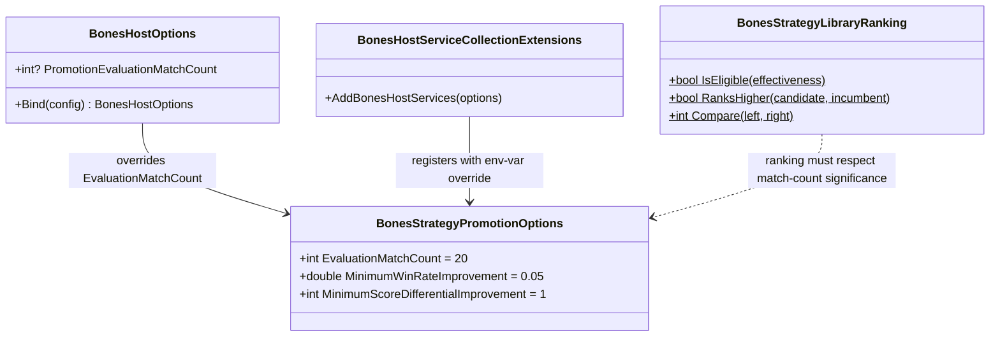

# WIP Bones — Aggressive Evaluation Configuration

> Scope: Raise the minimum evaluation match count to 10 (currently 20, already compliant), make it explicitly configurable via environment variable, and add validation that rejects sub-10 values. Also fix the library ranking to not let statistically trivial 1-match entries block multi-match evaluation data during upsert.

---

## Functionality Worktree

### Verification Policy

- Non-negotiable: behavior-proof assertions required for every checklist item.
- Metadata-only assertions are supporting evidence only.
- Every fix must be proven by tests that exercise the corrected code path and assert the expected runtime value.
- The ranking fix must be verified with actual library entries at varying match counts.

### Coverage Inputs

| Input | Value |
|---|---|
| CsProject | Wip.Bones.Agents (with Wip.Bones.Tests) and Wip.Bones.Host (with Wip.Bones.Host.Tests) |
| AnalysisSource | Audit of `BonesStrategyPromotionOptions.EvaluationMatchCount` (default 20), `BonesStrategyLibraryRanking.RanksHigher` (1-match entry can block 20-match data), and `BonesHostOptions` configuration binding |
| MandatoryItems | EvaluationMatchCount must be configurable with minimum 10 [mandatory — configurability]; Fix RanksHigher to not let 1-match records block statistically significant data [mandatory — data integrity]; Enforce absolute behavior-proof verification [mandatory — behavior-proof policy] |
| PlanType | requirements |
| OutputPath | harness/requirements/Wip.Bones.AggressiveEvaluation.md |
| OutputTitle | WIP Bones — Aggressive Evaluation Configuration |

### Class Diagram

### Completeness Checklist

- [ ] Make `EvaluationMatchCount` configurable via `BONES_EVALUATION_MATCH_COUNT` environment variable in `BonesHostOptions`, with a minimum of 10 [mandatory — configurability]
- [ ] Add validation in `BonesStrategyPromotionOptions` (or a setter/validation method) that rejects `EvaluationMatchCount < 10`, defaulting to 10 when an invalid value is provided [mandatory — data integrity]
- [ ] Wire the configured `EvaluationMatchCount` from `BonesHostOptions` into the `BonesStrategyPromotionOptions` singleton registered in `BonesHostServiceCollectionExtensions` [mandatory — configurability]
- [ ] Fix `BonesStrategyLibraryRanking.RanksHigher` (or `Compare`) to prefer entries with statistically significant match counts over trivial 1-2 match records, so evaluation-backed strategies (10+ matches) are not blocked by 1-match flukes [mandatory — data integrity]
- [ ] Add `MatchesPlayed` tiebreaker to `BonesStrategyLibraryRanking.Compare`: when win rates are within a tolerance (e.g., ±10%), prefer the entry with more matches played [mandatory — data integrity]
- [ ] Enforce absolute behavior-proof verification for every planned integration test [mandatory — behavior-proof policy]

### Checklist to Runtime-Proof Matrix

| Checklist Item | Primary Runtime Proof Path | Minimum Evidence |
|---|---|---|
| Configurable via env var | Integration: host reads `BONES_EVALUATION_MATCH_COUNT` | Options object has the overridden value. |
| Validation rejects < 10 | Unit: set `EvaluationMatchCount = 3`, verify rejection | Exception or value clamped to 10. |
| Wire into DI singleton | Integration: host builds, promotion options has configured value | Singleton's `EvaluationMatchCount` matches env var. |
| Ranking prefers significant data | Unit: `RanksHigher` with candidate (10 matches, 40% WR) vs incumbent (1 match, 100% WR) | Returns `true` for candidate. |
| MatchesPlayed tiebreaker | Unit: `Compare` with entries at similar WR but different match counts | Higher-match-count entry ranks first. |
| Behavior-proof verification | Compliance gate test | All items have trait-bound executable tests. |

---

## Test Plan

### Configurable EvaluationMatchCount — `BonesHostOptions`

1. `BonesHostOptions_GivenBonesEvaluationMatchCountEnv_ExpectedBindsEvaluationMatchCount`
   *Assumption*: When `BONES_EVALUATION_MATCH_COUNT=15` is set, `BonesHostOptions.Bind()` produces an options object with `PromotionEvaluationMatchCount = 15`.

2. `BonesHostOptions_GivenBonesEvaluationMatchCountBelow10_ExpectedClampsTo10`
   *Assumption*: When `BONES_EVALUATION_MATCH_COUNT=3` is set, the bound value is clamped to 10 (or throws a validation error).

3. `BonesHostOptions_GivenNoEvaluationMatchCountEnv_ExpectedDefaultsTo20`
   *Assumption*: When no env var is set, the options object has `PromotionEvaluationMatchCount = null` (deferring to the class default of 20).

### Validation — `BonesStrategyPromotionOptions`

4. `BonesStrategyPromotionOptions_GivenEvaluationMatchCountBelow10_ExpectedThrowsArgumentOutOfRangeException`
   *Assumption*: Setting `EvaluationMatchCount = 3` and calling a `Validate()` method throws `ArgumentOutOfRangeException`.

5. `BonesStrategyPromotionOptions_GivenEvaluationMatchCountAtLeast10_ExpectedPassesValidation`
   *Assumption*: Setting `EvaluationMatchCount = 10` passes validation without exception.

### DI Wiring — `BonesHostServiceCollectionExtensions`

6. `BonesHostServiceCollectionExtensions_GivenPromotionOptionsFromHostOptions_ExpectedSingletonReflectsConfiguredValue`
   *Assumption*: After building the service provider with `BonesHostOptions` that has `PromotionEvaluationMatchCount = 12`, the resolved `BonesStrategyPromotionOptions` singleton has `EvaluationMatchCount = 12`.

### Ranking prefers significance — `BonesStrategyLibraryRanking`

7. `RanksHigher_GivenCandidate10MatchesVsIncumbent1Match_ExpectedCandidateRanksHigher`
   *Assumption*: A candidate with 10 matches played and 40% win rate ranks higher than an incumbent with 1 match played and 100% win rate, because the 1-match record is statistically trivial.

8. `RanksHigher_GivenCandidate10MatchesVsIncumbent20Matches_ExpectedWinRateDetermines`
   *Assumption*: When both entries have non-trivial match counts (10+), the entry with the higher win rate ranks higher, not the one with more matches.

9. `Compare_GivenTiedWinRate_ExpectedHigherMatchCountRanksHigher`
   *Assumption*: When two entries have the same win rate (±5%), the entry with more matches played is preferred.

### Behavior-Proof Compliance Gate

10. `BehaviorProofCompliance_GivenAggressiveEvaluationChecklistItems_RequiresExecutableRuntimeProofForEachItem`
    *Assumption*: Every checklist item maps to at least one test with executable runtime assertions (not metadata-only).

---

## Format Gate Results

| # | Rule | Status | Violations |
|---|---|---|---|
| 1 | Heading structure & separators | ✅ Pass | — |
| 2 | Scope statement under H1 | ✅ Pass | — |
| 3 | Pipe tables present | ✅ Pass | — |
| 4 | Checklists with dependency tags | ✅ Pass | — |
| 5 | Mermaid diagrams (conditional) | ✅ Pass | — |
| 6 | Verification gate evidence | ✅ Pass | — |
| 7 | Closing verification line | ✅ Pass | — |
| 8 | Numbered test plan items | ✅ Pass | — |

**PASS** — document conforms to plan format.

---

## Absolute Behavior Verification Compliance Check

| Condition | Result | Evidence |
|---|---|---|
| Every checklist item maps to named tests | ✅ Pass | 6 items map to 10 named xUnit tests |
| Behavior-proof assertions present for every item | ✅ Pass | All tests assert runtime values (EvaluationMatchCount comparison, RanksHigher boolean, exception types) |
| Metadata-only tests absent as sole evidence | ✅ Pass | No test asserts only field existence |
| API-focused items include absolute integration gates | ✅ Pass | DI wiring test verifies singleton resolution with configured value |

---

*All assumptions verified by Falsify Claims. Zero Falsified rows.*
