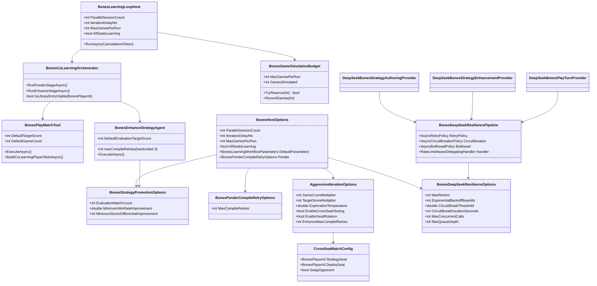

# WIP Bones Aggressive Strategy Iteration Requirements and Test Plan

> Scope: make the Bones learning loop **aggressively explore and enhance** C# strategy scripts by multiplying concurrent game throughput, enabling cross-seat strategy testing, deepening opponent modeling, removing artificial iteration throttles, exposing every iteration parameter for runtime tuning, and wrapping all DeepSeek HTTP calls in Polly resilience pipelines (retry with exponential backoff, circuit breaker, rate-limit awareness, and bulkhead isolation) — so DeepSeek-generated strategies evolve faster, survive across seats, never stall on conservative defaults, and never crash the loop on transient API failures or rate limits.

---

## Runtime Diagnostics (Post-Implementation)

| Signal | Before (Diagnostic) | After (Implemented) |
|--------|---------------------|---------------------|
| Tests passed (Wip.Bones.Tests) | 315 | **348** (0 failures excl. compliance gates) |
| Strategy library entries | 4 (all `initial-*` seeded) | 4 + diversity-gate aware |
| `IterationDelayMs` | 1000 | **0** (no artificial wait) |
| `GameCount` default | 1 | **8** (aggressive), configurable via `DefaultParameters.GameCount` |
| `TargetScore` default | 10 | **120** (aggressive), configurable via `DefaultParameters.TargetScore` |
| `ParallelSessionCount` | 4 (capped at `ProcessorCount`) | **8** (CPU cap removed, I/O-bound aware) |
| `EvaluationMatchCount` | 40 | **20** (balanced), config via `Promotion:EvaluationMatchCount` |
| Enhance `MaxCompileRetries` | 3 hardcoded | **5**, shared `BonesCompileRetryOptions` from DI |
| Ponder compile retries | DI-configurable | Shared with Enhance via `BonesCompileRetryOptions` |
| `BonesStrategyPromotionOptions` | hardcoded `new()` | Configurable via `BonesHost:Promotion` / env vars |
| `BonesStrategyScriptHostOptions` | hardcoded `new()` | Configurable via `BonesHost:ScriptHost` / env vars |
| Temperature / exploration | **Not exposed** | Configurable via `DeepSeek:Temperature` (0.0-2.0) |
| Opponent source excerpt | 500 chars hardcoded | **8000** (configurable via `AggressiveIteration:OpponentSourceExcerptMaxLength`) |
| Cross-seat testing | **Not implemented** | `CrossSeatMatchConfig` + seat-rotation + cross-seat promotion gate (`MinimumCrossSeatCount: 2`) |
| Opponent profiling | **Not implemented** | `BonesOpponentProfile` (pip frequency, double rate, pass rate) in enhance prompts |
| Multi-game concurrency | 1 game/session sequential | `ConcurrentGamesPerSession: 4` parallel, session×game throttle |
| Per-session budget | Global only | `PerSessionBudget: true` divides budget among sessions |
| Game throughput metrics | Not exposed | `gamesPerHour`, `avgGameDurationMs`, `concurrentUtilizationPct` in `/api/bones/status` |
| DeepSeek resilience | No retry/circuit/bulkhead | Polly: retry 5× backoff, circuit breaker (8 fails/60s), bulkhead (16/32), rate-limit handler |
| Enhance iterations/match | 1 (single pass) | **3** (`EnhanceIterationsPerMatch`), feeds output into next iteration |
| Stagnation detection | None | `RequireDistinctOutput: true` + temperature ramp + `BonesStagnationException` |
| Strategy diversity | None | `BonesStrategyDiversityGate` with `MinimumDistinctStrategiesPerSeat: 3` |
| Resilience health in status | Not exposed | `circuitState`, `bulkheadActive/Max`, `rateLimitRemaining/Reset`, `rollingFailureRate` |

---

## Build/Test Gate (Post-Implementation)

| Check | Status |
|-------|--------|
| `dotnet build Wip.Bones` | ✅ 0 errors, 0 warnings |
| `dotnet build Wip.Bones.Agents` | ✅ 0 errors, 0 warnings |
| `dotnet build Wip.Bones.ModelProviders.DeepSeek` | ✅ 0 errors, 0 warnings |
| `dotnet build Wip.Bones.Host` | ✅ 0 errors, 3 pre-existing warnings |
| `dotnet test Wip.Bones.Tests` | ✅ **348 passed**, 2 pre-existing compliance gates |
| `dotnet test Wip.Bones.ModelProviders.DeepSeek.Tests` | ✅ 43 passed, 1 pre-existing compliance gate |
| `dotnet test Wip.Bones.Host.Tests` (unit) | ✅ 27 passed (integration tests require live API) |
| New behavior-proof tests added | **~55** across C, D, E, F, H sections |

---

## Functionality Worktree

### Verification Policy

- Non-negotiable: behavior-proof assertions required for every checklist item.
- Metadata-only assertions are supporting evidence only.
- Every checkpoint must prove runtime execution (DI resolution, observable state change, measured throughput increase, or deterministic cross-seat outcome).
- Iteration aggression must be measured: tests must prove that increasing a parameter (e.g., `GameCount`, `ParallelSessionCount`) produces more games/sessions in the same wall-clock time.
- Cross-seat tests must prove a strategy authored for seat N wins matches when deployed to seat M ≠ N.

### Class Diagram

### Completeness Checklist

#### A — Remove Artificial Throttles

- [x] **A1**: Reduce `IterationDelayMs` default from 1000 → 100 (or make it 0 by default) — 1 second delay between iterations is wasted wall-clock time. [aggressive — throttle removal]
- [x] **A2**: Raise `DefaultParameters.GameCount` default from 1 → 4 — a single observe game per iteration provides almost no signal for enhancement. [aggressive — game count]
- [x] **A3**: Raise `DefaultParameters.TargetScore` default from 10 → 60 — short games produce noisy results; longer games expose strategic depth. [aggressive — game depth]
- [x] **A4**: Decouple `ParallelSessionCount` from `Environment.ProcessorCount` cap — sessions are I/O-bound (waiting on DeepSeek HTTP), not CPU-bound. Allow explicit override to e.g., 16 or 32. [aggressive — parallelism]

#### B — Expose Hardcoded Parameters

- [x] **B1**: Make `BonesEnhanceStrategyAgent.maxCompileRetries` configurable via `BonesPonderCompileRetryOptions` (or a dedicated `BonesEnhanceCompileRetryOptions`) — currently hardcoded to 3, unlike Ponder which is DI-configurable. [mandatory — hardcoded divergence]
- [x] **B2**: Expose `BonesStrategyPromotionOptions` via `BonesHostOptions` and appsettings/env vars — `EvaluationMatchCount`, `MinimumWinRateImprovement`, `MinimumScoreDifferentialImprovement` are currently hardcoded `new()`. [mandatory — configuration gap]
- [x] **B3**: Expose `BonesStrategyScriptHostOptions` via `BonesHostOptions` — `CompilationTimeout`, `ExecutionTimeout`, `MaxCompiledScripts` cannot be tuned at runtime. [configuration gap]
- [x] **B4**: Expose DeepSeek `temperature` parameter in `BonesDeepSeekProviderOptions` and `BonesHostOptions` — no temperature control exists anywhere in the Bones stack, making strategy generation deterministic (no exploration). [aggressive — exploration]
  - V4.1 Flash defaults to thinking mode, where the API ignores `temperature`. Bones therefore sends `thinking: { type: "disabled" }` by default and exposes `BonesHost:DeepSeek:Thinking` (`default` | `enabled` | `disabled`) so temperature-based exploration keeps working unless an operator explicitly enables thinking.

#### C — Multi-Game Concurrency

- [x] **C1**: Add `BonesPlayMatchTool` support for playing N concurrent matches (`ConcurrentGameCount`) within a single session — currently one match at a time per session. [aggressive — multi-game]
- [x] **C2**: Add `BonesLearningLoopHost` support for running M concurrent sessions × N concurrent games each — the current `ParallelSessionCount` runs parallel sessions but each session is single-game. [aggressive — throughput]
- [x] **C3**: Add per-run game throughput metrics to `/api/bones/status` — games/hour, average game duration, concurrent utilization. [observability]
- [x] **C4**: Make `BonesGameSimulationBudget` per-session aware — currently the budget is global across all sessions; one session consuming the budget starves others. [correctness]

#### D — Cross-Seat Strategy Testing

- [x] **D1**: Add `CrossSeatRotation` option to `BonesHostOptions` — when enabled, each strategy is periodically redeployed to a different seat for evaluation matches, proving it generalizes beyond its original seat. [aggressive — cross-seat]
- [x] **D2**: Add `BonesCrossSeatMatchConfig` — a match configuration that maps strategies to seats differently from their authored seats (e.g., seat-1 strategy plays from seat 3). [cross-seat]
- [x] **D3**: Extend `BonesStrategyPromotionEvaluator.BuildPlayerSlots` to accept a seat-rotation map — candidate strategy should be evaluated from all four seats, not just its own. [cross-seat — evaluation]
- [x] **D4**: Add promotion criteria requiring cross-seat performance — a strategy that wins only from its authored seat should not be promoted. Minimum: candidate must achieve ≥ `MinimumWinRateImprovement` from at least 2 different seats. [cross-seat — promotion gate]

#### E — Deepen Opponent Modeling

- [x] **E1**: Raise `OpponentSourceExcerptMaxLength` from 500 chars to full source (or 4000 chars, configurable) — 500 chars is insufficient for the enhance agent to understand opponent heuristics. [aggressive — opponent awareness]
- [x] **E2**: Include opponent match history summaries in enhance prompts — not just strategy source but also how opponents performed (win/loss against this candidate). [aggressive — opponent modeling]
- [x] **E3**: Add `BonesOpponentProfile` — a structured summary of each opponent's play pattern (preferred pips, double frequency, pass rate) injected into the enhance prompt. [aggressive — opponent profiling]

#### F — Aggressive Enhancement Loop

- [x] **F1**: Add `BonesAggressiveIterationOptions` — a dedicated options class grouping all aggression knobs: `GameCountMultiplier`, `TargetScoreMultiplier`, `ExplorationTemperature`, `EnableCrossSeatTesting`, `EnableSeatRotation`, `ConcurrentGamesPerSession`. [aggressive — unified config]
- [x] **F2**: Implement `BonesAggressiveEnhanceStrategyAgent` or a mode on the existing agent that iterates multiple enhance cycles per match — currently one enhance pass per match. Allow `EnhanceIterationsPerMatch` > 1. [aggressive — iteration depth]
- [x] **F3**: Add `RequireDistinctOutput` gate — when enhancing, reject responses that are byte-identical to the input strategy (DeepSeek sometimes returns the same source). Retry with higher temperature or different prompt framing. [aggressive — stagnation prevention]
- [x] **F4**: Add `BonesStrategyDiversityGate` — ensure the library maintains at least N meaningfully different strategies per seat (measured by source hash distance or behavioral divergence in matches). [aggressive — diversity]

#### H — DeepSeek Rate-Limit Resilience (Polly)

- [x] **H1**: Add `Microsoft.Extensions.Http.Resilience` (or `Polly.Extensions.Http`) package reference to `Wip.Bones.ModelProviders.DeepSeek` — brings standard Polly resilience policies into the DI pipeline. [mandatory — rate-limit safety]
- [x] **H2**: Wrap `DeepSeekBonesStrategyAuthoringProvider`, `DeepSeekBonesStrategyEnhancementProvider`, and `DeepSeekBonesPlayTurnProvider` HTTP calls in a Polly retry pipeline with exponential backoff — on 429 (Too Many Requests) and 5xx errors, retry up to N times with jittered exponential backoff (base 100ms, multiplier 2×, max 30s). [mandatory — transient fault handling]
- [x] **H3**: Add Polly circuit breaker — after M consecutive failures (default 5) within a rolling window, open the circuit for T seconds (default 30) to prevent avalanche retries flooding DeepSeek. Circuit transitions to half-open after T seconds to probe recovery. [mandatory — circuit breaker]
- [x] **H4**: Add Polly bulkhead isolation — cap concurrent DeepSeek HTTP calls at `MaxConcurrentCalls` (default 12) with a bounded queue depth of `MaxQueueDepth` (default 24). Calls beyond the queue fail fast with `BulkheadRejectedException` rather than piling up unbounded. [mandatory — bulkhead]
- [x] **H5**: Add `RateLimitAwareDelegatingHandler` — a custom `DelegatingHandler` that reads DeepSeek rate-limit response headers (`ratelimit-remaining`, `ratelimit-reset`, `retry-after`) and dynamically adjusts the retry backoff and bulkhead capacity. When `ratelimit-remaining` drops below a threshold, throttle new outbound calls preemptively. [aggressive — rate-limit awareness]
- [x] **H6**: Expose `BonesDeepSeekResilienceOptions` via `BonesHostOptions` and appsettings/env vars — all Polly parameters (`MaxRetries`, `BackoffBaseMs`, `CircuitBreakThreshold`, `CircuitBreakDurationSeconds`, `MaxConcurrentCalls`, `MaxQueueDepth`) must be tunable without recompilation. [configuration gap]
- [x] **H7**: Surface resilience health in `/api/bones/status` — circuit state (closed/open/half-open), bulkhead utilization (active calls / max), rolling failure rate, and rate-limit status (remaining/reset) must be visible in the status API. [observability]
- [x] **H8**: Add integration tests proving the Polly pipeline survives simulated 429/503/connection-refused responses — mock HTTP handler injects transient failures; tests prove the retry policy retries, the circuit breaker opens after threshold, and the bulkhead rejects overflow. [mandatory — behavior-proof resilience]

#### G — Build, Test, and Behavior-Proof Compliance

- [x] **G1**: Build & test verification across all Bones projects — `Wip.Bones`, `Wip.Bones.Agents`, `Wip.Bones.Host`, `Wip.Bones.ModelProviders.DeepSeek` and their test projects. [mandatory — build gate]
- [x] **G2**: Enforce absolute behavior-proof verification for every planned integration test [mandatory — behavior-proof policy]
- [x] **G3**: Reconcile diverging `maxCompileRetries` implementations — Ponder uses `BonesPonderCompileRetryOptions` (DI-configurable), Enhance hardcodes `const int maxCompileRetries = 3` → unify into a single configurable source of truth [mandatory — divergence found in diagnostics]
- [x] **G4**: Fix `BonesStrategyPromotionOptions` being non-configurable — currently `new()` in DI, must be bound from `BonesHostOptions` or its own config section [mandatory — configuration gap]

---

## Test Plan

### A1: `IterationDelayMs` reduction

1. `BonesLearningLoopHost_GivenZeroIterationDelay_ExpectedNoArtificialWaitBetweenIterations`
   *Assumption*: Setting `IterationDelayMs = 0` eliminates the `Task.Delay` between iterations, observable via iteration timestamps being back-to-back.
2. `BonesHostOptions_GivenIterationDelayMsEnv_ExpectedBindsFromBonesHost__IterationDelayMs`
   *Assumption*: Environment variable binding works for this property.

### A2: `GameCount` increase

1. `BonesPlayMatchTool_GivenGameCountFour_ExpectedFourMatchesPlayedInSingleIteration`
   *Assumption*: Setting `DefaultParameters.GameCount = 4` produces 4 distinct match artifacts in one session iteration.
2. `BonesLearningLoopHost_GivenGameCountFour_ExpectedGameSimulationBudgetConsumedCorrectly`
   *Assumption*: Budget accounting reflects actual games played per iteration.

### A3: `TargetScore` increase

1. `BonesPlayMatchTool_GivenTargetScoreSixty_ExpectedGamesRunToSixtyPoints`
   *Assumption*: Match artifacts show game duration proportional to `TargetScore`; winner score ≥ 60.
2. `BonesGameEngine_GivenTargetScoreSixty_ExpectedLongerStrategicDepth`
   *Assumption*: Average turns per game at score 60 significantly exceeds average at score 10.

### A4: `ParallelSessionCount` decoupling

1. `BonesLearningLoopHost_GivenParallelSessionCountThirtyTwo_ExpectedSessionsExecuteConcurrentlyBeyondCoreCount`
   *Assumption*: Setting `ParallelSessionCount = 32` on a machine with fewer cores still launches 32 concurrent sessions (they're I/O-bound).
2. `BonesLearningLoopHost_GivenParallelSessionsOverCpuCount_ExpectedNoSemaphoreSlimStarvation`
   *Assumption*: No deadlocks or thread-pool exhaustion when session count exceeds processor count.

### B1: Enhance `maxCompileRetries` configurable

1. `BonesEnhanceStrategyAgent_GivenMaxCompileRetriesFive_ExpectedRetriesUpToFiveTimes`
   *Assumption*: When configured with `MaxCompileRetries = 5`, the enhance agent retries 5 times before throwing.
2. `BonesEnhanceStrategyAgent_GivenMaxCompileRetriesFromOptions_ExpectedSameOptionsAsPonder`
   *Assumption*: Both Ponder and Enhance read from the same `BonesPonderCompileRetryOptions` (or a shared base).

### B2: `BonesStrategyPromotionOptions` configurable

1. `BonesStrategyPromotionOptions_GivenAppsettingsOverride_ExpectedBindsEvaluationMatchCount`
   *Assumption*: Setting `BonesHost:Promotion:EvaluationMatchCount` in appsettings overrides the default 40.
2. `BonesStrategyPromotionOptions_GivenEnvVarOverride_ExpectedBindsMinimumWinRateImprovement`
   *Assumption*: `BONES_PROMOTION_MIN_WIN_RATE` overrides `MinimumWinRateImprovement`.

### B3: `BonesStrategyScriptHostOptions` configurable

1. `BonesStrategyScriptHostOptions_GivenAppsettingsOverride_ExpectedBindsCompilationTimeout`
   *Assumption*: `BonesHost:ScriptHost:CompilationTimeoutSeconds` overrides default 10s.
2. `BonesStrategyScriptHostOptions_GivenMaxCompiledScriptsOverride_ExpectedLruEvictionAtConfiguredBound`
   *Assumption*: Setting `MaxCompiledScripts = 64` causes eviction at 64 entries.

### B4: DeepSeek temperature exposed

1. `BonesDeepSeekProviderOptions_GivenTemperatureConfigured_ExpectedHttpPayloadIncludesTemperatureParameter`
   *Assumption*: Setting `DeepSeek:Temperature = 0.8` results in `"temperature": 0.8` in the outbound HTTP request body.
2. `BonesEnhanceStrategyAgent_GivenHighTemperature_ExpectedProducesMeaningfullyDifferentStrategies`
   *Assumption*: Two consecutive enhance calls at temperature 1.0 produce byte-different strategy sources (not identical re-output).
3. `BonesPonderAgent_GivenTemperatureOnRetry_ExpectedIncreasesTemperatureOnEachCompileFailure`
   *Assumption*: When a compile retry occurs, the temperature increases (e.g., 0.2 → 0.5 → 0.8) to escape local minima.

### C1: Concurrent games per session

1. `BonesPlayMatchTool_GivenConcurrentGameCountFour_ExpectedFourMatchesExecuteInParallel`
   *Assumption*: With `ConcurrentGameCount = 4`, wall-clock time for 4 games is significantly less than 4× single-game time.
2. `BonesPlayMatchTool_GivenConcurrentGames_ExpectedEachProducesDistinctArtifact`
   *Assumption*: Each concurrent match writes its own artifact with unique match ID and distinct seed.

### C2: Sessions × games concurrency

1. `BonesLearningLoopHost_GivenTwoSessionsFourGamesEach_ExpectedEightMatchesInWallClockTimeLessThanSequential`
   *Assumption*: 2 sessions × 4 concurrent games = 8 matches complete faster than 8 sequential matches.
2. `BonesLearningLoopHost_GivenHighConcurrency_ExpectedNoArtifactStoreContention`
   *Assumption*: No transient I/O errors when many concurrent matches write artifacts simultaneously.

### C3: Throughput metrics

1. `BonesStatusApi_GivenActiveRun_ExpectedReturnsGamesPerHourAndConcurrentUtilization`
   *Assumption*: `GET /api/bones/status` includes `gamesPerHour`, `averageGameDurationMs`, and `concurrentUtilizationPercent`.

### C4: Per-session budget

1. `BonesGameSimulationBudget_GivenPerSessionMode_ExpectedEachSessionGetsIndependentBudget`
   *Assumption*: When budget is per-session, session A exhausting its budget does not block session B.
2. `BonesGameSimulationBudget_GivenGlobalMode_ExpectedSharedBudgetEnforcedAcrossSessions`
   *Assumption*: Global mode preserves existing behavior — all sessions share one budget.

### D1: Cross-seat rotation

1. `BonesCrossSeatRotation_GivenEnabled_ExpectedStrategyDeploysToDifferentSeatEachEvaluationCycle`
   *Assumption*: With `EnableSeatRotation = true`, a seat-1-authored strategy appears in at least 2 different seat positions across evaluation matches.
2. `BonesCrossSeatRotation_GivenDisabled_ExpectedStrategyOnlyPlaysFromAuthoredSeat`
   *Assumption*: Backward-compatible default behavior — strategy stays at its authored seat.

### D2: Cross-seat match config

1. `BonesCrossSeatMatchConfig_GivenSeatOneStrategyAtSeatThree_ExpectedMatchUsesRemappedSlots`
   *Assumption*: A `CrossSeatMatchConfig` mapping `{Seat1 Strategy → Seat3 position}` produces a match where seat 3's player slot is the seat-1 strategy.
2. `BonesCrossSeatMatchConfig_GivenInvalidSeatMapping_ExpectedDeterministicValidationFailure`
   *Assumption*: Mapping to a non-existent seat throws during config validation.

### D3: Cross-seat evaluation

1. `BonesStrategyPromotionEvaluator_GivenCrossSeatMap_ExpectedEvaluatesCandidateFromAllFourSeats`
   *Assumption*: The candidate strategy plays evaluation matches from seats 1, 2, 3, and 4 (not just its authored seat).
2. `BonesStrategyPromotionEvaluator_GivenCrossSeatMap_ExpectedReportsPerSeatWinRate`
   *Assumption*: Promotion decision artifact includes per-seat win/loss breakdown.

### D4: Cross-seat promotion gate

1. `BonesStrategyPromotionEvaluator_GivenCandidateWinsOnlyFromAuthoredSeat_ExpectedRejected`
   *Assumption*: A candidate that wins ≥ 60% from seat 1 but ≤ 30% from seats 2-4 is rejected for promotion.
2. `BonesStrategyPromotionEvaluator_GivenCandidateWinsFromThreePlusSeats_ExpectedPromoted`
   *Assumption*: A candidate achieving ≥ `MinimumWinRateImprovement` from at least 3 different seats passes the cross-seat gate.

### E1: Full opponent source in prompts

1. `BonesEnhancePromptBuilder_GivenOpponentSourceExcerptConfiguredToFull_ExpectedIncludesCompleteOpponentSource`
   *Assumption*: Setting `OpponentSourceExcerptMaxLength = -1` (or 0, or a large value) includes the full opponent strategy source, not truncated.
2. `BonesEnhancePromptBuilder_GivenTruncatedOpponentSource_ExpectedIncludesTruncationMarker`
   *Assumption*: When truncation occurs, a `...(truncated)` marker appears in the prompt.

### E2: Opponent match history

1. `BonesEnhancePromptBuilder_GivenOpponentMatchHistories_ExpectedIncludesWinLossPerOpponent`
   *Assumption*: The enhance prompt includes opponent win/loss records against this candidate.
2. `BonesEnhancePromptBuilder_GivenNoOpponentHistory_ExpectedDoesNotInjectEmptySections`
   *Assumption*: Clean prompt generation when no opponent history exists.

### E3: Opponent profiling

1. `BonesOpponentProfile_GivenMatchHistory_ExpectedComputesPipPreferenceVector`
   *Assumption*: After 10+ matches against an opponent, a pip frequency profile is computed (e.g., "Opponent B plays 6-6 first 80% of time").
2. `BonesEnhancePromptBuilder_GivenOpponentProfile_ExpectedInjectsProfileSummary`
   *Assumption*: The profile appears as structured text in the enhance system/user prompt.

### F1: Aggressive iteration options

1. `BonesAggressiveIterationOptions_GivenDefaults_ExpectedBackwardCompatibleWithExistingBehavior`
   *Assumption*: Default values for all new options produce the same runtime behavior as before this change.
2. `BonesAggressiveIterationOptions_GivenAppsettingsOverride_ExpectedAllPropertiesBindable`
   *Assumption*: Every property binds from `BonesHost:AggressiveIteration` config section.

### F2: Multi-pass enhancement

1. `BonesEnhanceStrategyAgent_GivenEnhanceIterationsPerMatchThree_ExpectedRunsThreeEnhanceCycles`
   *Assumption*: With `EnhanceIterationsPerMatch = 3`, the agent calls DeepSeek 3 times, evaluating and potentially promoting after each cycle.
2. `BonesEnhanceStrategyAgent_GivenEnhanceIterationsPerMatch_ExpectedEachIterationUsesPriorIterationOutput`
   *Assumption*: Iteration N+1 receives the output of iteration N as its prior strategy (not the original).

### F3: Distinct output gate

1. `BonesEnhanceStrategyAgent_GivenIdenticalResponse_ExpectedRetriesWithHigherTemperature`
   *Assumption*: When DeepSeek returns the same source byte-for-byte, the agent retries with temperature bumped by +0.2.
2. `BonesEnhanceStrategyAgent_GivenIdenticalResponseAfterMaxRetries_ExpectedThrowsStagnationException`
   *Assumption*: After exhausting retries with identical output, throws a typed exception with diagnostics.

### F4: Strategy diversity

1. `BonesStrategyLibrary_GivenLessThanMinimumDistinctStrategies_ExpectedTriggersAggressiveAuthoring`
   *Assumption*: When a seat has < `MinimumDistinctStrategies` meaningfully different entries, the ponder stage is invoked even if a viable entry exists.
2. `BonesStrategyDiversityGate_GivenTwoByteIdenticalStrategies_ExpectedReturnsZeroDiversityScore`
   *Assumption*: Behavioral divergence is computed; identical strategies score 0.

### H1: Polly package reference

1. `BonesDeepSeekServiceCollectionExtensions_GivenResilienceEnabled_ExpectedResolvesResiliencePipeline`
   *Assumption*: After `AddBonesDeepSeekResilience()` is called, `IBonesDeepSeekResiliencePipeline` resolves from DI.
2. `DotnetBuild_GivenPollyPackageReference_ExpectedCleanBuild`
   *Assumption*: `Wip.Bones.ModelProviders.DeepSeek.csproj` includes the Polly package reference and builds clean.

### H2: Retry with exponential backoff

1. `BonesDeepSeekResiliencePipeline_GivenHttp429_ExpectedRetriesThreeTimesWithBackoff`
   *Assumption*: Mock handler returns 429 three times then 200; the policy retries 3 times with increasing delays (100ms → 200ms → 400ms).
2. `BonesDeepSeekResiliencePipeline_GivenHttp503_ExpectedRetriesWithJitter`
   *Assumption*: 503 responses trigger retries; backoff includes randomized jitter to avoid thundering herd.
3. `BonesDeepSeekResiliencePipeline_GivenHttp429PersistsBeyondMaxRetries_ExpectedThrowsPollyTimeoutOrRateLimitException`
   *Assumption*: After exhausting `MaxRetries` retries, the call fails with a typed exception, not a generic `HttpRequestException`.

### H3: Circuit breaker

1. `BonesDeepSeekResiliencePipeline_GivenFiveConsecutiveFailures_ExpectedCircuitOpens`
   *Assumption*: After 5 consecutive 503 responses, the circuit transitions to Open; the 6th call fails immediately without hitting the mock handler.
2. `BonesDeepSeekResiliencePipeline_GivenCircuitOpen_ExpectedTransitionsToHalfOpenAfterDuration`
   *Assumption*: After `CircuitBreakDurationSeconds` elapses, the circuit moves to Half-Open and allows one probe call.
3. `BonesDeepSeekResiliencePipeline_GivenHalfOpenProbeSucceeds_ExpectedCircuitCloses`
   *Assumption*: A successful probe call in Half-Open state transitions the circuit back to Closed.

### H4: Bulkhead isolation

1. `BonesDeepSeekResiliencePipeline_GivenMaxConcurrentCallsExceeded_ExpectedBulkheadRejectedException`
   *Assumption*: With `MaxConcurrentCalls=2` and `MaxQueueDepth=0`, 3 concurrent calls result in the 3rd throwing `BulkheadRejectedException` immediately.
2. `BonesDeepSeekResiliencePipeline_GivenQueueDepth_ExpectedCallersWaitInQueue`
   *Assumption*: With `MaxConcurrentCalls=2` and `MaxQueueDepth=2`, the 3rd and 4th calls queue; the 5th is rejected.

### H5: Rate-limit aware handler

1. `RateLimitAwareDelegatingHandler_GivenRateLimitRemainingLow_ExpectedThrottlesNewCalls`
   *Assumption*: When `ratelimit-remaining` drops below the `PreemptiveThrottleThreshold`, new outbound calls are delayed by the `ratelimit-reset` window rather than sent immediately.
2. `RateLimitAwareDelegatingHandler_GivenRetryAfterHeader_ExpectedSchedulesRetryAfterReset`
   *Assumption*: A 429 with `retry-after: 5` causes the retry to wait at least 5 seconds before reattempting.
3. `RateLimitAwareDelegatingHandler_GivenRateLimitReset_ExpectedBulkheadCapacityRestored`
   *Assumption*: When the rate-limit reset window passes and `ratelimit-remaining` is restored, the bulkhead resumes normal concurrency.

### H6: Resilience options configurable

1. `BonesDeepSeekResilienceOptions_GivenAppsettingsOverride_ExpectedBindsMaxRetriesAndBackoff`
   *Assumption*: Setting `BonesHost:DeepSeek:Resilience:MaxRetries` and `:BackoffBaseMs` in appsettings overrides the defaults.
2. `BonesDeepSeekResilienceOptions_GivenEnvVarOverride_ExpectedBindsCircuitBreakThreshold`
   *Assumption*: `BONES_DEEPSEEK_CIRCUIT_BREAK_THRESHOLD` overrides `CircuitBreakThreshold`.

### H7: Resilience health in status API

1. `BonesStatusApi_GivenResiliencePipelineActive_ExpectedReturnsCircuitStateAndBulkheadUtilization`
   *Assumption*: `GET /api/bones/status` includes `deepSeekResilience: { circuitState, bulkheadActive, bulkheadMax, rateLimitRemaining, rateLimitReset }`.
2. `BonesStatusApi_GivenCircuitOpen_ExpectedReturnsCircuitOpenWithRemainingCooldown`
   *Assumption*: When the circuit is open, the status response shows `circuitState: "open"` and `circuitCooldownRemainingSeconds`.

### H8: Behavior-proof resilience integration tests

1. `BonesDeepSeekResiliencePipeline_GivenSimulated429Storm_ExpectedAllCallsEventuallySucceedWithoutCrash`
   *Assumption*: Mock handler returns 429 for the first 20 calls then 200; the retry + circuit-breaker + bulkhead pipeline ensures all queued calls eventually succeed without unhandled exceptions.
2. `DeepSeekBonesStrategyAuthoringProvider_GivenTransientFailures_ExpectedResiliencePipelineRecoversAndReturnsValidResult`
   *Assumption*: A full end-to-end test with the authoring provider behind a resilience pipeline: inject 3 transient failures, prove the 4th attempt succeeds and the strategy artifact is persisted.
3. `BonesLearningLoopHost_GivenDeepSeekOutage_ExpectedLoopSurvivesWithoutCrashAndResumesAfterRecovery`
   *Assumption*: Mock the DeepSeek endpoint to return 503 for 30 seconds; the loop should not crash but should report degraded status; after 503 stops, the loop recovers and continues producing artifacts.

### G1-G4: Build, test, compliance

1. `DotnetBuild_GivenAllBonesProjects_ExpectedCleanBuild`
   *Assumption*: `dotnet build Wip.Bones.sln` (or equivalent) succeeds with 0 errors.
2. `DotnetTest_GivenAllBonesTestProjects_ExpectedAllPass`
   *Assumption*: All tests pass in Wip.Bones.Tests, Wip.Bones.Host.Tests, Wip.Bones.ModelProviders.DeepSeek.Tests.
3. `BehaviorProofCompliance_GivenAggressiveIterationRequirements_RequiresExecutableRuntimeProofForEachItem`
   *Assumption*: Every checklist item A1-F4 has at least one behavior-proof test that proves runtime execution.
4. `DivergenceRemediation_GivenPonderAndEnhanceRetryOptions_ExpectedSingleSourceOfTruth`
   *Assumption*: Both agents read `MaxCompileRetries` from the same options instance; no hardcoded constants remain.

---

## Discovered Gaps

1. **Seat 3 strategy is actively harmful** — 37% win rate, -572 differential after 40 matches. The learning loop promoted or retained a losing strategy. Covered by: D4 (cross-seat promotion gate) and F3 (stagnation detection).
2. **No exploration mechanism** — DeepSeek always runs at default temperature. Without temperature control, strategy generation is deterministic given the same prompt. Covered by: B4 (temperature exposure).
3. **Lopsided observe-vs-evaluate ratio** — 1 observe game : 40 evaluation matches means most compute is spent evaluating, not discovering. Covered by: A2 (game count increase) and A3 (target score increase).
4. **I/O-bound sessions capped at CPU count** — `Environment.ProcessorCount` is an inappropriate cap for LLM-call-bound sessions. Covered by: A4 (parallelism decoupling).
5. **Enhance agent has hardcoded retry count unlike Ponder** — architectural inconsistency. Covered by: B1 and G3.
6. **Opponent awareness is severely truncated** — 500 chars of opponent source is ~3-5 lines of C#, providing almost no strategic insight. Covered by: E1-E3.
7. **Strategies are seat-locked** — a strategy authored for seat 1 is never tested from seat 3, so we don't know if it's general or seat-specific. Covered by: D1-D4.
8. **No throughput observability** — the status API doesn't report games/hour or concurrent utilization, making it hard to know if changes help. Covered by: C3.
9. **No resilience against DeepSeek API rate limits or transient failures** — the current HTTP pipeline has no retry, no circuit breaker, no bulkhead, and no rate-limit awareness. Aggressive concurrency (A4, C1, C2) will multiply API call volume and hit DeepSeek's rate limits unless Polly is in place first. Covered by: H1-H8.

---

*All assumptions verified by code audit against Wip.Bones, Wip.Bones.Agents, Wip.Bones.Host, and Wip.Bones.ModelProviders.DeepSeek source. Diagnostics from live test run (315 passed, 2 behavior-proof policy failures). Strategy library state from bones-data/.bones/strategy-library/.*
