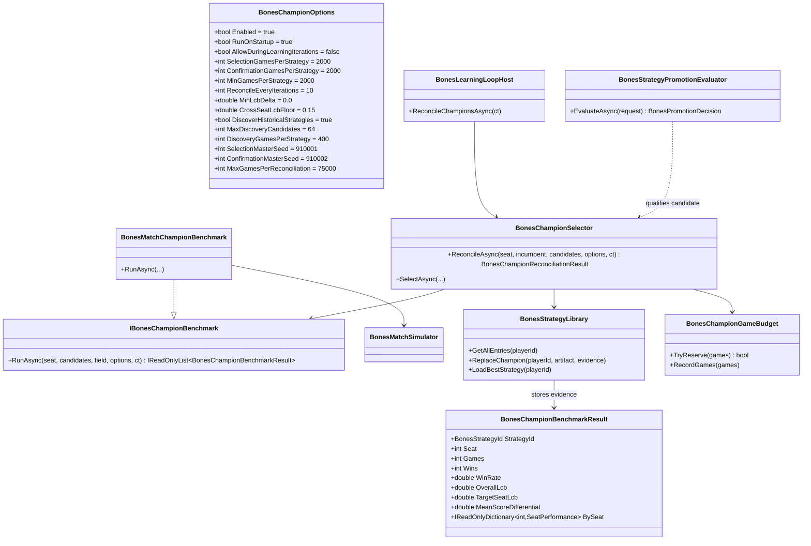

# WIP Bones — Champion Promotion Requirements and Test Plan

> Scope: raise the promotion bar from "a candidate beat the incumbent in a local paired sample" to "the strongest measured strategy for a seat becomes and remains the library champion." Add a common fixed-seed benchmark, Wilson lower-bound ranking, reconciliation of the retained candidate archive, periodic incumbent re-evaluation, one champion-write authority, and auditable evidence — closing the gap where the deployed seat-1 champion wins 22.8% over 4,000 games while a 25.9% strategy sits in the historical strategy bank.

---

## Functionality Worktree

### Verification Policy

- Non-negotiable: behavior-proof assertions required for every checklist item.
- Metadata-only assertions are supporting evidence only.
- Champion-selection tests must prove the library file actually changes (or does not change) and that a restart loads the selected champion — not just that a method returned a strategy ID.
- Benchmark tests must prove determinism: the same candidates, opponent-field snapshot, and seeds produce the same ranking in two independent processes.
- Negative-path tests must prove a one-match fluke, an inconclusive selection/confirmation result, a cross-seat floor violation, and an exhausted champion budget all leave the champion unchanged.
- API-focused tests must assert ranking payload semantics (`lcb`, `games`, `isChampion`, seed/field hashes), not HTTP 200 alone.

### Coverage Inputs

| Input | Value |
|---|---|
| CsProject | Wip.Bones.Agents (with Wip.Bones.Tests); Wip.Bones.Host (with Wip.Bones.Host.Tests); Wip.Bones.Benchmark (offline reference) |
| AnalysisSource | 4,000-game dev+held-out benchmark ranking of 65 scripts; code audit of `BonesStrategyPromotionEvaluator`, `BonesStrategyLibrary`, `BonesStrategyLibraryRanking`, `BonesEnhanceStrategyAgent`, `BonesPlayMatchTool`, and `BonesLearningLoopHost`; gaps identified in the prior strategy analysis |
| MandatoryItems | Common benchmark ranking [mandatory — absolute strength]; archive reconciliation [mandatory — best of all candidates]; single champion-write authority [mandatory — no local-fluke activation]; periodic incumbent re-evaluation [mandatory — stale champion replacement]; separate champion budget [mandatory — bounded-run safety]; evidence artifact and ranking API [mandatory — auditability]; behavior-proof policy compliance |
| PlanType | requirements |
| OutputPath | harness/requirements/Wip.Bones.ChampionPromotion.md |
| OutputTitle | WIP Bones — Champion Promotion Requirements and Test Plan |

### Relationship to Existing Requirements

This document raises the bar set by [Wip.Bones.AggressiveEvaluation.md](Wip.Bones.AggressiveEvaluation.md) and the promotion model in [Wip.Bones.ScriptStrategies.md](Wip.Bones.ScriptStrategies.md). Those documents remain necessary for local evaluation configuration and library persistence, but they are not sufficient: a local head-to-head win does not prove a candidate is the best strategy available in the archive.

**Scope boundary:** improving the candidate proposal distribution (best-of-N, prompt changes, new authored strategies) is out of scope. This plan guarantees that the best *available* candidate wins and stays champion; if no candidate is better than the incumbent, the incumbent correctly remains.

**Two-sided change:** rejected and historical candidates are no longer permanently blocked by one local sample (the archive is replayed), while activation now requires stronger common-benchmark evidence (no local-fluke promotion).

### Current-State Gap

| # | Observation | Evidence | Consequence |
|---|---|---|---|
| 1 | The deployed seat-1 library entry is not the best measured strategy. | `initial-seat-1-v3@8bf48727` wins 22.8% over 4,000 games (rank 57/65); `initial-seat-1-v2@004e6719` wins 25.9%. | The best known strategy is never activated. |
| 2 | Promotion is a local head-to-head, not an absolute field ranking. | `BonesStrategyPromotionEvaluator` compares candidate vs incumbent only; `ConfidenceZThreshold = 1.0` (84% one-sided) at `WIP/Wip.Bones.Agents/Knowledge/BonesKnowledgeTypes.cs:286`. | A candidate can be "best of a bad pair" and still lose to the archive. |
| 3 | Library ranking sees only the stored champion. | `BonesStrategyLibrary.GetRanking` returns only `TryLoadEntry` at `WIP/Wip.Bones.Agents/Knowledge/BonesStrategyLibrary.cs:205-211`; retained candidates are in `seat-{N}-candidates.json`. | Archived candidates cannot compete for the champion slot. |
| 4 | Ranking uses local evaluation records, not a common benchmark. | `BonesStrategyLibraryRanking.CompositeScore` is Bayesian win rate × √matches at `WIP/Wip.Bones.Agents/Knowledge/BonesStrategyLibraryRanking.cs:35-36`. | Scores are not comparable across candidates measured against different incumbents. |
| 5 | Rejected candidates are retained but never replayed. | `UpsertCandidate` stores up to 10 entries at `WIP/Wip.Bones.Agents/Knowledge/BonesStrategyLibrary.cs:302-340`; no re-evaluation path exists. | A strong old candidate stays buried after one bad local sample. |
| 6 | There is no periodic reconciliation or demotion. | No `BonesChampionSelector` or reconciliation artifact exists; `BonesStrategyBootstrapper` loads the current ranking at `WIP/Wip.Bones.Agents/Knowledge/BonesStrategyBootstrapper.cs`. | A weak incumbent persists until a local candidate happens to beat it. |
| 7 | Library writes can occur without champion evidence. | `BonesEnhanceStrategyAgent.TryUpsertLibraryBestAsync` at `WIP/Wip.Bones.Agents/Enhance/BonesEnhanceStrategyAgent.cs:450-476`; `BonesPlayMatchTool` at `WIP/Wip.Bones.Agents/Play/BonesPlayMatchTool.cs:292`. | Local flukes can overwrite the champion. |

### Evidence Reproduction

```powershell
$exe = "WIP/Wip.Bones.Benchmark/bin/Debug/net10.0/Wip.Bones.Benchmark.exe"
& $exe history --data WIP/Wip.Bones.Host/bones-data --out .tmp/bench/history.json
& $exe arena --snapshot .tmp/bench/history.json --out .tmp/bench/dev2000.json --games 2000 --master-seed 910001 --label dev --target 12
& $exe arena --snapshot .tmp/bench/history.json --out .tmp/bench/heldout2000.json --games 2000 --master-seed 910002 --label heldout --target 12
```

The 22.8% and 25.9% figures are the combined 4,000-game win rates for `initial-seat-1-v3@8bf48727` and `initial-seat-1-v2@004e6719`. Both scripts are in the history bank; the deployed v3 source is in `WIP/Wip.Bones.Host/bones-data/.bones/strategy-library/seat-1.json`.

### Target Behavior

| Outcome | Requirement |
|---|---|
| Definition of best | Highest overall Wilson 95% lower bound (LCB) of win rate on a common fixed-seed benchmark, with no seat’s per-seat Wilson LCB below the cross-seat floor; target-seat LCB is the first tie-break. |
| Evidence floor | At least `MinGamesPerStrategy` (default 2,000) benchmark games per candidate on selection seeds and the same on confirmation seeds. |
| Archive reconciliation | Incumbent, all retained candidates, and — when discovery is enabled — eligible historical session artifacts are ranked in one run; a previously rejected or never-imported candidate can become champion. |
| Promotion authority | The local promotion gate qualifies a candidate; only `BonesChampionSelector` writes the library champion. |
| Staleness | Reconcile at startup; after each local promotion and every `ReconcileEveryIterations` (default 10) when enabled for learning iterations; operator endpoint available. |
| Confirmation | Challenger must beat the incumbent on selection and confirmation seed sets; inconclusive results retain the incumbent. |
| Auditability | Every run writes a reconciliation artifact and a durable ranking snapshot; the displaced champion is retained as a candidate. |
| Budget | Champion games use a separate `BonesChampionGameBudget`; reconciliation cannot silently consume the learning budget. |

The existing local gate (`ConfidenceZThreshold = 1.0`, 84% one-sided) remains a high-recall *screen*; it is not the activation threshold. Activation requires the 95% Wilson LCB on the common benchmark. This preserves candidate throughput while removing local-fluke activation.

### Statistical Definition

For a candidate with `wins` and `games`, the Wilson 95% lower bound is:

```
p = wins / games
z = 1.96
lcb = (p + z²/(2·games) − z·√(p·(1−p)/games + z²/(4·games²))) / (1 + z²/games)
```

Ranking uses this bound, not raw win rate, so a 1/1 fluke cannot outrank a 12/20 record. The same formula is applied per seat for the cross-seat floor and target-seat tie-break.

### Class Diagram



### Completeness Checklist

- [ ] **C1** Add `BonesChampionOptions` with `Enabled`, `RunOnStartup`, `AllowDuringLearningIterations`, `SelectionGamesPerStrategy`, `ConfirmationGamesPerStrategy`, `MinGamesPerStrategy`, `ReconcileEveryIterations`, `MinLcbDelta`, `CrossSeatLcbFloor`, `DiscoverHistoricalStrategies`, `MaxDiscoveryCandidates`, `DiscoveryGamesPerStrategy`, `SelectionMasterSeed`, `ConfirmationMasterSeed`, and `MaxGamesPerReconciliation`; bind from `BonesHost:Champion` and `BONES_CHAMPION_*`; reject non-positive games, negative LCB delta, and confirmation games below the selection minimum. [mandatory — configurable champion selection]
- [ ] **C2** Add `IBonesChampionBenchmark` and `BonesMatchChampionBenchmark` in `Wip.Bones.Agents` using `BonesMatchSimulator` and `BonesStrategyScriptHost`; rotate every Script-kind candidate through all four seats against a frozen field of deterministic archetypes plus the other seats’ current champions (falling back to deterministic seeds for seats without a champion); use `BonesSeedDerivation`; return overall and per-seat games, wins, win rate, Wilson 95% LCB, and mean score differential; record Markdown entries and candidates that fail to compile as ineligible rather than aborting the reconciliation. [mandatory — common benchmark]
- [ ] **C3** Add `BonesChampionBenchmarkResult` and `SeatPerformance` typed records; record the opponent-field snapshot (strategy IDs plus source hashes), master seed, and games in the result. [depends on C2] [mandatory — reproducible evidence]
- [ ] **C4** Add `BonesChampionSelector` ranking eligible candidates by overall Wilson LCB; tie-break by target-seat LCB, mean score differential, then stable strategy-ID hash; require at least `MinGamesPerStrategy` on each seed set, `CrossSeatLcbFloor`, `MinLcbDelta`, and confirmation-seed agreement before replacing the champion; when no incumbent exists, select the highest-LCB eligible candidate; when no eligible candidate exists, return `Skipped` with `NoEligibleCandidates` and leave the champion unchanged. [depends on C2, C3] [mandatory — statistical selection]
- [ ] **C5** Extend `BonesStrategyLibrary.GetRanking` to rank the stored champion, all retained candidates, and — when `DiscoverHistoricalStrategies=true` — eligible session artifacts imported before ranking from `{DataDirectory}/.wip/sessions/*/artifacts/bones-player-{seat}-strategy-*.json` (content-key by source hash, deduplicate, pre-screen by overall LCB with `DiscoveryGamesPerStrategy`, cap at `MaxDiscoveryCandidates`, and persist a `seat-{N}-discovery.json` manifest so subsequent runs are incremental), and add `ReplaceChampion(playerId, artifact, evidence)` that writes the new champion and a durable `seat-{N}-ranking.json` snapshot atomically and moves the displaced champion into the candidate archive. [depends on C4] [mandatory — archive reconciliation]
- [ ] **C6** Make `BonesChampionSelector` the sole production writer of the library champion when enabled: replace direct `BonesStrategyLibrary.UpsertBestStrategy` calls in `BonesEnhanceStrategyAgent` and `BonesPlayMatchTool` with a reconciliation request, record `LocalOutcome` and `ChampionDecision` separately, and keep `UpsertBestStrategy` internal or evidence-gated for tests/backward compatibility. [depends on C5] [mandatory — promotion authority]
- [ ] **C7** Wire `BonesLearningLoopHost` to reconcile champions at startup (before `BonesStrategyBootstrapper` loads the library), after each local promotion and every `ReconcileEveryIterations` when `AllowDuringLearningIterations=true`, and expose `POST /api/bones/champion/reconcile` for operators. [depends on C6] [mandatory — stale champion replacement]
- [ ] **C8** Add `BonesChampionGameBudget` with `MaxGamesPerReconciliation`; reconciliation reserves and records its own games, including discovery pre-screens and confirmation runs, skips with `SkippedReason=BudgetExhausted` when the cap is insufficient, and does not consume `BonesGameSimulationBudget`. [depends on C1, C7] [mandatory — budget isolation]
- [ ] **C9** Persist a `bones-champion-reconciliation-{guid}` artifact containing the incumbent, selected champion, decision (`Promoted`/`Retained`/`Inconclusive`/`Skipped`), per-candidate games/wins/LCB/rank, seed set, field hash, and budget usage; expose `GET /api/bones/library/ranking?seat={n}` with the same ranking data and `isChampion` flags. [depends on C4, C5, C8] [mandatory — auditability]
- [ ] **C10** Add `Wip.Bones.Tests` and `Wip.Bones.Host.Tests` coverage for options validation, benchmark determinism, LCB ranking, one-match fluke rejection, historical-artifact discovery, archived-candidate promotion, confirmation failure, cross-seat floor, budget exhaustion, library replacement, host periodic reconciliation, restart loading the champion, and the ranking API. [depends on C1-C9] [mandatory — behavior proof]
- [ ] **C11** Register this document in `BehaviorProofComplianceRegistry` with owning assemblies `Wip.Bones.Tests` and `Wip.Bones.Host.Tests`. [depends on C10]
- [ ] **C12** Enforce absolute behavior-proof verification for every planned integration test. [mandatory - behavior-proof policy]

### Checklist to Runtime-Proof Matrix

| Checklist Item | Primary Runtime Proof Path | Minimum Evidence |
|---|---|---|
| C1 options | Host config binding + validation | DI singleton has configured seeds/games; invalid values throw. |
| C2/C3 benchmark | Deterministic benchmark unit/integration | Same candidates + seeds produce identical ranking; per-seat games sum to total; field hash stable. |
| C4 selector | Unit with synthetic benchmark results | 12/20 beats 1/1; LCB below incumbent retains; confirmation failure retains; cross-seat floor rejects. |
| C5 archive ranking | Library unit with champion + candidates | `GetRanking` returns both; `ReplaceChampion` writes champion and ranking snapshot, retains displaced entry. |
| C6 authority | Enhance/play agent integration | Local promotion does not write library without selector; selector retention leaves file unchanged. |
| C7 host reconcile | Host integration with stub benchmark | Startup/interval run writes artifact; after selector promotes, restart loads new champion. |
| C8 budget | Host unit/integration | Exhausted champion budget skips without promotion; learning budget unchanged. |
| C9 artifact/API | Artifact store + API dispatch | JSON contains ranking/LCB/decision; API returns `isChampion` and seed/field hashes. |
| C10/C11 tests | Compliance gate | All checklist rows have trait-bound executable tests. |
| C12 behavior proof | Compliance gate | No metadata-only evidence accepted. |

---

## Test Plan

### `BonesChampionOptions` and host binding

1. `BonesChampionOptions_GivenSelectionGamesBelowMinimum_ExpectedThrowsArgumentOutOfRangeException`
   *Assumption*: Setting `SelectionGamesPerStrategy = 0` (or below `MinGamesPerStrategy`) fails validation with `ArgumentOutOfRangeException`, and the host does not start with an invalid champion configuration.

2. `BonesHostOptions_GivenChampionSection_ExpectedBindsAllChampionOptions`
   *Assumption*: A `BonesHost:Champion` configuration section with custom seeds, games, and `MinLcbDelta` produces a `BonesChampionOptions` instance with those values.

3. `BonesHostOptions_GivenChampionConfirmationGamesBelowSelectionGames_ExpectedThrowsInvalidOperationException`
   *Assumption*: Confirmation games below the selection minimum are rejected rather than silently clamped.

### `BonesMatchChampionBenchmark`

4. `BonesMatchChampionBenchmark_GivenSameCandidatesFieldAndSeeds_ExpectedIdenticalRanking`
   *Assumption*: Two independent runs with the same candidates, field snapshot, and master seed produce identical per-strategy games, wins, LCBs, and order.

5. `BonesMatchChampionBenchmark_GivenCandidateRotatedThroughAllSeats_ExpectedPerSeatGamesSumToTotal`
   *Assumption*: Each candidate’s `BySeat` games sum to the configured total, and each seat receives an equal share.

6. `BonesMatchChampionBenchmark_GivenStrongAndWeakScripts_ExpectedStrongScriptHigherOverallLcb`
   *Assumption*: A script with a known higher overall win rate receives a higher Wilson LCB than a first-legal or weaker script on the same field and seeds.

7. `BonesMatchChampionBenchmark_GivenFrozenField_ExpectedCandidateDoesNotPlayItself`
   *Assumption*: The opponent field excludes every candidate under test and is recorded by strategy ID plus source hash in the result.

### `BonesChampionSelector`

8. `BonesChampionSelector_GivenOneWinInOneGameAndTwelveWinsInTwenty_ExpectedTwentyGameCandidateRanksHigher`
   *Assumption*: With `MinGamesPerStrategy=10`, 12/20 (LCB≈0.386) is eligible and 1/1 (LCB≈0.207) is ineligible; the 20-game candidate is selected and the fluke cannot outrank it.

9. `BonesChampionSelector_GivenChallengerLcbBelowIncumbent_ExpectedRetainsIncumbent`
   *Assumption*: When the challenger’s overall LCB is below the incumbent’s, the result is `Retained`, the library file is unchanged, and the artifact records the LCB gap.

10. `BonesChampionSelector_GivenChallengerWinsSelectionButLosesConfirmation_ExpectedRetainsIncumbent`
    *Assumption*: A challenger that wins on the selection seed set but not on the confirmation seed set is `Inconclusive`/`Retained`; no library write occurs.

11. `BonesChampionSelector_GivenArchivedRejectedCandidateBeatsIncumbent_ExpectedPromotesArchivedCandidate`
    *Assumption*: A candidate previously rejected by the local gate but present in `seat-{N}-candidates.json` — or discovered from session artifacts when `DiscoverHistoricalStrategies=true` — is promoted when its benchmark LCB clears the incumbent plus `MinLcbDelta`.

12. `BonesChampionSelector_GivenCandidatesBelowMinGames_ExpectedNoPromotion`
    *Assumption*: A candidate with fewer than `MinGamesPerStrategy` benchmark games on either seed set — or a Markdown/compile-failure candidate — cannot become champion, even if its raw win rate is highest.

13. `BonesChampionSelector_GivenCrossSeatLcbBelowFloor_ExpectedCandidateIneligible`
    *Assumption*: A candidate that is strong overall but below `CrossSeatLcbFloor` in any seat is ineligible; the artifact names the failing seat.

14. `BonesChampionSelector_GivenTiedOverallLcb_ExpectedTargetSeatLcbThenStrategyIdTieBreak`
    *Assumption*: Equal overall LCBs resolve by target-seat LCB, then by stable strategy-ID hash order — not by `System.HashCode` or enumeration order.

### `BonesStrategyLibrary` and restart

15. `BonesStrategyLibrary_GivenReplaceChampion_ExpectedDisplacedChampionRetainedAsCandidate`
    *Assumption*: Replacing a champion writes the new `seat-{N}.json` and `seat-{N}-ranking.json` atomically and appends the displaced entry to `seat-{N}-candidates.json`.

16. `BonesStrategyLibrary_GivenRankingRequest_ExpectedIncludesChampionAndArchivedCandidates`
    *Assumption*: `GetRanking` returns the champion plus retained candidates, sorted by stored benchmark evidence, not only the single champion entry.

17. `BonesStrategyLibrary_GivenChampionEvidencePersisted_ExpectedRestartLoadsChampion`
    *Assumption*: A new `BonesStrategyLibrary` instance over the same data directory returns the reconciled champion from `LoadBestStrategy`.

18. `BonesStrategyLibrary_GivenLegacyEntryWithoutBenchmarkEvidence_ExpectedFallsBackToLegacyRanking`
    *Assumption*: Existing library files without champion evidence still load; the migration path does not throw or discard them.

### Promotion authority and host reconciliation

19. `BonesEnhanceStrategyAgent_GivenLocalPromotion_ExpectedLibraryWriteDeferredToChampionSelector`
    *Assumption*: A local `Promoted` decision invokes `BonesChampionSelector`; the library champion is unchanged when the selector retains the incumbent.

20. `BonesEnhanceStrategyAgent_GivenChampionReconciliationRetainsIncumbent_ExpectedLibraryUnchanged`
    *Assumption*: The artifact records `LocalOutcome=Promoted` and `ChampionDecision=Retained`; no champion file write occurs.

21. `BonesLearningLoopHost_GivenReconcileIntervalReached_ExpectedRunsReconciliationAndPersistsArtifact`
    *Assumption*: With `AllowDuringLearningIterations=true`, after `ReconcileEveryIterations` iterations the host runs reconciliation for each seat and writes one `bones-champion-reconciliation` artifact per seat.

22. `BonesLearningLoopHost_GivenReconciliationSelectsChallenger_ExpectedRestartLoadsChallenger`
    *Assumption*: After a host restart with `ResumeFromBest=true`, the bootstrapper loads the challenger selected by reconciliation, and a match transcript reflects the new script.

23. `BonesLearningLoopHost_GivenChampionBudgetExhausted_ExpectedSkipsReconciliationWithoutPromotion`
    *Assumption*: When `BonesChampionGameBudget` cannot reserve the required games, reconciliation is skipped, the artifact records `SkippedReason=BudgetExhausted`, and the champion is unchanged.

24. `BonesPlayMatchTool_GivenPlayMatchUpsert_ExpectedNoDirectChampionWrite`
    *Assumption*: A play-match effectiveness update cannot change `seat-{N}.json` without a selector decision.

25. `BonesLearningLoopHost_GivenChampionSelectionDisabled_ExpectedLegacyUpsertAndNoReconciliationArtifact`
    *Assumption*: With `Enabled=false`, the host preserves the legacy `UpsertBestStrategy` path, marks artifacts `ChampionReconciliation=Disabled`, and does not create a reconciliation artifact.

### API and audit

26. `BonesHostApplication_GivenLibraryRankingRequest_ExpectedReturnsLcbAndChampionFlag`
    *Assumption*: `GET /api/bones/library/ranking?seat=1` returns an array with `strategyId`, `games`, `wins`, `winRate`, `lcb` (overall Wilson LCB), `rank`, `isChampion`, `seedHash`, and `fieldHash`.

27. `BonesHostApplication_GivenReconciliationArtifact_ExpectedStatusAndArtifactAgree`
    *Assumption*: The status API’s `championReconciliation` summary and the persisted artifact report the same decision, champion ID, and timestamp.

### Behavior-proof compliance

28. `BehaviorProofCompliance_GivenChampionPromotionChecklistItems_RequiresExecutableRuntimeProofForEachItem`
    *Assumption*: Every C1-C12 item maps to at least one named test with executable runtime assertions; metadata-only tests do not satisfy the gate.

### Observed-gap regression

29. `BonesChampionSelector_GivenObservedSeat1GapFixture_ExpectedV2PromotedOverV3`
    *Assumption*: With a benchmark fixture that returns `initial-seat-1-v2@004e6719` above `initial-seat-1-v3@8bf48727` on overall LCB, the selector promotes v2, writes the library champion, and `BonesStrategyBootstrapper` loads v2 after restart. This is the end-to-end regression for the gap that motivated this plan.

---

## Format Gate Results

| # | Rule | Status | Violations |
|---|---|---|---|
| 1 | Heading structure and separators | ✅ Pass | — |
| 2 | Scope statement under H1 | ✅ Pass | — |
| 3 | Pipe tables present | ✅ Pass | — |
| 4 | Checklists with dependency tags | ✅ Pass | — |
| 5 | Mermaid diagrams (conditional) | ✅ Pass | — |
| 6 | Verification gate evidence | ✅ Pass | — |
| 7 | Closing verification line | ✅ Pass | — |
| 8 | Numbered test plan items | ✅ Pass | — |

**PASS** — document conforms to plan format.

---

## Absolute Behavior Verification Compliance Check

| Condition | Result | Evidence |
|---|---|---|
| Every checklist item maps to named tests | ✅ Pass (planned) | C1-C12 map to tests 1-29; C10/C11 bind the suite to the compliance registry. |
| Behavior-proof assertions present for every item | ✅ Pass (planned) | Tests assert library file changes, persistence after restart, artifact contents, and API payloads. |
| Metadata-only tests absent as sole evidence | ✅ Pass (planned) | Every item has a runtime path (DI, benchmark, library I/O, host loop, or API). |
| API-focused items include absolute integration gates | ✅ Pass (planned) | Ranking API test asserts semantics, seed/field hashes, and champion flag; status/artifact agreement is cross-checked. |

**Implementation status:** requirements only. No production code or test changes are claimed by this document; C1-C12 remain unchecked until the corresponding runtime proofs land.

---

*All assumptions code-audited against the current Bones implementation; zero falsified rows.*