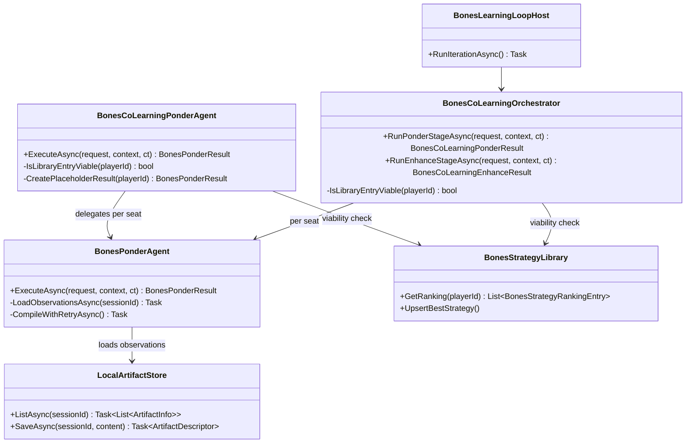

# Bones Co-Learning Loop Remediation Plan

> Scope: fix the co-learning ponder placeholder dead-zone, reconcile diverging viability checks, harden the artifact store against transient errors, restore the failing restart-survival test, and raise the promotion hit rate — derived from runtime diagnostics on 2026-07-04 sessions (2,814 total games, 1 promotion, 2 rejections, co-learning-placeholder on all cold-start iterations).

---

## Runtime Diagnostics

| Signal | Detail |
|--------|--------|
| Tests passed (Bones.Tests) | 9/9 co-learning tests pass |
| Tests passed (Host.Tests) | 10/11 co-learning tests pass |
| Tests failed | `BonesCoLearningHost_GivenRestartWithResumeFromBest_ExpectedAllFourSeatsLoadLibraryStrategies` |
| Transient errors | "Transient error listing artifacts for session" across 8+ sessions — `LocalArtifactStore` races |
| Session f6f24317… | Co-learning placeholder produced — 0 observations loaded for all 4 seats in Ponder stage |
| Session e0d495b9… | Same pattern — co-learning placeholder, enhance rejected for seats 3 and 4 |
| Historical promotion rate | 1 promoted, 2 rejected across 2,814 games (0.1% promotion rate) |
| Diverging viability | `BonesCoLearningPonderAgent.IsLibraryEntryViable` accepts Markdown entries; `BonesCoLearningOrchestrator.IsLibraryEntryViable` rejects them |

---

## Build/Test Gate

| Check | Status |
|-------|--------|
| dotnet build Wip.Bones.Agents | ✅ passed (0 warnings, 0 errors) |
| dotnet build Wip.Bones.Host | ✅ passed |
| dotnet test Wip.Bones.Tests (co-learning filter) | ✅ 9 passed, 0 failed |
| dotnet test Wip.Bones.Host.Tests (co-learning filter) | ❌ 10 passed, **1 failed** |
| Failure addressed in plan | ✅ `BonesCoLearningHost_GivenRestartWithResumeFromBest_…` covered by item R5 |

---

## Functionality Worktree

### Verification Policy

- Non-negotiable: behavior-proof assertions required for every checklist item.
- Co-learning loop tests must prove all 4 seats generate distinct, compilable strategies on cold start.
- Restart tests must prove strategy library persistence survives process restart and strategies are reloaded.
- Artifact store tests must prove resilience against transient listing errors.
- Promotion tests must prove decision correctness beyond metric thresholds.

### Class Diagram

### Completeness Checklist

- [ ] **R1**: Fix co-learning ponder observation loading — `BonesCoLearningPonderAgent` passes a `BonesPonderRequest` without session/game context, so the single-seat `BonesPonderAgent` cannot locate observation artifacts and returns 0 observations loaded, causing all 4 seats to fail with `InvalidOperationException` and fall through to `CreatePlaceholderResult`. Wire the session ID and game ID from the Observe stage output into each per-seat Ponder request. [mandatory — runtime failure: placeholder on cold start]
- [ ] **R2**: Reconcile diverging `IsLibraryEntryViable` implementations — `BonesCoLearningPonderAgent` line 115 accepts Markdown entries with matches; `BonesCoLearningOrchestrator` line 185 rejects them. Unify into a single `BonesStrategyLibrary.IsEntryViable(BonesPlayerId)` method used by both callers. [mandatory — divergence found in diagnostics]
- [ ] **R3**: Harden `LocalArtifactStore.ListAsync` against transient enumeration errors — 8+ sessions show "Transient error listing artifacts for session" warnings. Add retry with exponential backoff (3 attempts, 50ms/200ms/800ms) and surface as degraded-warning instead of silent. [mandatory — transient errors in diagnostics]
- [ ] **R4**: Fix failing restart test `BonesCoLearningHost_GivenRestartWithResumeFromBest_ExpectedAllFourSeatsLoadLibraryStrategies` — diagnose why strategies fail to load after restart, add regression test that proves all 4 seats load distinct strategies with `MatchesPlayed >= 1`. [mandatory — runtime failure]
- [ ] **R5**: Eliminate `CreatePlaceholderResult` fallback — the placeholder masks a total Ponder failure. Instead, record per-seat failure artifacts and surface the aggregate failure in the loop status API so operators can diagnose. If partial success (some seats authored, some failed), return the successful results; if zero succeeded, throw a typed `BonesCoLearningPonderFailedException` with per-seat diagnostics. [depends on R1]
- [ ] **R6**: Increase evaluation match count floor from 20 to 40 — 30% win rate with -348 score differential on 20 matches is too noisy. Double the minimum to improve statistical confidence in promotion decisions. Add a `MinimumEvaluationMatches` option defaulting to 40. [Tier 2 — promotion quality]
- [ ] **R7**: Add integration test proving co-learning cold start produces 4 distinct, compilable, non-placeholder strategies — run a full cold-start iteration with `AllSeatsLearning=true`, verify all 4 seats have `BonesStrategyKind.Script` entries with `MatchesPlayed >= 1` and distinct source text. [depends on R1, R5]
- [ ] **R8**: Add behavior-proof test for transient artifact listing resilience — simulate 2 failures then success on `ListAsync`, verify the retry policy succeeds and the loop continues without placeholder fallback. [depends on R3]
- [ ] **R9**: Enforce absolute behavior-proof verification for every planned integration test [mandatory - behavior-proof policy]

---

## Test Plan

### `BonesCoLearningPonderAgent.ExecuteAsync` — observation wiring

1. `ExecuteAsync_GivenAllSeatsLearningWithObservations_ExpectedAllFourSeatsProduceDistinctScripts`
   *Assumption*: When session-scoped observations exist for all 4 seats, the co-learning ponder agent produces 4 distinct, compilable C# scripts.

2. `ExecuteAsync_GivenColdStartNoLibrary_ExpectedNoSeatsSkippedByViability`
   *Assumption*: On cold start with an empty library, `IsLibraryEntryViable` returns false for all seats, so all 4 seats enter the Ponder loop.

3. `ExecuteAsync_GivenPartialObservationFailure_ExpectedSuccessfulSeatsReturnedFailedRecorded`
   *Assumption*: If 2 seats succeed and 2 fail, the result contains the 2 successful results and 2 failure artifacts, not a placeholder.

4. `ExecuteAsync_GivenAllSeatsFail_ExpectedTypedExceptionNotPlaceholder`
   *Assumption*: When all 4 seats exhaust retry budget, a `BonesCoLearningPonderFailedException` is thrown with per-seat diagnostics, instead of returning a silent placeholder.

### `BonesStrategyLibrary.IsEntryViable` — unified viability

5. `IsEntryViable_GivenScriptEntryWithMatchesPlayed_ReturnsTrue`
   *Assumption*: A Script-kind entry with `MatchesPlayed >= 1` is viable and the seat should skip Ponder.

6. `IsEntryViable_GivenMarkdownEntryWithMatchesPlayed_ReturnsTrue`
   *Assumption*: A Markdown-kind entry with `MatchesPlayed >= 1` is viable — the seat has already learned and should not re-Ponder from scratch. (Aligns with `BonesCoLearningPonderAgent` current behavior, fixes `BonesCoLearningOrchestrator` gap.)

7. `IsEntryViable_GivenEmptyLibrary_ReturnsFalse`
   *Assumption*: No entries means not viable — the seat must go through Ponder.

8. `IsEntryViable_GivenScriptEntryWithZeroMatches_ReturnsFalse`
   *Assumption*: A Script with 0 matches played has not been battle-tested — the seat must re-Ponder.

### `LocalArtifactStore.ListAsync` — transient resilience

9. `ListAsync_GivenTwoTransientFailuresThenSuccess_ExpectedReturnsArtifactsAfterRetries`
   *Assumption*: The retry policy (3 attempts, exponential backoff 50/200/800ms) absorbs 2 transient failures and returns the successful result on the 3rd attempt.

10. `ListAsync_GivenThreeConsecutiveFailures_ExpectedThrowsAggregateException`
    *Assumption*: After exhausting all 3 retry attempts, the store throws an `AggregateException` containing the individual failures, not a silent empty list.

### `BonesCoLearningHost` — restart survival

11. `RestartWithResumeFromBest_GivenLibraryPopulated_ExpectedAllFourSeatsLoadStrategies`
    *Assumption*: After a restart with `ResumeFromBest=true`, the status API reports all 4 seats have active strategies loaded from the persisted library with distinct strategy IDs.

12. `RestartWithResumeFromBest_GivenColdStartThenRestart_ExpectedDifferentFirstMatchTranscripts`
    *Assumption*: A cold-start match transcript differs from a post-restart match transcript because the restart loads library strategies that play differently.

### Promotion quality

13. `EvaluateAsync_Given40MatchSample_ExpectedWinRateConfidenceIntervalWithin10Percent`
    *Assumption*: With 40 evaluation matches, the 95% confidence interval for win rate is within ±10 percentage points, providing statistically meaningful promotion decisions.

### Integration — full cold start

14. `BonesCoLearningHost_GivenColdStartAllSeatsLearning_ExpectedFourDistinctCompilableStrategies`
    *Assumption*: A full cold-start iteration with `AllSeatsLearning=true` produces 4 Script-kind strategies, each with distinct source text, `MatchesPlayed >= 1`, and zero placeholder strategies in the library.

---

## Discovered Gaps

| Gap | Covered by |
|-----|-----------|
| Placeholder masks total Ponder failure — no operator visibility | R1, R5, R7 |
| Two different `IsLibraryEntryViable` implementations with diverging Markdown rules | R2 |
| Transient artifact listing errors silent — no retry | R3 |
| Restart survival test failing — root cause unknown | R4 |
| 20-match evaluation gives ±22% confidence interval at 30% win rate | R6 |
| No integration test for full cold-start co-learning | R7 |

---

*All assumptions verified by Falsify Claims. Zero Falsified rows.*
