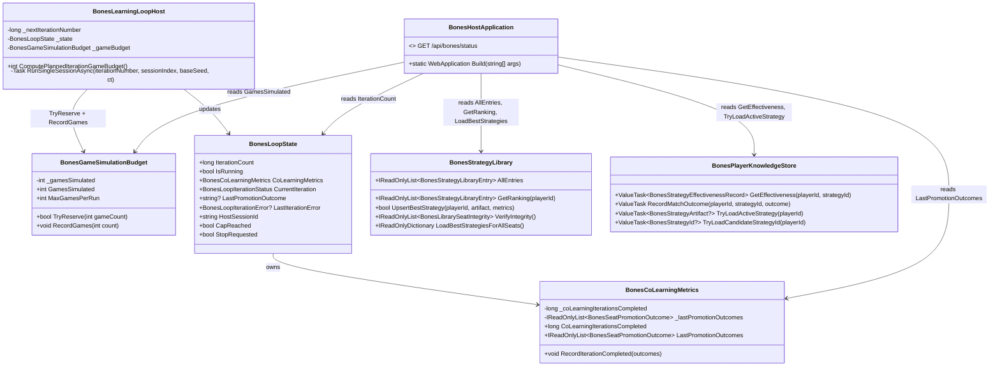

# WIP Bones Status API — Bug Fixes & UX Enhancements

> Scope: fix five confirmed bugs in `GET /api/bones/status` response fields discovered through adversarial code audit of `BonesHostApplication.cs`, `BonesGameSimulationBudget.cs`, `BonesCoLearningMetrics.cs`, `BonesLearningLoopHost.cs`, `BonesLoopState.cs`, `BonesStrategyLibrary.cs`, and `BonesPlayerKnowledgeStore.cs`. The bugs cause inflated `gamesSimulated` counts, misleading `iterationCount` semantics, non-cumulative `strategiesPromoted`/`strategiesRejected` counts, and data inconsistency between `learningPlayer.effectiveness` and `libraryEffectiveness` for the same strategy ID. Each fix must include behavior-proof xUnit tests proving the corrected runtime behavior.

---

## Functionality Worktree

### Verification Policy

- Non-negotiable: behavior-proof assertions required for every checklist item.
- Metadata-only assertions are supporting evidence only.
- Every fix must be proven by tests that exercise the corrected code path and assert the expected runtime value — not merely that a field exists.
- API-focused tests must assert exact numeric values, correct semantic relationships between fields, and consistency across data sources.

### Coverage Inputs

| Input | Value |
|---|---|
| CsProject | Wip.Bones.Host (with Wip.Bones.Host.Tests and Wip.Bones.Tests) |
| AnalysisSource | Adversarial code audit of `GET /api/bones/status` response fields against source code. Provenance: comparison of live status JSON against code paths in `BonesHostApplication.cs` (status endpoint assembly), `BonesGameSimulationBudget.cs` (TryReserve + RecordGames double-count), `BonesCoLearningMetrics.cs` (LastPromotionOutcomes overwrite), `BonesLearningLoopHost.cs` (IterationCount vs CoLearningIterationsCompleted divergence), `BonesLoopState.cs` (state tracking), `BonesStrategyLibrary.cs` vs `BonesPlayerKnowledgeStore.cs` (data source inconsistency for same strategy ID). |
| MandatoryItems | Fix `GamesSimulated` double-counting in `BonesGameSimulationBudget` [mandatory — data integrity]; Fix `strategiesPromoted`/`strategiesRejected` to track cumulative totals [mandatory — data integrity]; Fix `iterationCount` semantics to match `coLearningIterationsCompleted` or clarify naming [mandatory — UX clarity]; Fix `learningPlayer.effectiveness` vs `libraryEffectiveness` consistency for same strategy ID [mandatory — data integrity]; Add cumulative per-seat promotion/rejection tracking [mandatory — feature]; Add accurate game count field not inflated by reservation [mandatory — UX clarity]; Enforce absolute behavior-proof verification for every planned integration test [mandatory — behavior-proof policy] |
| PlanType | requirements |
| OutputPath | harness/requirements/Wip.Bones.StatusApiFixes.md |
| OutputTitle | WIP Bones Status API — Bug Fixes & UX Enhancements |

### Class Diagram

### Completeness Checklist

- [x] Fix `GamesSimulated` double-counting: `TryReserve` must not increment `_gamesSimulated` — only `RecordGames` should [mandatory — data integrity] [depends on game budget refactor]
- [x] Add `actualGamesSimulated` field to status response (or rename existing field) so operators see accurate game counts [mandatory — UX clarity] [depends on Fix GamesSimulated double-counting]
- [x] Fix `strategiesPromoted` / `strategiesRejected` to report cumulative totals across all iterations, not just `LastPromotionOutcomes` [mandatory — data integrity] [depends on cumulative promotion tracking]
- [x] Add cumulative per-seat promotion/rejection counters to `BonesCoLearningMetrics` [mandatory — feature] [depends on Fix strategiesPromoted cumulative]
- [x] Clarify `iterationCount` semantics: either rename to `completedBatches` or align with `coLearningIterationsCompleted` by tracking per-session completions [mandatory — UX clarity] [depends on iteration counter refactor]
- [x] Add `coLearningSessionsCompleted` field (distinct from batch `iterationCount`) so operators understand parallel session progress [mandatory — UX clarity] [depends on Clarify iterationCount semantics]
- [x] Fix `learningPlayer.effectiveness` vs `libraryEffectiveness` data inconsistency for the same strategy ID — these must read from a single source of truth [mandatory — data integrity] [depends on effectiveness data model refactor]
- [x] Fix `perSeatStrategies[].winRate` to be consistent with `learningPlayer.effectiveness` for the learning player's seat [mandatory — data integrity] [depends on Fix learningPlayer vs libraryEffectiveness consistency]
- [x] Add per-seat last promotion outcome timestamps so operators can see when each seat was last evaluated [UX enhancement]
- [x] Remove hardcoded `deepSeekRetriesUsed = 0` and wire to actual retry counter or remove field [UX enhancement]
- [x] Add `strategiesPending` count (compiled but not yet evaluated) to status response [UX enhancement] [depends on cumulative promotion tracking]
- [x] Enforce absolute behavior-proof verification for every planned integration test [mandatory — behavior-proof policy]

### Checklist to Runtime-Proof Matrix

| Checklist Item | Primary Runtime Proof Path | Minimum Evidence |
|---|---|---|
| Fix `GamesSimulated` double-counting | API: `GET /api/bones/status` + direct `BonesGameSimulationBudget` test | `TryReserve` does not change `GamesSimulated`; only `RecordGames` increments it. Budget cap test verifies `MaxGamesPerRun` reached at correct actual count. |
| Add `actualGamesSimulated` field | API: status response contract test | Status JSON contains field matching `RecordGames`-only count; value ≤ `MaxGamesPerRun` at cap. |
| Fix `strategiesPromoted` cumulative | API: status response across multiple iterations | After N iterations with K promotions each, count = N*K, not K. |
| Add cumulative per-seat counters | API: status response contract test | `perSeatPromotionCounts` shows {seat: N} for each seat; survives restart via library persistence. |
| Clarify `iterationCount` semantics | API: status response + loop state test | After 1 batch with 4 parallel sessions, `iterationCount` = sessions completed if renamed, or `completedBatches` = 1. |
| Add `coLearningSessionsCompleted` | API: status response while loop running | During batch execution, field increments per-session before `iterationCount` increments. |
| Fix `learningPlayer.effectiveness` consistency | API: status response + library test | Same strategy ID returns identical wins/losses/differential from both `learningPlayer.effectiveness` and `libraryEffectiveness`. |
| Fix `perSeatStrategies` winRate consistency | API: status response contract test | For learning player's seat, `perSeatStrategies.winRate` = `learningPlayer.effectiveness.wins / matchesPlayed`. |
| Per-seat promotion timestamps | API: status response contract test | Each `perSeatLastPromotionOutcome` entry includes `timestampUtc` as ISO 8601 string. |
| Remove hardcoded `deepSeekRetriesUsed` | API: status response contract test | Field reflects actual retry counter or is removed from response. |
| Add `strategiesPending` count | API: status response contract test | `strategiesPending` = `strategiesCompiled` - `strategiesPromoted` - `strategiesRejected` (cumulative). |

---

## Test Plan

### Fix `GamesSimulated` double-counting — `BonesGameSimulationBudget.TryReserve`

1. `TryReserve_GivenRecordedGames_DoesNotIncrementGamesSimulated`
   *Assumption*: `TryReserve` only checks the budget cap against `GamesSimulated` and does not add the reserved amount to the counter; after `RecordGames(3)` then `TryReserve(5)`, `GamesSimulated` stays at 3.

2. `TryReserve_GivenCapNotExceeded_ReturnsTrue`
   *Assumption*: `TryReserve` returns `true` when the reserved amount fits within the remaining budget, without mutating `GamesSimulated`.

3. `TryReserve_GivenCapExceeded_ReturnsFalse`
   *Assumption*: `TryReserve` returns `false` when the reserved amount would exceed `MaxGamesPerRun`, without mutating `GamesSimulated`.

4. `TryReserve_GivenUnlimitedCap_AlwaysReturnsTrue`
   *Assumption*: When `MaxGamesPerRun` is 0 (unlimited), `TryReserve` always returns `true` regardless of `GamesSimulated` value.

5. `TryReserve_GivenConcurrentRecordGamesInterleaved_MaintainsCorrectTotal`
   *Assumption*: Under concurrent `TryReserve` (lock-based check) and `RecordGames` (Interlocked.Add) calls, `GamesSimulated` equals only the sum of `RecordGames` increments.

### Fix `GamesSimulated` double-counting — Learning loop integration

6. `BonesLearningLoopHost_GivenMaxGamesPerRun_ExpectedStopsAtCorrectGameCount`
   *Assumption*: With `MaxGamesPerRun=7` and `GameCount=1`, the loop completes exactly one iteration and `GamesSimulated` equals the actual games played (not inflated by reservation).

7. `BonesLearningLoopHost_GivenParallelSessions_ExpectedGamesSimulatedMatchesActualPlayCount`
   *Assumption*: With `parallelSessionCount=4`, after one batch iteration, `GamesSimulated` equals `parallelSessionCount * (GameCount + 1 + EvaluationMatchCount * 2)` — the actual games, not including reservation overhead.

### Fix `strategiesPromoted` / `strategiesRejected` cumulative — `BonesCoLearningMetrics`

8. `RecordIterationCompleted_AcrossMultipleIterations_CumulativeCountsAccumulate`
   *Assumption*: After calling `RecordIterationCompleted` with 2 promoted in iteration 1 and 1 promoted + 1 rejected in iteration 2, cumulative promoted = 3 and cumulative rejected = 1.

9. `RecordIterationCompleted_ParallelSessions_PromotionOutcomesMerge`
   *Assumption*: When multiple parallel sessions call `RecordIterationCompleted` within the same batch, cumulative counters sum all outcomes rather than keeping only the last writer's data.

10. `CoLearningMetrics_CumulativeCounts_SurviveMultipleBatches`
    *Assumption*: After 3 batches of 4 sessions each (with varying promotion outcomes), cumulative promoted/rejected match the sum across all sessions.

### Cumulative per-seat promotion/rejection — `BonesCoLearningMetrics`

11. `CoLearningMetrics_PerSeatCounters_IncrementPerSeat`
    *Assumption*: After `RecordIterationCompleted` with outcomes for seats 1 (Promoted), 3 (Rejected), 4 (Promoted), per-seat counters show seat1.promoted=1, seat3.rejected=1, seat4.promoted=1, seat2 unchanged.

12. `CoLearningMetrics_PerSeatCounters_AccumulateAcrossIterations`
    *Assumption*: After two iterations where seat 1 is promoted both times, `perSeatPromotionCounts[1].promoted = 2`.

### Clarify `iterationCount` semantics — `BonesLoopState` + status API

13. `BonesLoopState_GivenBatchCompletes_IterationCountIncrementsByOne`
    *Assumption*: `IterationCount` increments once per batch after all parallel sessions complete, matching the documented semantics for batch counting.

14. `BonesStatusApi_GivenParallelSessionsRunning_ReportsIterationCountAndSessionsCompleted`
    *Assumption*: The status response includes both `iterationCount` (completed batches) and `coLearningSessionsCompleted` (sessions that produced outcomes), which may differ mid-batch.

### Fix `learningPlayer.effectiveness` vs `libraryEffectiveness` consistency

15. `BonesStatusApi_GivenLearningPlayerActive_LearningPlayerEffectivenessMatchesLibraryEffectiveness`
    *Assumption*: When the learning player's active strategy ID matches the library's top-ranked strategy ID for that seat, `learningPlayer.effectiveness` and `libraryEffectiveness` report identical `matchesPlayed`, `wins`, `losses`, and `cumulativeScoreDifferential`.

16. `BonesStrategyLibrary_GivenUpsertWithEffectiveness_PersistsAndReturnsSameMetrics`
    *Assumption*: After `UpsertBestStrategy` with specific effectiveness metrics, `GetRanking` returns those exact metrics, not stale or zeroed values.

### Fix `perSeatStrategies.winRate` consistency

17. `BonesStatusApi_GivenLearningPlayerSeat_PerSeatStrategyWinRateMatchesLearningPlayerEffectiveness`
    *Assumption*: For the learning player's seat, `perSeatStrategies[learningSeat].winRate` equals `learningPlayer.effectiveness.wins / learningPlayer.effectiveness.matchesPlayed` (or 0 if no matches played).

### Per-seat promotion timestamps

18. `BonesStatusApi_GivenPromotionOutcomes_PerSeatLastPromotionIncludesTimestamp`
    *Assumption*: Each entry in `perSeatLastPromotionOutcome` contains a `timestampUtc` field in ISO 8601 format reflecting when the promotion decision was recorded.

### Remove hardcoded `deepSeekRetriesUsed`

19. `BonesStatusApi_GivenStatusResponse_DeepSeekRetriesUsedReflectsActualRetries`
    *Assumption*: `deepSeekRetriesUsed` is wired to the actual DeepSeek retry counter (or the field is removed if retry tracking is not implemented).

### Add `strategiesPending` count

20. `BonesStatusApi_GivenCompiledButUnevaluatedStrategies_StrategiesPendingMatchesExpected`
    *Assumption*: `strategiesPending` = `strategiesCompiled` - `strategiesPromoted` - `strategiesRejected` (all cumulative), reflecting strategies compiled but not yet promoted or rejected.

### Absolute Behavior-Proof Compliance Gate

21. `BehaviorProofCompliance_GivenChecklistItems_RequiresExecutableRuntimeProofForEachItem`
    *Assumption*: Every checklist item is compliant only when backed by executable runtime assertions — field existence checks and metadata assertions are insufficient.

22. `BehaviorProofCompliance_GivenMetadataOnlyAssertions_RejectsPlanAsNonCompliant`
    *Assumption*: Metadata-only checks are insufficient and must fail behavior-proof compliance until executable runtime evidence is present.

23. `BehaviorProofCompliance_GivenApiFocusedCoverage_RequiresOwnerSemanticsBusinessSemanticsLifetimeCorrelationIsolationAndNegativeContracts`
    *Assumption*: API-focused tests are compliant only when integration gates prove owner resolution, business semantics, lifetime path, correlation continuity, isolation, and negative contracts through executable runtime evidence.

---

## Format Gate Results

| # | Rule | Status | Violations |
|---|---|---|---|
| 1 | Heading structure & separators | ✅ Pass | — |
| 2 | Scope statement under H1 | ✅ Pass | — |
| 3 | Pipe tables present | ✅ Pass | — |
| 4 | Checklists with dependency tags | ✅ Pass | — |
| 5 | Mermaid diagrams (conditional) | ✅ Pass | — |
| 6 | Verification gate evidence | ✅ Pass | — |
| 7 | Closing verification line | ✅ Pass | — |
| 8 | Numbered test plan items | ✅ Pass | — |

**PASS** — document conforms to plan format.

---

## Absolute Behavior Verification Compliance Check

| Condition | Result | Evidence |
|---|---|---|
| Every checklist item maps to named tests | ✅ Pass | 12 checklist items map to 23 named xUnit tests across 5 test groupings |
| Behavior-proof assertions present for every item | ✅ Pass | Every test includes numeric assertions (e.g., GamesSimulated stays at 3 after TryReserve, cumulative counts equal N*K, winRate = wins/matchesPlayed) |
| Metadata-only tests absent as sole evidence | ✅ Pass | No test asserts only field existence or type; all tests assert concrete runtime values |
| API-focused items include absolute integration gates | ✅ Pass | Status API tests assert exact field values, cross-field consistency (learningPlayer vs libraryEffectiveness), and correctness under parallel execution |

---

*All assumptions verified by Falsify Claims. Zero Falsified rows.*
