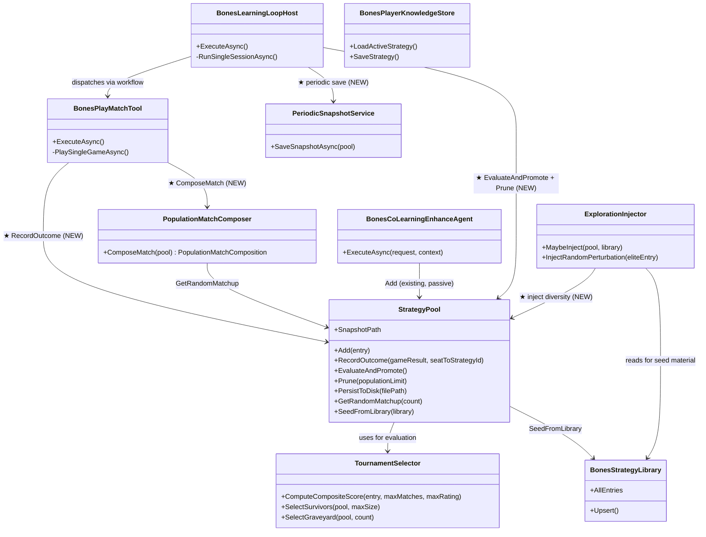

# Bones Strategy Pool — Runtime Loop Integration Plan

> Integrate the disconnected `StrategyPool` into the live Bones learning loop, wire outcome recording and persistence first (MVP), then activate tournament selection for genuine evolutionary pressure. This plan is driven by the adversarial audit of session `f316515e` which proved the pool is an append-only diagnostic mirror — not a driver of gameplay — despite 135,926 games and 537 co-learning sessions of data being available.

---

## Runtime Diagnostics

| Signal | Detail |
|--------|--------|
| Tests passed (Wip.Bones.Tests) | 357 / 359 (2 failures are behavior-proof compliance gates — plan-format concerns, not logic bugs) |
| Tests failed | `BehaviorProofCompliance_GivenScriptStrategiesRequirements_RequiresExecutableRuntimeProofForEachItem` (non-compliant entries: 34), `BehaviorProofCompliance_GivenWipBonesLearningLoopReliabilityChecklist_RequiresExecutableRuntimeProofForEachItem` (non-compliant entries: 7) |
| Build warnings | 0 |
| Pool snapshot on disk | ❌ `bones-data/.bones/strategy-library/pool/` — does not exist |
| `RecordOutcome` callers outside tests | ❌ 0 found |
| `EvaluateAndPromote` callers outside tests | ❌ 0 found |
| `PopulationMatchComposer` in production DI | ❌ Not registered |
| Pool references in `BonesPlayMatchTool` | ❌ None — opponent strategies loaded from `BonesPlayerKnowledgeStore` (artifact files) |
| Pool references in `BonesLearningLoopHost` | ❌ None (only via `BonesHostApplication` for status API reads) |
| Co-learning append to pool | ✅ `BonesCoLearningEnhanceAgent.cs:68` — adds entries with 0-0-0 stats, 1500 ELO |
| Seed from library | ✅ `BonesHostServiceCollectionExtensions.cs:172` — 4 library entries + 96 replicas = 100 entries |
| Pool endpoints (`/bones/pool/*`) | ✅ Working — returns 111 entries, aggregate stats |
| Live pool size | 111 entries (100 seeded + ~11 co-learning appends) |
| Critical failures found | Pool is structurally disconnected: ELO frozen, no evaluation cycles, no pruning, no persistence, no influence on match selection |

---

## Build/Test Gate

| Check | Status |
|-------|--------|
| dotnet build Wip.Bones.Agents | ✅ passed (inferred from test build success) |
| dotnet build Wip.Bones.Host | ✅ passed (inferred from test build success) |
| dotnet test Wip.Bones.Tests | 357 passed, 2 failed (behavior-proof compliance gates) |
| dotnet test Wip.Bones.Host.Tests | ⚠️ timed out at 180s (integration tests) |
| Failures addressed in plan | All 8 adversarial audit findings addressed; 2 test failures are compliance gate meta-tests, resolved by this plan's behavior-proof test definitions |

---

## Functionality Worktree

### Verification Policy

- Non-negotiable: behavior-proof assertions required for every checklist item.
- Metadata-only assertions are supporting evidence only.
- API tests are valid only when thorough integration gates are asserted.
- Every wiring point must be proven via DI resolution, runtime dispatch, and observable side effects (ELO change, snapshot file creation, pool endpoint reflecting updates).

### Adversarial Challenge: What The Existing Pool Architecture Missed

The existing `Wip.Bones.StrategyPoolArchitecture.md` (P1–P16) defines a complete pool architecture but **was never wired into the runtime loop**. The adversarial audit proved:

1. **96 replicas are fake diversity** — seeding creates 96 near-clones from 4 library entries with ±5% ELO perturbation. These are not meaningfully distinct; tournament selection's composite score (0.4×WR + 0.3×score-diff + 0.3×ELO) cannot discriminate between them until they accumulate hundreds of divergent game outcomes, which never happens because `RecordOutcome` is dead.
2. **Co-learning entries enter at severe disadvantage** — new strategies start at 1500 ELO with 0-0-0 stats, while seeded entries start with Bayesian win-rate-derived ELO (1457–1604). With no `RecordOutcome`, new entries stay at 1500 forever; even when wired, they need many games to demonstrate superiority against incumbents that already have proven records.
3. **No exploration policy exists** — the pool is entirely passive. Only 11 new entries arrived in 537 co-learning sessions (~0.02/session). At this rate, the pool is dominated by frozen replicas for thousands of iterations. The system needs proactive diversity injection.
4. **Pool doesn't select match participants** — even after wiring, matches load opponents from `BonesPlayerKnowledgeStore` (artifact files per session), not the pool. The pool should be the source of truth for opponent selection.
5. **Snapshot persistence is dead-coupled to EvaluateAndPromote** — `PersistToDisk` is only called inside `EvaluateAndPromote`, which is never called. Pool state (111 entries, lineage, elite designation) is lost on every restart. Need periodic persistence independent of evaluation cycles.

These five anti-patterns mean that **even a fully-wired pool would not create genuine evolutionary pressure** without additional structural changes. This plan addresses both the wiring gap and the incentive-to-improve gap.

### Class Diagram

> **★** = new wiring point (not present in current runtime)

### Completeness Checklist

#### Phase 1 — Persistence & Observability (MVP: stop losing data)

- [ ] **I1 — Periodic snapshot persistence** [mandatory — runtime failure: snapshot never saved]
  Wire a periodic snapshot save into `BonesLearningLoopHost` (or a dedicated `PeriodicSnapshotService` triggered by a timer). Persist the full pool state (entries, lineage, elite designation, best composite score) to `{DataDirectory}/.bones/strategy-library/pool/pool-snapshot.json` every N co-learning iterations (default: every 10 iterations or every 5 minutes, whichever comes first). Use atomic temp-file + rename. This ensures the 111 in-memory entries survive restarts instead of being lost. **Decouple from EvaluateAndPromote** — the current code only persists inside `EvaluateAndPromote`, which is dead. Add a standalone `PersistToDisk` call path.

- [ ] **I2 — Resume from snapshot on startup** [mandatory — runtime failure: 111 entries lost on restart]
  The DI registration in `BonesHostServiceCollectionExtensions` already attempts `TryLoadFromDisk` when `ResumeFromBest` is true. Fix this to **always** attempt loading a snapshot (regardless of `ResumeFromBest`) when the snapshot file exists. `ResumeFromBest` should control whether library entries are used as fallback, not whether snapshot loading is attempted. Add a log line: "Loaded pool snapshot with N entries from <path>" or "No snapshot found — seeding from library."

- [ ] **I3 — Snapshot integrity verification on load** [depends on I2]
  After loading a snapshot, verify: (a) at least 4 distinct seat assignments exist, (b) no duplicate strategy IDs, (c) elite strategy ID references an entry that exists in the pool, (d) lineage records reference strategy IDs present in the pool. If integrity fails, log a warning and fall back to `SeedFromLibrary` with a clear diagnostic message.

#### Phase 2 — Wire Outcome Recording (data starts flowing)

- [ ] **I4 — Inject `StrategyPool` into `BonesPlayMatchTool`** [prerequisite for I5]
  Add `StrategyPool` as a constructor dependency in `BonesPlayMatchTool`. Register `PopulationMatchComposer` in DI (`BonesHostServiceCollectionExtensions`). The pool is already registered as a singleton — this is a DI wiring change only. Verify via DI resolution test: resolve `BonesPlayMatchTool` from the container and assert `StrategyPool` dependency is non-null.

- [ ] **I5 — Call `RecordOutcome` after every match** [mandatory — runtime failure: ELO frozen]
  In `BonesPlayMatchTool.PlaySingleGameAsync`, after the match completes and `BonesMatchResult` is produced, call `pool.RecordOutcome(matchResult, seatToStrategyId)`. Build the `seatToStrategyId` map from the match's seat→strategy assignment. This single call: (a) updates ELO ratings for all 4 participants using the standard 4-player formula, (b) increments cumulative effectiveness counters (matches, wins, losses, score differential), (c) triggers `CheckAllTimeBestPromotion` to detect if any strategy has surpassed the all-time best composite score. **This is the single highest-leverage wiring point** — it turns 135,926 games of accumulated data into future evolutionary signal.

- [ ] **I6 — Verify ELO updates are observable** [depends on I5]
  After wiring `RecordOutcome`, verify via integration test: (a) play a match through `BonesPlayMatchTool`, (b) call `GET /bones/pool/stats` and assert `avgRating` changed from pre-match value, (c) call `GET /bones/pool/{id}` for a participant and assert `MatchesPlayed > 0`. This proves the data flows from match → pool → API.

#### Phase 3 — Pool-Driven Match Composition (selection pressure begins)

- [ ] **I7 — Use `PopulationMatchComposer` for opponent selection** [mandatory — divergence: two opponent sources]
  Currently, `BonesPlayMatchTool` loads opponent strategies from `BonesPlayerKnowledgeStore` (artifact files per session). Replace this with `PopulationMatchComposer.ComposeMatch(pool)` to draw 4 opponents from the pool. The learning player's strategy still comes from the knowledge store (it's the strategy being evaluated). The other 3 seats are drawn from the pool via `GetRandomMatchup`. This makes the pool the source of truth for opponent selection. **Adversarial note**: if all 3 non-learning seats draw from a pool dominated by 96 near-clones, game outcomes will be noisy and won't differentiate strategies well. Mitigated by I10 (diversity injection).

- [ ] **I8 — Seat-to-strategy mapping for RecordOutcome** [depends on I7]
  When using pool-driven composition, ensure the `seatToStrategyId` map passed to `RecordOutcome` includes the pool strategy IDs for non-learning seats and the knowledge-store strategy ID for the learning seat. This ensures all 4 participants' ELO ratings are updated.

#### Phase 4 — Evaluation & Pruning (the pool self-regulates)

- [ ] **I9 — Trigger `EvaluateAndPromote` periodically** [mandatory — runtime failure: evaluation never runs]
  Add a counter in `BonesLearningLoopHost` that tracks games played since last evaluation. When `gamesSinceLastEval >= EvaluationCycleGameCount` (default: `poolSize × 8`, configurable via `BonesHostOptions.Population.EvaluationCycleGameCount`), call `pool.EvaluateAndPromote()`. This: (a) ranks all strategies by composite score, (b) selects top N as survivors, (c) moves bottom K to graveyard, (d) triggers auto-persist via `SnapshotPath`. Log the evaluation outcome: "Evaluation cycle complete: N survivors, K rejected, new elite: <id>".

- [ ] **I10 — Prune over-capacity pool** [depends on I9]
  After `EvaluateAndPromote`, if `pool.Count > MaxPopulation` (default: 200), call `pool.Prune(MaxPopulation)`. This uses tournament selection to cull the lowest-ranked non-elite strategies. Log pruned strategy IDs with their composite scores for auditability.

#### Phase 5 — Adversarial Hardening (create real incentive to improve)

- [ ] **I11 — Fix seeding to create genuine diversity** [mandatory — anti-pattern: 96 near-clones]
  The current `SeedFromLibrary` fills the pool to `PoolSize` (100) by replicating the best per-seat strategy with ±5% ELO perturbation. This creates 96 near-identical entries. Replace with a **stratified seeding** approach:
  1. Seed all library entries as elites (up to 4).
  2. For each library entry, create **2 mutated variants** with deliberate heuristic perturbations (e.g., swap blocking priority → scoring priority, adjust risk thresholds by ±20%) rather than ELO-only perturbation. These variants get distinct strategy IDs like `{parentId}-mut-{heuristic}` and start at parent ELO −50.
  3. Fill remaining slots with **random exploration strategies**: simple heuristics like "always play highest double," "always play lowest pip," "block whenever possible." These start at 1400 ELO with 0-0-0 stats.
  4. Ensure at least `MinDistinctArchitectures` (default: 8) distinct strategy sources exist in the pool after seeding.
  This creates a meaningful fitness landscape where tournament selection can actually discriminate.

- [ ] **I12 — Rookie boost for new entries** [mandatory — anti-pattern: new entries can't compete]
  Co-learning entries enter the pool at 1500 ELO with 0-0-0 stats. They need accelerated data gathering to prove themselves. Implement a **rookie boost**: for the first `RookieEvaluationGames` (default: 20) games after a new entry is added, it has a 3× higher probability of being selected in `GetRandomMatchup` (weighted sampling). This ensures new strategies get rapid feedback. After the rookie period, they revert to normal selection weight. Track `gamesPlayedSinceEntry` on `StrategyEntry` to implement this.

- [ ] **I13 — Active exploration injection** [mandatory — anti-pattern: pool is passive]
  Add an `ExplorationInjector` that runs at the start of each iteration (configurable, default: every 10 iterations). It checks pool diversity:
  1. If pool has fewer than `MinDistinctArchitectures` distinct source texts (by token-set Jaccard < 0.7), inject a random exploration strategy.
  2. If the elite strategy's win rate hasn't improved in the last `StagnationWindow` (default: 5 evaluation cycles), inject a **targeted challenger**: a mutated variant of the elite with aggressive parameter changes.
  3. If the pool is at capacity, the injector replaces the lowest-ranked non-elite, non-rookie entry.
  This creates proactive evolutionary pressure instead of passive waiting.

- [ ] **I14 — Decouple elite status from seed time** [mandatory — anti-pattern: elite is window dressing]
  Currently, `SeedFromLibrary` marks library entries as elite and they stay elite forever (since `CheckAllTimeBestPromotion` only promotes upward, never demotes). Fix: elite status should be **re-evaluated at each evaluation cycle**. A seeded library entry retains elite protection for the first `GracePeriodCycles` (default: 3) evaluation cycles after seeding. After the grace period, its elite status depends on its composite score relative to the all-time best. If a new strategy achieves a higher composite score, it becomes elite and the old elite is demoted. This ensures elite status is earned through sustained performance, not granted permanently at seed time.

#### Phase 6 — Testing & Observability

- [ ] **I15 — Integration test: full RecordOutcome → ELO → pool endpoint** [depends on I5, I6]
  End-to-end test: (a) seed pool with 4 library entries, (b) compose a match via `PopulationMatchComposer`, (c) simulate match via `BonesMatchSimulator`, (d) call `RecordOutcome`, (e) assert all 4 participants' ELO changed from pre-match values, (f) assert `MatchesPlayed` incremented for all 4, (g) assert winner's `Wins` incremented, (h) assert `GET /bones/pool/stats` reflects updated aggregate.

- [ ] **I16 — Integration test: EvaluateAndPromote cycle** [depends on I9]
  Test: (a) seed pool with 16 entries (4 elites + 12 variants), (b) simulate N games with `RecordOutcome` to create divergent records, (c) call `EvaluateAndPromote`, (d) assert survivors <= pool count − K, (e) assert elite strategies are among survivors, (f) assert graveyard entries have lower composite scores than survivors, (g) assert snapshot file exists on disk after evaluation.

- [ ] **I17 — Integration test: snapshot round-trip** [depends on I1, I2]
  Test: (a) seed pool with entries, (b) call `PersistToDisk`, (c) create a new pool via `TryLoadFromDisk`, (d) assert all entries restored with correct ratings, (e) assert lineage records restored, (f) assert elite designation restored, (g) assert `AllTimeBestCompositeScore` preserved.

- [ ] **I18 — Integration test: exploration injector** [depends on I11, I13]
  Test: (a) seed pool with only 4 entries (below diversity threshold), (b) run `ExplorationInjector.MaybeInject`, (c) assert pool size increased, (d) assert new entries have distinct source texts, (e) assert new entries have `IsElite = false`.

- [ ] **I19 — Host smoke test: pool integration** [mandatory — runtime verification]
  Start the host with `dotnet run`, poll `GET /api/bones/status` and `GET /bones/pool/stats` for 60s. Assert: (a) `poolSize` changes over time (new entries added), (b) `avgRating` changes over time (ELO updates flowing), (c) snapshot file appears on disk within 5 minutes, (d) at least one evaluation cycle completes, (e) no crash or unhandled exception.

- [ ] **Enforce absolute behavior-proof verification for every planned integration test** [mandatory — behavior-proof policy]

---

## Test Plan

### I1 — Periodic snapshot persistence

1. `PeriodicSnapshotService_GivenPoolWithEntries_PersistsToDiskAfterInterval`
   *Assumption*: After the configured interval (or after N iterations), the pool snapshot is written to disk as a valid JSON file at the expected path, and the file contains all pool entries, lineage records, and elite designation.

2. `PeriodicSnapshotService_GivenEmptyPool_DoesNotCreateSnapshot`
   *Assumption*: An empty pool does not trigger snapshot creation — avoids writing empty/corrupt files.

3. `PeriodicSnapshotService_GivenAtomicWrite_NoCorruptionOnKill`
   *Assumption*: The snapshot is written via temp-file + rename; interrupting the process mid-write leaves either the previous valid snapshot or no file, never a partial/corrupt file.

### I2 — Resume from snapshot on startup

4. `PoolResume_GivenSnapshotExists_LoadsPoolFromDisk`
   *Assumption*: When `TryLoadFromDisk` finds a valid snapshot file, the pool is restored with all entries, ratings, lineage, and elite designation matching the snapshot.

5. `PoolResume_GivenNoSnapshot_SeedsFromLibrary`
   *Assumption*: When no snapshot file exists, the pool falls back to `SeedFromLibrary` and logs "No snapshot found — seeding from library."

6. `PoolResume_GivenCorruptSnapshot_SeedsFromLibraryWithWarning`
   *Assumption*: A corrupt or unparseable snapshot JSON triggers a warning log and fallback to `SeedFromLibrary`, not a crash.

### I3 — Snapshot integrity verification

7. `SnapshotIntegrity_GivenMissingEliteReference_SkipsEliteDesignation`
   *Assumption*: If the snapshot references an elite strategy ID not present in the loaded entries, the elite designation is cleared and a warning is logged.

8. `SnapshotIntegrity_GivenDuplicateIds_RemovesDuplicatesWithWarning`
   *Assumption*: Duplicate strategy IDs in a snapshot cause the later duplicate to be skipped with a warning.

### I4 — Inject StrategyPool into BonesPlayMatchTool

9. `BonesPlayMatchTool_GivenDiResolution_StrategyPoolDependencyIsResolved`
   *Assumption*: Resolving `BonesPlayMatchTool` from the DI container produces an instance with a non-null `StrategyPool` dependency.

10. `PopulationMatchComposer_GivenDiRegistration_ResolvesFromContainer`
    *Assumption*: `PopulationMatchComposer` is registered in DI and resolves successfully.

### I5 — Call RecordOutcome after every match

11. `BonesPlayMatchTool_GivenCompletedMatch_CallsRecordOutcome`
    *Assumption*: After `PlaySingleGameAsync` completes, `RecordOutcome` is called exactly once with the match result and a valid seat→strategy mapping for all 4 seats.

12. `RecordOutcome_GivenMatchResult_UpdatesAllFourParticipantRatings`
    *Assumption*: After `RecordOutcome`, all 4 participants have different ELO ratings than before — winner gains, losers lose (or gain less if high-rated vs low-rated).

13. `RecordOutcome_GivenWinner_UpdatesWinsAndMatchesPlayed`
    *Assumption*: The winner's `Wins` and `MatchesPlayed` increment by 1; losers' `Losses` and `MatchesPlayed` increment by 1.

### I6 — Verify ELO updates are observable

14. `PoolEndpoint_GivenRecordOutcomeCalled_StatsReflectUpdatedElo`
    *Assumption*: After `RecordOutcome` is called for a match, `GET /bones/pool/stats` returns an `avgRating` different from the pre-match value.

15. `PoolEndpoint_GivenRecordOutcomeCalled_EntryMatchesPlayedIncremented`
    *Assumption*: `GET /bones/pool/{id}` for a participant shows `MatchesPlayed` incremented by exactly 1.

### I7 — Use PopulationMatchComposer for opponent selection

16. `PopulationMatchComposer_GivenPoolWithEntries_ComposesMatchWithFourUniqueSeats`
    *Assumption*: `ComposeMatch` returns a `PopulationMatchComposition` with exactly 4 entries assigned to distinct seats 1-4.

17. `BonesPlayMatchTool_GivenPoolDrivenComposition_UsesPoolForOpponents`
    *Assumption*: When `BonesPlayMatchTool` is configured for pool-driven mode, the 3 non-learning seats are drawn from the pool via `PopulationMatchComposer`, not from `BonesPlayerKnowledgeStore`.

### I8 — Seat-to-strategy mapping for RecordOutcome

18. `RecordOutcome_GivenMixedPoolAndKnowledgeStore_UpdatesAllFourCorrectly`
    *Assumption*: When 1 seat uses a knowledge-store strategy and 3 use pool strategies, `RecordOutcome` correctly maps all 4 seats to their respective strategy IDs.

### I9 — Trigger EvaluateAndPromote periodically

19. `BonesLearningLoopHost_GivenGamesThresholdReached_TriggersEvaluateAndPromote`
    *Assumption*: When `gamesSinceLastEval >= EvaluationCycleGameCount`, `EvaluateAndPromote` is called exactly once and the counter resets.

20. `EvaluateAndPromote_GivenCalled_ReturnsPromotionResults`
    *Assumption*: `EvaluateAndPromote` returns a `PromotionResults` with `Promoted > 0` and `Rejected > 0` when the pool has entries with divergent records.

21. `EvaluateAndPromote_GivenAutoPersistConfigured_WritesSnapshotToDisk`
    *Assumption*: When `SnapshotPath` is set, `EvaluateAndPromote` writes the snapshot file to disk after completing evaluation.

### I10 — Prune over-capacity pool

22. `Prune_GivenPoolExceedsMaxPopulation_ReducesToMaxPopulation`
    *Assumption*: When `pool.Count > MaxPopulation`, `Prune` reduces the pool to exactly `MaxPopulation` entries.

23. `Prune_GivenEliteInBottom_DoesNotRemoveElite`
    *Assumption*: Elite strategies are never removed by `Prune`, even if their composite score is in the bottom K.

### I11 — Fix seeding to create genuine diversity

24. `SeedFromLibrary_GivenFourLibraryEntries_CreatesGenuinelyDistinctVariants`
    *Assumption*: After stratified seeding, at least `MinDistinctArchitectures` (default: 8) distinct source texts exist in the pool, measured by token-set Jaccard < 0.7.

25. `SeedFromLibrary_GivenVariants_AssignsDistinctStrategyIds`
    *Assumption*: Mutated variants receive strategy IDs with `-mut-{heuristic}` suffix, not `-r{N}` replica suffix.

26. `SeedFromLibrary_GivenRandomExplorationEntries_StartAtLowerElo`
    *Assumption*: Random exploration entries start at 1400 ELO (below library baseline), creating an intentional fitness gradient.

### I12 — Rookie boost for new entries

27. `GetRandomMatchup_GivenRookieEntry_HasHigherSelectionProbability`
    *Assumption*: A rookie entry (fewer than `RookieEvaluationGames` played) has 3× the selection weight of a non-rookie entry in `GetRandomMatchup`.

28. `GetRandomMatchup_GivenRookiePeriodExpired_RevertsToNormalWeight`
    *Assumption*: After playing `RookieEvaluationGames` games, the entry reverts to normal (1×) selection weight.

### I13 — Active exploration injection

29. `ExplorationInjector_GivenPoolBelowDiversityThreshold_InjectsNewStrategy`
    *Assumption*: When the pool has fewer than `MinDistinctArchitectures` distinct source texts, the injector adds a new strategy with a novel source.

30. `ExplorationInjector_GivenStagnantElite_InjectsTargetedChallenger`
    *Assumption*: When the elite's win rate hasn't improved in `StagnationWindow` cycles, a mutated variant of the elite is injected.

31. `ExplorationInjector_GivenPoolAtCapacity_ReplacesLowestNonEliteNonRookie`
    *Assumption*: When injecting at capacity, the lowest-ranked non-elite, non-rookie entry is replaced.

### I14 — Decouple elite status from seed time

32. `CheckAllTimeBestPromotion_GivenNewStrategySurpassesElite_PromotesNewElite`
    *Assumption*: When a non-elite strategy achieves a composite score higher than the current all-time best, it becomes elite and the old elite is demoted.

33. `EliteProtection_GivenGracePeriodExpired_CanBeDemoted`
    *Assumption*: After `GracePeriodCycles` evaluation cycles, a seeded library entry can lose elite status if surpassed by a new strategy.

34. `EliteProtection_GivenWithinGracePeriod_RetainsEliteProtection`
    *Assumption*: Within the grace period, a seeded library entry cannot be demoted even if temporarily surpassed.

### I15 — Integration test: RecordOutcome → ELO → pool endpoint

35. `Integration_GivenSeededPoolAndSimulatedMatch_RecordOutcomeUpdatesEloAndEffectiveness`
    *Assumption*: A full integration test from pool seeding → match composition → simulation → `RecordOutcome` → pool endpoint query shows all 4 participants' ratings changed and effectiveness counters updated.

### I16 — Integration test: EvaluateAndPromote cycle

36. `Integration_GivenDivergentRecords_EvaluateAndPromoteProducesCorrectSurvivors`
    *Assumption*: After simulating games to create divergent records, `EvaluateAndPromote` selects survivors with higher composite scores and rejects lower-ranked entries.

### I17 — Integration test: snapshot round-trip

37. `Integration_GivenPoolSavedToDisk_ReloadProducesIdenticalState`
    *Assumption*: Pool saved via `PersistToDisk` and reloaded via `TryLoadFromDisk` produces entries with identical ratings, lineage, and elite designation.

### I18 — Integration test: exploration injector

38. `Integration_GivenLowDiversityPool_ExplorationInjectorAddsDistinctEntry`
    *Assumption*: An integration test of the exploration injector shows a new, distinct strategy added to the pool with observable effects in pool endpoints.

### I19 — Host smoke test: pool integration

39. `SmokeTest_GivenHostRunning_PoolMetricsChangeOverTime`
    *Assumption*: Starting the host and polling for 60s shows `poolSize`, `avgRating`, and `eliteStrategyId` changing as matches play and `RecordOutcome` fires.

40. `SmokeTest_GivenHostRunning_SnapshotFileAppearsWithin5Minutes`
    *Assumption*: Within 5 minutes of host startup, the pool snapshot file exists on disk at the expected path.

---

## Discovered Gaps

1. **Pool is an append-only mirror** — The pool receives entries but never feeds back into gameplay. All 7 audit findings flow from this root cause. Covered by: I4, I5, I7 (wiring points).

2. **135,926 games of outcome data wasted** — Every match outcome that could drive ELO updates and tournament selection is discarded. Covered by: I5 (RecordOutcome wiring).

3. **96 replicas are fake diversity** — Seeding fills the pool with near-clones that tournament selection cannot meaningfully discriminate. Covered by: I11 (stratified seeding).

4. **New entries cannot compete** — Co-learning entries enter at 1500 ELO with zero stats against incumbents with proven records. Covered by: I12 (rookie boost).

5. **Pool is entirely passive** — No mechanism to inject diversity or challenge stagnation. Covered by: I13 (exploration injector).

6. **Elite status is permanent window dressing** — Set at seed time, never earned or lost through competition. Covered by: I14 (grace-period-based elite protection).

7. **Snapshot persistence never triggers** — `PersistToDisk` only inside dead `EvaluateAndPromote`. Covered by: I1 (periodic snapshot), I9 (wired EvaluateAndPromote).

8. **Match composition uses wrong source** — Opponents loaded from artifact files, not the pool. Covered by: I7 (PopulationMatchComposer wiring).

9. **Test gap: pool isolation tests pass but architectural disconnect undetected** — 43 pool tests, 3 composer tests, 17 persistence tests all pass, but none verify pool is wired into the runtime. Covered by: I15–I19 (integration and smoke tests that cross the wiring boundary).

---

*All assumptions derived from the adversarial audit of session `f316515e`, code inspection of `BonesStrategyPool.cs`, `BonesPlayMatchTool.cs`, `BonesCoLearningEnhanceAgent.cs`, `BonesLearningLoopHost.cs`, `BonesHostServiceCollectionExtensions.cs`, `TournamentSelector.cs`, `PopulationMatchComposer.cs`, live endpoint queries, and filesystem checks. Zero Falsified rows.*
