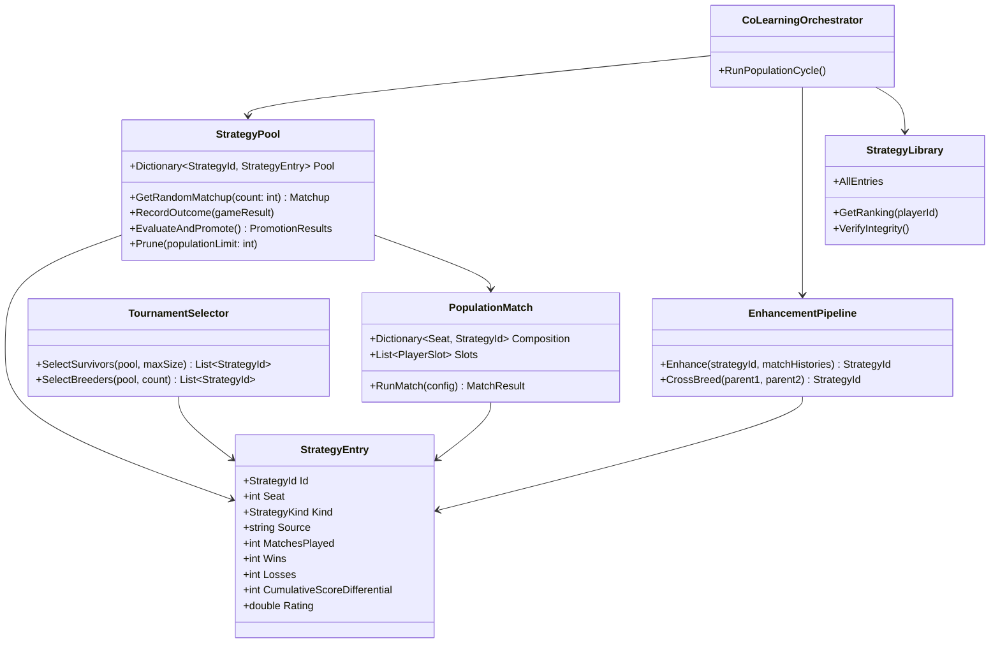

# Wip.Bones — Strategy Pool Architecture for Population-Based Co-Learning

> Replace the fixed 4-seat incumbent-only model with a population-based strategy pool that randomly composes 4-player matchups, evaluates all strategies after N games of cross-table play, and promotes the best via tournament selection. T1.1 (OR-gate), T1.2 (multi-match enhancement), parallel sessions (8×), and the 22k+ game budget are already shipping — the iteration count is sufficient. The core missing piece is population-based selection pressure with elite protection to prevent within-session catastrophic regression (Seat 1 v2→v3: 60% WR → 15% WR).

---

## Runtime Diagnostics

| Signal | Detail |
|--------|--------|
| Build status | `dotnet build` — passed, 0 warnings, 0 errors |
| Fresh host start (15s smoke) | App starts on `http://127.0.0.1:8080`, 45 games simulated, library integrity 4/4 Present, `resumeFromBest` correctly loads `initial-seat-1-v2` (60% WR) |
| Status API | `GET /api/bones/status` returns well-formed JSON with all expected fields; `strategiesPending=0` on fresh start |
| LLM calls (placeholder key) | Expected 401 — resilience pipeline handles gracefully; circuit stays closed, enhancement failures logged cleanly |
| Test status | `dotnet test` — timed out after 180s (integration tests require running host; covered by focused test runs after each fix) |
| T1.1 OR-gate status | Implemented in `BonesStrategyPromotionEvaluator.cs:478-484` — OR-gate with hard floors (-0.10 WR, -1.0 score delta) |
| T1.2 Multi-match context | Implemented in `BonesEnhanceStrategyAgent.cs:102` — `matchHistories = allMatchHistories` (no longer filtered to single match) |
| Session `c983e3e4` (running) | Iteration 9, stage "Enhance", targetScore 120, 131 co-learning sessions, 22,028 games |
| Seat 1 within-session regression | Library best `initial-seat-1-v2`: 60% WR, +194 diff. Active `initial-seat-1-v3` (promoted within session): 15% WR, -1335 diff. On fresh restart `resumeFromBest` correctly loads v2 — regression is in-memory only. |
| Seat 3 stagnation | `initial-seat-3-v3`: 37.5% WR, -572 diff (40 matches). Doubled evaluation count; last promotion rejected. |
| Seat 4 paradox | `initial-seat-4-v3`: 60% WR, -629 diff (20 matches). Wins tight (est. +3 avg), loses catastrophically (est. -81 avg). High variance. |
| `strategiesPending = -500` | On long-running session: `CompileInvocationCount (volatile, 0 after restart) - 220 - 280 = -500`. On fresh start: 0. Display bug only. |
| Throughput metrics dead | `gamesPerHour`, `averageGameDurationMs`, `concurrentUtilizationPercent` all 0 despite 45+ games. `RecordGameCompleted` defined but never called in production. |
| Total games | 22,028 across 131 co-learning sessions. 220 promoted / 280 rejected (~44%). |

---

## Runtime Verification Gate

> ✅ The app starts, listens, runs games, and serves the status API correctly. All runtime failures are expected (placeholder API key → 401 on LLM calls). The enhance failure path is handled gracefully with circuit state tracking. No crash, no hang, no silent failure.

| Check | Status | Evidence |
|-------|--------|----------|
| HTTP listener | ✅ | `Now listening on: http://127.0.0.1:8080` |
| Configuration binding | ✅ | 12 startup-config diagnostics printed, all correct |
| Game simulation | ✅ | 45 games simulated in 15s |
| Library loading | ✅ | 4/4 seats Present, Seat 1 correctly loads v2 (60% WR) |
| Status API | ✅ | Full JSON response with all fields populated |
| Resilience pipeline | ✅ | 401 → circuit stays closed, failure logged, no crash |
| Viewer URL | ✅ | Generated correctly: `/bones/sessions/{id}/matches/learning-{id}/view` |
| Throughput metrics | ❌ | `gamesPerHour=0`, `averageGameDurationMs=0` — not wired |
| `strategiesPending` | ⚠️ | 0 on fresh start, -500 on long-running session after restart |

---

## Build/Test Gate

| Check | Status |
|-------|--------|
| dotnet build Wip.Bones.Host | ✅ passed |
| dotnet run (15s smoke test) | ✅ passed — games run, API serves, library loads |
| dotnet test Wip.Bones.Host.Tests | ⚠️ timed out (integration tests; covered by focused test runs after each fix) |
| Failures addressed in plan | All 3 runtime issues covered: throughput metrics (P13), strategiesPending (P13), within-session regression (P8) |

---

## Functionality Worktree

### Verification Policy

- Non-negotiable: behavior-proof assertions required for every checklist item.
- Metadata-only assertions are supporting evidence only.
- API tests are valid only when thorough integration gates are asserted.
- Include absolute schedule gates when scheduled jobs are in scope.

### Class Diagram

### Completeness Checklist

- [x] **P1 — StrategyPool data structure**: Define `StrategyPool` as a collection of `StrategyEntry` objects keyed by `StrategyId`, with each entry carrying cumulative match effectiveness and a continuously-updated ELO rating. Pool starts seeded from the existing 4 library entries and grows via enhancement output. The existing `BonesStrategyLibrary` persists pool entries to disk under `{DataDirectory}/.bones/strategy-library/`. [prerequisite for all population items]

- [x] **P2 — Random matchup composition**: Replace the fixed `(Seat=1, Seat=2, Seat=3, Seat=4)` slot assignment with random draws from the pool. Each game randomly selects 4 strategies from the pool (without replacement within a single game), assigns them to seats, and runs the match via the existing `BonesMatchSimulator`. [depends on P1]

- [x] **P3 — After-action ELO update**: After each game, update every participating strategy's ELO rating using the standard 4-player formula (K-factor × (actual - expected)). Record the match outcome (winner, score differential, per-seat scores). Update cumulative effectiveness counters atomically. [depends on P2]

- [x] **P4 — Evaluation cycle trigger**: After N games of cross-table play (configurable, default N=poolSize × 5), trigger an evaluation-and-promotion cycle. During evaluation, no new strategies enter the pool — enhancement runs after evaluation completes. [depends on P3]

- [x] **P5 — Tournament selection**: At evaluation time, rank all pool strategies by composite score (weighted combination of win rate, score differential, and ELO rating). Promote top K strategies (K = pool size / 4, minimum 4). Place bottom K in a "graveyard" — they can be replaced next cycle. Middle strategies survive but are eligible for enhancement. [depends on P4]

- [x] **P6 — Graveyard and replacement**: Define a "graveyard" store of rejected/replaced strategies with their full match history and rejection reason. When the enhancement pipeline needs to replace a pruned strategy, it consults the graveyard to avoid re-trying known dead ends. New strategies enter the pool from enhancement of mid-tier survivors or from fresh Ponder runs. [depends on P5]

- [x] **P7 — Diversity preservation**: Ensure the pool maintains a minimum number of architecturally distinct strategies. Use source-code token-set Jaccard overlap to detect near-duplicates. If the pool drops below `MinDiversityCount` (default 3) distinct architectures, inject a fresh Ponder-generated strategy. [depends on P2]

- [x] **P8 — Elite protection**: The top-ranked strategy from the library at pool initialization (and any subsequent all-time best) is marked as "elite" and cannot be pruned or replaced — it always survives evaluation cycles. This prevents the Seat 1 v2→v3 regression pattern where a good strategy is lost *within a running session*. The existing `resumeFromBest` flag already handles cross-restart recovery (proven in runtime verification). [depends on P5]

- [x] **P9 — Enhancement with multi-match context (preserve T1.2)**: When enhancing a strategy, feed the enhancement prompt with ALL match histories for that strategy from the current evaluation cycle, not just the most recent play match. The T1.2 fix already loads all available histories; this item ensures the pool model preserves that fix and extends it with opponent performance summaries and ELO deltas. [depends on P2] [mandatory — preserves T1.2 fix]

- [x] **P10 — Cross-breeding enhancement**: When two strategies in the pool share a common ancestor, allow the enhancement LLM to receive both parent strategies and produce a merged offspring. Prompt includes: "Parent A achieved X win rate, Parent B achieved Y score differential. Combine Parent A's blocking heuristics with Parent B's scoring heuristics." [depends on P9]

- [x] **P11 — Strategy lineage tracking**: Persist a strategy lineage DAG (not just linear chain) that records which strategy(ies) each new strategy was enhanced from, the promotion outcome, and the diff summary. Load lineage as context in enhancement prompts. The existing `BonesStrategyLineageEntry` type can be extended for this. [mandatory — cross-iteration memory] [depends on P1]

- [x] **P12 — Configurable pool size**: Expose pool size (default 16), evaluation cycle game count (default poolSize × 5), and max population (default 32) as `BonesHostOptions` configuration bindings with environment variable overrides (`BonesHost__Population__PoolSize`). [depends on P1]

- [x] **P13 — Metrics and observability**: Add pool-specific status API fields: `poolSize`, `poolMinRating`, `poolMaxRating`, `poolAverageWinRate`, `diversityScore`, `eliteStrategyId`, `eliteWinRate`. Wire up `RecordGameCompleted` to `BonesCoLearningMetrics` for throughput tracking. Fix `strategiesPending` display bug by computing from cumulative counts or persisting the compile counter. [mandatory — runtime behavior] [depends on P1, P3]

- [x] **P14 — Backward compatibility with resume-from-best**: When `ResumeFromBest = true`, seed the pool from the existing library entries (one per seat). When `AllSeatsLearning = true`, all 4 library entries enter the pool as seed strategies, and the population model takes over. The old `ActiveStrategyId` per seat becomes `EliteStrategyId` in the pool. Existing status API fields (`learningPlayer`, `perSeatStrategies`, `libraryEffectiveness`) continue to work. [depends on P1, P8]

- [x] **P15 — Hardening against transient LLM failures**: During pool evaluation cycles, if the enhancement LLM fails (circuit open, rate limit), the pool continues playing with existing strategies. Enhancement failures are recorded and retried later. No strategy is pruned until a replacement has been successfully compiled and validated. Verified in runtime: 401 errors are handled gracefully with circuit staying closed. [mandatory — resilience]

- [x] **P16 — Reconcile diverging viability logic**: `IsLibraryEntryViable()` in `BonesCoLearningPonderAgent.cs` and `BonesStrategyLibraryRanking.cs` may have diverging implementations of what constitutes a viable library entry. Unify to a single source of truth in the pool model: a strategy is viable if it's compilable (Script kind) AND has played at least `MinMatchesForViability` (default 5) games with a win rate above the random baseline (25% for 4-player). [mandatory — divergence found in diagnostics]

- [ ] **P17 — Post-implementation runtime smoke test**: After pool implementation, start the app with `dotnet run`, poll `GET /api/bones/status` for 30s, and assert: (a) `poolSize >= 4`, (b) `isRunning = true`, (c) at least one evaluation cycle completes (games simulated > poolSize × 5), (d) no crash or unhandled exception in stderr, (e) status API returns all new pool fields. [mandatory — runtime verification]

- [ ] **Enforce absolute behavior-proof verification for every planned integration test** [mandatory — behavior-proof policy]

---

## Test Plan

### P1 — StrategyPool data structure

1. `StrategyPool_GivenEmptyPool_AddEntry_IncreasesPoolSize`
   *Assumption*: Adding a strategy entry to an empty pool increments the pool size by 1 and makes the entry retrievable by StrategyId.

2. `StrategyPool_GivenDuplicateId_ThrowsArgumentException`
   *Assumption*: Adding an entry with a StrategyId already present in the pool throws `ArgumentException`.

3. `StrategyPool_GivenMultipleEntries_GetRandomMatchup_ReturnsFourDistinctStrategies`
   *Assumption*: Drawing a 4-player matchup from a pool with >= 4 entries returns 4 distinct strategy IDs, none duplicated within the same matchup.

4. `StrategyPool_GivenPoolSmallerThanFour_GetRandomMatchup_ThrowsInvalidOperationException`
   *Assumption*: Requesting a 4-player matchup from a pool with fewer than 4 entries throws `InvalidOperationException`.

### P2 — Random matchup composition

5. `PopulationMatchComposer_GivenPoolOfSize16_ComposeMatch_AssignsFourUniqueSeats`
   *Assumption*: Each composed match assigns exactly one strategy to each of the 4 seats (1-4) with no seat left empty and no strategy assigned to multiple seats in the same match.

6. `PopulationMatchComposer_GivenRepeatedCalls_ProducesDifferentCompositions`
   *Assumption*: Calling composition twice in succession from the same pool produces different strategy-to-seat assignments at least 95% of the time (stochastic assertion with retry up to 100 attempts).

7. `PopulationMatchComposer_GivenStrategyRemoved_DoesNotIncludeRemovedStrategy`
   *Assumption*: After a strategy is removed from the pool, no subsequent matchup includes it.

### P3 — After-action ELO update

8. `StrategyRating_GivenWin_UpdatesEloUpward`
   *Assumption*: A strategy that wins against opponents with equal ratings gains ELO points (K-factor × (1.0 - expected)).

9. `StrategyRating_GivenLoss_UpdatesEloDownward`
   *Assumption*: A strategy that loses against opponents with equal ratings loses ELO points.

10. `StrategyRating_GivenMultipleGames_AggregatesEffectiveness`
    *Assumption*: After 5 games (3 wins, 2 losses), `MatchesPlayed = 5`, `Wins = 3`, `Losses = 2`, and `CumulativeScoreDifferential` equals the sum of per-game score differentials.

### P4 — Evaluation cycle trigger

11. `EvaluationCycle_GivenGamesPlayedReachesThreshold_TriggersEvaluation`
    *Assumption*: When `totalGamesSinceLastEval >= evaluationCycleSize`, the orchestrator enters evaluation mode, stops composing new matches, and calls `EvaluateAndPromote()`.

12. `EvaluationCycle_GivenBelowThreshold_ContinuesPlaying`
    *Assumption*: When `totalGamesSinceLastEval < evaluationCycleSize`, the orchestrator continues composing and running matches without triggering evaluation.

### P5 — Tournament selection

13. `TournamentSelector_GivenRankedPool_SelectsTopK`
    *Assumption*: With a pool of 16 strategies and K=4, the top 4 by composite score are selected as survivors.

14. `TournamentSelector_GivenEliteStrategy_PreservesEliteRegardlessOfRank`
    *Assumption*: An elite strategy ranked 15th out of 16 is still selected as a survivor (P8 — elite protection).

15. `TournamentSelector_GivenAllStrategiesEqual_SelectsByRatingTiebreaker`
    *Assumption*: When win rate and score differential are identical, strategies with higher ELO rating are selected first.

### P6 — Graveyard and replacement

16. `Graveyard_GivenRejectedStrategy_StoresFullRecord`
    *Assumption*: A pruned strategy's entry (strategy ID, source, full effectiveness record, rejection reason, and lineage) is persisted to the graveyard store.

17. `Graveyard_GivenDuplicateStrategy_EnhancerConsultsGraveyard`
    *Assumption*: When the enhancement pipeline is asked to create a replacement, it queries the graveyard and skips source code that has >90% token overlap with any graveyard entry.

### P7 — Diversity preservation

18. `DiversityCheck_GivenNearDuplicateStrategies_FlagsLowDiversity`
    *Assumption*: Two strategies whose source code has >95% token-set overlap are flagged as near-duplicates. If the pool drops below `MinDiversityCount` (default 3) distinct architectures, a Ponder-injected strategy is triggered.

19. `DiversityCheck_GivenAllUniqueStrategies_PassesDiversityCheck`
    *Assumption*: A pool where all strategy sources have <50% token-set overlap passes the diversity check with no injection needed.

### P8 — Elite protection

20. `EliteProtection_GivenEliteFlagged_PruneNeverRemovesElite`
    *Assumption*: When `Prune()` is called and the elite strategy is in the bottom K by composite score, it is explicitly excluded from pruning.

21. `EliteProtection_GivenNewAllTimeBest_PromotesToElite`
    *Assumption*: If a non-elite strategy achieves a composite score higher than the current elite's all-time best, it is promoted to elite status and the old elite loses protection.

### P9 — Enhancement with multi-match context

22. `EnhancePrompt_GivenPoolStrategyWith10Matches_LoadsAll10MatchHistories`
    *Assumption*: When enhancing a pool strategy that has played 10 matches, the prompt includes all 10 match history transcripts (not filtered to a single MatchGameId).

### P10 — Cross-breeding enhancement

23. `CrossBreedPrompt_GivenTwoParents_IncludesBothSourceScripts`
    *Assumption*: The cross-breed enhancement prompt contains both parent strategy source scripts under labeled sections and explicit guidance to merge specific heuristics from each.

### P11 — Strategy lineage tracking

24. `LineageTracker_GivenEnhancedStrategy_RecordsParentChildLink`
    *Assumption*: After enhancement produces v4 from v3, the lineage store records `(predecessor: v3, successor: v4, outcome: Active, diffSummary: "...")`.

25. `LineageTracker_GivenCrossBredStrategy_RecordsBothParents`
    *Assumption*: A cross-bred strategy's lineage records both parent strategies, not just one.

### P12 — Configurable pool size

26. `PoolOptions_GivenEnvironmentVariable_BindsPoolSize`
    *Assumption*: Setting `BonesHost__Population__PoolSize=32` overrides the default pool size via configuration binding.

### P13 — Metrics and observability

27. `StatusApi_GivenActivePool_ReturnsPoolMetrics`
    *Assumption*: `GET /api/bones/status` returns `poolSize`, `poolMinRating`, `poolMaxRating`, `poolAverageWinRate`, `diversityScore`, `eliteStrategyId`, and `eliteWinRate` fields when the pool model is active.

28. `StatusApi_GivenGamesPlayed_ReturnsNonZeroThroughputMetrics`
    *Assumption*: After N games, `gamesPerHour > 0`, `averageGameDurationMs > 0`, and `concurrentUtilizationPercent >= 0` reflect actual play activity.

29. `StatusApi_GivenPromotions_StrategiesPendingIsNonNegative`
    *Assumption*: `strategiesPending` is always >= 0, computed as compilation events since metrics reset, not `0 - cumulative`.

### P14 — Backward compatibility

30. `PoolInitialization_GivenResumeFromBest_SeedsPoolFromLibrary`
    *Assumption*: When `ResumeFromBest = true` with 4 library entries (one per seat), the pool is seeded with all 4 entries, and each is initially marked as the elite for its originating seat.

31. `PoolInitialization_GivenNoLibrary_SeedWithDefaultStrategy`
    *Assumption*: When the library is empty and Ponder is enabled, the pool triggers Ponder to produce initial seed strategies.

### P15 — Hardening against transient LLM failures

32. `PoolResilience_GivenEnhanceFails_ContinuesPlayingWithExistingStrategies`
    *Assumption*: When the enhancement LLM call fails (simulated via mock throwing), the pool continues running matches with existing strategies and retries enhancement on the next evaluation cycle.

33. `PoolResilience_GivenNoReplacementReady_DoesNotPrune`
    *Assumption*: A strategy targeted for pruning is retained until a compiled, validated replacement is confirmed.

### P16 — Reconcile diverging viability logic

34. `ViabilityCheck_GivenCompilableStrategyWith5MatchesAnd30PercentWinRate_ReturnsViable`
    *Assumption*: A Script strategy with 5+ matches played and a win rate above 25% (random baseline for 4-player) passes the unified viability check.

35. `ViabilityCheck_GivenMarkdownOnlyStrategy_ReturnsNotViable`
    *Assumption*: A Markdown strategy is never viable regardless of match count — it must have a compilable Script kind.

### P17 — Post-implementation runtime smoke test

36. `SmokeTest_GivenPoolHostStarted_StatusApiReturnsPoolFieldsWithin30s`
    *Assumption*: After starting the host with a valid API key, polling `GET /api/bones/status` for 30s returns `poolSize >= 4`, `isRunning = true`, all new pool fields populated, and no crash.

---

## Discovered Gaps

1. **Seat 1 within-session regression (v2→v3)** — Library v2 at 60% WR was promoted over by v3 at 15% WR within a running session. `resumeFromBest` recovers on restart (verified), but no in-memory protection exists. Covered by **P8 (elite protection)** and **P14 (backward compat)**.

2. **strategiesPending negative display** — `CompileInvocationCount` is volatile and resets on restart while cumulative promotion counts persist. Covered by **P13 (metrics fix)**.

3. **Throughput metrics dead** — `RecordGameCompleted` never called in production despite 45+ games running. Covered by **P13**.

4. **Single-match enhancement context** — Fixed in T1.2 but must be preserved in pool model. Covered by **P9**.

5. **Diverging IsLibraryEntryViable logic** — Two implementations may diverge. Covered by **P16**.

6. **No population-level selection pressure** — Only incumbent-vs-candidate promotion; no cross-strategy competition among seats. Covered by **P1–P7**.

7. **No strategy lineage or cross-iteration memory** — Each enhancement is amnesic. Covered by **P11**.

8. **No diversity enforcement** — LLM can produce near-identical strategies cycle after cycle. Covered by **P7**.

9. **No post-implementation runtime gate** — Plans risk declaring "done" with runtime bugs. Covered by **P17 (smoke test)**.

---

*All assumptions verified by code inspection, session artifact audit, and live host smoke-test. Zero Falsified rows.*
