# Requirements: Wip.Factory Functional Alpha

> Scope: specify a **functional alpha** of the Agentic Software Factory described in `Agentic_Software_Factory_Modus_WIP_Integration_v0.3` (17 Nov 2026) — a working, end-to-end, evidence-producing factory built on the existing Modus plugin kernel and the existing WIP agent runtime. "Functional" means one requirement travels from submitted event to a governed, operator-approved merge with a durable chain of evidence, and one bounded self-improvement experiment runs over those sessions. "Alpha" means single-host, single-repository, local-first storage, no unattended release, and no production multi-tenancy. Superseded subsystems are reused, not reimplemented.

---

## Request Fidelity and Named Mechanisms

### Verbatim request

> "Read this file and come up with a propper requirement set for an functional alpha of this factory"

Source file: `Agentic_Software_Factory_Modus_WIP_Integration_v0.3.pdf` / `.md`, sha256 `41e56939…` / `3921a92e…`, dated 17 November 2026, status "Design proposal, not an implementation claim".

### Named mechanisms and where each lands

Every mechanism named by the source document's defining vocabulary is either landed in this document or excluded with user sign-off. Provenance: `user` = the human request, `source` = the v0.3 document, `repo` = verified repository constraint, `agent` = analysis constraint adopted here.

| # | Mechanism | Provenance | Landed in |
|---|---|---|---|
| M-01 | Modus remains the plugin/hosting substrate; factory does not replace it | source | F-A.5, F-A.6, F-B.1–F-B.6 |
| M-02 | WIP remains the governed agent runtime; factory does not replace it | source | F-E.2, F-E.3, F-F.1–F-F.5 |
| M-03 | New `Wip.Factory` application layer with the nine proposed package boundaries | source | F-A.1–F-A.5 |
| M-04 | Durable work-item events; event notifies, durable state authorizes | source | F-C.1–F-C.7 |
| M-05 | Typed domain artifacts with version pinning and provenance | source | F-A.1, F-I.4 |
| M-06 | Dependency-aware readiness and a distinct factory work-state machine | source | F-A.3, F-C.5 |
| M-07 | Blackboard: logical collaboration interface, role-scoped, not one mutable bucket | source | F-H.1–F-H.3 |
| M-08 | Immutable agent-profile versions; data-only evolution without DLL reload | source | F-D.1–F-D.6 |
| M-09 | Agent definitions distinct from profiles, instances and WIP sessions | source | F-D.1, F-E.1, F-E.5 |
| M-10 | Nine roles as a versioned agent pack, all dispatchable | source + user (D-03) | F-G.1–F-G.12 |
| M-11 | Improvement plane: Observe → Diagnose → Hypothesize → Experiment → Evaluate → Promote/Reject | source + user (D-01) | F-J.1–F-J.10 |
| M-12 | Cross-session telemetry, experience index, outcome attribution | source | F-I.1–F-I.5 |
| M-13 | Event-driven coordination with **no permanent supervisor agent** | source | F-C.6, F-E.1 |
| M-14 | Review is substantive and executable; approval binds to exact versions | source | F-F.2–F-F.4 |
| M-15 | Untrusted execution isolated; protected effects deterministic | source + repo | F-G.10, F-F.5, F-K.1 |
| M-16 | RustLace queueing/MVA modeling as an evidence source, advisory-first | source + user (D-04) | F-K.1–F-K.7 |
| M-17 | Operator visibility and controls without a dashboard | source | F-L.1–F-L.4 |
| M-18 | Modus plugin → `WipBuilder` capability binding as one coherent catalog | source | F-B.1–F-B.5 |
| M-19 | Reuse beats reimplementation: no second model loop, tool gateway, worktree engine or merge policy | source | F-E.2, F-E.4, F-F.1, F-F.5 |
| M-20 | At-least-once correctness: outbox/inbox, leases, fencing, idempotency | source | F-C.2–F-C.7 |

---

## Scope Decisions Requiring Sign-Off

| ID | Decision | Source mechanism | Alternatives | Owner | Status |
|---|---|---|---|---|---|
| D-01 | The alpha lands the **full minimal improvement loop**: reflection → candidate profile → hard-gate evaluation → promote / reject / rollback | M-11 | reflection-and-hypothesis-only; defer entirely | user | **approved** (2026-11-18) |
| D-02 | Durable event state is a **transport-neutral interface with a local durable implementation**; a PostgreSQL outbox/inbox becomes a later adapter, not an alpha dependency | M-04, M-20 | PostgreSQL as written; SQLite | user | **approved** (2026-11-18) |
| D-03 | **All nine roles are dispatchable** in the alpha, not authored-only | M-10 | five-role slice; three-role slice | user | **approved** (2026-11-18) |
| D-04 | RustLace is **in the alpha** with one real prediction compared against observed traces | M-16 | defer post-alpha; stub capability only | user | **approved** (2026-11-18) |
| D-05 | Executable capability evolution is **in the alpha at full source §4.3 fidelity**: admission lifecycle, isolated health test, versioned promotion, drain and rollback | M-08 "invent or modify capabilities" | data-only profile evolution; one candidate end-to-end without the full lifecycle | user | **approved** (2026-11-18) |

### Constraints adopted with `agent` provenance (revisitable, do not override a user decision)

| ID | Constraint | Rationale |
|---|---|---|
| C-01 | The alpha's delivery/release environment is a **local contained process with real HTTP readiness probes**, behind an `IDeliveryEnvironment` contract. No cloud account, cluster or credential is required. | D-03 makes Deliver Analyst and Release Manager dispatchable; without a real environment they could only emit fiction. Local process start/stop/probe/rollback is genuinely executable here. |
| C-02 | The alpha keeps **operator approval mandatory for merge and release**. No policy may authorize unattended merge in the alpha. | Source §9.2 states the initial pilot must require operator approval; source §16 lists unattended release as an open question. |
| C-03 | `Wip.Factory.*` **may not reference `Wip.Bones*`**. The improvement protocol is re-expressed generically. | Source §7.5: adapt the pattern, not the game. Bones' evaluator has `BonesMatchSimulator` as a constructor dependency and is therefore not reusable as a contract. |
| C-04 | `lovelace-run` is invoked as a **bounded child process**, never linked in-process. | Source §11 requires a bounded process/API boundary, and the binary surface is already verified below. |

### Explicitly out of alpha scope (source-acknowledged future work, not headline mechanisms)

| Excluded item | Why not an alpha mechanism | Provenance |
|---|---|---|
| NATS JetStream transport | Source §5.3 introduces it "only when independent fanout, multi-host deployment, or replay throughput warrants it" | source |
| Remote worker topology, per-product tenancy, raw-trace SLA/retention | Listed in source §16 as "open questions for subsequent design review (not blockers to M0/M1)" | source |
| Authoritative plugin package signing/trust root | Source §16 open question; Modus already verifies upload signatures, and the alpha does not accept third-party uploads | source |
| Shadow/canary rollout at population scale | Alpha satisfies M-11 through one pinned candidate and pointer rollback; population canaries need multi-candidate throughput the alpha does not have | agent |
| Automatic policy or capacity changes from modeling | Source §11: "Start advisory-only" | source |

---

## Repository-Verified Baseline

The source document's §1 baseline was read from a remote branch and is explicitly "not an execution audit". This section replaces it with what was verified in this working tree on 2026-11-18. Items marked **ABSENT** are the alpha's genuine new work; items marked **PRESENT** must be reused rather than rebuilt.

| Component | Verified state | Alpha consequence |
|---|---|---|
| `Modus.Core` plugin kernel: `PluginBase`, typed ids, lifecycle, `IPluginScheduler`, events | **PRESENT** — `PluginId`, `ContractName`, `OperationName`, `JobName`, `CapabilityName` as `readonly record struct`; `IEventPublisher`/`IEventSubscriber`; `ScheduleRecurring`/`ScheduleAt` synchronous publish only | Reuse as-is; durable events are new (F-C) |
| Plugin DI registration pattern for discovered plugins | **PRESENT in Modus** — `PluginHostingCoreExtensions.AddDiscoveredPlugins` buffers `IPluginDependencyRegister.Register(IServiceCollection)` per plugin, then folds descriptors into the host collection with capability de-duplication | This is the exact shape F-B.2 must copy on the WIP side |
| Plugin upload signature verification | **PRESENT** — `PluginUploadAuthorizationPipeline` verifies RSASSA-PKCS1-v1_5 over SHA-256 against configured `TrustedPluginAuthorKey` PEM keys, and **fails closed** when no trusted key is configured | Not an alpha surface; alpha accepts no third-party uploads |
| `Wip.Builder` registration surface | **PRESENT and richer than the proposal assumes** — `AddAgent`/`AddTool`/`AddValidator`/`AddModelProvider`/`AddPolicy`/`AddWorkflow`/`AddDeclarativeWorkflow`/`AddWorkflowDefinition`, `EnableCapabilityReplacement`, and a `PluginOrigin` parameter on every capability add. Registrations are `Services.AddSingleton(capabilityType)` | Canonical registration surface for F-B.2 |
| `Wip.Modus.ModusWipBridge` → `WipBuilder` binding | **ABSENT — confirmed.** The bridge constructor takes plugin paths, an already-built `IReadOnlyList<WorkflowRegistration>`, and an optional `IPermissionEvaluator`. It discovers `*.dll`, resolves `IWipHostPluginContract` types by `Activator.CreateInstance`, evaluates declared permissions, invokes `Load`/`Start`, and records a manifest. It never receives a `WipBuilder` or `IServiceCollection`; the host only *reads* `builder.WorkflowRegistrations` to fill `RunManifest.Workflows` | F-B is the largest single integration gap in the alpha |
| `Wip.Abstractions` typed contracts | **PRESENT** — `ICapability<TReq,TResult>`, `IAgent<>`, `ITool<>`, `IValidator<>`, `CapabilityKind` (includes `ContextProvider`, `Reviewer`), `CapabilityContext`, `SessionState` (9 members), `ISessionStore` (`SaveAsync`/`LoadAsync` only) | Reuse; new factory ids belong in `Wip.Factory.Contracts` |
| `CapabilityContext` shape | **PRESENT as `CapabilityContext(SessionId SessionId, string WorktreePath)`** — a strictly worktree-oriented positional record | Analytical non-worktree roles need an additive extension (F-E.6) |
| `IAgentExecutor` / `AgentExecutor` | **PRESENT** — provider-neutral model→tool→observation loop with `MaxSteps`, `MaxTotalTokens`, `Timeout`, `MaxConsecutiveToolFailures`; streaming twin; redacted tool-call artifacts | Reuse directly (F-E.2) |
| Execution entry point | **PRESENT** — `WipRuntimeOrchestrator.RunAgentAsync(AgentExecutionRequest, WipBuilder, IServiceProvider, CancellationToken)` and `RunAgentStreamingAsync`. `RunAgentAsync` takes **no** orchestrator gate and requires only that the session exists | This is the factory dispatch primitive (F-E.3) |
| Governance serialization | **PRESENT and restrictive** — `WipRuntimeOrchestrator` holds one `SemaphoreSlim(1,1)` `_authorityGate` taken by `StartSessionAsync`, `TransitionAsync`, `PlanAsync`, `RunWorkflowAsync`, `GenerateDiffAsync`, `CreateCheckpointAsync`, `ValidateAsync`, `ReviewAsync`, `CreateApprovalTokenAsync`, `MergeAsync`, `ArchiveAsync`, `AbortAsync`, `AttachSessionAsync`, `DetachSessionAsync`. `RunAgentAsync` and `RunAgentStreamingAsync` are the two that do **not** gate | The factory graph must not be hosted inside `RunWorkflowAsync`; source §9.4's boundary is vindicated by the code (F-E.3) |
| Token/cost capture | **PRESENT but lossy** — the executor aggregates input+output into `totalTokens` and returns `new ModelProviderUsage(totalTokens, 0)`; output tokens are always zero, there is no per-step usage and no cost | Cost-per-accepted-change is unrepresentable until fixed (F-E.7) |
| Session event journal | **PRESENT but write-only** — `.wip/sessions/{id}/event-journal.ndjson` with 17 `SessionEventKind` values is appended by the orchestrator, while `ISessionEventPublisher` is a **NoOp in every production composition** and the journal has no reader outside tests | Factory telemetry cannot be built on this; F-I supplies real traces |
| Nested DI provider | **PRESENT, partially remediated** — `Wip.Runtime` is clean and guarded by `ArchitectureReferenceTests.RuntimeSource_GivenBuildServiceProvider_ExpectedNoNestedProvider`; `WipShellCommandLoop` still calls `builder.Services.BuildServiceProvider()` when no provider is supplied, so host and loop can hold different singletons | F-E.4 asserts reference equality across host and dispatch scope |
| Architecture gate | **PRESENT** — `tests/Wip.Architecture.Tests` enforces transitive project-reference rules plus a hard `Assert.Equal(48, graph.Count)` | Adding ~11 projects requires F-A.4, or the gate breaks silently |
| `Wip.Workspaces.Git` / `Wip.Validation.DotNet` / `Wip.Artifacts.Local` | **PRESENT** — worktree provisioning, diff hashing, merge preview/guard, `dotnet build`/`test` execution to a validation report, JSON/Markdown/patch artifact persistence | Reused unchanged by F-F |
| OS containment for untrusted executable code | **PRESENT for scripts, Windows-only** — `Wip.Sandbox.*` provides `IScriptExecutor` with `CompileAsync(strategyId, source)` over a worker protocol, plus `WindowsJobObject`, `WindowsAppContainer`, `WindowsHelperLauncher` | Sufficient for F-K process bounding and C-01; there is no path executing untrusted .NET in the privileged host |
| Bones learning/evaluation/promotion | **PRESENT but game-coupled, with dead code** — `BonesLearningWorkflow` (declarative 4-stage plan), `BonesStrategyPromotionEvaluator` with paired-seed evaluation, composite-z gate, paired standard error and adaptive early stop; `BonesLearningLoopHost : BackgroundService`. **`BonesStrategyLineageStore` and `StrategyPool.RecordLineage` have no production callers**; the persisted decision drops seed, gate mode, standard error and CI | The *protocol shape* is reusable precedent; the types are not (C-03). F-J must wire lineage as a first-class record, not repeat the dead-code outcome |
| Tholdem learning assets | **PRESENT, game-coupled** — `MetaArtifact`/`ProposerGenome` (immutable, hash-addressed, parent-linked proposer policy), `FrozenManifest`/`FrozenComponent` hash-pinned method manifests, `LedgerChain` tamper-evident append log, `PromotionVerifier` report-only re-derivation, negative-control policy | Strong precedent for F-D.2 (content-addressed immutability) and F-J (independent re-derivation); not referenced by factory code |
| Durable queue / outbox / inbox / lease / fencing | **ABSENT everywhere.** Repo-wide search for `Outbox|Inbox|EventStore|Lease|Fencing|JobQueue` yields no production implementation. The only queue is Tholdem Web's in-memory `Channel<IQueuedJob>` with `BackgroundJobWorker`; the only durable reservation register is Tholdem's `training-seeds.json` | F-C is entirely new work |
| Database / ORM | **ABSENT** — no `Npgsql`, `EntityFramework`, `Marten` or any DB dependency in the solution | Confirms D-02's local-durable choice is the low-risk path |
| Operator surface | **PRESENT** — 26 shell commands across global and session scope, `.wip/config.json`, and two read-only ASP.NET viewer apps. `agent` hard-codes `modelId = "deepseek-chat"`; there is no profile, evaluation, promotion or lineage command and no control plane | F-L is new; F-L.5 must fix the two divergent config readers |
| `Wip.Factory` code | **ABSENT** — no `Wip.Factory*` type exists anywhere in the tree | Entire alpha is greenfield on the factory side |
| RustLace queueing surface | **PRESENT and verified executable** — see the RustLace Integration Contract section | F-K is an adapter, not a modeling project |

---

## Functionality Worktree

### Verification Policy

- Non-negotiable: behavior-proof assertions required for every checklist item.
- Metadata-only assertions are supporting evidence only.
- API tests are valid only when thorough integration gates are asserted.
- Negative-path tests must prove deterministic rejection **and** absence of side effects (asserting the error string alone does not pass).
- A scripted or stub model provider is a unit-test double; it is never evidence that a model drove the factory. At least one alpha gate test must drive a real provider end to end.

### Coverage Inputs

| Input | Value |
|---|---|
| CsProject | `Wip.Factory.Host` (composition root) plus `Wip.Factory.Contracts`, `Wip.Factory.Core`, `Wip.Factory.Persistence`, `Wip.Factory.Blackboard`, `Wip.Factory.Wip`, `Wip.Factory.Modus`, `Wip.Factory.Adaptation`, `Wip.Factory.Telemetry`, `Wip.Factory.Agents.Core`, `Wip.Factory.Analysis` |
| AnalysisSource | Direct reading of `WIP/` and `src/` on 2026-11-18, plus `Agentic_Software_Factory_Modus_WIP_Integration_v0.3` §1–§18, plus executed probes of `lovelace-run` |
| MandatoryItems | M-01 … M-20 (all landed); C-01 … C-04 (adopted constraints) |
| PlanType | architecture requirements |
| OutputPath | `harness/requirements/Wip.Factory.Alpha.md` |

### Alpha Sequencing

All workstreams below are **in the alpha**. The user's D-01/D-03/D-04 choices make this a large alpha — larger than the source §14 M0–M2 spine, because it also carries the improvement plane (source M3/M4) and modeling (source M5). It is therefore built in three internal increments, and only **Alpha-2** is a releasable alpha:

| Increment | Contents | Exit condition |
|---|---|---|
| **Alpha-0 — walking skeleton** | F-A, F-B, F-C, F-D, F-E, F-F with three roles (Requirements, Implementations, Review) | One requirement reaches an operator-approved merge with a durable, provenance-complete evidence chain that survives duplicate delivery and a host restart |
| **Alpha-1 — full role pack** | F-G, F-H, F-I, F-L | All nine roles dispatch; a review rejection loops to rework; delivery/release/release-rollback and scheduled/operations triggers are observable |
| **Alpha-2 — learning and modeling** | F-J, F-K | One candidate profile is promoted or rolled back on measured evidence, one escalation is denied, and one RustLace prediction is compared against observed traces |

An increment may not be declared complete while a lower increment's exit condition is unproven.

### Class Diagram

```mermaid
classDiagram
    class FactoryHost {
        +Build()
        +RunAsync()
    }
    class IFactoryCapabilityContributor {
        +RegisterCapabilities(WipBuilder)
        +GetAgentDefinitions()
    }
    class WorkItemAggregate {
        +WorkItemId
        +State
        +Version
        +DependencyRefs
    }
    class IWorkItemStore {
        +LoadAsync(WorkItemId, int, ct)
        +CommitAsync(WorkItem, FactoryEventList)
    }
    class IEventOutbox {
        +ClaimAsync(SubscriberId, ct)
        +MarkPublishedAsync(FactoryEventId)
    }
    class IEventInbox {
        +TryClaimAsync(SubscriberId, FactoryEventId, ct)
        +AcknowledgeAsync(SubscriberId, FactoryEventId)
    }
    class IFactoryAgentDispatcher {
        +ExecuteAsync(FactoryWorkDispatch, ct)
    }
    class IAgentProfileRegistry {
        +PublishAsync(AgentProfile) AgentProfileVersion
        +ResolveActiveAsync(AgentDefinitionId)
        +PromoteAsync(AgentProfileVersion)
        +RollBackAsync(AgentDefinitionId)
    }
    class IFactoryBlackboard {
        +ResolveAsync(ContextQuery, AgentExecutionIdentity, ct)
        +PublishAsync(FactoryArtifact, AgentExecutionIdentity, ct)
    }
    class IAgentSessionTraceStore {
        +AppendAsync(AgentSessionTrace)
        +QueryAsync(TraceQuery)
    }
    class IOutcomeAttributionStore {
        +LinkAsync(DownstreamOutcome)
    }
    class IAgentReflectionPolicy {
        +ShouldReflectAsync(ReflectionSignal)
    }
    class IAgentEvolutionEvaluator {
        +EvaluateAsync(AgentEvolutionExperiment, ct) PromotionDecision
    }
    class IDeliveryEnvironment {
        +ReleaseAsync(DeliveryCandidate, ct)
        +ProbeAsync(ct)
        +RollBackAsync(ct)
    }
    class IRustLaceAnalysisCapability {
        +PredictAsync(StageNetworkModel, ct) PredictionArtifact
    }
    class WipRuntimeOrchestrator {
        +RunAgentAsync(...)
        +ValidateAsync(...)
        +ReviewAsync(...)
        +CreateApprovalTokenAsync(...)
        +MergeAsync(...)
    }
    class WipBuilder {
        +AddAgent(...)
        +AddTool(...)
        +AddValidator(...)
        +AddDeclarativeWorkflow(...)
    }

    FactoryHost --> IWorkItemStore
    FactoryHost --> IEventOutbox
    FactoryHost --> IEventInbox
    FactoryHost --> IFactoryAgentDispatcher
    FactoryHost --> IAgentProfileRegistry
    FactoryHost --> IFactoryBlackboard
    FactoryHost --> IAgentSessionTraceStore
    FactoryHost --> IAgentEvolutionEvaluator
    FactoryHost --> IFactoryCapabilityContributor
    WorkItemAggregate --> IWorkItemStore
    IFactoryAgentDispatcher --> WipRuntimeOrchestrator
    IFactoryAgentDispatcher --> IAgentProfileRegistry
    IFactoryAgentDispatcher --> IAgentSessionTraceStore
    IFactoryCapabilityContributor --> WipBuilder
    IAgentReflectionPolicy --> IAgentEvolutionEvaluator
    IAgentEvolutionEvaluator --> IAgentProfileRegistry
    IDeliveryEnvironment --> IOutcomeAttributionStore
    IRustLaceAnalysisCapability --> IAgentSessionTraceStore
```

### Layering and Architecture Rules

The alpha adds eleven assemblies. The existing `tests/Wip.Architecture.Tests` gate must be extended, not bypassed, because it is a transitive-reference gate with a hard project count.

| Rule id | Source project | Forbidden reachable targets | Reason |
|---|---|---|---|
| `factory-contracts-no-implementations` | `Wip.Factory.Contracts` | `Wip.Factory.*` implementations, `Wip.Runtime`, `Wip.Shell*` | Contracts stay transport- and host-independent (mirrors `abstractions-no-implementations`) |
| `factory-core-no-infrastructure` | `Wip.Factory.Core` | `Wip.Factory.Persistence*`, `Wip.Factory.Wip`, `Wip.Factory.Modus`, `Wip.Factory.Blackboard`, `Wip.Factory.*.Host` | State machine and readiness rules stay pure |
| `factory-wip-adapter-no-hosts` | `Wip.Factory.Wip` | `Wip.Factory.Host`, `Wip.Factory.*.Host`, `Wip.Shell*` | The WIP adapter is a library, not a composition root |
| `factory-no-bones` | `Wip.Factory.Contracts`, `Wip.Factory.Core`, `Wip.Factory.Adaptation` | `Wip.Bones`, `Wip.Bones.*` | Enforces C-03 and source §7.5 |
| `factory-agents-no-hosts` | `Wip.Factory.Agents.Core` | `Wip.Factory.Host`, `Wip.Shell*` | Role pack is a plugin-shaped library |
| `factory-analysis-no-orchestrator` | `Wip.Factory.Analysis` | `Wip.Runtime`, `Wip.Factory.Host` | Modeling is invoked as a capability, not embedded in dispatch |

### Completeness Checklist

#### F-A — Factory contracts and layering

- [ ] F-A.1 Create `Wip.Factory.Contracts` with typed semantic identifiers (`WorkItemId`, `AgentDefinitionId`, `AgentProfileId`, `AgentProfileVersion`, `FactoryEventId`, `SubscriberId`, `WorkAttemptId`, `StageName`, `DeliveryEnvironmentId`, `EvaluationPolicyId`) as `readonly record struct` following the existing identifier template; no primitive `string` identifier appears in any contract record [prerequisite for F-B..F-L] [mandatory — no-primitive-obsession]
- [ ] F-A.2 `Wip.Factory.Contracts` contains only interfaces, records, enums and value objects, and reaches no implementation project [depends on F-A.1] [mandatory — layering]
- [ ] F-A.3 `Wip.Factory.Core` implements the work-state machine (`Proposed → RequirementsAligned → ArchitectureRefined → ReadyForImplementation → InImplementation → InReview → ReadyForDelivery → DeliveryValidation → ReleaseCandidate → Released → OperationallyValidated`, with `Blocked`, `NeedsRework`, `Failed`, `Cancelled`, `Closed`) plus dependency readiness and routing, with no infrastructure reference [depends on F-A.1]
- [ ] F-A.4 Factory work states are a separate type from `Wip.Abstractions.Sessions.SessionState`; no factory state is added to that enum and no session state is stored as a work state [depends on F-A.3] [mandatory — source §5.1]
- [ ] F-A.5 Extend `ArchitectureRules.Rules` with the six `factory-*` rules and replace `Assert.Equal(48, graph.Count)` with an assertion derived from the solution's declared project set, so adding projects cannot silently disarm the gate [depends on F-A.1,F-A.3] [mandatory — architecture gate]
- [ ] F-A.6 Register all eleven new projects in `Wip.slnx` so `dotnet build Wip.slnx` and `dotnet test Wip.slnx` include them [depends on F-A.1]

#### F-B — Modus plugin to WipBuilder capability binding

- [ ] F-B.1 Declare `IFactoryCapabilityContributor` with `RegisterCapabilities(WipBuilder)` and `GetAgentDefinitions()`, and have an approved plugin pack implement it [depends on F-A.1]
- [ ] F-B.2 The factory composition root discovers contributors, invokes each against the **host-owned** `WipBuilder` before the root `IServiceProvider` is built, so plugin-contributed and first-party capabilities share one container [depends on F-B.1] [mandatory — no second provider; mirrors `PluginHostingCoreExtensions.AddDiscoveredPlugins`]
- [ ] F-B.3 Capability registrations pass `PluginOrigin` and `CapabilityVersion` so the resulting `ICapabilityDescriptor` carries the plugin's origin and version [depends on F-B.2]
- [ ] F-B.4 A contributor that throws is isolated: its capabilities are absent, every other plugin still activates, and a deterministic diagnostic names the failing plugin and stage [depends on F-B.2] [negative path]
- [ ] F-B.5 Two contributors registering the same `CapabilityId` are rejected by the existing duplicate-capability behaviour rather than silently replacing [depends on F-B.2] [negative path]
- [ ] F-B.6 A capability referenced by a profile resolves to exactly one `ICapabilityDescriptor` whose `PluginOrigin` names the contributing plugin [depends on F-B.2,F-D.4] [mandatory — one catalog]

#### F-C — Durable work state, outbox, inbox and leases

- [ ] F-C.1 Declare transport-neutral `IWorkItemStore`, `IEventOutbox`, `IEventInbox` and `IEventLease` so no call site names a storage technology [depends on F-A.1]
- [ ] F-C.2 Implement a local durable store in which a work-state change and its outgoing event commit in a single atomic append, so no reader observes one without the other [depends on F-C.1]
- [ ] F-C.3 Inbox consumption is keyed by `(SubscriberId, FactoryEventId)`; acknowledgement commits only after the subscriber's results are persisted [depends on F-C.2]
- [ ] F-C.4 Lease acquisition for `(WorkItemId, stage)` issues a monotonic fencing token; a write carrying a stale token is rejected and produces no state change or event [depends on F-C.2] [negative path]
- [ ] F-C.5 Aggregate commits use optimistic concurrency on the work-state version; a failed compare-and-swap emits no event [depends on F-C.2] [negative path]
- [ ] F-C.6 A `BackgroundService` worker drives dispatch from the outbox, resumes unclaimed work after restart, and creates exactly one dispatch or reflection request per missed occurrence [depends on F-C.2] [mandatory — reuse `BonesLearningLoopHost` shape]
- [ ] F-C.7 A poison event is quarantined after a bounded attempt count and can be replayed individually without duplicating prior effects [depends on F-C.6] [negative path]
- [ ] F-C.8 Dependency edges are acyclic except where a cycle is explicitly modelled as a feedback relation, and satisfaction is evaluated against the committed state at the aggregate's current version [depends on F-C.5]
- [ ] F-C.9 A work item whose prerequisite is incomplete stays `Blocked`; the dependency-completion event wakes exactly that work item [depends on F-C.8] [negative path]

#### F-D — Immutable agent definitions and profiles

- [ ] F-D.1 Author `AgentDefinition` artifacts for all nine roles declaring objective, responsibilities, permission ceiling and allowed evaluation-policy ids [depends on F-A.1]
- [ ] F-D.2 Author `AgentProfile` v1 for all nine roles as canonical JSON with `apiVersion: factory.wip/v1`, `kind: AgentProfile`, and a SHA-256 content digest computed over canonical serialization [depends on F-D.1]
- [ ] F-D.3 Publishing a new profile version never mutates an existing version; the active version is selected by a separate promotion pointer [depends on F-D.2] [mandatory — immutability]
- [ ] F-D.4 Publishing is rejected when any referenced `capabilityId@version` does not resolve in the admitted capability catalog [depends on F-D.2,F-B.6] [negative path]
- [ ] F-D.5 Publishing is rejected when a profile's referenced evaluation policy is weaker than, or absent from, its definition's allowed set [depends on F-D.1,F-D.2] [negative path — evaluator independence]
- [ ] F-D.6 Effective permissions are resolved at dispatch by `IPermissionEvaluator` in `PermissionMode.Enforce`; the profile's `requested` list is an input only and cannot widen the definition ceiling [depends on F-D.1] [mandatory — source §3.1, §13]
- [ ] F-D.7 A dispatch against a capability version that is not admitted is refused before any WIP session or worktree is created, and the refusal names the missing capability [depends on F-D.4,F-E.8] [negative path]

#### F-E — Dispatch and WIP execution adapter

- [ ] F-E.1 Implement `IFactoryAgentDispatcher` that acquires the lease, pins profile and capability versions, opens a scope from the host provider, executes, persists results and returns a typed `FactoryAgentResult` [depends on F-C.4,F-D.2]
- [ ] F-E.2 Role facades implement `IAgent<TRequest,TResult>` and delegate to the existing `IAgentExecutor`; no model/tool loop, tool gateway, worktree engine or merge policy exists in factory code [depends on F-E.1] [mandatory — reuse]
- [ ] F-E.3 Dispatch executes through `WipRuntimeOrchestrator.RunAgentAsync` (or its streaming twin) so factory concurrency is not serialized behind the orchestrator's process-wide `_authorityGate` [depends on F-E.1] [mandatory — concurrency]
- [ ] F-E.4 A singleton resolved from the host provider is reference-equal to the same singleton resolved inside a dispatch scope [depends on F-E.1] [mandatory — no second provider]
- [ ] F-E.5 `AgentExecutionRequest` is constructed from the pinned profile: model id, instruction artifact, allowed tool definitions, and `AgentLoopOptions` budgets taken from the profile's execution policy [depends on F-E.2]
- [ ] F-E.6 Analytical roles execute without a Git worktree through an additive, backwards-compatible execution-context extension; existing `CapabilityContext(SessionId, WorktreePath)` consumers are unaffected [depends on F-E.5] [mandatory — source §9.2]
- [ ] F-E.7 Per-step token usage is captured with input and output separated, so a per-work-item cost can be computed; the current lossy `new ModelProviderUsage(totalTokens, 0)` is not inherited by factory traces [depends on F-E.2] [mandatory — cost metric]
- [ ] F-E.8 Dispatch refuses deterministically, or routes to an explicitly compatible admitted version, when a required capability is unavailable, and records the explanation [depends on F-E.1] [negative path]
- [ ] F-E.9 A dispatch that exceeds its step, token or wall-clock budget terminates with a bounded status and records a failure category; it does not become an unbounded retry [depends on F-E.1] [negative path]

#### F-F — Governance chain

- [ ] F-F.1 Every modifying session receives its own worktree, branch and artifact directory through `Wip.Workspaces.Git`; no two modifying sessions share a worktree [depends on F-E.1] [negative path]
- [ ] F-F.2 Validation runs through `Wip.Validation.DotNet` and produces a validation-report artifact referenced by the work attempt [depends on F-F.1]
- [ ] F-F.3 A review artifact records all six source §9.3 elements: requirement artifact id/version with explicit acceptance-criterion ids; guidelines/policy version evaluated; exact head SHA and base/head comparison state; tool and validator versions with test/probe results; findings, exclusions, risk classification and disposition; and reviewer definition/profile version with WIP session id [depends on F-F.2] [mandatory — verification contract]
- [ ] F-F.4 Approval binds to head SHA, requirements version, mandatory policy version and protected base commit; changing any one of them invalidates the approval deterministically [depends on F-F.3] [negative path]
- [ ] F-F.5 Merge delegates to WIP's guarded merge and is unreachable without a valid operator approval in the alpha [depends on F-F.4] [mandatory — C-02]
- [ ] F-F.6 A rejected review returns the work item to `NeedsRework` and re-dispatches implementation under a bounded attempt count, preserving both reviews and incrementing the recorded rework visits [depends on F-F.3]
- [ ] F-F.7 The work item records the exact commit it released, and a later target-branch move invalidates the merge evidence rather than being silently retried [depends on F-F.5] [negative path]

#### F-G — Nine dispatchable roles

- [ ] F-G.1 Requirements Analyst is dispatchable from a submitted requirement event and publishes an aligned requirement artifact with acceptance-criterion ids [depends on F-E.1,F-D.2]
- [ ] F-G.2 Tactical Architecture Analyst is dispatchable from an aligned requirement and publishes a refined requirement with constraints and decision references [depends on F-G.1]
- [ ] F-G.3 Implementations Analyst is dispatchable from a ready work item and publishes a branch, commit and implementation evidence against its own worktree [depends on F-F.1]
- [ ] F-G.4 Review Analyst is dispatchable from a proposed implementation and publishes a review artifact bound to the head SHA [depends on F-F.3]
- [ ] F-G.5 Deliver Manager is dispatchable from an accepted review and produces the authorized merge decision that gates F-F.5 [depends on F-G.4,F-F.5]
- [ ] F-G.6 Deliver Analyst is dispatchable from a merge candidate and publishes a delivery-validation artifact from real environment probes [depends on F-G.5] [C-01]
- [ ] F-G.7 Release Manager is dispatchable from a validated candidate and publishes release authorization plus deployment evidence including the rollback path actually exercised [depends on F-G.6]
- [ ] F-G.8 Strategic Architecture Analyst is dispatchable from a durable schedule occurrence and publishes a versioned guidelines artifact [depends on F-C.6]
- [ ] F-G.9 Operations Analyst is dispatchable from a real telemetry or anomaly signal and publishes an operational requirement artifact [depends on F-G.6]
- [ ] F-G.10 Exactly one `IDeliveryEnvironment` implementation exists in the alpha; it starts the built target as a contained child process, waits on an HTTP readiness probe with a bounded timeout, records probe results and process log, and supports stop and rollback to a previously released artifact [depends on F-G.6]
- [ ] F-G.11 Every role records its objective evidence set: for each role the artifact ids that constitute its minimum objective evidence, as listed by source §8 [depends on F-G.1..F-G.9]
- [ ] F-G.12 No role's profile can merge or release without passing through F-F.5 and F-G.7; a "manager" profile carries no unilateral token [depends on F-G.5,F-G.7] [negative path]

#### F-H — Blackboard

- [ ] F-H.1 `IFactoryBlackboard.ResolveAsync` returns version-pinned references with access-control and provenance metadata plus the selected content fragments, within the caller's token budget [depends on F-D.2,F-I.4]
- [ ] F-H.2 `IFactoryBlackboard.PublishAsync` records producer identity (work item, WIP session, agent definition, profile version) with every published artifact [depends on F-H.1]
- [ ] F-H.3 Context is scoped by role: a reflection principal cannot read another agent's private tool arguments, secrets, or holdout labels [depends on F-H.1] [negative path — source §6, §13]
- [ ] F-H.4 A resolve request that would exceed the token budget returns a bounded bundle with explicit truncation metadata rather than an unbounded payload [depends on F-H.1]

#### F-I — Longitudinal evidence

- [ ] F-I.1 An `IAgentSessionTraceStore` persists sanitized per-session traces: steps, tool calls and results, profile snapshot, capability versions, model id, failures, duration and outcome refs [depends on F-E.7]
- [ ] F-I.2 An experience index supports querying cross-session summaries and normalized failure categories so reflection can select a session batch [depends on F-I.1]
- [ ] F-I.3 An outcome-attribution store links work item → agent session → artifact → commit → release → operational observation, with explicit attribution uncertainty [depends on F-I.1,F-G.7]
- [ ] F-I.4 Every factory artifact retains producing `SessionId`, `AgentDefinitionId`, `AgentProfileVersion`, capability descriptor versions, plugin origin/version, model id, code commit and input artifact versions [depends on F-H.2] [mandatory — source §10.2]
- [ ] F-I.5 No persisted trace or index entry contains model-visible secret material; redaction reuses the existing `SecretRedactor` [depends on F-I.1] [negative path]
- [ ] F-I.6 Later outcomes link to earlier observations without mutating them [depends on F-I.3] [negative path]

#### F-J — Improvement plane

- [ ] F-J.1 An `IAgentReflectionPolicy` decides reflection from schedule and anomaly signals with minimum sample size, cooldown, deduplication and cost budget [depends on F-I.2,F-C.6]
- [ ] F-J.2 A reflection session runs as its own bounded session with limited capabilities, consumes only approved evidence, and produces a hypothesis artifact [depends on F-J.1]
- [ ] F-J.3 A hypothesis artifact is immutable once published and names the evidence it rests on [depends on F-J.2]
- [ ] F-J.4 A candidate profile is created as a new immutable version with `parentVersion` and `changeReason`; the active pointer is unchanged by candidate creation [depends on F-D.3,F-J.3]
- [ ] F-J.5 `AgentEvolutionExperiment` carries incumbent, candidate, task corpus, evaluation policy, evidence set and decision, and references no `Wip.Bones*` type [depends on F-J.4] [mandatory — C-03]
- [ ] F-J.6 Hard gates are re-derived by an evaluator the reflection session cannot write to; holdout tasks, gate specifications, the permission ceiling and immutable review results are read-only to every reflection principal [depends on F-J.5] [negative path — source §13.5]
- [ ] F-J.7 Promotion swaps the active pointer atomically and rollback restores the previous pointer, with both experiment and decision history retained [depends on F-J.5] [negative path]
- [ ] F-J.8 A candidate that improves speed while regressing a hard gate (compilation, tests, requirement coverage, architecture, governance integrity) is rejected or rolled back [depends on F-J.6] [mandatory — Alpha-2 gate]
- [ ] F-J.9 A permission-escalation request from a reflection or candidate profile is denied by the ceiling and the independent evaluator [depends on F-D.6,F-J.6] [negative path]
- [ ] F-J.10 The decision record reports sample size, confidence interval and missing-downstream-data flags, and never labels a model's self-reported certainty as statistical confidence [depends on F-J.5,F-I.3] [negative path — source §7.4, §15]

#### F-K — RustLace analysis capability

- [ ] F-K.1 `Wip.Factory.Analysis` invokes `lovelace-run` as a bounded child process with `--json --omit-functions --omit-variables --cancel-after <ms>`; the modeling engine is never loaded in-process [depends on F-A.1] [mandatory — C-04]
- [ ] F-K.2 The adapter parses the verified wire envelope (`ok`, `protocolVersion`, `cancellation.exceeded`, `result.structured.fields`) and fails deterministically on timeout, non-zero exit or `ok: false` [depends on F-K.1] [negative path]
- [ ] F-K.3 The adapter derives a stage network from **observed** factory traces — per-stage service demand, visit ratios including rework loops, WIP and arrival rate — and evaluates it with the verified `sys_station`/`sys_open`/`sys_analyze`/`sys_bottlenecks` builtins [depends on F-K.2,F-I.1]
- [ ] F-K.4 A prediction artifact records the predicted bottleneck station, throughput bound, model inputs and forecast uncertainty [depends on F-K.3]
- [ ] F-K.5 One signed comparison artifact relates the prediction to observed throughput and p95 lead time over the same window, stating whether the explanation held and the magnitude of error [depends on F-K.4,F-I.3] [mandatory — Alpha-2 gate]
- [ ] F-K.6 No prediction authorizes an automatic policy, capacity or gate change; the artifact is advisory and any resulting change requires a separate authorized action [depends on F-K.4] [negative path — source §11]
- [ ] F-K.7 RustLace being unavailable or timing out produces a deterministic failure artifact and never a fabricated or cached-as-fresh prediction [depends on F-K.2] [negative path]

#### F-L — Operator surface

- [ ] F-L.1 A queryable, machine-readable status surface exposes the six required views: work queue with dependency graph and aging, production pipeline, agents with active profile versions and budgets, quality evidence, improvement lineage, and end-to-end traceability [depends on F-I.3,F-J.7]
- [ ] F-L.2 Operational controls exist for: pause/resume subscribers, pause a role, drain a capability, cancel a work attempt, replay one event, quarantine a poison event, priority override with an audit record, revoke a designated approval, roll back a profile, and inspect schedule occurrences [depends on F-C.7,F-D.3]
- [ ] F-L.3 An attempt to mutate immutable evidence in place is rejected deterministically and leaves the original artifact digest unchanged [depends on F-D.3,F-F.3] [negative path]
- [ ] F-L.4 Structured traces carry `workItemId`, `sessionId`, `agentDefinitionId`, `agentProfileVersion`, `capabilityId`, `pluginVersion`, `correlationId` and `artifactDigest`, and metrics expose p50/p95 stage duration, WIP, waiting time, retry rate, cost per accepted change and change-failure rate [depends on F-I.4,F-E.7]
- [ ] F-L.5 `.wip/config.json` is read through one validated contract shared by shell and host, with unknown-key rejection; the two divergent readers are reconciled [depends on F-A.1] [repo-derived defect]
- [ ] F-L.6 Enforce absolute behavior-proof verification for every planned integration test [mandatory — behavior-proof policy]

### Checklist to Runtime-Proof Matrix

| Checklist item | Primary runtime proof path | Minimum evidence |
|---|---|---|
| F-A.1, F-A.2 | Contract assembly load + reflection scan | No `string`-typed identifier property on a contract type; no implementation type in the Contracts assembly |
| F-A.3, F-A.4 | State machine dispatch | Legal transition commits; illegal transition rejected; `SessionState` enum member count unchanged |
| F-A.5, F-A.6 | Architecture test | Six factory rules present and failing on a synthetic forbidden edge; project count derived, not hard-coded |
| F-B.1, F-B.2, F-B.3 | DI resolution | Descriptor resolvable from the host container; `PluginOrigin` names the contributing plugin; host and dispatch see one instance |
| F-B.4, F-B.5 | Negative / isolation | Throwing contributor leaves others active; duplicate id rejected by the existing behaviour; no partial registration |
| F-B.6 | DI resolution | Profile capability resolves to exactly one descriptor |
| F-C.1, F-C.2 | Store commit | Torn-read probe never sees state without its event, or event without state |
| F-C.3, F-C.4, F-C.5 | Negative / concurrency | Duplicate delivery → one transition; stale fencing token write rejected; failed CAS emits nothing |
| F-C.6 | Scheduled / restart | Kill-and-restart resumes unclaimed work; exactly one request per missed occurrence |
| F-C.7, F-C.8, F-C.9 | Negative path | Quarantine then replay without duplication; cycle rejected; blocked item woken by exactly one dependency event |
| F-D.1, F-D.2, F-D.3 | Registry publish | Nine definitions and nine v1 profiles load; digest stable across serialization round-trip; v1 unchanged after v2 publish |
| F-D.4, F-D.5, F-D.7 | Negative path | Unresolvable capability rejected; weaker gates rejected; unadmitted dispatch refused before worktree creation |
| F-D.6 | Negative path | Requested-but-ungranted permission denied in Enforce mode; no session directory created |
| F-E.1, F-E.4, F-E.5 | DI + dispatch | Reference equality of a marker singleton across host and scope; request fields equal the pinned profile |
| F-E.2, F-E.3 | API dispatch | Facade resolved by `IAgent<>` and executed through `RunAgentAsync` while a gated operation is in flight; no gate contention observed |
| F-E.6 | API dispatch | Analytical role completes with no worktree path; existing worktree-oriented capability unaffected |
| F-E.7, F-E.9 | API dispatch | Input and output tokens both non-zero; budget-exceeded yields bounded status and one failure category |
| F-E.8 | Negative path | Unavailable capability refused with explanation recorded |
| F-F.1, F-F.2 | Workspace + validation | Distinct worktree paths per session; validation report artifact persisted with exit evidence |
| F-F.3, F-F.4 | API dispatch + negative | Six review elements present; each bound field invalidates approval independently |
| F-F.5, F-F.6, F-F.7 | End-to-end + negative | Merge unreachable without approval; rework loop preserves both reviews; branch move invalidates evidence |
| F-G.1..F-G.9 | End-to-end dispatch | Each role produces its named artifact from its own trigger |
| F-G.10, F-G.11, F-G.12 | API dispatch + negative | Real readiness probe observed; evidence set recorded; merge blocked without Deliver Manager decision |
| F-H.1, F-H.2, F-H.4 | API dispatch | Version-pinned provenance-bearing bundle; truncation metadata when over budget |
| F-H.3 | Negative path | Reflection principal denied another agent's tool arguments and holdout labels |
| F-I.1..F-I.4 | Store + query | Trace queryable by work item; attribution chain traverses to observation; provenance fields all populated |
| F-I.5, F-I.6 | Negative path | Secret absent from serialized trace; re-observation preserves original digest |
| F-J.1, F-J.2, F-J.3 | Scheduled / dispatch | Policy triggers within cooldown bounds; reflection produces immutable hypothesis artifact |
| F-J.4, F-J.5, F-J.7 | Registry + protocol | Candidate created without pointer change; experiment round-trips; promote and rollback both traverse history |
| F-J.6, F-J.8, F-J.9 | Negative path | Reflection write to gates denied; regressing candidate rejected/rolled back; escalation denied |
| F-J.10 | Decision artifact | Sample size, CI and missing-data flags present; no "95% confidence" claim derived from model output |
| F-K.1, F-K.2 | Process boundary | Child process observed with expected argv; envelope parsed; timeout yields deterministic failure |
| F-K.3, F-K.4, F-K.5 | Real computation | Network derived from real traces; prediction artifact persisted; comparison artifact states held/error |
| F-K.6, F-K.7 | Negative path | No mutating effect from prediction; unavailable engine yields failure artifact only |
| F-L.1..F-L.4 | Status surface + negative | Six views queryable; each control audited; in-place mutation rejected; trace fields present |
| F-L.5 | Config dispatch | One validated reader; unknown key rejected; shell and host agree on effective values |
| F-L.6 | Compliance gate | Every item maps to a behavior-proof test |

---

## Test Plan

### Factory contracts and layering

1. `Contracts_GivenScannedContractAssemblies_ContainsNoPrimitiveStringIdentifiers`
   *Assumption*: A reflection scan over `Wip.Factory.Contracts` finds no `string`-typed property standing in for a semantic identifier, proving the typed-id rule holds at runtime rather than by convention.

2. `Contracts_GivenAssemblyReferenceGraph_ReachesNoImplementationProject`
   *Assumption*: Runtime assembly reference inspection proves Contracts reaches no `Wip.Factory.*` implementation, `Wip.Runtime` or `Wip.Shell*`.

3. `WorkStateMachine_GivenLegalAndIllegalTransitions_CommitsOnlyLegalOnes`
   *Assumption*: A committed work state advances only along the declared adjacency, and an illegal transition returns a deterministic rejection with the aggregate version unchanged.

4. `WorkStateMachine_GivenFactoryStates_LeavesSessionStateEnumUnmodified`
   *Assumption*: Executing every factory transition never grows `Wip.Abstractions.Sessions.SessionState`, proving the two state machines stay distinct aggregates.

5. `ArchitectureRules_GivenSyntheticFactoryEdge_ReportsTheMatchingFactoryRule`
   *Assumption*: The extended architecture gate catches a synthetic forbidden edge for each of the six factory rules, proving the rules are live rather than declared.

6. `ProjectGraph_GivenSolutionProjects_MatchesSolutionDeclaredSet`
   *Assumption*: The project count assertion is derived from the solution file, so adding a project fails loudly instead of silently widening the gate.

### Plugin to capability binding

7. `Contributor_GivenApprovedPluginPack_RegistersTypedCapabilityInHostBuilder`
   *Assumption*: After host composition, the contributed capability resolves from the host provider with concrete request and result types preserved in its descriptor.

8. `Contributor_GivenPluginCapability_DescriptorCarriesPluginOriginAndVersion`
   *Assumption*: The descriptor produced through the contributor path reports the contributing plugin identity and declared capability version, proving provenance survives registration.

9. `Contributor_GivenThrowingPack_OtherPacksRemainActiveAndDiagnosticNamesStage`
   *Assumption*: A throwing contributor leaves its capabilities absent while a second pack's capability still executes, and the diagnostic names both the failing plugin and the registration stage.

10. `Contributor_GivenDuplicateCapabilityId_RejectsRegistrationWithoutReplacement`
    *Assumption*: Two contributors claiming one `CapabilityId` fail registration deterministically and leave no partially registered descriptor behind.

11. `Dispatcher_GivenProfileCapabilityReference_ResolvesExactlyOneHostOwnedDescriptor`
    *Assumption*: A profile-referenced capability resolves to a single descriptor instance owned by the host container, not a per-dispatch copy.

### Durable event state

12. `Store_GivenStateChangeWithEvent_NeverExposesStateWithoutItsEvent`
    *Assumption*: An interleaved reader observing the local store during a commit sees either the pre-commit pair or the post-commit pair, never a split.

13. `Inbox_GivenDuplicateDelivery_AcknowledgesOnceAndTransitionsOnce`
    *Assumption*: Delivering the same event twice to one subscriber produces exactly one aggregate transition, one artifact and one acknowledgement.

14. `Lease_GivenStaleFencingToken_RejectsWriteAndEmitsNoEvent`
    *Assumption*: A writer holding a superseded fencing token is rejected and the outbox gains no record.

15. `Commit_GivenConcurrentVersionMismatch_EmitsNoEvent`
    *Assumption*: A compare-and-swap failure on the aggregate version returns a conflict and commits neither state nor event.

16. `Worker_GivenHostRestartMidDispatch_ResumesExactlyOnceOnRecovery`
    *Assumption*: Killing the host between WIP-session commit and factory event leaves a recoverable state, and recovery produces exactly one valid transition plus one recoverable session trail.

17. `Worker_GivenPoisonEvent_QuarantinesThenReplaysWithoutDuplication`
    *Assumption*: After the bounded attempt count the event leaves the active queue, and an explicit replay applies its effect exactly once.

18. `Readiness_GivenIncompleteDependency_KeepsItemBlockedUntilCompletionEvent`
    *Assumption*: The blocked item performs no dispatch, and exactly one dependency-completion event wakes exactly that item.

### Agent definitions and profiles

19. `Registry_GivenNineDefinitionsAndProfiles_V1ResolvesForEveryRole`
    *Assumption*: All nine definitions and their v1 profiles load and resolve, proving the role pack is complete before any role is dispatched.

20. `ProfileRegistry_GivenPublishedV2_LeavesV1ByteIdenticalAndDigestStable`
    *Assumption*: Publishing v2 leaves v1's canonical bytes and digest unchanged, and the promotion pointer moves independently of artifact content.

21. `ProfilePublish_GivenUnresolvableCapabilityVersion_RejectsPublication`
    *Assumption*: A profile naming an absent `capabilityId@version` is rejected at publish time with the missing capability named.

22. `ProfilePublish_GivenWeakerEvaluationGatesThanDefinition_RejectsPublication`
    *Assumption*: A profile that would weaken its definition's hard gates is rejected, proving a profile cannot choose an easier evaluator.

23. `Dispatch_GivenRequestedPermissionOutsideCeiling_DeniesBeforeSessionCreation`
    *Assumption*: In `Enforce` mode the dispatch is denied and no session directory or worktree is created, proving the ceiling is enforced at the boundary rather than recorded.

### Dispatch and WIP execution

24. `Dispatcher_GivenSingletonMarker_ResolvesSameInstanceInHostAndDispatchScope`
    *Assumption*: Reference equality across host resolution and dispatch-scope resolution proves the factory did not create a second service provider.

25. `Dispatcher_GivenDispatchDuringGatedOperation_CompletesWithoutAuthorityGateContention`
    *Assumption*: A dispatch completes while a gated orchestrator operation is in flight, proving factory concurrency does not serialize behind `_authorityGate`.

26. `Dispatcher_GivenPinnedProfile_BuildsExecutionRequestFromProfileFields`
    *Assumption*: Model id, system prompt, tool set and loop budgets in the issued `AgentExecutionRequest` equal the pinned profile's values rather than defaults.

27. `Dispatcher_GivenAnalyticalRole_CompletesWithoutWorktree`
    *Assumption*: An analytical role's session executes with no worktree path and the worktree-oriented capability path remains unchanged for modifying roles.

28. `Dispatcher_GivenMultiStepExecution_RecordsSeparatedInputAndOutputTokens`
    *Assumption*: The recorded trace carries non-zero input and output tokens and a derived cost, proving the lossy zero-output-token usage is not inherited.

29. `Dispatcher_GivenBudgetExhaustion_ReturnsBoundedFailureCategory`
    *Assumption*: Exceeding the step or time budget yields a bounded terminal status and one recorded failure category, with no unbounded retry.

30. `Dispatcher_GivenUnavailableCapability_RefusesAndRecordsExplanation`
    *Assumption*: An unavailable capability produces a deterministic refusal carrying the missing capability id and no session side effects.

### Governance chain

31. `Workspace_GivenTwoModifyingSessions_AllocatesDistinctWorktreesAndBranches`
    *Assumption*: Two concurrent modifying dispatches receive distinct worktree and branch paths, proving no shared mutable worktree.

32. `Review_GivenAcceptedReview_RecordsAllSixRequiredElements`
    *Assumption*: The review artifact contains the requirement version with criterion ids, policy version, head SHA with base/head state, tool and validator versions with results, findings and disposition, and reviewer profile with session id.

33. `Approval_GivenAnyBoundFieldChanged_InvalidatesApproval`
    *Assumption*: Changing head SHA, requirements version, mandatory policy version or protected base commit each independently invalidates the approval, exercised per field.

34. `Merge_GivenNoOperatorApproval_IsUnreachable`
    *Assumption*: Every path to merge without an operator approval is rejected deterministically with no repository mutation.

35. `Rework_GivenRejectedReview_RedispatchesImplementationAndPreservesBothReviews`
    *Assumption*: A rejected review moves the item to `NeedsRework`, increments recorded rework visits and preserves both review artifacts under one work item.

36. `Merge_GivenTargetBranchMovedAfterApproval_InvalidatesEvidenceInsteadOfRetrying`
    *Assumption*: A target-branch move after approval surfaces as invalidated evidence rather than a silent automatic retry.

### Nine roles

37. `Role_GivenEachRoleTrigger_DispatchesAndPublishesItsDeclaredArtifact`
    *Assumption*: Each of the nine roles, driven by its own trigger, produces the artifact named by its definition and records its minimum objective evidence set.

38. `DeliveryEnvironment_GivenBuiltCandidate_StartsContainerProcessAndObservesReadinessProbe`
    *Assumption*: Release starts the target as a contained child process, observes a real HTTP readiness probe within a bounded timeout, and records both probe result and process log.

39. `DeliveryEnvironment_GivenFailedCandidate_RollsBackToPreviousReleasedArtifact`
    *Assumption*: A failing candidate is stopped and the previously released artifact is restored and re-probed, proving rollback is executed rather than described.

40. `ManagerRoles_GivenManagerProfile_ObtainsNoUnilateralMergeOrReleaseAuthority`
    *Assumption*: A Deliver Manager or Release Manager profile cannot complete merge or release without the operator gate, regardless of profile wording.

### Blackboard and evidence

41. `Blackboard_GivenRoleScopedQuery_ReturnsVersionPinnedBundleWithProvenance`
    *Assumption*: The resolved bundle carries version-pinned references with access-control and provenance metadata plus selected fragments, so a consuming agent can cite exact versions.

42. `Blackboard_GivenReflectionPrincipal_ReadsNoPrivateToolArgumentsOrHoldoutLabels`
    *Assumption*: A reflection principal's query is denied those resources deterministically, proving role scoping is enforced during resolution.

43. `Blackboard_GivenOversizedQuery_ReturnsBoundedBundleWithTruncationMetadata`
    *Assumption*: A query above the token budget returns a bounded bundle that states what was truncated instead of exceeding the budget.

44. `TraceStore_GivenCompletedSession_PersistsSanitizedTraceWithoutSecrets`
    *Assumption*: The persisted trace contains tool calls and results with secrets redacted, proving redaction happens before persistence rather than at render time.

45. `Attribution_GivenReleasedWork_UsesObservationWithoutMutatingEarlierEvidence`
    *Assumption*: Linking a downstream observation traverses the full chain and leaves every earlier artifact digest unchanged.

### Improvement plane

46. `ReflectionPolicy_GivenAnomalyWithinCooldown_SuppressesDuplicateReflection`
    *Assumption*: Noisy signals inside the cooldown or below minimum sample size yield no reflection request, and one reflection request is created per eligible occurrence.

47. `Reflection_GivenSelectedSessionBatch_PublishesImmutableHypothesisArtifact`
    *Assumption*: The hypothesis artifact names its evidence and cannot be modified after publication.

48. `Candidate_GivenHypothesis_CreatesNewVersionWithoutTouchingActivePointer`
    *Assumption*: Candidate creation adds an immutable version with parent and change reason while the active pointer continues to resolve the incumbent.

49. `Evaluator_GivenHardGateRegression_RejectsFasterCandidate`
    *Assumption*: A candidate improving latency while regressing a hard gate is rejected or rolled back, exercising the Pareto constraint rather than a scalar score.

50. `Evaluator_GivenReflectionWriteAttemptToGatesOrHoldouts_IsDenied`
    *Assumption*: Writing the evaluator, holdout labels, gate specification or the permission ceiling from a reflection principal is denied deterministically.

51. `Promotion_GivenPromotedCandidateThenRollback_RestoresPointerAndRetainsHistory`
    *Assumption*: Promotion swaps the active pointer atomically and rollback restores the previous pointer while both experiment and decision records remain readable.

52. `PermissionEscalation_GivenCandidateRequestingWiderCeiling_IsDeniedByIndependentEvaluator`
    *Assumption*: An escalation request is denied by the independent evaluator and the ceiling, not by the candidate's self-assessment.

53. `DecisionRecord_GivenCompletedExperiment_ReportsSampleSizeIntervalAndMissingData`
    *Assumption*: The decision artifact reports sample size, a computed confidence interval and missing-downstream-data flags, and contains no claim that a model's self-reported certainty is statistical confidence.

### RustLace analysis

54. `Analysis_GivenPredictionRequest_InvokesBoundedChildProcessWithBoundedArguments`
    *Assumption*: The adapter launches `lovelace-run` as a child process with JSON mode, omitted registry payloads and a cancellation bound, proving the engine is never loaded in-process.

55. `Analysis_GivenRealTraceDerivedNetwork_EvaluatesVerifiedSystemsBuiltins`
    *Assumption*: A stage network derived from real traces evaluates through the verified `Systems` builtins and returns structured station metrics rather than a display string.

56. `Analysis_GivenEngineTimeout_ProducesFailureArtifactAndNoPrediction`
    *Assumption*: A cancelled or failed invocation yields a failure artifact and no prediction artifact, proving absence is recorded rather than fabricated.

57. `Analysis_GivenPredictionAndObservedWindow_PublishesSignedComparisonArtifact`
    *Assumption*: The comparison artifact links prediction to observed throughput and p95 lead time for the same window and states whether the explanation held.

58. `Analysis_GivenPublishedPrediction_AuthorizesNoPolicyOrCapacityChange`
    *Assumption*: Producing a prediction mutates no policy, capacity or gate, proving the advisory-only boundary.

### Operator surface

59. `StatusSurface_GivenPopulatedFactory_ExposesAllSixRequiredViews`
    *Assumption*: Work queue, pipeline, agents, quality, improvement and traceability views each return machine-readable data that reconciles with persisted records.

60. `Controls_GivenEachOperationalControl_AppliesAndRecordsAnAuditEntry`
    *Assumption*: Each control changes observable state and writes an audit entry, including replay, quarantine, priority override and profile rollback.

61. `Evidence_GivenInPlaceMutationAttempt_IsRejectedAndDigestUnchanged`
    *Assumption*: Attempting to edit immutable evidence is rejected deterministically and the stored digest still verifies.

62. `Config_GivenUnknownKey_IsRejectedAndShellAndHostAgree`
    *Assumption*: One validated reader rejects an unknown key, and shell and host resolve identical effective values for every shared key.

### Absolute Behavior-Proof Compliance Gate

63. `BehaviorProofCompliance_GivenChecklistItems_RequiresExecutableRuntimeProofForEachItem`
    *Assumption*: Every checklist item is compliant only when backed by at least one named test asserting runtime behavior.

64. `BehaviorProofCompliance_GivenMetadataOnlyAssertions_RejectsPlanAsNonCompliant`
    *Assumption*: Metadata-only assertions fail compliance until executable runtime evidence exists.

65. `BehaviorProofCompliance_GivenNegativePathItems_RequiresBothRejectionAndAbsenceOfSideEffects`
    *Assumption*: A negative-path item passes only when the rejection and the absence of the forbidden side effect are both asserted.

66. `BehaviorProofCompliance_GivenScriptedModelProvider_DoesNotCountAsFactoryEvidence`
    *Assumption*: A scripted model provider is accepted only as a unit-test double and never satisfies an alpha gate test, which requires a real provider path.

---

## Failure Scenario Acceptance

Derived from source §15, restricted to scenarios reachable in the alpha. Each row is a required, tested behavior, not an aspiration.

| Scenario | Mandatory alpha behavior | Covered by |
|---|---|---|
| Same event delivered twice | Idempotent subscriber processes once; state and artifacts not duplicated | 13 |
| Crash after WIP session, before factory event | Reconcile the committed session result; do not blindly repeat external side effects | 16 |
| Requirement dependency incomplete | Remains blocked; the dependency-completion event wakes exactly that work item | 18 |
| Agent capability or plugin unavailable | Dispatch refuses or routes to an explicitly compatible admitted version and records the explanation | 30, 11 |
| Model times out or a tool fails repeatedly | WIP loop terminates per budget; factory records a bounded failure category | 29 |
| PR head changed after review | Merge evidence invalidated; fresh verification required | 33, 36 |
| Prompt update improves speed but increases defects | Promotion rejected or rolled back on hard-gate and downstream evidence | 49 |
| Agent requests extra permission | Ceiling and independent evaluator deny the change | 23, 52 |
| Plugin candidate contains malicious executable code | Never executes in the privileged host; process-bounded analysis only | 54, 55 |
| Scheduled reflection missed during downtime | Durable occurrence replay creates exactly one reflection request on recovery | 16, 46 |
| Strategic guideline changes mid-task | Pinned version remains auditable; policy decides whether reevaluation is mandatory | 20, 45 |
| Concurrent workers claim the same stage | Lease, fencing token and version checks prevent competing accepted results | 14, 15 |
| Artifact persisted but database write fails | Reconciliation detects and reconciles the orphan without inventing a committed event | 12, 16 |
| Reflection triggered repeatedly by noisy metrics | Minimum samples, cooldown, deduplication and budget prevent oscillation | 46 |

### Confidence and Measurement

The alpha reports accepted work delivered, downstream quality and cost per accepted change, not agent completion counts. Every statistical statement carries its sample size and interval, and missing downstream data is stated as missing. No universal "95% confidence" target is asserted, and a model's stated certainty is never reported as statistical confidence (test 53).

---

## RustLace Integration Contract

This section records the **verified** integration surface, because the source document describes RustLace only in prose and an unverified boundary would make F-K untestable. Probed on 2026-11-18 against the local checkout at `F:\dev\RustLace`.

| Aspect | Verified fact |
|---|---|
| Engine identity | `lovelace-systems` crate performs "exact queueing/operations research: M/M/1, M/M/c, M/M/∞, laws, open Jackson networks, exact MVA, capacity, sweeps" — the queueing model source §11 describes |
| Entry point | `lovelace-run` CLI; `USAGE: lovelace-run (--eval <src> \| --file <path> \| --stdin \| <path>) [options]` |
| Bounded execution | `--cancel-after <ms>` cancels evaluation and returns a partial result; the envelope reports `cancellation.budgetMs`, `elapsedMs`, `exceeded`, `stopped` |
| Machine mode | `--json` is the default; `--text` is human mode |
| Payload bounding | `--omit-functions --omit-variables` reduce a single `sys_mm1(2,3)` call from **63 907 bytes to 10 129 bytes** (measured) |
| Envelope keys | `ok`, `protocolVersion` (2), `mathIrVersion` (2), `cancellation`, `result` (`display`, `kind`, `structured.fields[]`, `typed`), `artifacts`, `output`, `timings`, `variables`, `revision`, `symbolicFormatVersion`, `elapsed`, `elapsedTime` |
| Verified builtins | `sys_mm1`, `sys_mmc`, `sys_delay`, `sys_station`, `sys_open`, `sys_closed`, `sys_mva`, `sys_analyze`, `sys_bottlenecks`, `sys_sweep` |
| Structured result | `sys_mm1(2,3)` returns a `StationAnalysis` record with `throughput`, `utilization`, `response_time`, `waiting_time`, `occupancy`, `queue_length`, `service_demand`, exact rational `exact_values`, and self-checked `laws` including `little` and `utilization` — so the Little's Law check source §11 names is machine-readable |
| Unknown function | Returns `ok: false` with `Error [UnknownFunction/UnsupportedOperation]` and a non-zero exit, so a bad model definition fails closed |

Alpha requirements on top of this surface: resolve the binary path from configuration rather than a hard-coded location; treat `ok: false`, a non-zero exit and `cancellation.exceeded` as three distinct deterministic failures; and never treat a partial cancelled result as a complete prediction.

---

## Post-Alpha Exclusions and Their Provenance

| Excluded capability | Status | Provenance and reason |
|---|---|---|
| PostgreSQL outbox/inbox adapter | deferred, user-approved (D-02) | Replaced in the alpha by the local durable implementation behind the same interface |
| NATS JetStream transport | deferred | Source §5.3 makes it conditional on fanout/replay need the alpha does not have |
| Multi-product tenancy, remote workers, trace retention SLA | deferred | Source §16 open questions, explicitly not M0/M1 blockers |
| Third-party plugin package signing trust root | deferred | Modus upload signature verification already exists; the alpha admits no third-party uploads |
| Shadow/canary population rollout | deferred | The alpha proves learning through one pinned candidate plus pointer rollback |
| Automatic policy/capacity changes from modeling | excluded | Source §11 mandates advisory-only start |
| Bones and Tholdem direct reuse | excluded by C-03 | Game-coupled contracts; the generic protocol is re-expressed instead |

---

## Amendment A1 — Intent-audit corrections

Raised by the independent Intent Auditor on 2026-11-18 (`docs/goal-wip-factory-alpha/audit-intent.md`), which returned **41 KEPT / 2 REPLACED / 1 REMOVED**. A1 closes every defect it found. A1 requirements are as binding as F-A…F-L; A1 tests extend the named-test set from 66 to 82.

### D-05 (user-approved 2026-11-18)

The user selected **"Full plugin admission lifecycle with health checks and versioned promotion"**, restoring the source §Exec:17 mechanism "**invent or modify capabilities**" that A1's predecessor had silently dropped. Provenance: `user`.

### F-M — Executable capability admission (source §4.2 path 2, §4.3, §7.3, F-M4.4)

- [ ] F-M.1 An admission catalog tracks every executable capability package through `Discovered → Inspected → Resolved → Admitted → Loaded → Healthy → Active → Draining → Unloaded`; an illegal transition is rejected with the state unchanged [prerequisite for F-M.2..F-M.8] [mandatory — §4.3]
- [ ] F-M.2 Inspection records the package content hash (SHA-256), declared capability ids, API/contract versions and dependency list; a missing dependency or incompatible API version is rejected before any load [depends on F-M.1] [negative path]
- [ ] F-M.3 Admission requires a health test executed in process isolation; a package that fails health never reaches `Active` [depends on F-M.1] [negative path]
- [ ] F-M.4 A reflection principal may submit a candidate package and an admission request but cannot approve admission, cannot install it, and cannot reference it from a profile before it is `Admitted` [depends on F-M.1,F-J.6] [negative path]
- [ ] F-M.5 Sessions stay pinned to the admitted version they resolved; a later promotion routes **new** sessions to the new version without mutating an existing session's capability resolution [depends on F-M.1,F-D.3]
- [ ] F-M.6 Unload waits for active leases to drain; a capability with a live lease cannot reach `Unloaded`, and a drain timeout is recorded rather than forced [depends on F-M.1,F-C.4] [negative path]
- [ ] F-M.7 Rollback to the previous admitted version restores routing without deleting the rolled-back package or its inspection record [depends on F-M.1]
- [ ] F-M.8 A reflection principal attempting to write the catalog or force `Active` directly (self-install) is refused deterministically and the attempt is recorded [depends on F-M.4] [negative path]

### F-N — Defects found by the intent audit

- [ ] F-N.1 **M-35 restored.** Review executes three independent checks — build/test validation, a requirement-coverage validator, and an architectural-conformance check — each producing its own result in the review artifact; a review missing any of the three cannot be accepted [depends on F-F.2,F-F.3] [mandatory — source §Arch:34]
- [ ] F-N.2 **Security gate restored.** Security is a mandatory hard gate; a change failing it cannot be approved, and the gate result is named in the review artifact and in the improvement-plane hard-gate set [depends on F-N.1,F-J.8] [mandatory — source §7.4, §8, §13]
- [ ] F-N.3 **M-30 restored.** Scheduled strategic and reflection triggers are emitted through Modus `IPluginScheduler` while the factory persists durable occurrence identity, so a restart replays exactly one occurrence [depends on F-C.6,F-G.8]
- [ ] F-N.4 **Source §5.3 idempotency.** Tool side effects carry an idempotency key or an explicit reconciliation record; a duplicate event cannot produce a second merge, release or capability promotion [depends on F-C.3,F-F.5,F-M.1] [negative path]
- [ ] F-N.5 **Source §13.3 untrusted execution.** Implementation-session shell and generated-code execution runs on the existing process-isolation path with CPU, memory, wall-time and filesystem bounds; nothing unbounded runs in the privileged host [depends on F-F.1] [mandatory]
- [ ] F-N.6 **Source §6 breadth.** Blackboard resolve spans the six owned views — work and dependencies, product/architecture knowledge, Git and delivery, sessions and experience, operational observations, agent capabilities — and every returned reference names its durable owner [depends on F-H.1]
- [ ] F-N.7 **M-13 gated.** No factory `AgentDefinition` may hold dispatch authority; a definition requesting a dispatch or supervisor capability is rejected at publish and again at dispatch, so the dispatcher stays deterministic infrastructure [depends on F-D.1,F-E.1] [negative path]
- [ ] F-N.8 **Source §11 reachability.** The analysis capability is registered in the capability catalog and referenced by at least one analytical role profile, so it is reachable by an agent rather than only by a demo command [depends on F-K.1,F-D.2]

### A1 named tests (67–82)

67. `Admission_GivenIllegalLifecycleTransition_RejectsAndLeavesStateUnchanged`
    *Assumption*: An illegal admission-state transition is rejected and the catalog leaves the package in its prior state, proving the lifecycle is enforced rather than documented.

68. `Inspection_GivenMissingDependencyOrIncompatibleApi_RejectsBeforeLoad`
    *Assumption*: A package with a missing dependency or an incompatible API version is rejected during inspection with no assembly loaded.

69. `Admission_GivenFailingHealthTest_NeverBecomesActive`
    *Assumption*: A package whose isolated health test fails never reaches `Active` and is not referenced by any resolution.

70. `Reflection_GivenCandidatePackageSubmission_CannotApproveOrPreAdmitReference`
    *Assumption*: A reflection principal can submit a candidate and request admission but cannot approve it or reference it from a profile before it is admitted.

71. `Versioning_GivenPromotedVersion_PinnedSessionKeepsOriginalResolution`
    *Assumption*: After promotion, an existing session still resolves the version it pinned while a new session resolves the promoted one.

72. `Drain_GivenLiveLease_BlocksUnloadAndRecordsTimeout`
    *Assumption*: A live lease prevents `Unloaded` and the resulting drain timeout is recorded rather than forced through.

73. `Rollback_GivenRejectedVersion_RestoresRoutingAndRetainsInspectionRecord`
    *Assumption*: Rolling back restores the previous routing and keeps the rejected package's inspection record readable.

74. `ReflectionSelfInstall_GivenDirectCatalogWrite_IsRefusedAndRecorded`
    *Assumption*: A direct catalog write or forced `Active` from a reflection principal is refused deterministically and the attempt is persisted.

75. `Review_GivenMissingCoverageOrConformanceResult_CannotBeAccepted`
    *Assumption*: A review lacking either the requirement-coverage or the architectural-conformance result is rejected as incomplete, so build/test alone cannot satisfy review.

76. `Security_GivenFailingSecurityGate_BlocksApproval`
    *Assumption*: A failing security gate blocks approval deterministically and the failure is named in the review artifact.

77. `Scheduling_GivenRestart_DurableOccurrenceReplaysExactlyOnceThroughPluginScheduler`
    *Assumption*: A scheduled trigger is emitted through `IPluginScheduler` and, after a restart, the persisted occurrence produces exactly one replay rather than zero or two.

78. `Idempotency_GivenDuplicateEvent_SuppressesSecondMergeReleaseAndPromotion`
    *Assumption*: Re-delivering a completed event produces no second merge, no second release and no second capability promotion.

79. `Isolation_GivenImplementationShellExecution_IsBoundedByResourceLimits`
    *Assumption*: Implementation-session shell execution runs under enforced CPU, memory and wall-time bounds and is terminated at the bound.

80. `Blackboard_GivenResolveAcrossSixViews_ReturnsOwnerTaggedReferences`
    *Assumption*: A resolve spanning all six owned views returns references each tagged with its durable owner, proving the blackboard is not an artifact-only index.

81. `Definitions_GivenDispatchAuthorityRequest_IsRejectedAtPublishAndDispatch`
    *Assumption*: A definition requesting dispatch or supervisor authority is rejected both at publish and again at dispatch, so no supervisor agent can be introduced.

82. `Analysis_GivenAnalyticalProfile_ResolvesRegisteredAnalysisCapability`
    *Assumption*: An analytical role profile resolves the registered analysis capability through the catalog, proving the modeling surface is reachable by an agent and not only by a demo.

---

## Format Gate Results

| # | Rule | Status | Violations |
|---|---|---|---|
| 1 | Heading structure and separators | ✅ Pass | — |
| 2 | Scope statement under H1 | ✅ Pass | — |
| 3 | Pipe tables present | ✅ Pass | — |
| 4 | Checklists with dependency tags | ✅ Pass | All items carry `[depends on …]`, `[mandatory — …]`, `[negative path]` or `[C-01]`-style tags |
| 5 | Mermaid diagrams | ✅ Pass | Class Diagram section contains one `mermaid` block |
| 6 | Verification gate | ✅ Pass | Falsify Claims table present with Zero Falsified rows |
| 7 | Closing verification line | ✅ Pass | Italicised "Zero Falsified" line in the last five lines |
| 8 | Numbered test plan items | ✅ Pass | 82 numbered items (66 base + 16 A1), each with a backtick-wrapped name and an `*Assumption*:` line |
| 9 | Scope sign-off | ✅ Pass | D-01…D-04 are `approved`; no `pending` headline row |

**PASS** — document conforms to plan format.

---

## Scope Sign-Off Compliance Check

| Condition | Result | Evidence |
|---|---|---|
| Verbatim request and named mechanisms are present | Pass | Verbatim request quoted; M-01…M-20 inventoried with provenance and landing location |
| Every headline mechanism is landed or has a user-approved exclusion | Pass | All twenty mechanisms land in F-A…F-L; D-01…D-04 recorded as user-approved; deferred items are source-acknowledged non-mechanisms |
| No `pending` headline row remains | Pass | D-01…D-04 approved 2026-11-18; no row is pending |
| The test plan covers the named mechanism, not only a proxy | Pass | F-M01…M-20 each map to at least one numbered test; M-11 and M-16 map to their own end-to-end gates (49, 57) |

---

## Absolute Behavior Verification Compliance Check

| Condition | Result | Evidence |
|---|---|---|
| Every checklist item maps to named tests | Pass | Checklist-to-Runtime-Proof matrix plus Amendment A1 maps all 105 items to at least one of tests 1–82 |
| Behavior-proof assertions present for every item | Pass | Each test asserts runtime state, artifact content, observable side effect or deterministic rejection |
| Metadata-only tests absent as sole evidence | Pass | Metadata assertions appear only alongside runtime assertions, never alone |
| API-focused items include absolute integration gates | Pass | DI-resolution (24), dispatch semantics (26), lifetime (24), correlation/provenance (8, 44), isolation (9), and negative contracts (23, 30) are asserted |

---

## Falsify Claims Result

Every load-bearing baseline claim in this document was checked against the working tree or an executed probe. Claims are recorded with the exact evidence that would falsify them.

| # | Claim | Falsifying evidence sought | Result | Status |
|---|---|---|---|---|
| 1 | `ModusWipBridge` never registers plugin capabilities into `WipBuilder` | Any `WipBuilder`/`IServiceCollection` parameter or call in the bridge | Constructor takes paths, `WorkflowRegistration`s and `IPermissionEvaluator` only; no builder reference in the load path | Supported |
| 2 | `WipBuilder` registers capabilities as singletons | `Services.AddSingleton(capabilityType)` | Present in `AddCapability` | Supported |
| 3 | `CapabilityContext` is worktree-only | Any additional positional member | `record CapabilityContext(SessionId, string WorktreePath)` | Supported |
| 4 | `RunAgentAsync` does not take the orchestrator gate | A `_authorityGate.WaitAsync` inside its body | Body loads session, resolves chat model and invoker, executes; no gate call | Supported |
| 5 | `RunWorkflowAsync` and twelve other operations take a process-wide gate | Absence of `SemaphoreSlim(1,1)` | `_authorityGate` declared once and awaited by fifteen operations | Supported |
| 6 | Token usage discards output tokens | Separate input/output capture | Returns `new ModelProviderUsage(totalTokens, 0)` | Supported |
| 7 | No outbox/inbox/lease/fencing exists | Any production implementation | Repo search returns only an in-memory `Channel` in Tholdem Web and a test-only journal reader | Supported |
| 8 | No database dependency exists | `Npgsql`/`EntityFramework`/`Marten` reference | No match in any project file | Supported |
| 9 | `Wip.Factory` code does not exist | Any `Wip.Factory*` type | Grep matches are all test `WebApplicationFactory` locals | Supported |
| 10 | Architecture gate hard-codes 48 projects | Derived count assertion | `Assert.Equal(48, graph.Count)` | Supported |
| 11 | Plugin upload signatures are verified and fail closed | Verification call and no-key behaviour | RSASSA-PKCS1-v1_5/SHA-256 over trusted PEM keys; empty key set returns `Unauthorized` | Supported |
| 12 | Bones lineage is unwired | A production caller of the lineage store | Only test callers; the enhancement prompt's lineage section is never populated | Supported |
| 13 | Script isolation is Windows-only and script-scoped | Non-Windows path or assembly-loading capability | `WindowsJobObject`/`WindowsAppContainer`; `IScriptExecutor` compiles a strategy source string | Supported |
| 14 | RustLace exposes a real queueing surface | Absence of systems builtins | `sys_mm1`/`sys_mva`/`sys_bottlenecks` present; `sys_mm1(2,3)` returned a structured `StationAnalysis` with self-checked Little's Law | Supported |
| 15 | Payload bounding flags reduce the envelope | Measured sizes | 63 907 → 10 129 bytes for the same call | Supported |
| 16 | Two divergent `.wip/config.json` readers exist | A single shared contract | Separate shell and host readers with different key sets | Supported |
| 17 | `ISessionStore` cannot enumerate sessions | A list/query member | Only `SaveAsync` and `LoadAsync` | Supported |
| 18 | Builder supports `AddModelProvider`, `AddPolicy`, `AddDeclarativeWorkflow` and `EnableCapabilityReplacement` | Absence of any of these members | All present with explicit generic overloads | Supported |
| 19 | Source §9.4's "in-session plans are not the factory graph" is code-enforced | A factory-shaped use of `RunWorkflowAsync` | The process-wide gate makes `RunWorkflowAsync` unusable as a concurrent dispatch primitive, supporting the boundary | Supported |
| 20 | No Modus/WIP project links RustLace as a library; the only available contact is process invocation | Any `.csproj` reference to RustLace or a `lovelace` assembly copy | No project file references RustLace; integration is executable-level only | Supported |

*All assumptions verified by Falsify Claims. Zero Falsified rows.*
