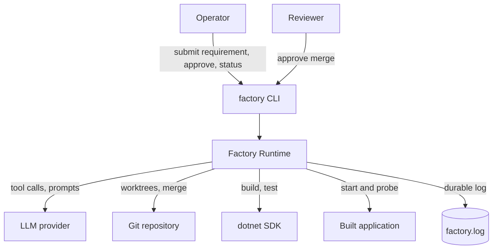
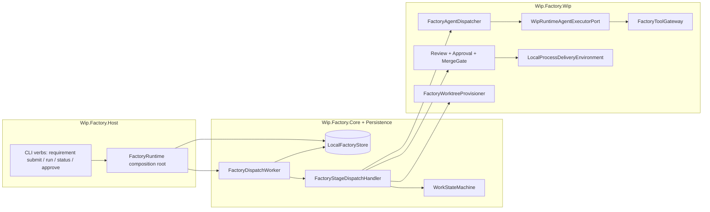
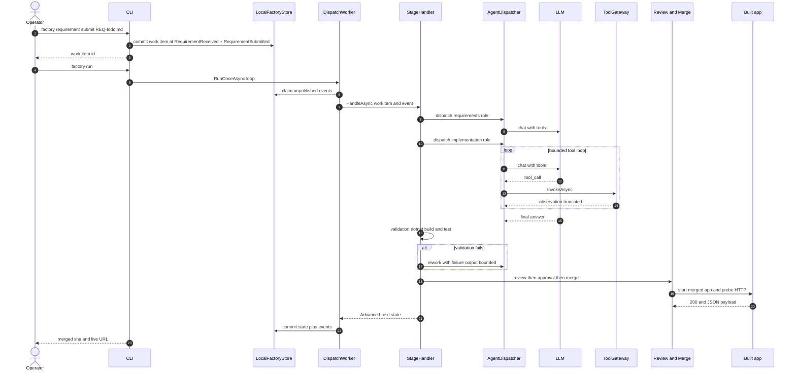
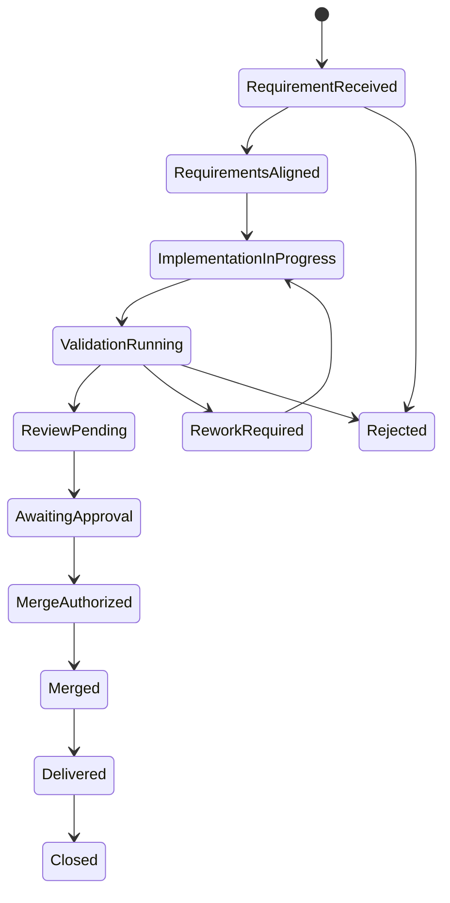
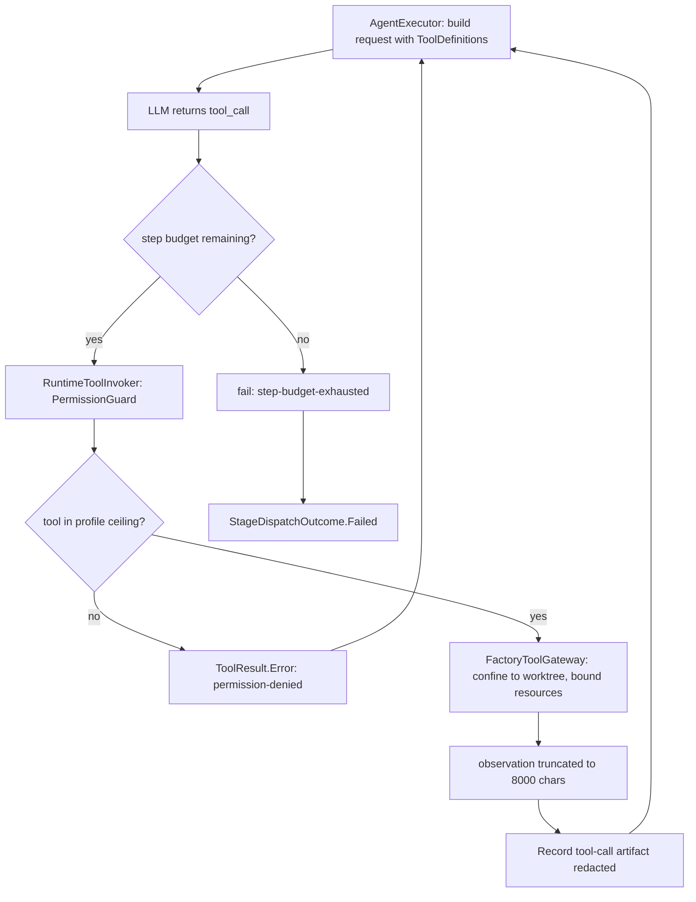
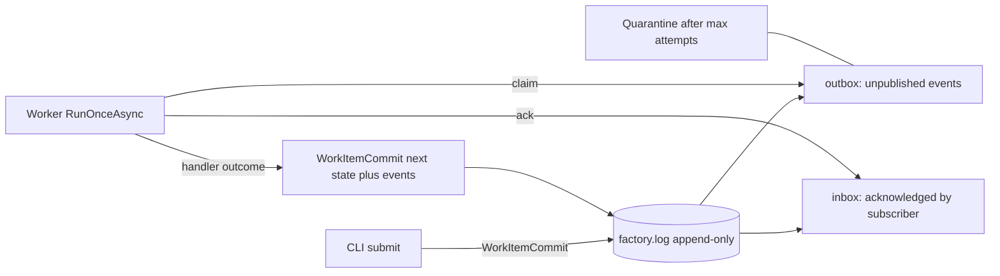

# Wip.Factory Operator Alpha — Requirement Set

**Status: SUPERSEDED by v0.2** — do not implement this version. See `Wip.Factory.Operator.Alpha.v0.2.md`. — decisions D-01…D-07 are user-owned (see §4).
Version 0.1 · 2026-11-18 · Supersedes nothing; extends `Wip.Factory.Alpha.md`

---

## 1. Why this document exists

The delivered `Wip.Factory.Alpha.md` alpha passes its nine definition-of-done gates, but it is **not a
factory you can feed work to**. Evidence from the delivered code:

| Claim implied by "functional alpha" | What the code actually does |
|---|---|
| A host accepts requirements | `Wip.Factory.Host` exposes only `factory demo <verb>`; each verb builds its own in-memory objects |
| Requirements are stored | No requirement store is used; `LocalFactoryStore` is referenced **nowhere** in the host |
| Requirements are published | `FactoryEventTypes.RequirementSubmitted` exists as a constant; nothing ever publishes it |
| Event-driven dispatch runs | `IStageDispatchHandler` is implemented **only in `DispatchWorkerTests.cs`** — never composed in production |
| The factory builds software | Requirements are hardcoded string literals (`"REQ-todo-app"`); building any application required writing a new ~400-line C# demo class |

The user's words that define this alpha:

> "it should receive requirements and build working software… it should be able to do tool calls to get it
> right"
> "you shouldn't have to write an app to use the factory? doesnt it have a host? how does it accept
> requirements? does it have a requirement publish or store?"

**Goal of this alpha:** an operator submits a requirement to a running factory host and receives a merged,
running, HTTP-verified application — with no new C# written per application.

---

## 2. Intent fidelity

| # | User mechanism (verbatim) | Status | Where honoured |
|---|---|---|---|
| A1 | "receive requirements" | **KEPT** | F-A: durable intake with operator-supplied text and acceptance criteria |
| A2 | "build working software" | **KEPT** | F-F/F-G: real build, real tests, real HTTP probe of the merged app |
| A3 | "do tool calls to get it right" | **KEPT** | F-D: list/read/write/run tool gateway with a multi-step agent loop and self-correction |
| A4 | "you shouldn't have to write an app to use the factory" | **KEPT** | F-B: `factory requirement submit` / `factory run` / `factory status`; no per-app code |
| A5 | "doesnt it have a host" | **KEPT** | F-B.1: one composition root, one durable runtime, CLI verbs |
| A6 | "requirement publish or store" | **KEPT** | F-A.3/F-C: `RequirementSubmitted` event + durable `IWorkItemStore` |
| A7 | (prior alpha) nine roles, improvement loop, RustLace, admission | **KEPT** | untouched; D1–D9 regression must stay green |

No mechanism is replaced or removed. Nothing in this set requires user-approved exclusion.

---

## 3. Scope

**In scope:** requirement intake, host composition, production stage dispatch, tool gateway, agent
tool-call loop, validation and rework, review/approval/merge reuse, local deployment and live probe,
operator CLI visibility, durable resume.

**Out of scope:** a dashboard (M-17 remains satisfied by CLI + machine-readable output), containers or
cloud deployment, multi-tenant concurrency, a second model loop or tool gateway (all tools go through
WIP's existing `IToolInvoker`), and any new merge policy.

---

## 4. Decisions requiring sign-off

Each has a recommendation; the build is blocked until these are answered.

| ID | Decision | Options | Recommendation |
|---|---|---|---|
| **D-01** | Requirement intake channel | (a) CLI file-based `factory requirement submit --file req.md` (b) HTTP endpoint (c) both | **(a)** — durable, scriptable, testable; (b) can follow |
| **D-02** | Who authors acceptance tests | (a) factory derives them from the requirement's acceptance criteria (b) the model writes them (c) both, model may add but not weaken | **(a) + (c)** — a model must never grade its own work; model may add tests, never remove or weaken an acceptance test |
| **D-03** | `run` tool command allowlist | (a) `dotnet` only (b) `dotnet` + `git` (c) unrestricted | **(a)** — no shell, no metacharacters; `git` stays a factory concern, not a model concern |
| **D-04** | Roles per requirement | (a) minimal 3-role path: requirements → implementation → review (b) all nine, always (c) 3-role default, others on trigger | **(c)** — nine remain available; the default path must not require nine agent turns |
| **D-05** | Where the built app runs | (a) local child process on a free port, probed over HTTP (b) container (c) no deployment, tests only | **(a)** — already implemented and proven by `LocalProcessDeliveryEnvironment` |
| **D-06** | Durable state location | (a) `.wip/factory/` in the repository (b) OS temp per run | **(a)** — enables resume, inspection and replay |
| **D-07** | Fate of the existing seven `demo` verbs | (a) keep as regression harness, clearly non-primary (b) delete | **(a)** — they are the D1–D9 evidence; keep and label |

---

## 5. Architecture

### 5.1 System context

### 5.2 Components

### 5.3 Requirement to running application

### 5.4 Work state machine (existing, now actually driven)

State labels map to `FactoryWorkState` members in `Wip.Factory.Contracts/Work`; the implementation
aligns the literal names and every transition must be accepted by the existing `WorkStateMachine`
(no new states, no new edges without an amendment).

### 5.5 Tool-call loop

### 5.6 Persistence and event spine

---

## 6. Functional requirements

### F-A — Requirement intake

1. `factory requirement submit --file <path> [--title <t>]` accepts a Markdown requirement file.
2. The file must contain a title and at least one acceptance criterion; submission is refused with a named error otherwise.
3. A submission creates one durable work item with a stable `WorkItemId` and a monotonically increasing version.
4. A submission emits `factory.requirement.submitted.v1` carrying the requirement text, its acceptance criteria and a content digest.
5. Re-submitting byte-identical content is idempotent: the same requirement is not duplicated.
6. The requirement text, criteria and digest are recoverable from the durable store after a process restart.
7. The CLI prints the work item id, state and digest in machine-readable form.
8. A requirement whose digest cannot be recomputed is refused before any state is committed.

### F-B — Host composition (no per-application code)

1. One composition root assembles store, worker, handler, dispatcher, tools, governance and delivery.
2. `factory run` drives the worker until no work remains or a bound is reached, then reports counts.
3. `factory status [--work-item <id>]` reports state, version, events, attempts and next legal actions.
4. `factory approve --work-item <id> --digest <d>` records an operator approval against a specific artifact digest.
5. Building a new application requires **zero** new C# — only a requirement document.
6. All state lives under `.wip/factory/`; a second `factory run` resumes without redoing committed work.
7. The runtime exposes the same surface to tests as to the CLI (one entry point, not two).
8. Startup refuses to run if the store directory is inside the target repository's worktree tree.

### F-C — Stage dispatch (production)

1. A production `IStageDispatchHandler` maps `(workItem.State, event.Type)` to one role dispatch.
2. Unknown trigger types return `NoOp` and never advance state.
3. Every advanced state is validated by `WorkStateMachine.LegalTargets` before commit; an illegal target fails the stage with a named category.
4. The handler owns no scheduling, no leasing and no state commit — those stay with the worker.
5. A stage that exhausts attempts is quarantined and reported, never silently dropped.
6. Dispatch is idempotent per `(workItem, event)`: a replayed event does not re-run side effects.
7. Each stage records its role, profile version, model id, tokens and duration as events.

### F-D — Tool gateway

1. Four tools are exposed: `list_files`, `read_file`, `write_file`, `run_command`.
2. Every path is resolved inside the session worktree; absolute paths and traversal are refused with `path-outside-worktree`.
3. `write_file` creates parent directories and returns the byte count written.
4. `read_file` truncates observations and reports truncation.
5. `run_command` accepts a program plus an argument vector, never a shell string; metacharacters are not interpreted.
6. `run_command` refuses any program outside the configured allowlist (D-03).
7. `run_command` is bounded by wall time, process memory and process count, and reports `TerminatedByWallTime`.
8. Tool output handed back to the model is truncated to a documented limit with an explicit marker.
9. Every tool call is recorded as a redacted artifact; the observation is not persisted verbatim when it contains secrets.
10. A tool invoked without a worktree fails with `no-worktree` rather than writing to the process directory.

### F-E — Agent tool-call loop

1. The agent receives `ToolDefinition`s derived from the profile's pinned capability list only.
2. The loop terminates on final answer, step budget, wall clock or cancellation — each with a distinct failure category.
3. A tool error is returned to the model as an observation, not a stage failure, so the model can self-correct.
4. Step and time budgets are recorded per dispatch and reported to the operator.
5. The loop issues exactly one model call per step; no hidden retries.
6. A dispatch that exceeds its budget fails the stage with `step-budget-exhausted` or `timeout`.

### F-F — Validation and rework

1. Validation runs a real `dotnet build` and, when test projects exist, a real `dotnet test` in the session worktree.
2. Build or test failure is reported with exit code and truncated output.
3. A failed validation triggers at most `N` rework dispatches (default 2), each receiving the failure output.
4. Exhausting rework fails the stage with `validation-failed` and records the last output as evidence.
5. Validation is executed by the factory, never trusted from the model's claims.
6. A stage cannot reach review without a passing validation result recorded on the work item.

### F-G — Governance and delivery (reuse, not reimplementation)

1. Review reuses `FactoryReviewService` with four checks; a missing check refuses the review.
2. Approval binds to artifact digest, base sha, head sha, policy id and profile version.
3. Merge reuses `FactoryMergeGate`; no merge without a valid approval, exactly one merge per approval.
4. The merged application is started as a real process and probed over HTTP.
5. A failed probe refuses delivery and restores the previous release.
6. The live URL, response status and body are recorded as evidence.

### F-H — Operator visibility

1. `factory status` shows every work item with state, version, digest and last failure category.
2. Per-work-item `factory show` lists events in commit order with correlation ids.
3. The CLI has no interactive prompts in `run`; refusals are exit codes plus a machine-readable reason.
4. All operator-facing output is stable, parseable and free of secrets.

### F-I — Durability and resume

1. Killing the process mid-run and re-running resumes from committed state without duplicating merges.
2. The outbox and inbox are durable; a dispatched event is never re-dispatched after acknowledgement.
3. A partially written log record is discarded on read, never half-applied.
4. Fencing tokens prevent two concurrent runs from advancing the same work item.

---

## 7. Non-functional requirements

| ID | Requirement |
|---|---|
| N-1 | The existing 86 factory tests and the 460/3 baseline stay green. |
| N-2 | No second model loop, tool gateway, worktree engine or merge policy is introduced. |
| N-3 | No secrets reach the durable log, artifacts or CLI output. |
| N-4 | A full requirement-to-live-app run completes in under 15 minutes on this machine or fails with a named category. |
| N-5 | Every new failure path has a named category string, not a bare exception. |
| N-6 | All new identifiers are typed, never `string` (no-primitive-obsession). |
| N-7 | All new behaviour is covered by a named test in §8. |
| N-8 | UTF-8 without BOM everywhere; no new build warnings. |

---

## 8. Named behaviour-proof tests

1. `Intake_GivenRequirementFile_CommitsWorkItemAndEmitsRequirementSubmitted`
2. `Intake_GivenFileWithoutAcceptanceCriteria_IsRefused`
3. `Intake_GivenIdenticalContentTwice_IsIdempotent`
4. `Intake_GivenRestart_RequirementIsRecoverable`
5. `Intake_GivenCorruptedDigest_CommitsNothing`
6. `Host_GivenSubmittedRequirement_BuildsWithoutNewCode`
7. `Host_GivenSecondRun_ResumesWithoutRedoingCommittedWork`
8. `Host_GivenStatus_ReportsStateVersionAndDigest`
9. `Host_GivenApproveWithWrongDigest_RefusesApproval`
10. `Host_GivenStoreInsideWorktree_RefusesToStart`
11. `StageHandler_GivenUnknownTrigger_ReturnsNoOp`
12. `StageHandler_GivenIllegalTargetState_FailsWithCategory`
13. `StageHandler_GivenReplayedEvent_DoesNotRepeatSideEffects`
14. `StageHandler_GivenExhaustedAttempts_QuarantinesAndReports`
15. `StageHandler_GivenStageDispatch_RecordsRoleProfileModelAndTokens`
16. `ToolGateway_GivenAbsolutePath_IsRefused`
17. `ToolGateway_GivenTraversalPath_IsRefused`
18. `ToolGateway_GivenWriteFile_CreatesDirectoriesAndReportsBytes`
19. `ToolGateway_GivenReadFile_TruncatesAndReportsTruncation`
20. `ToolGateway_GivenShellMetacharacters_TreatsThemAsLiteralArguments`
21. `ToolGateway_GivenProgramOutsideAllowlist_IsRefused`
22. `ToolGateway_GivenLongRunningCommand_IsBoundedByWallTime`
23. `ToolGateway_GivenNoWorktree_FailsWithoutWriting`
24. `ToolGateway_GivenSecretInOutput_RedactsArtifact`
25. `AgentLoop_GivenToolError_ReturnsObservationAndContinues`
26. `AgentLoop_GivenStepBudgetExhausted_FailsWithCategory`
27. `AgentLoop_GivenCancellation_StopsBeforeNextModelCall`
28. `AgentLoop_GivenProfileWithoutTool_DoesNotOfferItToTheModel`
29. `Validation_GivenBuildFailure_FailsStageWithOutput`
30. `Validation_GivenPassingTests_AdvancesToReview`
31. `Validation_GivenFailedTests_ReworkReceivesFailureOutput`
32. `Validation_GivenReworkExhausted_FailsWithValidationFailed`
33. `Validation_GivenModelClaimsSuccessButTestsFail_StageFails`
34. `Governance_GivenMissingReviewCheck_RefusesReview`
35. `Governance_GivenValidApproval_MergesExactlyOnce`
36. `Delivery_GivenRunningApp_ProbesAndRecordsResponse`
37. `Delivery_GivenFailedProbe_RestoresPreviousRelease`
38. `Resume_GivenKilledProcess_DoesNotMergeTwice`
39. `Resume_GivenConcurrentRuns_FencingRejectsTheSecond`
40. `Operator_GivenRun_EmitsMachineReadableCountsAndExitCodes`

---

## 9. Traceability to the delivered alpha

The nine gates from `Wip.Factory.Alpha.md` remain in force and unmodified; this alpha adds the missing
**operator path** on top of them:

| Prior gate | This alpha |
|---|---|
| D1 build, D2 architecture | must stay green (N-1) |
| D3 82 named tests | unchanged; adds tests 1–40 above |
| D5 requirement-to-merge | becomes reachable through CLI intake rather than a demo class |
| D8 nine roles | three-role default with nine available (D-04) |
| D9 admission | unchanged |

---

## 10. Open questions

| ID | Question | Default if unanswered |
|---|---|---|
| **OQ-101** | Should the requirement file carry structured front-matter (AC ids, priorities) or free text with a criteria list? | Structured YAML front-matter plus free-text body |
| **OQ-102** | Step and wall-clock budget per implementation stage? | 40 steps / 10 minutes |
| **OQ-103** | May the model modify acceptance tests at all? | It may add tests; modifying or deleting an acceptance test is a security-check failure |
| **OQ-104** | Concurrency: one active work item or several in parallel? | One at a time in this alpha |
| **OQ-105** | What should happen on merge conflict? | Fail the stage with `merge-conflict` and leave the worktree for an operator |
| **OQ-106** | Should validation also run `dotnet format`/analyzers? | No; build and test only |

---

## 11. Acceptance of this document

This requirement set is reviewable in isolation. Implementation starts only after D-01…D-07 are answered,
because each changes public surface: intake channel (D-01), test authorship (D-02), tool allowlist (D-03),
role path (D-04), deployment shape (D-05), state location (D-06) and demo retention (D-07).

**Diagrams:** §5.1 context · §5.2 components · §5.3 sequence · §5.4 state machine · §5.5 tool loop ·
§5.6 persistence.
