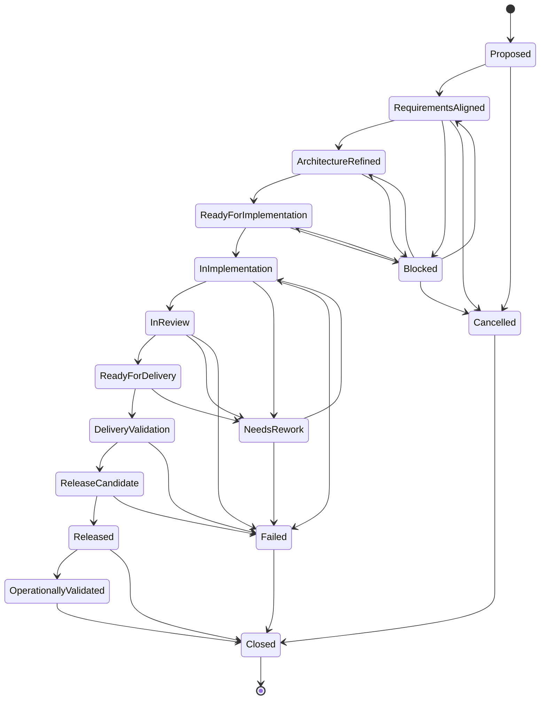
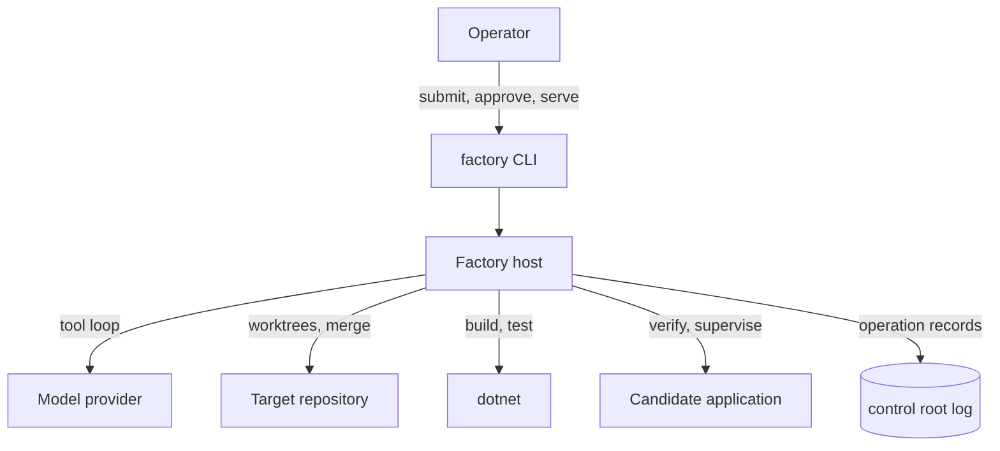
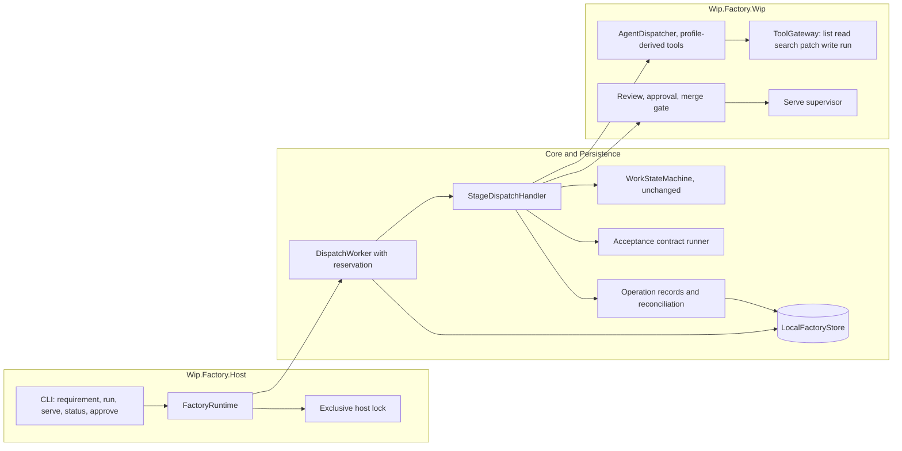
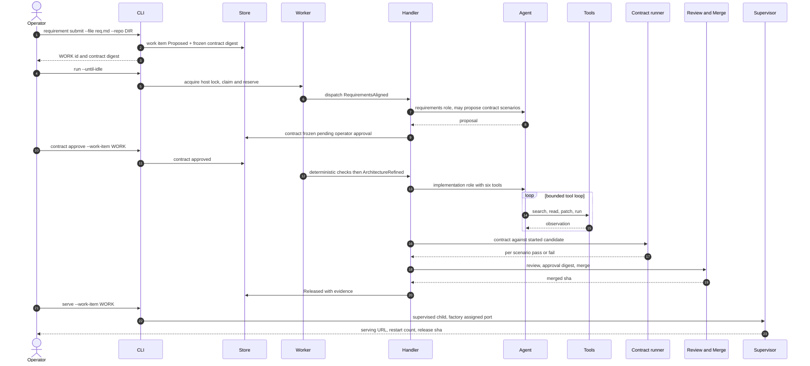
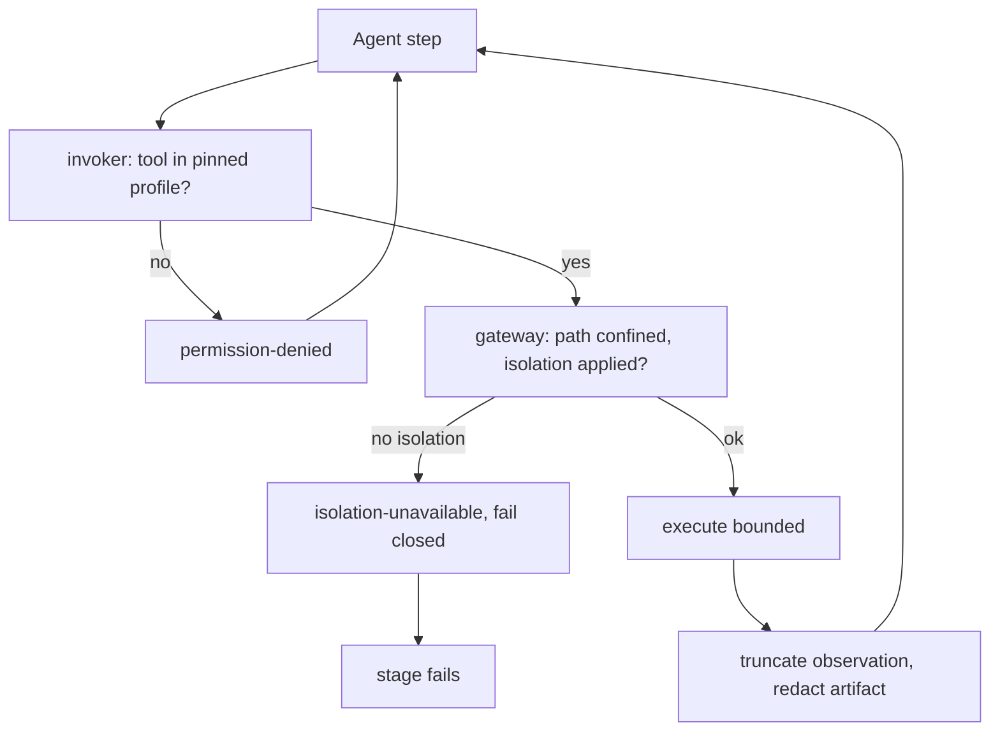
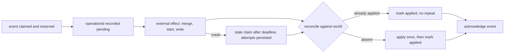

# Wip.Factory Operator Alpha — Requirement Set **v0.2**

**Status: `DIRECTION APPROVED — v0.2 FOR SIGN-OFF`**
Revision of v0.1 after external review at `4a9793a`. Supersedes the v0.1 body entirely.
2026-11-18

> v0.1 is rejected, not amended in place. Every finding below is either a verified defect in the
> delivered code, an internal inconsistency in v0.1, or an unearned guarantee. Where v0.1 and v0.2
> disagree, v0.2 governs.

---

## 0. What changed, and what was verified

Each row is a review finding plus my own check against the branch. Nothing here is accepted on the
reviewer's authority alone — the four P0s that could be checked in code were checked in code.

| # | Finding | My verification | v0.2 change |
|---|---|---|---|
| 1 | v0.1 state machine invents states | **CONFIRMED.** `FactoryWorkState` has 16 members: `Proposed, RequirementsAligned, ArchitectureRefined, ReadyForImplementation, InImplementation, InReview, ReadyForDelivery, DeliveryValidation, ReleaseCandidate, Released, OperationallyValidated, Blocked, NeedsRework, Failed, Cancelled, Closed`. My v0.1 diagram named `RequirementReceived`, `ValidationRunning`, `AwaitingApproval`, `Merged`, `Delivered` — none exist. | §3.1 replaces the diagram with the real 16 states, the real adjacency, and an exact event→transition table. No new states. |
| 2 | No independent acceptance oracle | **CONFIRMED by design.** v0.1 F-F validated by `dotnet test`, i.e. tests the implementation agent could author. | §3.2 freezes a factory-owned **HTTP acceptance contract** at intake; §3.2.4 forbids any dependency on generated tests. PA-04 proves the oracle can fail a wrong implementation. |
| 3 | Exactly-once is not established | **CONFIRMED.** `ClaimUnpublishedAsync` filters `!Published` and returns — it does **not** reserve. `FactoryDispatchWorker` references leases **0 times** while `LocalFactoryStore` exposes **69** lease/fencing references. `FactoryMergeGate` dedupes via a process-local `HashSet`. | §3.3 replaces "exactly once" with **effectively-once via persisted operation records + reconciliation**, plus an OS host lock. Claims become reservations. |
| 4 | A probe is not a deployment | **CONFIRMED.** `LocalProcessDeliveryEnvironment` keeps its release registry in memory and `Dispose()` kills the child. | §3.4 separates **verification** from **supervision**: `factory serve` owns the process; probes bind to a factory-assigned port and the factory-started PID. |
| 5 | Allowlist is not isolation | **CONFIRMED.** `BoundedProcessRunner` reports `IsolationApplied=false` without failing, and resource limits are not filesystem/network isolation. | §3.5 makes execution **fail-closed** on missing isolation; §3.5.3 documents the MSBuild code-execution residual and the trusted-environment opt-in. |
| 6 | Tool contract too weak | **Accepted.** Whole-file writes are a poor default for unfamiliar repositories. | §3.6 adds `search_text` and `apply_patch`; §3.6.2 enforces the profile ceiling **at invocation**. |
| 7 | Profile ceiling not enforced at invocation | **CONFIRMED.** `FactoryAgentDispatcher` passes caller-supplied `dispatch.Tools` straight through; only profile *references* are checked. | §3.6.2: exposed tools are derived from the pinned profile, and the invoker rejects anything outside it. |
| 8 | Storage location contradicts itself | **CONFIRMED.** v0.1 F-B.6 said `.wip/factory/`; F-B.8 forbade control state inside a worktree. | §3.7 defines a **control root** separate from the target repository; worktrees live under it. |

Additionally, v0.1 carried a defect the review implied but did not name: **`DeliveryValidation` cannot
reach `NeedsRework`** in the shipped adjacency (it may only reach `ReleaseCandidate` or `Failed`). See
**D-08** in §8 — this is a user decision, not mine to take.

---

## 1. Product Acceptance Gate (top-level definition of done)

These eight gates sit **above** every component gate. Passing the 40 supporting tests does not
satisfy them, and no internal test may substitute for them.

| Gate | Required proof | How it is executed |
|---|---|---|
| **PA-01** | A clean installation accepts an **unfamiliar** supported requirement, from an unmodified factory, and delivers a running application whose behaviour passes the frozen contract | operator CLI only; no app-specific source, no factory edit |
| **PA-02** | A **second, behaviourally different** requirement also passes, with no factory change between runs | same host binary, different requirement file |
| **PA-03** | Generated source exists, is attributable, and matches the merged revision | diff vs base sha, non-empty; merged tree contains it; artifact links work item → session → diff |
| **PA-04** | The acceptance oracle **catches a deliberately incorrect implementation** | inject a known-wrong candidate; contract must fail it |
| **PA-05** | Killing the factory during implementation, merge and delivery recovers safely | kill at three points, resume, assert no double merge and no corrupted state |
| **PA-06** | An approval cannot be reused after code, policy or evidence changes | mutate each of the seven bound fields; merge must refuse |
| **PA-07** | The live endpoint belongs to the intended release and satisfies the requirement | factory-started PID on a factory-assigned port + acceptance contract |
| **PA-08** | Unpinned tools, unsafe paths and unsupported execution environments are refused | negative tests at the tool, profile and process layers |

**PA-01 and PA-02 are the non-negotiable acceptance criterion.** A v0.2 delivery that cannot show two
unfamiliar requirements built by the unchanged host is not a delivery, regardless of any other result.

**Held-out requirement rule:** the requirements used for PA-01/PA-02 must not be the ones used while
building the factory. The implementer declares two requirement files in advance, and their acceptance
contracts are frozen before implementation starts.

---

## 2. Supported application class

The factory makes a real but bounded promise. For this alpha the supported class is:

> **A single-repository ASP.NET Core HTTP application targeting .NET 10, exposing JSON HTTP endpoints,
> described by a declarative HTTP acceptance contract.**

- May: create or modify projects in the target repository, add endpoints, add internal tests.
- May not be relied upon: databases, background services, authentication, websockets, multiple
  repositories, other languages, desktop UI, containers or cloud deployment.
- A requirement outside the class is **refused at intake** with `requirement-outside-supported-class`,
  not attempted and then failed late.

The 15-minute target (N-4) is a benchmark for a documented reference workload on this machine, not a
claim about every requirement.

---

## 3. Architectural corrections

### 3.1 Work-state model — exact, no additions

The 16 states and the adjacency below are the shipped `WorkStateMachine`. v0.2 adds **no states and no
edges**; approval, merge, validation and tool progress are **evidence records attached to a state**,
not states.



**Exact event → transition table.** Any event not listed here is a stage `NoOp`, never a transition.

| Event | From | To | Produced by | Guards (all must hold) |
|---|---|---|---|---|
| `factory.requirement.submitted.v1` | `Proposed` | `RequirementsAligned` | requirements role | requirement valid; class supported; contract frozen |
| `factory.requirement.refused.v1` | `Proposed` | `Cancelled` | intake | requirement outside supported class |
| `factory.architecture.aligned.v1` | `RequirementsAligned` | `ArchitectureRefined` | **deterministic checks** | contract parses; target repo is a single repo; no disallowed dependency |
| `factory.implementation.planned.v1` | `ArchitectureRefined` | `ReadyForImplementation` | deterministic | plan artifact present |
| `factory.implementation.requested.v1` | `ReadyForImplementation` | `InImplementation` | worker | — |
| `factory.implementation.completed.v1` | `InImplementation` | `InReview` | implementation role | **attributable non-empty diff**; build green (§3.8) |
| `factory.review.accepted.v1` | `InReview` | `ReadyForDelivery` | review role | four checks + contract pass recorded |
| `factory.review.rejected.v1` | `InReview` | `NeedsRework` | review role | rework budget remaining |
| `factory.rework.requested.v1` | `NeedsRework` | `InImplementation` | worker | rework budget remaining |
| `factory.delivery.requested.v1` | `ReadyForDelivery` | `DeliveryValidation` | worker | approval valid and unapplied |
| `factory.delivery.validated.v1` | `DeliveryValidation` | `ReleaseCandidate` | delivery | candidate built; contract green; approval still valid |
| `factory.release.approved.v1` | `ReleaseCandidate` | `Released` | operator approval | approval digest matches candidate |
| `factory.release.observed.v1` | `Released` | `OperationallyValidated` | supervision probe | served candidate matches release |
| `factory.work.closed.v1` | `OperationallyValidated`, `Failed`, `Cancelled`, `Released` | `Closed` | operator or policy | — |
| `factory.stage.failed.v1` | per adjacency | `Failed` | any stage | — |

Failure at `DeliveryValidation` **cannot** reach `NeedsRework` in the shipped adjacency. See D-08.

### 3.2 Frozen acceptance contract (the independent oracle)

**3.2.1 Shape.** Intake produces a structured HTTP contract, not prose:

```yaml
requirement: book-catalog
supportedClass: aspnetcore-http-net10
basePath: /
scenarios:
  - id: AC-1
    method: POST
    path: /books
    body: { title: "Dune", author: "Herbert" }
    expect: { status: 201, json: { title: "Dune", author: "Herbert" } }
    capture: { bookId: "$.id" }
  - id: AC-2
    method: GET
    path: /books/{bookId}
    expect: { status: 200, json: { title: "Dune" } }
  - id: AC-3
    method: DELETE
    path: /books/{bookId}
    expect: { status: 204 }
  - id: AC-4
    method: GET
    path: /books/{bookId}
    expect: { status: 404 }
```

**3.2.2 Freeze.** The contract is written to the durable store and digest-pinned **before**
`ArchitectureRefined`. From that moment it is immutable.

**3.2.3 Who may change it.** Only an operator, by submitting a new requirement revision (a new work
item). Neither the implementation role nor the review role may edit, skip, reorder or relax a scenario.

**3.2.4 Execution.** A factory-owned deterministic runner executes the contract against the running
candidate: real HTTP, `capture` values substituted, per-scenario pass/fail recorded with request and
response digests. **It does not invoke `dotnet test` and does not trust the repository's tests.**

**3.2.5 Ambiguity is refused, not guessed.** A requirement whose acceptance cannot be expressed as
observable HTTP behaviour is refused at intake with `acceptance-not-observable`. Guessing is how a
factory silently builds the wrong application.

**3.2.6 Independence.** The contract is derived at intake from the requirement text and **approved by
the operator before implementation starts** — a human or policy gate, not a second LLM agreeing with
the first. PA-04 is the proof that this oracle can actually reject.

### 3.3 Effectively-once: operation records, not "exactly once"

v0.1 promised exactly-once processing of arbitrary external effects. That is not achievable and will not
be claimed.

**3.3.1 Claiming reserves.** `ClaimUnpublishedAsync` must, in one durable commit, mark the event
`claimed` with subscriber, attempt count and a claim deadline. A crash leaves a stale claim that is
reclaimable after the deadline, with the attempt count **persisted**, not in a dictionary.

**3.3.2 Operation identity.** Each externally visible effect carries
`operationId = sha256(workItemId | eventId | stage | operationKind)`. Every operation is recorded
`pending → applied | failed` in the log before and after it runs.

**3.3.3 Reconciliation on restart.** Before applying an operation, the factory reconciles against the
world, because the log may be behind reality:

| Operation | Reconciliation |
|---|---|
| merge | `git rev-parse` proves whether the merge commit already exists and contains the head sha |
| delivery start | process table + port ownership proves whether the candidate is already running |
| file write | content digest of the target file |
| approval apply | persisted `applied` record keyed by approval id, not a `HashSet` |

**3.3.4 Single-writer lock.** For this alpha the host takes an **exclusive OS lock file** in the control
root at `factory run`. A second run exits `host-lock-held`. Multi-process concurrency is explicitly
*not* claimed; the lock makes that honest rather than pretending fencing already covers it.

**3.3.5 The promise.** "Effectively-once outcomes for operations that are idempotent or reconcilable."
Anything else is documented as at-least-once.

### 3.4 Delivery verification vs application supervision

**3.4.1 Split.** `factory run` verifies; `factory serve` supervises.

- `factory run --until-idle` starts the candidate **only** as a short-lived verification process, runs
  the contract, records evidence, and stops it.
- `factory serve --work-item <id>` starts the merged application as a **supervised** child, keeps the
  factory process alive, restarts on unexpected exit (bounded), and records each transition.

**3.4.2 Candidate identity.** Verification must prove it spoke to *this* candidate:

1. the factory allocates the port (never a fixed port),
2. the PID it started is the PID listening,
3. the process is still alive at probe time,
4. only then are scenarios executed.

This closes the failure mode where an older release answers on a reused port.

**3.4.3 Honest reporting.** `factory run` must never print "deployed" or "live" for a process it then
kills. It prints `verified at <url> (process stopped)`. Only `factory serve` reports `serving`.

**3.4.4 Rollback.** A failed verification restores the previous release reference and records
`rollback-performed`; it does not leave a half-started candidate.

### 3.5 Execution isolation is fail-closed

**3.5.1** If the process bound cannot be applied (`IsolationApplied == false`), `run_command` **fails**
with `isolation-unavailable`. It must not silently degrade — v0.1's F-D.7 was ambiguous here.

**3.5.2** Allowed subcommands only: `build`, `test`, `run`, `publish`, `restore`, `new`. `dotnet test`
may run only against projects the factory created or explicitly permitted.

**3.5.3 Residual risk, stated plainly.** A `.csproj` can contain MSBuild targets that execute arbitrary
processes; `dotnet`-only allowlisting does not prevent that, and Job Objects bound resources but do not
confine the filesystem or network. Two mitigations for this alpha:

1. the target repository is a fresh, dedicated repository, not a working tree with other content;
2. the operator must pass `--trusted-environment` for the alpha, which is recorded in the log and in
   every delivery artifact.

Claims of sandboxing beyond this are forbidden in the documentation.

**3.5.4** Paths remain worktree-confined: absolute paths and traversal refused with
`path-outside-worktree`; a session without a worktree fails with `no-worktree`.

### 3.6 Tool contract v2

**3.6.1 Tools.** `list_files`, `read_file`, `search_text`, `apply_patch`, `write_file`, `run_command`.

- `search_text` — bounded regex/literal search with file filters, returns path:line with a match cap.
- `apply_patch` — atomic unified-diff application; refuses on conflict, returns the hunks applied.
- `write_file` remains for new files and whole-file replacement, not as the primary edit path.

**3.6.2 Ceiling enforced at invocation.** Exposed `ToolDefinition`s are derived from the **pinned
profile**, and `IToolInvoker` re-checks the same pinned set per call. A tool outside the ceiling returns
`permission-denied` even if the model requests it by name. Fixes the pass-through in
`FactoryAgentDispatcher`.

**3.6.3 Bounds.** Every tool call is bounded by wall time and output size, with an explicit truncation
marker; tool-call artifacts are redacted, observations are not stored verbatim when they contain secrets.

### 3.7 Control root vs target repository

| Path | Contents | Rule |
|---|---|---|
| `<controlRoot>` (default `%LOCALAPPDATA%\wip-factory\<repoId>`) | `factory.log`, artifacts, registry, leases, lock | **never** inside the target repository or a worktree |
| `<targetRepo>` | the operator's repository, passed explicitly | created empty or cloned; never auto-initialised in place |
| `<controlRoot>/worktrees/<session>` | session worktrees | outside the target repo |

Startup refuses with `control-root-inside-target` if the resolved control root is inside the target
repository. v0.1 F-B.6/F-B.8 conflict is resolved in favour of separation.

### 3.8 Software-production contract

An implementation stage is complete only when **all** hold; otherwise the stage fails:

1. the worktree diff against the base sha is **non-empty**;
2. at least one project file exists and the project class matches §2;
3. `dotnet build` succeeds with an attributable exit code;
4. a runnable entry point exists and the factory can start it;
5. a durable artifact links `workItemId → sessionId → profileVersion → baseSha → headSha → diffDigest`.

A conversational "I implemented it successfully" with no diff is `no-attributable-change` and fails the
stage. This is the requirement that stops a chat transcript from being mistaken for a product.

---

## 4. Diagrams

### 4.1 Context



### 4.2 Components



### 4.3 Requirement to running software



### 4.4 Tool loop with ceiling enforcement



### 4.5 Effectively-once operations



---

## 5. Requirements

Only deltas from v0.1 are listed where v0.1 survives. Items removed from v0.1 are named in §5.3.

### F-A — Intake and contract

1. `factory requirement submit --file <path> --repo <dir>` requires an explicit target repository.
2. Intake validates: title present; `supportedClass` present; every scenario has method, path and expected status; at least one scenario.
3. Unsupported or unobservable requirements are refused at intake (`requirement-outside-supported-class`, `acceptance-not-observable`) and produce no work item.
4. A submission commits a work item at `Proposed` plus the contract digest in one atomic commit.
5. `factory contract show|approve --work-item <id> --digest <d>` freezes the contract; implementation cannot start before it is frozen.
6. Re-submitting identical content is idempotent.
7. Requirement text, scenarios and digest survive restart.
8. A contract whose recomputed digest differs from the pinned digest blocks the work item with `contract-tampered`.

### F-B — Host

1. One composition root assembles store, worker, handler, dispatcher, tools, contract runner, governance and supervisor; the CLI is a thin adapter over it.
2. `factory run --until-idle` acquires the exclusive lock, drains work, and reports counts and exit code.
3. A second concurrent `run` exits `host-lock-held`.
4. `factory status` and `factory show` are machine-readable and secret-free.
5. `factory serve` supervises; `factory run` never claims to have deployed.
6. Building a new application requires no factory source change — PA-02 is the proof.
7. Startup refuses if the control root resolves inside the target repository or any worktree.

### F-C — Stage dispatch

1. The production handler maps `(state, event)` to exactly one action using §3.1's table.
2. Unlisted events are `NoOp`.
3. Every transition is validated by `WorkStateMachine` before commit; illegal targets fail with `illegal-transition`.
4. The handler performs no leasing, scheduling or committing.
5. Attempts are persisted and survive restart; exhaustion quarantines with a reason.
6. Dispatch is idempotent per `(workItem, event)`.
7. Each stage records role, profile version, model id, tokens, duration and operation id.
8. `ArchitectureRefined` and `ReadyForImplementation` are reached by deterministic checks, not extra LLM turns.

### F-D — Tool gateway

1. Six tools as §3.6.1.
2. Path confinement as v0.1 F-D.2, now including `apply_patch` targets.
3. `run_command` is argument-vector only; no shell; metacharacters literal.
4. Only the §3.5.2 subcommands.
5. Fail-closed when isolation is unavailable.
6. Output truncated with marker; artifacts redacted.
7. A tool outside the pinned profile is refused at invocation.
8. Mismatch between exposed tools and pinned profile is a startup failure.

### F-E — Agent loop

1. Tools offered = pinned profile ∩ implemented tools.
2. Loop ends on final answer, step budget, wall clock or cancellation — distinct categories.
3. Tool errors return as observations so the model can correct itself.
4. Budgets recorded per dispatch.
5. One model call per step.

### F-F — Verification and rework

1. The **acceptance contract** is the primary gate; generated repository tests are advisory only.
2. Contract execution is real HTTP against a factory-started candidate on a factory-allocated port.
3. Failure records per-scenario evidence and enters rework at most `N` times (default 2).
4. Rework receives the failing scenarios verbatim, not a summary.
5. Exhaustion fails the stage with `acceptance-contract-failed`.
6. Build must be green before contract execution.
7. No stage reaches `ReadyForDelivery` without a green contract record bound to the head sha.

### F-G — Governance and merge

1. Review reuses `FactoryReviewService`; four checks required.
2. Approval binds digest, base sha, head sha, policy id, profile version, contract digest, contract result.
3. Merge reuses `FactoryMergeGate`; applied approvals are **persisted**, never a `HashSet`.
4. Merge is reconciled against git before applying.
5. Exactly one merge per approval; a changed bound field invalidates it (PA-06).
6. Merge conflict fails with `merge-conflict` leaving the worktree for an operator.

### F-H — Delivery

1. `factory run` starts, verifies, stops and reports `verified ... (process stopped)`.
2. `factory serve` supervises with bounded restarts and records transitions.
3. Candidate identity per §3.4.2 before any scenario runs.
4. Failed verification restores the previous release reference.
5. Serving requires a `Released` work item; serving an unapproved candidate is refused.

### F-I — Durability and recovery

1. Claims are reservations with persisted attempts and deadlines.
2. Killed during implementation, merge or delivery, a restart reconciles per §3.3.3 and never repeats a merge.
3. Partially written log records are discarded, never half-applied.
4. Tearing down mid-write leaves a recoverable store.

### F-J — Operator surface

1. `status`, `show`, `contract show`, `approve`, `serve` are the documented surface.
2. Exit codes distinguish success, refusal, blocked and failed.
3. Output is stable and parseable; no prompts inside `run`.

### 5.3 Removed from v0.1

| v0.1 item | Why removed |
|---|---|
| F-A.4 `RequirementSubmitted` emitted on submit | replaced by contract-freezing events; a bare submitted event has no consumer |
| F-B.8 "state under `.wip/factory/`" | contradicts F-B.8's own prohibition; replaced by §3.7 control root |
| F-D.1 four tools | superseded by six |
| F-F.1 "`dotnet test` is the validation" | superseded by the contract oracle |
| The v0.1 state diagram | invented states; replaced by §3.1 |
| "blocked until all seven decisions answered" | replaced: decisions are ratified once, then the implementer is accountable |

---

## 6. Non-functional requirements

| ID | Requirement |
|---|---|
| N-1 | The 86 existing factory tests and the 460/3 baseline stay green. |
| N-2 | No second model loop, tool gateway, worktree engine or merge policy. |
| N-3 | No secret in log, artifact or CLI output. |
| N-4 | A reference-workload run meets a documented time budget or fails with a named category. |
| N-5 | Every failure has a named category string. |
| N-6 | No new `string` identifiers (no-primitive-obsession). |
| N-7 | Every requirement traced to a named test in §7. |
| N-8 | UTF-8 no BOM; no new build warnings. |
| N-9 | Documentation must not claim sandboxing, exactly-once or multi-process concurrency beyond §3.3/§3.5. |

---

## 7. Tests

### 7.1 Product acceptance (must all pass to accept v0.2)

`PA-01_...` … `PA-08_...` — each an end-to-end test through the operator CLI against production
composition. PA-01 and PA-02 use held-out requirement files committed before implementation.

### 7.2 Supporting behaviour tests (the 40 from v0.1, revised)

Kept, renumbered, and adjusted where superseded:

1. `Intake_GivenRequirementFile_CommitsWorkItemAndFreezesContract`
2. `Intake_GivenFileWithoutAcceptanceScenarios_IsRefused`
3. `Intake_GivenUnsupportedClass_IsRefusedBeforeAnyState`
4. `Intake_GivenIdenticalContentTwice_IsIdempotent`
5. `Intake_GivenRestart_RequirementAndContractAreRecoverable`
6. `Intake_GivenTamperedContractDigest_BlocksWorkItem`
7. `Contract_GivenAmbiguousProse_IsRefusedAsNotObservable`
8. `Contract_GivenModelAttemptToEdit_IsRefused`
9. `Contract_GivenWrongImplementation_FailsTheOriginalScenarios`
10. `Contract_GivenPassingGeneratedTestsButFailingScenarios_StillFails`
11. `Host_GivenSubmittedRequirement_RunsWithoutFactorySourceChange`
12. `Host_GivenSecondRun_ResumesWithoutRepeatingOperations`
13. `Host_GivenConcurrentRun_ExitsHostLockHeld`
14. `Host_GivenControlRootInsideTarget_RefusesToStart`
15. `Host_GivenStatus_ReportsStateVersionDigestAndLastFailure`
16. `StageHandler_GivenUnknownEvent_ReturnsNoOp`
17. `StageHandler_GivenIllegalTarget_FailsWithIllegalTransition`
18. `StageHandler_GivenReplayedEvent_DoesNotRepeatSideEffects`
19. `StageHandler_GivenExhaustedAttempts_QuarantinesWithPersistedCount`
20. `StageHandler_GivenArchitectureGate_IsDeterministicNotModelDriven`
21. `Claim_GivenCrashAfterClaim_IsReclaimableAfterDeadline`
22. `Claim_GivenLiveClaim_IsNotDispatchedTwice`
23. `Operation_GivenMergeAlreadyApplied_ReconcilesWithoutSecondMerge`
24. `Operation_GivenDeliveryAlreadyRunning_ReconcilesOwnership`
25. `Merge_GivenApprovalAppliedBeforeRestart_IsRefusedAfterRestart`
26. `ToolGateway_GivenAbsolutePath_IsRefused`
27. `ToolGateway_GivenTraversalPath_IsRefused`
28. `ToolGateway_GivenApplyPatchConflict_RefusesAtomically`
29. `ToolGateway_GivenSearchText_RespectsMatchCap`
30. `ToolGateway_GivenToolOutsideProfile_IsDeniedAtInvocation`
31. `ToolGateway_GivenMissingIsolation_FailsClosed`
32. `ToolGateway_GivenSubcommandOutsideAllowlist_IsRefused`
33. `ToolGateway_GivenShellMetacharacters_TreatsThemAsLiterals`
34. `ToolGateway_GivenLongRunningCommand_IsTerminatedAtWallTime`
35. `AgentLoop_GivenToolError_ContinuesWithObservation`
36. `AgentLoop_GivenStepBudget_FailsWithCategory`
37. `Production_GivenConversationalAnswerWithoutDiff_FailsNoAttributableChange`
38. `Production_GivenEmptyDiff_FailsStage`
39. `Delivery_GivenStaleReleaseOnReusedPort_IsNotAcceptedAsTheCandidate`
40. `Delivery_GivenVerifiedCandidate_ReportsProcessStoppedNotDeployed`

---

## 8. Decisions

| ID | v0.1 proposal | v0.2 resolution | Status |
|---|---|---|---|
| **D-01** | CLI file intake | Accepted, plus explicit `--repo` | ratified |
| **D-02** | Factory derives tests; model may add | **Revised:** frozen, operator-approved HTTP contract; model may add repository tests but they never gate | ratified |
| **D-03** | `dotnet` only | **Conditional:** subcommand allowlist + fail-closed isolation + `--trusted-environment` acknowledgement | ratified, condition stated |
| **D-04** | 3-role default, nine available | Accepted; deterministic checks cover `ArchitectureRefined` | ratified |
| **D-05** | Local process + probe | **Revised:** `serve` supervision, candidate identity, honest reporting | ratified |
| **D-06** | `.wip/factory/` | **Revised:** control root outside the target repository | ratified |
| **D-07** | Keep demos | Accepted; removed from the operator onboarding path | ratified |
| **D-08** | — | **OPEN — user decision.** `DeliveryValidation` cannot reach `NeedsRework` in the shipped adjacency. Either (a) amend adjacency to allow it (one edge), or (b) accept that a delivery-stage contract failure is terminal `Failed` and requires a new requirement revision. | **needs answer** |
| **D-09** | — | **OPEN — user decision.** May the contract-approval gate be satisfied by policy (auto-approve when the requirement matches a pre-approved class template) for PA-02 to run unattended, or must a human approve every contract? | **needs answer** |

Only D-08 and D-09 remain open. Per review §3, no blanket block: once these are answered, the
implementer is accountable for a working result and may not escalate routine implementation choices.

---

## 9. Sign-off

v0.2 is ready for sign-off when D-08 and D-09 are answered. Everything else is ratified and traced to
the eight PA gates in §1.

**The acceptance sentence for this alpha:** *the unchanged factory host delivers two previously unseen,
behaviourally different requirements to running applications whose behaviour passes their frozen
contracts, and fails a deliberately wrong candidate.*
