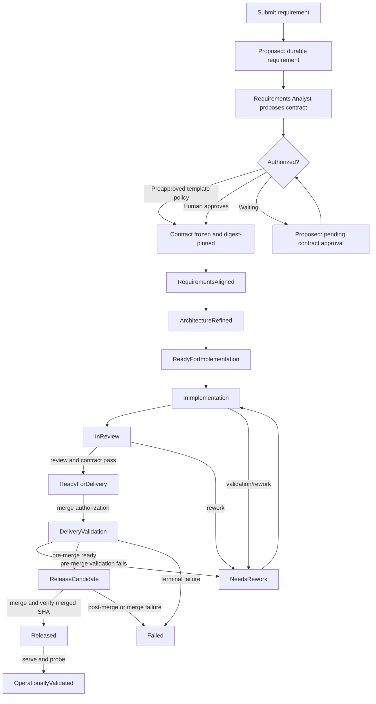

# Wip.Factory Operator Alpha — Requirements Specification v0.3

**Status:** PROPOSED FOR IMPLEMENTATION — D-01…D-09 RATIFIED; implementation acceptance outstanding  
**Date:** 2026-11-18  
**Source:** Operator Alpha v0.2 (2026-11-18), incorporating the subsequent independent review and explicit user decisions  
**Baseline under review:** `jjackbauer/Modus`, branch `feature/wip-factory-alpha`, commit `4a9793a6ab9f499b956aec24edfd4fbc80f2ac2f`  
**Suggested repository path:** `harness/requirements/Wip.Factory.Operator.Alpha.v0.3.md`

> **Precedence.** This document supersedes the entirety of Operator Alpha v0.2 for implementation. The original `Wip.Factory.Alpha.md` remains a regression/architecture baseline only where it does not conflict with the explicitly defined operator contract below. Component tests, demo results and prior D1–D9 gates are **necessary but never sufficient** for accepting this operator alpha.
>
> **Approval boundaries.** D-08 **A** and D-09 **template-policy approval** were explicitly selected by the user. All other interpretations and implementation details in this document are proposed engineering resolutions to the reviewed contradictions, not claims that the baseline branch already implements them. No additional user decisions are required to begin implementation. The implementer must report any irreconcilable code constraint as a named blocker rather than silently narrow the product goal.

## 0. Intent, scope and definitions

### 0.1 Product objective

An operator uses one unchanged **factory host**, submitting ordinary requirement documents to build or modify **two previously unseen, behaviorally different** supported applications. The factory produces attributable source, compiles and tests it, verifies it against an independent, immutable HTTP acceptance contract, obtains merge authorization, merges the actual source, verifies the merged output, and can explicitly supervise the application with `factory serve`. No per-application C# demo, factory source change, prewritten application-specific fixture, or bespoke workflow registration is allowed.

**Non-negotiable:** PA-01 and PA-02 must pass with requirements withheld from the implementer until its delivery is frozen; PA-04 must reject an intentionally incorrect implementation. A green build, 40 named unit tests, nine role definitions, or a successful `factory demo` does not replace these proofs.

### 0.2 Supported application class (bounded promise)

- **Required:** one local Git repository; ASP.NET Core on .NET 10; one HTTP JSON service; declarative, observable HTTP acceptance criteria; project generation or editing; build and run in the supported host environment.
- **May be supported:** multiple endpoints, path parameters, CRUD and multi-step stateful scenarios, appropriate in-memory or file-backed internal state when explicitly specified, generated unit tests.
- **Not promised:** databases as external services, authentication, distributed systems, WebSockets, queues, multiple repositories, desktop UI, non-.NET languages, containers, cloud deployment, or persistence across deployed-app restarts unless the requirement declares a supported mechanism.
- **Pilot platform:** Windows with required process resource controls available. Other operating systems may be added only with behaviorally equivalent isolation and negative tests; no silent fallback to unbounded execution.
- **Trust scope:** this is a *trusted local alpha*, not a secure multi-tenant or untrusted-code sandbox; §6 explicitly defines the residual risk.
- **Unsupported requirements:** refused with a named category. Syntactically unsupported requests may be refused before work-item creation. Ambiguity discovered during contract derivation is recorded against a `Proposed` work item and must be resolved or cancelled before implementation.

### 0.3 Terms (normative)

| Term | Meaning |
|---|---|
| **Requirement revision** | Immutable operator-supplied source text, content digest and metadata, owned by the factory control store. |
| **Contract proposal** | Candidate structured HTTP scenarios derived by the Requirements Analyst or supplied by the operator; not yet authorized. |
| **Frozen acceptance contract** | Canonicalized, validated, digest-pinned contract authorized by an operator or an explicitly preapproved template policy; unreadable for mutation by implementation/review agents. |
| **Merge approval** | Separate, explicit operator authorization of reviewed source and bound evidence. **D-09 does not auto-approve merges.** |
| **Work item** | Durable factory aggregate surviving multiple bounded WIP sessions and rework attempts. |
| **Execution attempt** | One bounded agent/stage episode with a stable ID; may include multiple tool invocations. |
| **Operation** | A particular external side effect with a stable unique ID and durable pending/applied/failed record. |
| **Verification** | Temporary app process plus actual HTTP contract execution; ends with process stopped. |
| **Supervision** | `factory serve` owns an application process for as long as that command is running. |
| **Released** | Approved source merged and its resulting revision verified; **not** evidence that a persistent app process is running. |
| **OperationallyValidated** | The separately supervised release has passed release-identity and acceptance/health probes. |

### 0.4 Reuse boundary

- Reuse **Modus** plugin contracts, lifecycle and discovery, and **WIP** `IAgentExecutor`, `IToolInvoker`, typed capabilities, scoped DI, session management, worktrees, validation, and existing `FactoryReviewService` / `FactoryMergeGate` / Git integration.
- The factory supplies durable work-state orchestration, an operator composition root, versioned acceptance contract and operation evidence, a profile-filtered tool adapter, and release supervision. It must **not** create a second model loop, independent shell command engine, alternative merge authorization policy, or central LLM supervisor.
- The nine logical agent roles and existing agent-profile improvement mechanisms remain available/regression-covered. The default operator path may use three model-driven roles (Requirements, Implementations, Review) plus deterministic checks and factory infrastructure; nine model calls are not mandatory.

## 1. Product acceptance gates — the actual definition of done

All eight PA gates are mandatory, independently reproducible and use the **production host composition** exposed through the documented CLI. Each gate records commands, exit codes, logs, durable event/operation excerpts, exact Git revisions and expected/observed behavior.

| Gate | Named proof | Mandatory result |
|---|---|---|
| **PA-01** | `PA01_BlindRequirementA_OperatorToVerifiedRelease` | Clean host receives an independent, unfamiliar requirement; production agents generate real source; frozen contract, regression checks, authorization, merge and post-merge verification pass; `serve` runs and proves the intended release. |
| **PA-02** | `PA02_BlindRequirementB_SameHostDifferentBehavior` | A second independently withheld, behaviorally different supported requirement succeeds with the same factory binary and configuration, no source edits or app-specific adapters. |
| **PA-03** | `PA03_GeneratedDiff_MatchesMergedRevision` | Nonempty attributable diff; stable work-item → session → profile → attempt → base/head/diff digest; merged SHA/tree contain the reviewed changes. |
| **PA-04** | `PA04_KnownWrongCandidate_IndependentOracleRejects` | A deliberately incorrect candidate whose generated tests pass must fail at least one frozen HTTP scenario. The factory refuses progress/release. |
| **PA-05** | `PA05_KillAndResume_NoDuplicateEffects` | Inject process kills during implementation, merge and verification; restart and reconcile; no duplicate merge, corrupt state, false release, or lost failure record. |
| **PA-06** | `PA06_MutateApprovalBoundField_RefusesMerge` | Mutate each approval-bound fact independently (source SHA, target/base, requirement/contract, policy/guidelines/profile, check results/evidence); all stale or mismatched approvals refuse merge. |
| **PA-07** | `PA07_LiveRelease_IdentityAndContractVerified` | `serve` owns the correct process tree, release artifact and allocated loopback port; exact merged revision is reported and required HTTP scenarios pass; old/stale listeners cannot impersonate the release. |
| **PA-08** | `PA08_UntrustedAccessAndUnsupportedIsolation_Refused` | Unpinned tools, path escapes (including reparse points), unsupported dotnet commands, missing required resource controls, and unauthorized contract edits fail with named categories. |

### 1.1 Blind evaluation protocol

1. **Development fixtures** may be known to the implementer and may be used for regression/debugging; they do not satisfy PA-01/02.
2. **Final test requirements and expected acceptance fixtures are chosen and disclosed by an independent evaluator only after the factory implementation, configuration and test harness have been frozen** and their hashes recorded. Their format and supported class are public beforehand; their particular application behaviors and data are not.
3. Both final tasks use the **same binary and effective factory configuration**, the real configured model provider, and the ordinary operator commands. The factory may create different worktrees and agent sessions; no compiled code or configuration change may be made to accommodate the second requirement.
4. The evaluator is permitted to invoke the public `factory contract approve` command for contracts that are not covered by a preapproved template; this does **not** undermine D-09. Auto-approval is validated separately with a preapproved-template test.
5. Scenario input values are varied or seeded by the evaluator. Do not accept a hardcoded fixture response as proof of generalized application behavior.
6. External LLM outages or model budget exhaustion are reported as **inconclusive/failed execution evidence**, never converted into a passing mock. Deterministic fake-model tests support CI but do not replace live-model PA-01/02.
7. A failed PA gate makes the overall delivery **not accepted**, regardless of previous demo or component gate success.

### 1.2 Acceptance evidence manifest

The host must emit a machine-readable acceptance manifest containing: host binary/source SHA, configured model/provider IDs (no secrets), requirement and contract digests, template/approval source if any, work-item and session IDs, profile/tool versions, base/head/merged SHAs, diff/validation/review digests, operation IDs, HTTP scenario results, application-process identity, release artifact digest, timings, and pass/fail/inconclusive per PA gate. Missing evidence is not a pass.

## 2. Decisions and authority (ratified)

| ID | Decision | Binding resolution |
|---|---|---|
| D-01 | Intake | CLI file submission, explicit `--repo`; no app-specific code. |
| D-02 | Acceptance authorship | Factory derives/proposes scenarios or accepts operator-authored scenarios. **Only operator approval or a strictly preapproved-template policy freezes them.** Model-written repository tests cannot redefine the oracle. |
| D-03 | Commands | `dotnet` with explicitly listed subcommands only; argument vectors; mandatory OS resource limits; `--trusted-environment` explicitly acknowledges residual filesystem/network risk. |
| D-04 | Roles | Three model-driven roles by default; nine available; deterministic architectural gates do not imply extra LLM turns. |
| D-05 | Delivery | Local temporary HTTP verification plus explicit blocking `factory serve` supervision. |
| D-06 | State root | Durable factory control root outside target repository and all worktrees. |
| D-07 | Demos | Retain existing demo verbs as regression fixtures; they cannot satisfy PA-01/02. |
| **D-08 A** | **Delivery rework** | **Add exactly one adjacency edge: `DeliveryValidation → NeedsRework`**. It is legal **only before the merge operation is applied**. Failed post-merge verification cannot use this edge; it follows compensation/corrective-work semantics (§5.4). |
| **D-09** | **Contract approval** | A policy may auto-approve **only an exact, explicitly preapproved, immutable template/version with validated parameters inside its authorized schema**. Otherwise a human operator approves. No fuzzy LLM similarity, silent template creation, or automatic merge approval. |

The decisions are already ratified; routine implementation details must not be escalated as additional user sign-off gates. Any security-relevant relaxation requires a separate explicit requirement revision.

## 3. Canonical end-to-end lifecycle

### 3.1 Work states: existing sixteen plus one approved edge

The authoritative work state remains `Wip.Factory.Contracts.Work.FactoryWorkState`. No new enum member is permitted. Approval, contract proposal, validation, merge, tool execution and supervision details are **durable substates/evidence**, not new top-level enum states.

| From | Legal targets in this alpha |
|---|---|
| `Proposed` | `RequirementsAligned`, `Cancelled` |
| `RequirementsAligned` | `ArchitectureRefined`, `Blocked`, `Cancelled` |
| `ArchitectureRefined` | `ReadyForImplementation`, `Blocked`, `Cancelled` |
| `ReadyForImplementation` | `InImplementation`, `Blocked`, `Cancelled` |
| `InImplementation` | `InReview`, `NeedsRework`, `Failed` |
| `InReview` | `ReadyForDelivery`, `NeedsRework`, `Failed` |
| `NeedsRework` | `InImplementation`, `Failed` |
| `ReadyForDelivery` | `DeliveryValidation`, `NeedsRework` |
| `DeliveryValidation` | `ReleaseCandidate`, `Failed`, **`NeedsRework` (D-08 A, pre-merge only)** |
| `ReleaseCandidate` | `Released`, `Failed` |
| `Released` | `OperationallyValidated`, `Closed` |
| `OperationallyValidated` | `Closed` |
| `Blocked` | `RequirementsAligned`, `ArchitectureRefined`, `ReadyForImplementation`, `Cancelled` |
| `Failed` | `Closed` |
| `Cancelled` | `Closed` |
| `Closed` | none |

**Implementation invariant:** `WorkStateMachine.LegalTargets` and the event routing table are generated/tested from one authoritative transition definition, or verified by a contract test; they must never silently disagree. D-08 A is the *only* permitted new edge, and existing regression tests must be updated to acknowledge it explicitly.



### 3.2 Intake, contract proposal and freezing — no dead-start

The *submitted Markdown document* contains at least a title, explicit `supportedClass: aspnetcore-http-net10`, natural-language task and at least one user-facing acceptance expectation. It may optionally contain a structured HTTP contract or a reference to a preapproved contract template. An existing repository is selected explicitly with `--repo`. The host supports one defined input schema: YAML front matter for metadata plus a free-text Markdown body. A dedicated `acceptanceContract` reference may point to a separate local YAML/JSON file, which is copied and digest-pinned at intake (no live external file dependency). Unrecognized metadata is refused rather than silently ignored. Example:

```markdown
---
title: Book catalog HTTP API
supportedClass: aspnetcore-http-net10
---

Create an HTTP JSON API to add, retrieve and delete books.

## Acceptance expectations
- Creating a book with title and author returns 201 and a stable identifier.
- Retrieving the identifier returns the created title and author.
- Deleting the identifier returns 204; retrieving it afterward returns 404.
```

This is **not** an application-specific program or test fixture. The Requirements Analyst converts the expectations to an observable proposed contract, unless an explicit structured contract was supplied. The operator or preapproved-template policy determines whether that proposal becomes the authoritative oracle.

**Canonical sequence:**

1. `factory requirement submit --file <req.md> --repo <repo>` performs syntactic checks, computes the immutable requirement digest, deduplicates by `(repo identity, requirement digest, specified revision scope)`, commits one `Proposed` item and the complete requirement document, and **atomically publishes `factory.requirement.submitted.v1`**.
2. `factory run --until-idle` consumes the submission event. If a valid structured contract was provided, it records that proposal. Otherwise the **Requirements Analyst** produces structured scenarios and explicit unresolved questions. The proposal and its validation result are durably recorded **without changing `Proposed`**.
3. A factory-owned deterministic schema validator confirms the supported class and that scenarios are observable and executable. Invalid or ambiguous proposals remain actionable as `Proposed` with a named reason; irreconcilably unsupported work may transition `Proposed → Cancelled` with audit evidence. This is not a silent no-op.
4. The contract is **not frozen on first proposal**. It becomes frozen only after either (a) an operator approves that exact proposal digest via `factory contract approve`, or (b) the strict template policy described in §4 approves it. Approval atomically persists the canonical contract digest, approval provenance and `factory.contract.approved.v1` event.
5. `factory.contract.approved.v1` triggers `Proposed → RequirementsAligned`, guarded by a verified frozen contract. **No implementation, approval or merge may occur before this point.**
6. `factory run` reaches a quiescent **waiting-for-contract-approval** status and exits normally with a distinct blocked/pending outcome when manual authorization is needed; it does not busy-loop or repeatedly charge model tokens.

**Required contract write path:** extend the stage-dispatch contract with a **`Recorded` / `ProgressWithoutTransition`** result that carries durable fact/artifact updates and outgoing events but preserves `FactoryWorkState`. The worker commits those facts, the incremented aggregate version and outgoing events together before acknowledging the incoming event. `NoOp` remains reserved for genuinely irrelevant triggers and must never discard an unpersisted proposal. The stage handler does **not** own commits, scheduling or leases.

### 3.3 Exact trigger/transition routing

The following are **trigger events**. A successful transition emits a *new* event for the next action. Event names below are authoritative for the operator alpha; adapt legacy names with explicit versioned adapters, not silent aliases. Additional diagnostic events are permitted but cannot advance states unless listed here.

| Trigger event | Required current state | State outcome | Work and guard | Produced follow-up |
|---|---|---|---|---|
| `factory.requirement.submitted.v1` | `Proposed` | `Recorded`, no state change | Validate/derive contract proposal; durable facts | `factory.contract.proposed.v1` |
| `factory.contract.proposed.v1` | `Proposed` | `Recorded`, no state change, or pending | Strict template approval evaluation; otherwise await operator | `factory.contract.approved.v1` **only** if authorized |
| `factory.contract.approved.v1` | `Proposed` | `RequirementsAligned` | Pinned contract, immutable approval provenance | `factory.requirement.aligned.v1` |
| `factory.requirement.aligned.v1` | `RequirementsAligned` | `ArchitectureRefined` | Deterministic supported-class/repo/contract checks | `factory.architecture.aligned.v1` |
| `factory.architecture.aligned.v1` | `ArchitectureRefined` | `ReadyForImplementation` | Durable implementation plan and dependency readiness | `factory.implementation.ready.v1` |
| `factory.implementation.ready.v1` | `ReadyForImplementation` | `InImplementation` | Worktree lease and pinned agent profile | `factory.implementation.requested.v1` |
| `factory.implementation.requested.v1` | `InImplementation` | `InReview` **or** `NeedsRework`/`Failed` | Real diff, build, regression tests; bounded implementation and repair | `factory.implementation.completed.v1` or `factory.rework.requested.v1` |
| `factory.implementation.completed.v1` | `InReview` | `ReadyForDelivery` **or** `NeedsRework`/`Failed` | Independent four-check review and passing frozen HTTP scenarios bound to candidate SHA | `factory.review.accepted.v1` or `factory.rework.requested.v1` |
| `factory.review.accepted.v1` | `ReadyForDelivery` | `Recorded` / pending | Await distinct **merge approval**, never infer it from contract approval | none until operator action |
| `factory.merge.approved.v1` | `ReadyForDelivery` | `DeliveryValidation` | Unexpired digest-bound merge approval; code and policy unchanged | `factory.delivery.requested.v1` |
| `factory.delivery.requested.v1` | `DeliveryValidation` | `ReleaseCandidate` **or** `NeedsRework`/`Failed` | Pre-merge revalidation and drift guard; D-08 A only before merge | `factory.release.candidate-ready.v1` or `factory.rework.requested.v1` |
| `factory.rework.requested.v1` | `NeedsRework` | `InImplementation` **or** `Failed` | Rework budget, failure evidence, new attempt identity | `factory.implementation.requested.v1` |
| `factory.release.candidate-ready.v1` | `ReleaseCandidate` | `Released` **or** `Failed` | Real authorized merge, reconcile Git, independently verify actual merged SHA | `factory.release.completed.v1` or failure evidence |
| `factory.release.completed.v1` | `Released` | `Recorded`, no state change | Persist release artifact and stopped-verification report | none until serve |
| `factory.release.observed.v1` | `Released` | `OperationallyValidated` | `serve`-owned PID/process-tree, release SHA, HTTP probe and scenarios | `factory.operations.validated.v1` |
| `factory.work.close.requested.v1` | `Released`, `OperationallyValidated`, `Failed`, `Cancelled` | `Closed` | Policy/operator authorizes closure with final evidence | `factory.work.closed.v1` |

**Failure events:** `factory.stage.failed.v1` is an **observation**, not an instruction to force `Failed` from any state. The stage/worker selects a legal state-specific target. In `Proposed`, failures leave the work item awaiting correction or cancel it (`Proposed → Cancelled`); in `RequirementsAligned`/`ArchitectureRefined`/`ReadyForImplementation`, failures use `Blocked`/`Cancelled` as legal. In `InImplementation`, `InReview` and pre-merge `DeliveryValidation`, use bounded `NeedsRework` where legal, otherwise `Failed`. In `ReleaseCandidate`, use `Failed` and preserve post-merge recovery evidence. No illegal transition is permitted in the name of standardized error handling.

**Dependency blocking:** preserve the existing `Blocked` behavior. The store must durably remember the previous allowed phase (`blockedFrom`) and emit a dependency-readiness trigger when prerequisites become satisfied. Do not acknowledge and discard the only future wake-up. A wake-up restores the proper legal target from `Blocked` without inventing a central scheduling agent.

### 3.4 Production, review, authorization and merge — one definite order

1. **Implement:** start from a known target-branch SHA in an isolated WIP Git worktree; produce a real nonempty diff, create/modify source, build, and run mandatory existing regression tests. Agent prose alone is not output.
2. **Independent review:** separately executed build/test, requirements coverage, architecture conformance and security checks; execute the frozen HTTP contract on a **temporary, identified pre-merge candidate**. Every check must bind to a trusted command or HTTP evidence artifact. Report/repair failure before requesting merge authorization.
3. **ReadyForDelivery:** review passed and the candidate SHA, base SHA, target branch and all approval-bound evidence are frozen. Do **not** merge yet.
4. **Merge approval:** `factory approve --work-item <id> --review-digest <sha256:...>` (or an equivalent documented exact selector) records an **operator** authorization bound to §5.2. **D-09 authorizes contract approval only.**
5. **DeliveryValidation:** recheck that contract, head/base/target, policy and all evidence still match; rerun pre-merge acceptance if necessary. If this fails **before merge**, take D-08 A's `DeliveryValidation → NeedsRework` edge, revoke the stale approval, and require a new review and authorization after changes. Rework budget applies.
6. **ReleaseCandidate:** perform the real authorized merge using the **existing** merge gate and WIP Git engine. Record an operation ID and reconcile against Git on retry; do not introduce a separate merge policy. Refuse target drift that invalidates the bound baseline.
7. **Post-merge proof:** inspect the **actual merged commit/tree**, not just the implementation worktree; build/run the merged revision from a pinned release artifact and rerun the frozen HTTP contract. A merge commit or post-merge transformation must never escape verification. Only after success enter `Released`. A failed post-merge proof enters `Failed`; it must not use D-08's pre-merge edge or claim a live release.
8. **Serve:** `factory serve --work-item <id>` starts/supervises the verified merged release. Only after process-identity and contract/health proof does `Released → OperationallyValidated` occur.

**Conflict/drift:** on an unapproved target branch change, refuse merge with `approval-stale` / `target-drift` rather than silently rebasing. On a real merge conflict, record `merge-conflict`, preserve the worktree and require a new governed attempt. Never `git reset --hard` an operator's branch as an automatic recovery shortcut.

### 3.5 Pre-merge and post-merge failure behavior (D-08 A)

| Point of failure | Legal action | Approval and release behavior |
|---|---|---|
| Build/test or implementation agent | `InImplementation → NeedsRework` (or `Failed` on exhaustion) | No approval valid. |
| Independent review / contract | `InReview → NeedsRework` (or `Failed`) | No merge approval issued. |
| Drift, acceptance or environment check **before** merge | **`DeliveryValidation → NeedsRework`** (or `Failed` on exhaustion) | Revoke previous merge approval; new SHA requires new review + approval. |
| Merge conflict / stale authorization | `ReleaseCandidate → Failed` with preserved worktree, or keep operation pending when retry is safe | No automatic unauthorized merge; operator resolves via corrective/new attempt. |
| HTTP/build failure **after** merge effect | `ReleaseCandidate → Failed`; operation evidence records merged SHA | Do not attempt `NeedsRework`. Revert/release-reference rollback requires explicit governed compensation/corrective work. |
| `serve` process crashes | Remain `Released` (or record loss of operational health); bounded supervisor retries | No new merge or source mutation; `OperationallyValidated` must not falsely indicate currently healthy if observed down. |

A `Failed` work item can be closed; it does not prevent submission of a linked corrective work item. All rework attempts have durable IDs, budgets and lineage; default **two** implementation rework dispatches per item, configurable within bounded limits.

## 4. Frozen HTTP acceptance contract and D-09 template-policy approval

### 4.1 Data format and deterministic execution

A canonical JSON/YAML contract must include `schemaVersion`, `supportedClass`, ordered `scenarios`, stable criterion IDs, HTTP methods, relative paths, expected statuses and deterministic assertions. For example:

```yaml
schemaVersion: 1
supportedClass: aspnetcore-http-net10
scenarios:
  - id: AC-1
    method: POST
    path: /books
    request:
      json: {title: 'Dune', author: 'Herbert'}
    expect:
      status: 201
      jsonSubset: {title: 'Dune', author: 'Herbert'}
    capture: {bookId: '$.id'}
  - id: AC-2
    method: GET
    path: /books/{bookId}
    expect:
      status: 200
      jsonSubset: {title: 'Dune'}
  - id: AC-3
    method: DELETE
    path: /books/{bookId}
    expect: {status: 204}
  - id: AC-4
    method: GET
    path: /books/{bookId}
    expect: {status: 404}
```

The contract runner is factory-owned and executes **real HTTP**; it must not trust the model's answer, generated test assertions or the application's self-reported status. Define and test: JSON subset semantics (additional fields allowed unless strict mode), exact scalar comparison, ordered arrays by default, capture syntax and substitution, path encoding, scenario sequencing, per-request and suite timeouts, maximum payload and response sizes, redirect handling, expected content type, negative statuses, and reset/isolation of application state between separate test runs. No external network URLs or filesystem path escapes may be specified in scenarios. A non-observable or malformed contract is refused **before implementation** with a named reason.

The frozen canonical contract bytes and digest are stored under control-root authority. The implementation/review agent may read the contract requirements but **cannot write, remove, reorder or skip its authoritative scenarios**. Acceptance test results bind to contract digest, runner version, app artifact digest and candidate Git SHA. Existing project/regression tests remain mandatory; newly generated tests are additional evidence, never a substitute for the frozen oracle.

### 4.2 Human approval fallback

`factory contract show --work-item <id>` displays the exact proposal, validation errors, source requirement digest and canonical contract digest. `factory contract approve --work-item <id> --digest sha256:...` checks that exact content and records actor, time, digest and approval reason before freezing. A changed proposal invalidates earlier authorization and requires a new approval. A human may reject a proposal with actionable feedback, permitting a new proposal while the item remains `Proposed`; every revision is separately versioned and audited.

### 4.3 Policy approval of *explicitly preapproved templates* (D-09)

**Normative policy:** automated approval is allowed **only** when all conditions hold:

1. An operator or independently authorized administrator previously registered and approved an **immutable template manifest**: `templateId`, `templateVersion`, manifest digest, contract schema version, supported class, parameter schema, allowed substitutions/ranges, exact scenario structure and mandatory assertions.
2. The proposed contract explicitly names that version. The policy validates the manifest's approval record and canonical digest, instantiates it with validated operator-provided parameters, and proves the resulting canonical scenario contract matches the template's permitted substitutions. **No semantic/embedding/LLM similarity judgment is accepted.**
3. Neither the Requirements nor Implementation nor Review Agent may create, approve, broaden, or replace a trusted template or edit its parameter schema. A new template/version requires separate operator authorization outside the executing work item.
4. The decision records `approvalKind=template-policy`, template ID/version/digest, parameters digest, policy version, resulting contract digest, approving principal and time; all are immutable and must be visible in `factory show`.
5. Failure to match every condition **falls back to waiting for human approval**. It never silently declines acceptance coverage, drops a scenario or self-approves a model-authored variation.
6. Revocation or change of template/policy invalidates pending/unused contract authorizations; existing work must revalidate the frozen contract provenance at merge time. A template approval **never** authorizes a source merge or release.

**Negative tests:** unknown template; stale version; altered mandatory assertions; unexpected parameter; out-of-range parameter; template digest mismatch; revoked preapproval; model-generated template; failed match followed by human approval. All must have deterministic named outcomes.

### 4.4 Isolation and adversarial acceptance

Contract execution uses fresh application process state per suite or a documented reset endpoint/setup. Cross-scenario captures are permitted *within* a suite, but leaked state from a prior unrelated work item cannot influence the next. Final evaluation varies at least one observable value and includes both positive and negative behavior. PA-04 injects a known-wrong implementation with passing self-generated tests and proves the independent contract rejects it.

## 5. Durability, exact evidence binding, and merge governance

### 5.1 Durable event processing (effectively-once outcomes)

`LocalFactoryStore` may remain a single append-only local log for the alpha, but it must be used in the **production host** (not only demos) and protect all cross-process writers.

- **Atomic commit:** aggregate version, immutable requirement/contract/evidence refs, outgoing events and operation updates become visible together. Partially written trailing records are discarded only when provably incomplete; interior corruption fails closed with an explicit category.
- **Reservation:** `ClaimUnpublishedAsync` must actually persist claim owner, claim deadline, durable attempt count and event/subscriber identity; live claims cannot be claimed twice. Expired claims are reclaimed. No process-local retry dictionary is an authority.
- **Inbox:** subscriber acknowledgment is durable and performed only after the corresponding stage outcome is committed. For a crash between effect and acknowledgment, reconcile before any reattempt.
- **Persistent work:** every work item/contract can be reloaded by a fresh host process. Read-only status is derived from durable state and must not depend on a stale in-memory `FactoryStatusSurface`.
- **Side effects:** exactly-once *execution* of arbitrary Git, process or filesystem operations is not promised. The guarantee is **effectively-once outcomes where idempotency or reconciliation is available**.

### 5.2 Operation IDs and approval bindings

Assign a durable **`stageAttemptId`** once for each logical attempt; create a unique, monotonic **`effectOrdinal`** for every external effect within it. An operation ID is derived from a canonical encoding of:

`(workItemId, eventId, stage, stageAttemptId, effectOrdinal, effectKind, canonicalTarget, desiredContentOrInputDigest)`.

The ID is **allocated and durably recorded before execution**. Retries of that same operation load and reuse the same ID; a new deliberate effect or rework attempt gets a new one. Three `write_file` invocations must produce three distinct IDs. Persist `pending → applied | failed | reconciliation-required` with observed external identity and verification digest. A failed/uncertain effect must not simply be reissued on startup.

**Merge authorization** must bind at minimum:

- repository identity, target branch, target/base SHA and proposed head SHA;
- immutable requirement revision and frozen acceptance contract digest/schema;
- exact review artifact digest, four executed-check results and mandatory validation/HTTP result digests;
- mandatory policy version and architecture-guidelines version;
- implementation and reviewer profile versions and applicable tool/runner versions;
- approval actor, time, unique approval ID and review validity window (if configured).

Any change to a bound value invalidates an unused approval. PA-06 mutates **every bound category**, not an arbitrarily fixed count of seven fields. The merge gate persists applied approvals, checks actual Git state, and cannot succeed twice under replay or new process instances.

### 5.3 Locking and concurrency scope

- **Execution lock:** only one `factory run` may own the run-exclusive OS lock for the control root. A second exits `host-lock-held` without executing stages. This alpha does not claim multi-worker scheduling.
- **Store mutation lock:** `requirement submit`, `contract approve`, `approve`, `run`, `serve` and administrative mutation commands all acquire the same cross-process **transactional store lock for each mutation**. A process-local `SemaphoreSlim` alone is insufficient. Read-only `status` may use a consistent snapshot.
- **Supervisor lock:** at most one active `factory serve` owns a given release/work-item supervisor lease; it does **not** hold the run execution lock indefinitely or prevent intake and status. A second serving instance must refuse or explicitly reconcile an existing matching supervisor.
- **Filesystem safety:** control root is outside target repository and all agent worktrees. Worktree ownership is persisted/validated, not inferred from a process-local dictionary alone.

No claim of two independent writers safely editing the same factory log is accepted unless the cross-process lock and restart tests establish it.

### 5.4 Reconciliation and post-merge compensation

| Operation | Durable reconciliation before retry |
|---|---|
| Git merge | Inspect target branch/ref, commit graph and previously bound base/head; determine whether exact approved change is already contained; do not repeat or substitute a different merge. |
| Write/patch | Resolve target and verify content digest/patch result; do not overwrite a newer revision or reapply a non-idempotent patch blindly. |
| Approval application | Check persistent unique approval ID and digest binding; never rely on process-local `HashSet`. |
| Temporary candidate | Check process identity/port, terminate only owned orphan if safe, restart verification from the pinned artifact as appropriate. |
| Supervised release | Check persistent release manifest and OS process identity; on `serve` restart reconcile ownership or start the same pinned release once. |

A post-merge verification failure records the actual merged SHA and moves `ReleaseCandidate → Failed`. The factory must **not** overwrite or reset target history. If a previous serving release exists, keep/restore its **release pointer**, but reverting committed source history is a **separate authorized compensation** or corrective work item. The operator sees the exact failure, affected revision and recovery options. Never claim `Released` on a failed proof.

### 5.5 Review integrity

`FactoryReviewService` continues to require Validation, RequirementCoverage, ArchitecturalConformance and Security checks. An agent-provided `Passed=true` flag is insufficient: every check references a factory-executed result (invocation ID, tool/runner version, command/arguments or HTTP scenario set, exact Git revision, output digest, exit code, time and producer identity). Evidence artifacts are immutable or content-addressed and independently rehashable. Review excludes/risks are not allowed to bypass mandatory checks.

## 6. Tools, execution boundaries, and agent profiles

### 6.1 Six-tool interface (no parallel tool runtime)

Use WIP `IToolInvoker` and `AgentExecutor` with a factory adapter for exactly these profile-admitted tools: `list_files`, `read_file`, `search_text`, `apply_patch`, `write_file`, `run_command`.

- `search_text`: bounded literal/regex search with file filters, match cap, path:line reporting and explicit truncation.
- `apply_patch`: deterministic unified-diff application with expected source digest/optional base SHA, complete dry-run validation, conflict refusal and atomic replace; partial hunks are never committed.
- `write_file`: allowed for new files or explicitly authorized whole-file replacement; returns bytes and digest; never silently overwrites unrelated changes.
- `read_file`/`list_files`: bounded output, predictable sorting and truncation metadata.
- `run_command`: executable resolved to a trusted configured `dotnet` binary plus argument vector; no shell or metacharacter interpretation, no arbitrary paths or extra executables. Allowed first subcommands: `new`, `restore`, `build`, `test`, `run`, `publish`, subject to command-specific argument and target checks. `git` operations remain a factory/WIP governance responsibility.

Paths must be resolved within the session worktree, reject absolute and traversal paths and account for symlinks/junctions/reparse points and path races. An unsafe or missing worktree is a hard refusal. Tool observations are truncated **during capture** to bound memory, with markers and redacted durable evidence. Tool arguments/output must be sanitized before any persistence or CLI exposure; no unsupported claim of perfect secret detection is made.

### 6.2 Profile ceiling and authority

For each execution the factory loads an **immutable, pinned agent profile** and derives `ToolDefinition`s from the intersection of profile capabilities, admitted Modus/WIP plugin capabilities and runtime grants. The caller may not inject extra `dispatch.Tools`. At every actual invocation, `IToolInvoker` independently checks `(sessionId, profileVersion, toolId, permissions, worktree)`; a manually constructed or model-invented tool call outside the ceiling returns `permission-denied` without performing side effects. A profile mismatch is a startup/dispatch failure, not silently repaired by expanding authority.

Agent self-improvement mechanisms may propose new methodologies or skills but may not edit the frozen contract, mandatory review evidence, their own evaluators, permission ceiling, or trusted template registry. This operator alpha reuses the existing improvement architecture as a regression requirement; it does not need to implement unrestricted capability self-modification to pass PA-01/02.

### 6.3 Safe execution and documented residual risk

- Windows Job Object or equivalent OS resource controls **must actually apply** before tool-command execution; `IsolationApplied=false` means `isolation-unavailable` and **failure**, even when `--trusted-environment` is set. Define wall time, memory and process-count ceilings; kill the owned process tree on timeout; report exit and termination reason.
- Resource limits are **not** a filesystem/network sandbox. `.csproj`/MSBuild targets and tests can run arbitrary code despite `dotnet`-only command allowlisting. The operator must explicitly pass `--trusted-environment` to the first run and to any manual serving operation not covered by a persisted release-scoped acknowledgement; store its actor/time/scope in durable evidence. The acknowledgement accepts residual risk; it never disables enforced resource bounds.
- Use a fresh dedicated target repository without unrelated data or secrets, sanitize the execution environment, never pass credentials to generated processes, bind HTTP listeners to loopback, and avoid network access unless explicitly required and authorized by policy.
- Do not market this configuration as sandboxed or safe for hostile code. Provide an explicit fail-closed unsupported-platform result.

### 6.4 Bounded agent execution

Reuse WIP's model/tool loop. Configured profile determines max steps (suggested starting bound 40 for implementation), tokens, timeout (suggested starting bound 10 minutes for implementation), model, and tool-failure budget. A tool error becomes a model-visible observation when recoverable, permitting self-correction; a permission or isolation denial remains a hard policy failure if the request cannot continue safely. No hidden model retries; every model call, tool call and repair attempt is separately attributable. Final model prose is never treated as verified software.

## 7. Software-production and delivery contracts

### 7.1 Completion of implementation

The Implementations Analyst cannot report success unless the factory verifies: (a) nonempty diff against its pinned base SHA; (b) supported ASP.NET Core project files and runnable entry point; (c) actual `dotnet build` success; (d) required pre-existing regression test success; (e) durable links `workItemId → sessionId → profileVersion → stageAttemptId → baseSha → headSha → diffDigest`; and (f) no unauthorized changes to control-root fixtures, approved contract or protected policies. Missing/empty diff is `no-attributable-change` even if the chat answer claims completion.

### 7.2 Candidate verification and deployment semantics

- A factory-owned runner starts the candidate using a **pinned build/release artifact** and an OS-allocated available loopback port. The factory identifies the actual listening process by process identity (PID and start-time, with child process-tree lineage where required), executable/artifact path, allocated port and SHA; a random HTTP 200 from a stale process is insufficient.
- Execute the frozen acceptance scenarios and regression build/test gates against the **reviewed candidate**, then again against the **actual merged revision** before declaring `Released`.
- Stop the temporary verification process. `factory run` reports **`verified, merged, process stopped`** where appropriate; it must not report deployed/live for a process it terminates.
- The factory persists a release manifest with the merged SHA, artifact digest, command/args, runtime version, approved contract digest and expected port-binding protocol. `factory serve --work-item <id>` launches exactly that release, not a mutable working directory, and remains active while supervising it. Restarts are bounded and logged; a crash of the CLI itself does **not** imply an independent daemon keeps serving.
- `Released` permits serving. A successful live `serve` contract/identity probe emits `factory.release.observed.v1` and enables `OperationallyValidated`. Later downtime must be visible as current health, even though historical operational validation remains auditable.
- If pre-merge verification fails, take legal rework; if a merged candidate fails, do not claim release and use §5.4 compensation rules. If prior release exists, restore its serving reference where safe; never silently rewrite Git history.

### 7.3 HTTP runner precision

The runner logs method, canonical path, request body digest, expected and observed status/content type, selected response-field digests, captured variable names (not secrets), per-scenario elapsed time and rejection reason. Default JSON comparison is structural subset for maps and ordered exact comparison for asserted arrays; add explicit strict mode if needed. Reject unsupported JSONPath/capture expression forms rather than silently ignoring them. Apply explicit per-scenario and suite timeouts; all HTTP URLs must be factory-owned loopback URLs.

## 8. Operator CLI contract

The following interface is normative at the behavioral level; option parsing may use existing shared infrastructure. Interactive prompts are prohibited inside `run`; all outputs have a stable machine-readable representation (e.g. `--json`). Failures have nonzero exit codes and named categories.

```text
factory requirement submit --file <req.md> --repo <dir> [--title <title>] [--json]
factory contract show --work-item <id> [--json]
factory contract approve --work-item <id> --digest <sha256:...> [--json]
factory contract reject --work-item <id> --digest <sha256:...> --reason <text>
factory run --until-idle --trusted-environment [--json]
factory status [--work-item <id>] [--json]
factory show --work-item <id> [--json]
factory approve --work-item <id> --review-digest <sha256:...> [--json]
factory serve --work-item <id> --trusted-environment [--json]
factory template list|show|approve|revoke ...           # operator/admin-only policy surface
```

**Submit:** persists the requirement, returns work-item ID, state, requirement digest and target repository. **Contract show:** displays proposed/frozen contract, provenance, errors and required action. **Run:** acquires exclusive execution lock, drains eligible events until idle, approval wait, bounded failure or cancellation; reports counts and next legal actions. **Status/show:** read durable facts from a fresh process, including states, versions, attempts, categories, event history, template approval and pending merge approval. **Approve:** merges nothing directly; records the exact merge-authorization event and digest. **Serve:** blocking supervisor, reports release SHA, PID/port, health and restarts. **Template commands:** may not be exposed to model tools and must use authenticated/explicit operator authorization even in the local alpha.

**Suggested exit categories:** `ok`, `waiting-for-contract-approval`, `waiting-for-merge-approval`, `unsupported-class`, `contract-invalid`, `contract-tampered`, `host-lock-held`, `tool-permission-denied`, `path-outside-worktree`, `isolation-unavailable`, `step-budget-exhausted`, `validation-failed`, `acceptance-contract-failed`, `approval-stale`, `merge-conflict`, `post-merge-verification-failed`, `serve-failed`, `store-corrupt`. Map categories to documented stable numeric exit codes; do not use exception text as the public API.

## 9. Persistence layout, bootstrap and observability

```text
<controlRoot>/                       # e.g., %LOCALAPPDATA%/wip-factory/<repoId>/
  factory.log                        # durable event/work/operation records
  work-items/<workItemId>/           # immutable requirement revisions and scenario proposals
  contracts/<digest>/                # immutable frozen acceptance contracts
  templates/<id>/<version>/          # approved template manifests, protected
  evidence/<digest>/                 # validation/review/HTTP/artifact evidence
  worktrees/<sessionId>/             # WIP Git worktrees, outside target repo
  releases/<mergedSha>/              # pinned build/release artifact and manifest
  locks/                             # run/store/supervisor OS locks
<targetRepo>/                        # operator-selected Git repository; never contains control state
```

The control root must never resolve under the target repository or one of its worktrees, including through symlinks/junctions. A dedicated repository can be created/cloned explicitly by the operator; do not destructively auto-initialize an existing directory. All file creation/recovery paths are bounded and error-classified.

Existing factory status views (WorkQueue, ProductionPipeline, Agents, Quality, Improvement, Traceability) must be reconstructed from durable state, not from demo-only `FactoryStatusSurface.Record` calls. The operator must be able to identify why work is stalled and exactly what action can unblock it. Event/telemetry records include correlation, causation, immutable profile/model versions, token cost, wall time, attempt ID, operation IDs, tool-runner versions, and downstream outcome references; redact sensitive values before persistence.

## 10. Functional requirements (normative)

The detailed rules in §§3–9 are normative. This matrix identifies required deliverable groups and their acceptance evidence.

| ID | Requirement family | Acceptance conditions |
|---|---|---|
| F-A | Requirement intake and contract lifecycle | §3.2 and §4; durable `Proposed` + submitted event, honest proposal/freeze, strict D-09 provenance. |
| F-B | Generic factory host and CLI | §8; one composition root, public commands, no per-app C#; status and resume work from fresh process. |
| F-C | Production event-driven dispatch | §3.3; legal transitions, real stage handler, `Recorded` result, dependency wake-ups, durable retries. |
| F-D | Tools | §6.1; six tools; profile invocation ceiling, worktree confinement, patch atomicity and resource limits. |
| F-E | Agent execution | §6.4; existing WIP model/tool loop, bounded and fully attributable; final prose never counts as output. |
| F-F | Verification and rework | §3.4, §3.5, §4; mandatory regression tests + independent frozen HTTP oracle; D-08 A for pre-merge failure. |
| F-G | Review, approval and merge | §5; four evidence-backed checks, operator merge authorization and durable effect reconciliation. |
| F-H | Delivery and supervision | §7; temporary verification versus blocking serve; release SHA identity and rollback honesty. |
| F-I | Persistence and recovery | §5, §9; reservation, attempts, operations, cross-process lock, kill/restart and corruption tests. |
| F-J | Operator visibility and administration | §8–9; stable CLI, durable views, explicit next action and failure category; template management protected. |
| F-K | Blind product acceptance | §1; held-out two-app demonstration and wrong-candidate rejection through unchanged host. |

## 11. Non-functional requirements

| ID | Normative constraint |
|---|---|
| N-01 | Preserve and execute all existing factory regression suites and baseline platform tests. Record actual passing counts and exact commit; prior reported `86` factory tests and `460/3` baseline are historical assertions, not substitute for a fresh run. |
| N-02 | No second LLM/model/tool loop, unrelated Git/worktree engine, extra merge gate or central LLM orchestrator. |
| N-03 | No known secrets in persisted event/evidence/CLI outputs; minimize/sanitize child environment and record redaction failures. Never claim generic provable absence of all secrets. |
| N-04 | Document a reference workstation and workload; pass a measured 15-minute target for that workload **or** fail within documented bounds and with a named category. No universal performance promise. |
| N-05 | Public failures have stable categories and exit codes, not bare stack traces. |
| N-06 | New domain identities (`WorkItemId`, `OperationId`, `ContractDigest`, etc.) are typed; interoperable text fields such as URLs are strings where appropriate. |
| N-07 | Each normative family and PA gate is traced to executable tests and evidence; name-only reflection compliance does not prove behavior. |
| N-08 | UTF-8 without BOM, nullable-safe code, no new build warnings; CI builds and runs the relevant production-host and factory suites. |
| N-09 | No unsupported promises of sandboxing, exactly-once external execution, continuous deployment, unbounded agent autonomy or multi-process scheduling. |
| N-10 | The final acceptance harness does not embed or disclose the blind PA-01/02 requirement contents before implementation freeze. |
| N-11 | Operator actions and policy approvals leave immutable, attributable audit records and cannot silently weaken mandatory gates. |

## 12. Executable test plan

### 12.1 Product gates (mandatory)

Implement the eight named PA-01 through PA-08 procedures in §1, with externally observable assertions through the **actual CLI and runtime**. Test fixtures for all but the blind inputs may reside in the repository. The final evaluator supplies blind inputs after freeze. A deterministic fake-model provider can exercise failure injection; **PA-01/02 require a real configured model**. Capture and publish the manifest described in §1.2.

### 12.2 Supporting behavior tests — retained/revised forty from v0.2

1. `Intake_GivenRequirementFile_CommitsWorkItemAndEmitsRequirementSubmitted`
2. `Intake_GivenFileWithoutAcceptanceExpectations_IsRefused`
3. `Intake_GivenUnsupportedClass_IsRefusedBeforeImplementation`
4. `Intake_GivenIdenticalContentTwice_IsIdempotent`
5. `Intake_GivenRestart_RequirementAndContractProposalAreRecoverable`
6. `Intake_GivenTamperedFrozenContract_BlocksWorkItem`
7. `Contract_GivenAmbiguousUnobservableProse_RequiresResolutionBeforeFreeze`
8. `Contract_GivenModelAttemptToEditFrozenOracle_IsRefused`
9. `Contract_GivenWrongImplementation_FailsOriginalScenarios`
10. `Contract_GivenPassingGeneratedTestsButFailingScenarios_StillFails`
11. `Host_GivenSubmittedRequirement_RunsWithoutFactorySourceChange`
12. `Host_GivenSecondRun_ResumesWithoutRepeatingAppliedOperations`
13. `Host_GivenConcurrentRun_ExitsHostLockHeld`
14. `Host_GivenControlRootInsideTarget_RefusesToStart`
15. `Host_GivenStatus_ReportsStateVersionDigestAndLastFailure`
16. `StageHandler_GivenUnknownEvent_ReturnsNoOp`
17. `StageHandler_GivenIllegalTarget_FailsWithIllegalTransition`
18. `StageHandler_GivenReplayedEvent_DoesNotRepeatSideEffects`
19. `StageHandler_GivenExhaustedAttempts_QuarantinesWithPersistedCount`
20. `StageHandler_GivenArchitectureGate_IsDeterministicNotModelDriven`
21. `Claim_GivenCrashAfterClaim_IsReclaimableAfterDeadline`
22. `Claim_GivenLiveClaim_IsNotDispatchedTwice`
23. `Operation_GivenMergeAlreadyApplied_ReconcilesWithoutSecondMerge`
24. `Operation_GivenDeliveryAlreadyRunning_ReconcilesOwnership`
25. `Merge_GivenApprovalAppliedBeforeRestart_IsRefusedAfterRestart`
26. `ToolGateway_GivenAbsolutePath_IsRefused`
27. `ToolGateway_GivenTraversalPath_IsRefused`
28. `ToolGateway_GivenApplyPatchConflict_RefusesAtomically`
29. `ToolGateway_GivenSearchText_RespectsMatchCap`
30. `ToolGateway_GivenToolOutsideProfile_IsDeniedAtInvocation`
31. `ToolGateway_GivenMissingIsolation_FailsClosed`
32. `ToolGateway_GivenSubcommandOutsideAllowlist_IsRefused`
33. `ToolGateway_GivenShellMetacharacters_TreatsThemAsLiterals`
34. `ToolGateway_GivenLongRunningCommand_IsTerminatedAtWallTime`
35. `AgentLoop_GivenToolError_ContinuesWithObservation`
36. `AgentLoop_GivenStepBudget_FailsWithCategory`
37. `Production_GivenConversationalAnswerWithoutDiff_FailsNoAttributableChange`
38. `Production_GivenEmptyDiff_FailsStage`
39. `Delivery_GivenStaleReleaseOnReusedPort_IsNotAcceptedAsCandidate`
40. `Delivery_GivenVerifiedCandidate_ReportsProcessStoppedNotDeployed`

### 12.3 Additional mandatory tests addressing v0.3 findings

41. `Lifecycle_GivenSubmission_EmitsConsumableRequirementSubmitted`
42. `Lifecycle_GivenContractProposal_RecordsWithoutStateTransition`
43. `Lifecycle_GivenPendingContractApproval_StopsWithoutBusyLoop`
44. `Lifecycle_GivenContractApproved_TransitionsProposedToRequirementsAligned`
45. `Lifecycle_GivenOnlyUnlistedEvent_DoesNotAdvance`
46. `Lifecycle_GivenEarlyFailure_UsesLegalBlockedOrCancelledTransition`
47. `Lifecycle_GivenPreMergeDeliveryFailure_TransitionsToNeedsRework`
48. `Lifecycle_GivenMergeAlreadyApplied_DoesNotUsePreMergeReworkEdge`
49. `Lifecycle_GivenReadyForDelivery_RequiresDistinctMergeAuthorization`
50. `Lifecycle_GivenRealMerge_RecordsAndVerifiesMergedSha`
51. `Lifecycle_GivenPostMergeContractFailure_NeverRecordsReleased`
52. `Contract_GivenProposalChanged_InvalidatesPriorAuthorization`
53. `Contract_GivenApprovedTemplateAndValidParameters_AutoApprovesWithProvenance`
54. `Contract_GivenUnknownOrRevokedTemplate_FallsBackToHumanApproval`
55. `Contract_GivenTemplateAssertionEdited_RefusesPolicyApproval`
56. `Contract_GivenTemplateParamOutOfBounds_RefusesPolicyApproval`
57. `Contract_GivenNonTemplateProposal_DoesNotAutoApprove`
58. `Contract_GivenPolicyContractApproval_CannotAuthorizeMerge`
59. `Contract_GivenScenarioCaptureAndSubstitution_ExecutesInOrder`
60. `Contract_GivenSubsetAndArrayAssertions_UsesSpecifiedSemantics`
61. `Contract_GivenSeparateApplicationRun_ResetsScenarioState`
62. `Operation_GivenThreeWritesInStage_HasThreeUniqueStableIds`
63. `Operation_GivenReplayOfSameEffect_ReusesOriginalOperationId`
64. `Operation_GivenUncertainMergeState_ReconcilesGitBeforeRetry`
65. `Store_GivenSubmitApproveServeConcurrentProcesses_SerializesMutations`
66. `Store_GivenRestart_OperatorStatusReadsDurableState`
67. `Store_GivenDependencyRelease_BlockedItemWakesOnce`
68. `Approval_GivenAnyBoundFieldChanged_RefusesMerge`
69. `Review_GivenPassingFlagWithoutExecutionProof_RefusesAcceptance`
70. `Verification_GivenHeadChangedAfterReview_RefusesMergeApproval`
71. `Verification_GivenMergeCommitDifferentFromHead_RunsContractOnMergedTree`
72. `Supervisor_GivenServeExit_DoesNotClaimAlwaysOnDaemon`
73. `Supervisor_GivenSecondServe_RefusesDuplicateOwnership`
74. `Supervisor_GivenRestart_UsesPinnedReleaseArtifact`
75. `ToolGateway_GivenSymlinkOrJunctionEscape_Refuses`
76. `ToolGateway_GivenLargeOutput_BoundsCaptureMemoryAndMarksTruncation`
77. `Execution_GivenTrustedEnvironmentWithoutResourceControls_StillFailsClosed`
78. `Contract_GivenHumanRejectsProposal_AllowsReproposalWithoutImplementation`
79. `Workflow_GivenRealFactoryHost_NeverInvokesDemoImplementation`
80. `PA02_GivenDifferentBlindRequirement_UsesUnchangedFactoryBinary`

**Test integrity:** every named supporting test must be an executable test in a suite run by CI, assert meaningful externally observable behavior, and fail under a deliberately introduced representative defect. A reflection-based method-name presence check is merely a coverage inventory, not an implementation proof. Run platform-specific negative tests on the platform to which their guarantee applies.

### 12.4 Minimum traceability map

| Normative area | Supporting test IDs from §§12.2–12.3 | Product proof |
|---|---|---|
| F-A intake/contracts | 1–10, 41–44, 52–61, 78 | PA-01, PA-02, PA-04 |
| F-B host/composition | 11–15, 65–66, 79–80 | PA-01, PA-02, PA-05 |
| F-C event/dispatch | 16–22, 41–51, 67 | PA-01, PA-05 |
| F-D tools | 26–34, 62–63, 75–77 | PA-03, PA-08 |
| F-E agents/profile | 30, 35–38, 62–63 | PA-01, PA-02, PA-08 |
| F-F verification/rework | 7–10, 37–40, 47–48, 59–61, 70–71 | PA-01, PA-04, PA-07 |
| F-G governance/merge | 23–25, 49–51, 64, 68–71 | PA-03, PA-05, PA-06 |
| F-H supervision | 24, 39–40, 51, 72–74 | PA-05, PA-07 |
| F-I store/recovery | 4–6, 12–14, 18–25, 62–67 | PA-05, PA-06 |
| F-J operator visibility | 11–15, 43–44, 65–66, 79 | PA-01, PA-02, PA-05 |
| F-K blind acceptance | 79–80 | PA-01 through PA-08 |

This map is the minimum matrix. The implementation must extend it to individual normative clauses and concrete test methods/results in its delivery report. A green test name without an asserted effect is not proof.

## 13. Milestones and handoff contracts (vertical, not infrastructure theater)

| Milestone | Deliverable and mandatory stop condition |
|---|---|
| **M0 — Freeze acceptance harness** | Document the supported class, public CLI and PA protocol; implement reusable harness/adversarial wrong candidate; reserve blind fixtures with an independent evaluator. No app-specific code in the factory. |
| **M1 — Real intake and event spine** | One host composition root; durable `Proposed` item, `RequirementSubmitted`, contract proposal/approval (including D-09), `Recorded` stage outcome, `status/show`; restart from a fresh process. **Stop:** submit and advance to `RequirementsAligned` through actual CLI. |
| **M2 — Generic production work** | A pinned WIP agent with six profile-admitted tools generates nonempty source in a WIP worktree; build + existing regressions green; durable attempt/output evidence. **Stop:** a fresh supported requirement produces a buildable app without per-app C#. |
| **M3 — Independent acceptance and merge** | Contract runner, four-check evidence-backed review, separate merge approval, D-08 A rework, durable merge effect and merged-SHA verification. **Stop:** an intentionally wrong implementation is rejected, a correct one merges. |
| **M4 — Serving and recovery** | Pinned release artifacts, temporary verification and blocking `serve`, process/port identity, interruption/reconciliation, store cross-process locks. **Stop:** PA-03–PA-08 green, no false deployed claims. |
| **M5 — Blind product acceptance** | Freeze binary/config; evaluator provides two unseen, different requirements; execute PA-01/PA-02 unchanged, capture manifests and logs. **Stop:** any failed PA gate means no accepted delivery. |

The implementer must run the actual operator path after each milestone and clearly report its first failing step. No declaring a milestone complete solely because its classes and named unit tests exist. Maintain both existing nine-role/adaptation/analysis regression tests and the operator-alpha tests, without allowing them to displace the vertical product proof.

## 14. Traceability and implementation map

| Existing baseline | Required integration/change |
|---|---|
| `WIP/Wip.Factory.Host/Program.cs` | Replace demo-only entrypoint with one production composition root, while retaining `factory demo` as an explicitly secondary regression command. |
| `WIP/Wip.Factory.Persistence/LocalFactoryStore.cs` | Wire into host; durable requirement/contract/operation facts, cross-process locking, actual reservations, persisted attempts and reconciliation. |
| `WIP/Wip.Factory.Core/Fanout/FactoryDispatchWorker.cs` | Use real `IStageDispatchHandler`, event-state routing, `Recorded` outcomes, durable claims/attempts, no process-local authority for retries. |
| `WIP/Wip.Factory.Core/WorkStates.cs` | Preserve existing adjacency and **add only D-08 A's `DeliveryValidation → NeedsRework`**. |
| `WIP/Wip.Factory.Wip/Fanout/FactoryAgentDispatcher.cs` | Derive actual offered tools from pinned profile; enforce at invoker; prevent caller-supplied tool escalation. |
| `WIP/Wip.Runtime/Runtime/AgentExecutor.cs` | Reuse existing model/tool loop and bounded statuses; do not fork. |
| `WIP/Wip.Factory.Wip/Governance/ReviewAndApproval.cs` | Evidence-backed checks, full approval binding, persisted applied IDs, merge reconciliation; retain the existing gate. |
| `WIP/Wip.Factory.Wip/Isolation/BoundedProcessRunner.cs` | Require resource control enforcement; stream/cap output; explicitly disclose filesystem/network residual. |
| `WIP/Wip.Factory.Wip/Delivery/LocalProcessDeliveryEnvironment.cs` | Retain temporary verification role; add separate pinned-release `serve` supervisor and live process-identity checks. |
| `WIP/Wip.Factory.Agents.Core/Tools` | Add bounded search/atomic patch tools; integrate within existing WIP invoker, not a second gateway. |
| `WIP/Wip.Factory.Host.Tests` and existing suites | Execute PA gates and supporting tests through production composition; prevent demo-only test substitution. |

## 15. Explicitly superseded v0.2 claims and closure checklist

### 15.1 Replacements

- **Removed claim:** v0.2 §5.3 removed `RequirementSubmitted` publication. **v0.3 reinstates it** as the canonical durable intake trigger; its production consumer generates/validates the contract proposal.
- **Removed contradiction:** a contract is not simultaneously frozen and awaiting approval. v0.3 distinguishes **proposal** from **approved frozen contract**.
- **Removed sequencing ambiguity:** contract approval and merge approval are separate. Review precedes merge authorization; pre-merge `DeliveryValidation` precedes the merge; the **actual merged revision** is verified before `Released`; `serve` is a separate, blocking supervisory action.
- **D-08 choice:** the existing state-machine edge prohibition has exactly one explicit exception: `DeliveryValidation → NeedsRework`, **pre-merge only**.
- **D-09 choice:** policy approval is limited to approved immutable templates and parameter schemas, never arbitrary natural-language similarity or agent self-approval; default remains human when no explicit match exists.
- **Removed operation collision:** stage effects receive distinct durable operation IDs; same operation IDs are reused across retry/reconciliation.
- **Removed lock gap:** all writers use cross-process store transactions, while `run` uses an exclusive execution lock and `serve` uses an independent supervisor lock.
- **Removed fake held-out claim:** final PA-01/02 requirements are chosen after the implementation is frozen, not declared to the implementer beforehand.
- **Removed unsupported review/deployment claims:** boolean review checks need independently executed evidence; passing generated tests cannot replace original regression/HTTP acceptance; `run` verification cannot be called a persistent live deployment.
- **Removed unsafe trust implication:** OS resource controls remain mandatory, while `--trusted-environment` acknowledges that generated .NET projects are not sandboxed.

### 15.2 Sign-off checklist

- [x] Product goal and supported class defined.
- [x] D-01…D-07 retained as ratified.
- [x] **D-08 A adopted:** pre-merge `DeliveryValidation → NeedsRework`.
- [x] **D-09 adopted:** strict policy approval of explicitly preapproved templates, with human fallback.
- [x] Canonical intake/contract lifecycle and dispatch contract defined.
- [x] Exact state/event and pre/post-merge lifecycle defined.
- [x] Effect identity, recovery, lock and approval bindings defined.
- [x] Independent held-out PA protocol, test coverage and CLI defined.
- [ ] Implementation complete with all named tests and gates executed against real production composition.
- [ ] **PA-01 and PA-02:** two genuinely unseen supported applications pass on an unchanged, frozen factory binary.
- [ ] **PA-04:** deliberately wrong candidate rejected by the independent oracle.

**Definition of accepted delivery:** *the unchanged Modus/WIP factory host accepts two independently withheld, behaviorally different supported requirements through its public CLI, builds attributable applications with real model tool calls, passes immutable independently approved HTTP contracts and existing regression gates, authorizes and reconciles an actual merge, verifies the merged revision, and can supervise the resulting application; it also rejects an intentionally incorrect candidate and survives the specified crash/retry tests.*
