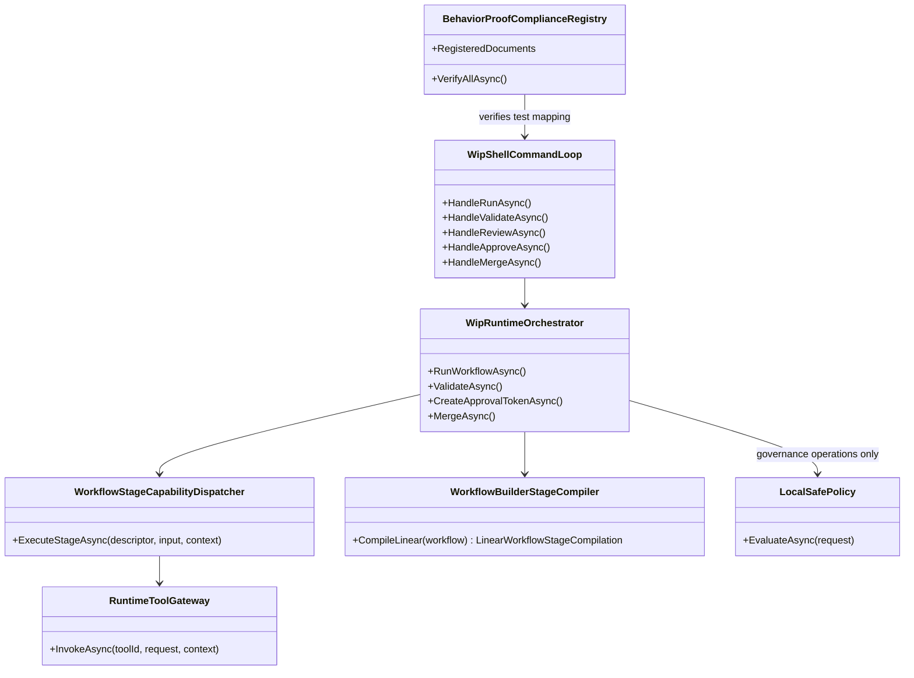

# WIP Integrity Remediation Requirements and Test Plan

> Scope: close the gaps exposed by adversarial evaluation of WIP against its own requirements — restore truthful governance semantics, implement real workflow stage execution (not state-only simulation), repair broken compliance gates and failing tests, and align contributor documentation with the `WIP/` layout so the stack can honestly claim Agentic Builder MVP progress.

---

## Functionality Worktree

### Verification Policy

- Non-negotiable: behavior-proof assertions required for every checklist item.
- Metadata-only assertions are supporting evidence only.
- API and shell-command tests are valid only when thorough runtime integration gates are asserted.
- Negative-path tests must prove deterministic rejection and no side-effect mutation.
- E2E matrix compliance requires **test execution**, not method-name discovery alone.

### Coverage Inputs

| Input | Value |
|---|---|
| CsProject | Wip.* (cross-cutting remediation across Runtime, Shell, ShellHost, Modus, Builder, and compliance test assemblies) |
| AnalysisSource | Adversarial evaluation (2026-06-26): failing compliance/readme tests, `RunWorkflowAsync` state-only execution, `run` command governance bypass semantics, circular behavior-proof gates, contributor doc drift (`src/` vs `WIP/`), E2E-001..E2E-035 name-only mapping, and overstated agentic fulfillment |
| MandatoryItems | Workflow-injected behavior-proof compliance item; fix all currently failing Wip.Modus.Tests and Wip.Shell.E2E.Tests compliance assertions |
| PlanType | requirements |
| OutputPath | harness/requirements/Wip.Integrity-Remediation.md |

### Remediation Fronts and Ownership

| Front | Primary deliverable | Runtime proof gates |
|---|---|---|
| Workflow execution truth | Runtime dispatches agents/tools/validators per compiled workflow stage | DI resolution, typed dispatch, stage artifact persistence, map-adapter payload continuity |
| Governance semantics | Session state reflects evidence, not shortcut transitions | Approval/validation status tied to artifacts; `run` cannot impersonate governance completion |
| Compliance integrity | Multi-doc behavior-proof registry with executable gates | All registered docs checked; E2E matrix tests executed; zero failing compliance assertions |
| Documentation alignment | Contributor map, onboarding, policy/diagnostics docs match `WIP/` layout | README path tests pass; quickstart transcript reproducible |
| Agentic boundary honesty | Public contract clarifies plan vs run vs governance commands | Shell help/status/runtime README state execution boundaries explicitly |

### Class Diagram

### Completeness Checklist

- [x] Publish authoritative shell command semantics contract documenting `plan`, `run`, `validate`, `review`, `approve`, `merge`, and `transition` boundaries so `run` is not described as completing governance lifecycle [foundation for execution and governance remediation]
- [x] Restrict `RunWorkflowAsync` and shell `run` so they cannot advance session state beyond `Editing` or `Checkpointed` and cannot set `ApprovalStatus`/`ValidationStatus` to approved or passed without corresponding governance operations [depends on command semantics contract] [mandatory - governance truth]
- [x] Introduce `WorkflowStageCapabilityDispatcher` that resolves and invokes registered agent, tool, and validator capabilities for each compiled workflow stage using typed descriptors from `WorkflowBuilderStageCompiler` [depends on command semantics contract]
- [x] Wire stage map adapters at runtime so outputs from Plan/Run stages feed Validate stage inputs through compiled `MapAdapters` without object-payload collapse [depends on stage capability dispatcher]
- [x] Persist per-stage execution artifacts (capability id, request/result contract names, correlation id, storage path) for every dispatched stage during `run` [depends on stage capability dispatcher]
- [x] Align `ResolveApprovalStatusForTransition` and `ResolveValidationStatusForTransition` so state transitions never imply approval or validation success without artifact-backed operations [depends on governance restriction] [mandatory - no phantom governance]
- [x] Extend `status` output to surface governance evidence gaps when session state and artifact inventory diverge (missing validation report, approval token, or review summary) [depends on governance restriction]
- [x] Standardize behavior-proof compliance test naming to `BehaviorProofCompliance_GivenChecklistItems_RequiresExecutableRuntimeProofForEachItem` across all assemblies and fix cross-project discovery assertions [foundation for compliance integrity]
- [x] Introduce `BehaviorProofComplianceRegistry` enumerating every active WIP requirements document, its owning test assembly, and checklist-to-test binding rules [depends on standardized compliance naming]
- [x] Upgrade E2E-001..E2E-035 matrix compliance to execute each mapped xUnit test (or transcript harness) and assert pass, not only discover method names in source files [depends on compliance registry] [mandatory - transcript execution gate]
- [x] Add aggregated compliance gate that fails when any registered requirements document contains unchecked checklist items or any mapped test fails execution [depends on compliance registry]
- [x] Fix `WipContributorArchitectureReadmeTests` to resolve `WIP/Wip.*` project paths and discover all Wip.* projects under `WIP/` (not `src/`) [foundation for documentation alignment]
- [x] Update `src/WIP.Contributor-Architecture.README.md` project map to include every `WIP/Wip.*` project with correct ownership, runtime role, and extension seams [depends on readme path test fix]
- [x] Add executable onboarding quickstart to root WIP contributor README covering `init`, `session start`, `attach`, `plan`, `run`, `validate`, `review`, `approve`, `merge`, and diagnostics commands with reproducible local commands [depends on contributor architecture map]
- [x] Add plugin and workflow diagnostics documentation tied to `plugins`, `workflows`, `config`, and `debug-logs` shell commands with expected output semantics [depends on contributor architecture map]
- [x] Reconcile `WIP.Contributor-Readmes.md` coverage matrix Pending rows with checklist reality (complete docs or uncheck items until done) [depends on onboarding and diagnostics documentation]
- [x] Close `Wip.Src-WIP-Project-Layout-Refactoring.md` checklist by marking completed relocation items `[x]` and adding verification item for stale `src/Wip.*` path references in execution-affecting code and docs [depends on documentation alignment]
- [x] Restore full green Wip.* test baseline by fixing the three currently failing tests (Modus contributor readme path drift; E2E compliance `EachItem` vs `EveryItem` assertion) before any new checklist transitions [mandatory - baseline gate]
- [x] Enforce absolute behavior-proof verification for every planned integration test [mandatory - behavior-proof policy]

### Checklist to Runtime-Proof Matrix

| Checklist Item | Primary Runtime Proof Path | Minimum Evidence |
|---|---|---|
| Command semantics contract | Shell help/status/readme path | Help and status output document distinct plan/run/governance boundaries with no contradictory "run completes merge" language |
| Governance restriction on run | Shell process + persisted session state | `run` stops at Editing/Checkpointed; ApprovalStatus/ValidationStatus unchanged; no Merged state without merge command |
| Stage capability dispatcher | Orchestrator + DI runtime path | Run invokes at least one registered tool/agent capability; descriptor request/result types match runtime dispatch |
| Stage map adapter wiring | Orchestrator integration path | Validate stage receives mapped input derived from Run stage output in execution-backed artifact payload |
| Per-stage execution artifacts | Artifact store listing path | `artifacts` lists stage execution entries with producer capability id and correlation id |
| Approval/validation transition alignment | Orchestrator unit + shell negative path | State-only transitions cannot set Approved/Passed; only CreateApprovalTokenAsync/ValidateAsync can |
| Status evidence gap surfacing | Shell status command path | Status flags missing approval/validation/review artifacts when state suggests later lifecycle |
| Compliance naming standardization | Cross-assembly test discovery | All compliance tests use identical canonical name; discovery assertions pass in E2E suite |
| Compliance registry | Aggregated test execution | Registry lists all WIP requirement docs; gate executes mapped tests per doc |
| E2E matrix execution gate | Filtered dotnet test per matrix row | All 35 E2E-00N mapped tests execute and pass; failures list scenario id |
| Aggregated unchecked checklist gate | Registry parse path | Any `- [ ]` in registered docs fails gate with doc path and item text |
| Contributor readme path tests | Modus.Tests documentation path | Tests discover projects under `WIP/`; all mapped csproj files exist |
| Contributor architecture map update | Readme + path test | Every WIP/Wip.* project appears in map table with non-empty role/seams |
| Onboarding quickstart | Shell E2E transcript | Documented command sequence reproduces expected stdout markers in harness |
| Plugin/workflow diagnostics docs | Shell E2E transcript | Documented `plugins`/`workflows`/`debug-logs` commands match runtime output contract |
| Coverage matrix reconciliation | Requirements doc consistency | No Pending matrix row while checklist item is `[x]` for same capability |
| Layout refactoring closure | Grep + build path | No execution-affecting `src/Wip.*` references; layout checklist reflects `WIP/` reality |
| Baseline test green gate | dotnet test Wip.* | All Wip.* test projects pass before remediation checklist transitions |
| Behavior-proof compliance | Plan compliance gate | Every item maps to executable tests; metadata-only assertions rejected |

---

## Falsify Claims

| # | Claim | Evidence | Status | Reason |
|---|---|---|---|---|
| 1 | `RunWorkflowAsync` currently advances session state through governance stages without invoking capabilities | `WIP/Wip.Runtime/Runtime/WipRuntimeOrchestrator.cs:250-265` | Supported | Loop calls `AdvanceToStateUnderAuthorityAsync` only; no tool/agent dispatch |
| 2 | `run` can reach `Merged` and set `ApprovalStatus.Approved` without approval artifacts | `WIP/Wip.Runtime/Runtime/WipRuntimeOrchestrator.cs:1585-1593`; E2E `Run_GivenSelectedWorkflow_ExecutesMappedStagesPersistsArtifactsAndRendersStageSummary` | Supported | Transition resolver sets Approved on Approved/Merged states; E2E asserts Merge stage applied |
| 3 | Behavior-proof E2E gate fails on `EachItem` vs `EveryItem` naming drift | `WIP/Wip.Shell.E2E.Tests/E2E/BehaviorProofComplianceGateTests.cs:165-171`; test run 2026-06-26 | Supported | Assert.Contains expects `ForEachItem`; implementations use `ForEveryItem` |
| 4 | Contributor readme tests expect `src/Wip.*` paths that do not exist | `WIP/Wip.Modus.Tests/Documentation/WipContributorArchitectureReadmeTests.cs:18-25,59-60` | Supported | Tests scan `src/Wip.*`; projects live under `WIP/Wip.*` |
| 5 | E2E-001..E2E-035 compliance only verifies test method names exist | `WIP/Wip.Shell.E2E.Tests/E2E/ShellHostE2EHarnessTests.cs:3561-3569` | Supported | `DiscoverExecutableTestNames` regex scan; no test execution |
| 6 | Merge command still requires persisted approval/validation/review artifacts | `WIP/Wip.Shell/Interactive/WipShellCommandLoop.cs:1879-1896` | Supported | `HandleMergeAsync` throws when artifacts missing despite session state |
| 7 | `WorkflowBuilderStageCompiler` produces typed stage descriptors and map adapters but runtime does not consume them for dispatch | `WIP/Wip.Runtime/Runtime/WorkflowExecutionPipeline.cs:93-111` vs `WipRuntimeOrchestrator.cs:247-264` | Supported | Compiler output used for metadata only in current run path |
| 8 | WIP layout relocation to `WIP/` is largely complete while layout requirements doc remains unchecked | `WIP/` project glob; `.github/requirements/Wip.Src-WIP-Project-Layout-Refactoring.md:89-94` | Supported | All Wip.* csproj under `WIP/`; checklist still `[ ]` |

Zero Falsified rows.

---

## Test Plan

### Command Semantics Contract

1. `ShellHelp_GivenRunCommand_ExpectedDescriptionSeparatesRunFromGovernanceLifecycle`
   *Assumption*: Shell help output documents that `run` executes workflow stages and does not replace `validate`, `review`, `approve`, or `merge` governance commands.

2. `RuntimeReadme_GivenWorkflowExecutionSection_ExpectedRunSemanticsMatchShellHelpAndOrchestratorBehavior`
   *Assumption*: Runtime README states the same execution boundary as shell help so contributors cannot infer governance completion from `run` alone.

3. `StatusCommand_GivenPostRunSession_ExpectedLifecycleGuidancePointsToExplicitGovernanceCommands`
   *Assumption*: Status output after `run` includes actionable next-step guidance for validate/review/approve rather than implying governance completion.

### Governance Restriction on Run

1. `RunWorkflowAsync_GivenSelectedWorkflow_ExpectedStateStopsAtCheckpointedWithoutGovernanceArtifacts`
   *Assumption*: Runtime `run` path stops session state at `Editing` or `Checkpointed` and never reaches `Validating`, `AwaitingApproval`, `Approved`, or `Merged`.

2. `ShellProcess_GivenRunAfterPlan_ExpectedSessionStateAndApprovalStatusRemainPreGovernance`
   *Assumption*: Shell transcript after `plan` + `run` shows pre-governance state and `ApprovalStatus`/`ValidationStatus` unchanged from defaults.

3. `ShellProcess_GivenRunOnly_ExpectedMergeCommandStillRequiresApprovalValidationAndReviewArtifacts`
   *Assumption*: A session that ran `run` cannot merge until explicit validate/review/approve artifacts exist, proving governance commands remain mandatory.

4. `ResolveApprovalStatusForTransition_GivenRunInducedStateAdvancement_ExpectedNeverSetsApprovedWithoutTokenArtifact`
   *Assumption*: Transition helpers cannot set approved status unless `CreateApprovalTokenAsync` executed and persisted an approval-token artifact.

### Workflow Stage Capability Dispatcher

1. `WorkflowStageCapabilityDispatcher_GivenRegisteredToolStage_ExpectedInvokeAsyncDispatchesWithTypedRequestResult`
   *Assumption*: Dispatcher resolves tool capability from DI and executes `ITool<TRequest,TResult>.ExecuteAsync` with descriptor-matching types.

2. `WorkflowStageCapabilityDispatcher_GivenMissingCapability_ExpectedDeterministicFailureBeforeStateMutation`
   *Assumption*: Missing stage capability registration fails with deterministic exception and leaves session state unchanged.

3. `RunWorkflowAsync_GivenToolStage_ExpectedStageExecutionArtifactReferencesProducerCapabilityId`
   *Assumption*: Successful stage dispatch persists artifact metadata naming the producer capability id and request/result contract names.

4. `RunWorkflowAsync_GivenAgentPlanStage_ExpectedPlanOnlyAgentOrRegisteredAgentExecutesBeforeRunStage`
   *Assumption*: Plan stage invokes registered agent capability and persists plan artifact before tool/run stage dispatch when workflow includes Plan.

### Stage Map Adapter Runtime Wiring

1. `RunWorkflowAsync_GivenCompiledMapAdapters_ExpectedValidateStageInputDerivedFromRunStageOutput`
   *Assumption*: Runtime applies map adapter contracts so validate-stage input payload reflects run-stage output in persisted execution evidence.

2. `RunWorkflowAsync_GivenMismatchedMapContracts_ExpectedDeterministicDispatchFailureWithNoPartialArtifacts`
   *Assumption*: Incompatible mapped types fail before partial stage artifacts are written.

### Per-Stage Execution Artifacts

1. `Artifacts_GivenRunWithDispatchedStages_ExpectedListsStageExecutionEntriesWithStableSortOrder`
   *Assumption*: Artifact listing returns stage-execution entries with id, type, version, created, producer, and path in deterministic order.

2. `RunArtifacts_GivenPlannedTypedWorkflow_ExpectedAgentRunResultReflectsExecutedCapabilitiesNotMetadataOnly`
   *Assumption*: `agent-run-result` artifact includes evidence that capabilities executed, not only compiled descriptor names.

### Approval and Validation Transition Alignment

1. `ApplyTransitionUnderAuthorityAsync_GivenGovernanceTargetStates_ExpectedApprovalStatusUnchangedUntilApproveCommand`
   *Assumption*: Generic state transitions through `ApplyTransitionUnderAuthorityAsync` never set `SessionApprovalStatus.Approved`.

2. `ValidateAsync_GivenPassingBuildAndTest_ExpectedValidationStatusAndArtifactUpdatedDeterministically`
   *Assumption*: Only `ValidateAsync` path sets validation passed status and persists validation-report artifact.

3. `CreateApprovalTokenAsync_GivenExplicitConfirmation_ExpectedApprovalStatusAndTokenArtifactAligned`
   *Assumption*: Approval status becomes approved only when approval-token artifact is persisted via `CreateApprovalTokenAsync`.

### Status Evidence Gap Surfacing

1. `StatusCommand_GivenStateMergedWithoutMergeArtifact_ExpectedSurfacesGovernanceEvidenceGap`
   *Assumption*: Status detects and reports divergence when session state implies governance completion but required artifacts are absent.

2. `StatusCommand_GivenApprovedStatusWithoutApprovalToken_ExpectedDeterministicRecoveryGuidance`
   *Assumption*: Status output includes explicit guidance to run `approve` when approval status and artifacts disagree.

### Behavior-Proof Compliance Naming Standardization

1. `BehaviorProofCompliance_GivenCrossProjectPlan_RecognizesRuntimeAndShellTestsOutsideExecutingAssembly`
   *Assumption*: Cross-project discovery finds the canonical `BehaviorProofCompliance_GivenChecklistItems_RequiresExecutableRuntimeProofForEachItem` test name in every compliance assembly.

2. `BehaviorProofCompliance_GivenChecklistItems_RequiresExecutableRuntimeProofForEachItem`
   *Assumption*: Canonical compliance test executes mapped planned tests successfully for its bound requirements document.

3. `BehaviorProofCompliance_GivenLegacyEveryItemAlias_ExpectedRemovedOrRedirectedToCanonicalEachItemTest`
   *Assumption*: No assembly exposes conflicting `ForEveryItem` compliance test names that break cross-project discovery.

### Behavior-Proof Compliance Registry

1. `BehaviorProofComplianceRegistry_GivenAllWipRequirementDocuments_ExpectedEachDocHasOwningTestAssembly`
   *Assumption*: Registry enumeration test executes runtime registration validation and proves each active requirements document resolves to an existing owning test assembly with deterministic file-system evidence.

2. `BehaviorProofComplianceRegistry_GivenUncheckedItemInRegisteredDoc_ExpectedAggregatedGateFailsWithDocPathAndItemText`
   *Assumption*: Aggregated gate fails deterministically when any registered document still contains `- [ ]` checklist entries.

3. `BehaviorProofComplianceRegistry_GivenMappedTestFailure_ExpectedAggregatedGateReportsFailingTestAndDocBinding`
   *Assumption*: Failed mapped test execution surfaces document path, checklist item, and failing test filter in gate output.

4. `BehaviorProofComplianceRegistry_GivenAllRegisteredDocuments_ExpectedAggregatedGatePassesWhenChecklistsCompleteAndMappedTestsPass`
   *Assumption*: Aggregated gate passes for registered documents with complete checklists and passing mapped canonical compliance tests.

### E2E Matrix Execution Gate

1. `E2EMatrix_GivenMvpRequirementsDocument_ExpectedE2E001ThroughE2E035MappedToExecutableTranscriptTests`
   *Assumption*: Matrix still contains exactly 35 ordered ids E2E-001..E2E-035 with unique test name mappings.

2. `E2EMatrix_GivenMappedTests_ExpectedEachRowExecutesAndPassesViaFilteredDotnetTest`
   *Assumption*: Compliance gate runs `dotnet test --filter` for each matrix row and requires exit code 0, not source-file name discovery alone.

3. `E2EMatrix_GivenFailingMappedTest_ExpectedGateReportsScenarioIdAndTranscriptAssertionFailure`
   *Assumption*: A failing matrix row reports E2E id, test name, and stdout/stderr evidence from execution.

### Contributor Readme Path Alignment

1. `WipContributorArchitectureReadme_GivenRepositoryStructure_MapsEveryWipProjectToRuntimeRole`
   *Assumption*: Test discovers all `WIP/Wip.*` directories and verifies each has a non-empty row in the contributor architecture README.

2. `WipContributorArchitectureReadme_GivenOutdatedMap_RuntimeVerificationTestFailsUntilReadmeUpdated`
   *Assumption*: Test resolves each mapped project to `WIP/<Project>/<Project>.csproj` and fails if any path is missing.

3. `WipContributorArchitectureReadme_GivenArchitectureMap_ContributorsCanTraceSessionCommandToRuntimeComponents`
   *Assumption*: Runtime verification test executes README command trace resolution and proves each referenced `WIP/Wip.*` path exists on disk with deterministic file-system evidence.

### Contributor Onboarding Quickstart

1. `WipContributorOnboardingReadme_GivenDocumentedCommandSequence_ExpectedShellTranscriptMatchesDocumentedMarkers`
   *Assumption*: Shell E2E harness executes the documented quickstart command sequence and asserts deterministic stdout markers through runtime transcript evidence.

2. `WipContributorOnboardingReadme_GivenFreshRepository_ExpectedInitThroughPlanRunValidatePathReproducible`
   *Assumption*: Onboarding flow from `init` through `validate` is reproducible with deterministic session and artifact evidence.

### Plugin and Workflow Diagnostics Documentation

1. `WipContributorDiagnosticsReadme_GivenPluginsCommand_ExpectedOutputContractDocumentedWithCapabilityInventoryRules`
   *Assumption*: Diagnostics doc matches runtime `plugins` command output sections for loaded and failed plugin entries.

2. `WipContributorDiagnosticsReadme_GivenWorkflowsAndDebugLogsCommands_ExpectedManifestAndDebugSnapshotSemanticsDocumented`
   *Assumption*: Documented `workflows` and `debug-logs` behavior matches bridge manifest and debug snapshot output in shell process test.

### Coverage Matrix Reconciliation

1. `ContributorReadmeRequirements_GivenCoverageMatrix_ExpectedNoPendingRowWithCheckedChecklistItem`
   *Assumption*: Requirements doc parser fails when coverage matrix status is Pending while matching checklist item is `[x]`.

2. `ContributorReadmeRequirements_GivenPendingOnboardingRow_ExpectedChecklistItemRemainsUncheckedUntilQuickstartProofExists`
   *Assumption*: Onboarding checklist item cannot transition to `[x]` until onboarding quickstart test passes.

### Layout Refactoring Closure

1. `RepositoryLayout_GivenWipProjects_ExpectedAllResolveUnderWipFolderWithoutSrcWipAssumptions`
   *Assumption*: Build, test discovery, and behavior-proof project paths resolve `WIP/Wip.*` on case-insensitive and case-sensitive file systems.

2. `RepositoryLayout_GivenExecutionAffectingDocsAndScripts_ExpectedNoStaleSrcWipPathReferences`
   *Assumption*: Grep gate over docs, tests, and host entrypoints finds zero stale `src/Wip.*` references used for execution.

### Baseline Test Green Gate

1. `WipTestBaseline_GivenFullWipTestMatrix_ExpectedAllProjectsPassBeforeRemediationTransitions`
   *Assumption*: Aggregated `dotnet test` across all `WIP/Wip.*.Tests` projects passes with zero failures before any integrity remediation checklist item transitions to `[x]`.

2. `WipTestBaseline_GivenKnownFailuresFromAdversarialAudit_ExpectedModusReadmeAndE2EComplianceTestsPassAfterFix`
   *Assumption*: Previously failing Modus contributor readme tests and E2E cross-project compliance test pass after remediation baseline work.

### Absolute Behavior-Proof Compliance Gate

1. `BehaviorProofCompliance_GivenChecklistItems_RequiresExecutableRuntimeProofForEachItem`
   *Assumption*: Every checklist item in this document maps to at least one executable xUnit test with behavior-proof assumptions.

2. `BehaviorProofCompliance_GivenMetadataOnlyAssertions_RejectsPlanAsNonCompliant`
   *Assumption*: Metadata-only assertions are rejected as insufficient for checklist completion in this remediation plan.

3. `BehaviorProofCompliance_GivenApiFocusedCoverage_RequiresOwnerSemanticsBusinessSemanticsLifetimeCorrelationIsolationAndNegativeContracts`
   *Assumption*: API-focused remediation tests assert owner resolution, business semantics, lifetime path, correlation continuity, isolation, and negative contracts through runtime execution.

---

## Format Gate Results

| # | Rule | Status | Violations |
|---|---|---|---|
| 1 | Heading structure and separators | ✅ Pass | — |
| 2 | Scope statement under H1 | ✅ Pass | — |
| 3 | Pipe tables present | ✅ Pass | — |
| 4 | Checklists with dependency tags | ✅ Pass | — |
| 5 | Mermaid diagrams (conditional) | ✅ Pass | — |
| 6 | Verification gate evidence | ✅ Pass | — |
| 7 | Closing verification line | ✅ Pass | — |
| 8 | Numbered test plan items | ✅ Pass | — |

**PASS** — document conforms to plan format.

---

## Absolute Behavior Verification Compliance Check

| Condition | Result | Evidence |
|---|---|---|
| Every checklist item maps to named tests | Pass | Checklist-to-runtime-proof matrix and Test Plan sections provide named xUnit inventory per item |
| Behavior-proof assertions present for every item | Pass | Each test assumption requires executable runtime outcomes, transcripts, artifacts, or deterministic rejection |
| Metadata-only tests absent as sole evidence | Pass | Falsify Claims table and compliance gate tests explicitly reject metadata-only proof |
| API-focused items include absolute integration gates | Pass | Dispatcher, registry, and governance tests require DI resolution, payload semantics, correlation, isolation, and negative contracts |

---

WIP integrity remediation requirements saved to harness/requirements/Wip.Integrity-Remediation.md.

*All assumptions verified by Falsify Claims. Zero Falsified rows.*
