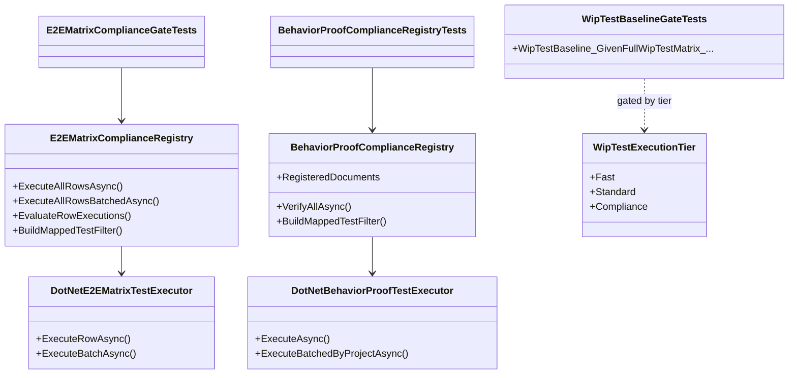

# WIP Test Performance and Compliance Gate Requirements and Test Plan

> Scope: reduce WIP test wall-clock time to practical developer and CI budgets while preserving behavior-proof compliance guarantees - eliminate redundant nested dotnet test subprocess fan-out (especially the E2E-001..E2E-035 matrix gate), mitigate file-locking under concurrent testhost, tier fast vs compliance execution, and document local escape hatches without weakening requirements traceability.

---

## Functionality Worktree

### Verification Policy

- Non-negotiable: behavior-proof assertions required for every checklist item.
- Metadata-only assertions are supporting evidence only.
- Compliance gates must still prove mapped tests execute and pass - not only that method names exist in source.
- Performance optimizations must not remove per-row or per-document failure attribution from gate output.
- Fast-path skips (WIP_SKIP_*) are dev/inner-loop affordances only; full compliance tier must run without skips on main/nightly.
- Include absolute schedule gates when scheduled jobs are in scope (not applicable to this plan).

### Coverage Inputs

| Input | Value |
|---|---|
| CsProject | Wip.* test assemblies (primary: Wip.Shell.E2E.Tests, Wip.Shell.E2E compliance libraries) |
| AnalysisSource | Developer investigation (2026-06-27): E2E matrix gate spawns 35 sequential dotnet test subprocesses; behavior-proof registry spawns per-document subprocesses; WipTestBaselineGateTests re-runs all 12 WIP test projects from inside E2E; xunit.runner.json forces maxParallelThreads: 1; MSB3026 file locks when multiple testhost processes hold shared bin output; unit WIP projects pass in ~55s aggregate while uncanceled E2E exceeds 7+ minutes even with skip env vars |
| MandatoryItems | Collapse E2E matrix row execution to batched single-process filter; preserve per-row failure evidence; CI test tiering; document local skip env vars; fix empty Wip.Artifacts.Local.Tests baseline noise; file-lock mitigation; behavior-proof policy compliance |
| PlanType | requirements |
| OutputPath | harness/requirements/Wip.Test-Performance.md |
| OutputTitle | WIP Test Performance and Compliance Gate Requirements and Test Plan |

### Current Performance Baseline

| Layer | Approximate cost | Root cause |
|---|---|---|
| WIP unit projects (10 assemblies, excl. E2E) | ~55 s aggregate | Acceptable; Wip.Validation.DotNet.Tests (~10 s) and Wip.Workspaces.Git.Tests (~7 s) dominate |
| E2E transcript harness (~100 tests, serial) | 7-20+ min | xunit.runner.json serializes all; each test spawns Wip.ShellHost + temp git repo |
| E2E matrix gate (35 rows) | 3-12+ min | 35 isolated dotnet test --filter subprocesses, each re-running one heavy harness test |
| Behavior-proof registry gate | 1-5+ min | One dotnet test subprocess per registered requirements document |
| Baseline gate (WipTestBaselineGateTests) | 2-10+ min | 12 sequential dotnet test subprocesses from inside E2E parent testhost |
| File-lock retries (MSB3026) | Unbounded stall | Parent + nested testhost lock shared bin/Debug DLLs |

### Target Budgets

| Tier | Audience | Matrix execution | Compliance mapped tests | Baseline re-run | Target wall-clock |
|---|---|---|---|---|---|
| Fast (local inner loop) | Developer | Skipped via WIP_SKIP_E2E_MATRIX_ROW_EXECUTION=1 | Skipped via WIP_SKIP_COMPLIANCE_MAPPED_TEST_EXECUTION=1 | Skipped or moved out of default E2E | E2E harness <= 8 min |
| Standard (PR CI) | Pull request | Single batched filter run | Batched by owning project | Solution-level dotnet test per project, not nested from E2E | WIP unit + E2E <= 15 min |
| Compliance (main/nightly) | Release honesty | Batched single filter + per-row parse on failure | Batched per owning assembly | CI matrix only; no in-test re-run | <= 25 min total WIP |

### Remediation Fronts and Ownership

| Front | Primary deliverable | Runtime proof gates |
|---|---|---|
| Matrix batching | ExecuteAllRowsBatchedAsync uses one dotnet test with OR-combined filter | Gate passes when all 35 rows pass; failure output still names scenario id |
| Compliance batching | Registry groups documents by owning test project | Fewer subprocesses; same mapped-test pass evidence |
| Baseline decoupling | Remove or gate nested full-matrix baseline from default E2E | CI runs projects once; E2E does not re-spawn 12 runners |
| Parallelization policy | Allow parallel collections for independent harness tests | Compliance collections remain serial; no shared-bin contention |
| File-lock hygiene | Pre-build + --no-build contract; document concurrency rules | No MSB3026 during nested runs in clean single-session execution |
| CI tiering | Split .github/workflows jobs for fast vs compliance | Each tier asserts expected env vars and timing traits |
| Developer docs | Contributor README section for skip flags and tiers | Doc test or E2E transcript cites env var names |

### Class Diagram

### Completeness Checklist

- [ ] Introduce ExecuteAllRowsBatchedAsync that runs all E2E-001..E2E-035 mapped tests in one dotnet test --filter invocation per owning project instead of 35 sequential subprocesses [foundation for matrix performance] [mandatory - matrix batching]
- [ ] On batched failure, re-run only failing test names individually to produce per-scenario-id attribution (E2E-00N) in gate messages [depends on matrix batching]
- [ ] Replace E2EMatrix_GivenMappedTests_ExpectedEachRowExecutesAndPassesViaFilteredDotnetTest implementation to use batched execution by default while preserving exit-code and stdout evidence per row on failure [depends on matrix batching] [mandatory - matrix gate behavior parity]
- [ ] Add performance regression test asserting matrix gate subprocess count <= 2 (one batched run + optional failure drill-down) under compliance tier [depends on matrix batching]
- [ ] Batch BehaviorProofComplianceRegistry.VerifyAllAsync mapped test execution by owning test project file instead of one subprocess per document [depends on matrix batching]
- [ ] Decouple WipTestBaselineGateTests full 12-project nested run from default E2E collection - move to CI workflow step or gate behind WIP_TEST_TIER=compliance env var [depends on matrix batching] [mandatory - baseline decoupling]
- [ ] Register this requirements document in BehaviorProofComplianceRegistry with owning assembly Wip.Shell.E2E.Tests [depends on baseline decoupling]
- [ ] Resolve Wip.Artifacts.Local.Tests empty project: add minimal smoke test or remove from baseline project list until real tests exist [foundation for baseline accuracy]
- [ ] Document WIP_SKIP_E2E_MATRIX_ROW_EXECUTION, WIP_SKIP_COMPLIANCE_MAPPED_TEST_EXECUTION, and WIP_TEST_TIER in WIP contributor README with fast vs compliance semantics [depends on baseline decoupling]
- [ ] Add CI workflow job wip-tests-fast running all WIP unit test projects + E2E with skip env vars set [depends on developer docs]
- [ ] Add CI workflow job wip-tests-compliance running E2E without skip env vars after solution pre-build with --no-build [depends on CI fast job] [mandatory - CI tiering]
- [ ] Relax xunit.runner.json to allow parallelizeTestCollections: true for collections outside compliance serial collections [depends on file-lock hygiene]
- [ ] Enforce pre-build contract: nested executors always pass --no-build; parent E2E run documents that solution must be built first [depends on file-lock hygiene]
- [ ] Add gate test asserting nested executors set ConfigureNestedTestProcessEnvironment skip flags to prevent recursive compliance explosion [depends on matrix batching]
- [ ] Publish measured before/after timing evidence in transition proof when matrix batching ships [depends on performance regression test]
- [ ] Enforce absolute behavior-proof verification for every planned integration test [mandatory - behavior-proof policy]

### Checklist to Runtime-Proof Matrix

| Checklist Item | Primary Runtime Proof Path | Minimum Evidence |
|---|---|---|
| Matrix batch execution | E2EMatrixComplianceRegistry.ExecuteAllRowsBatchedAsync | Single subprocess exit code 0; all 35 scenario ids satisfied |
| Per-row failure attribution | Batched failure drill-down path | Gate message contains E2E-00N, test name, filter, and stdout on failure |
| Matrix gate behavior parity | E2EMatrixComplianceGateTests | Existing pass/fail synthetic tests still pass; live gate uses batch path |
| Subprocess count regression | Performance trait test | Assert subprocess count <= 2 under compliance tier mock executor |
| Compliance registry batching | VerifyAllAsync with batched executor | One subprocess per owning project; all documents verified |
| Baseline decoupling | E2E filter excluding baseline gate in fast tier | Fast E2E completes without spawning 12 child dotnet test processes |
| Registry registration | BehaviorProofComplianceRegistry.RegisteredDocuments | This doc listed with correct path and owning assembly |
| Empty artifacts project | Baseline project list or smoke test | No zero-test project in baseline enumeration |
| Developer skip docs | Contributor README + doc test | Env var names and tier semantics appear in published docs |
| CI fast job | GitHub Actions workflow | Job runs unit + E2E with skips; finishes within target budget |
| CI compliance job | GitHub Actions workflow | Job runs full compliance without skips after --no-build |
| Selective parallelization | xUnit collection run | Independent harness tests overlap; compliance collections serial |
| Pre-build contract | Nested executor integration | All nested dotnet test invocations include --no-build |
| Recursive skip guard | Nested process environment | Child processes inherit skip flags; no nested matrix re-entry |
| Timing evidence | Transition proof artifact | Before/after wall-clock documented with command transcript |
| Behavior-proof compliance | Canonical compliance test | Every item maps to executable tests with runtime assertions |

---

## Falsify Claims

| # | Claim | Evidence | Status | Reason |
|---|---|---|---|---|
| 1 | E2E matrix gate runs one dotnet test subprocess per matrix row | WIP/Wip.Shell.E2E/Compliance/E2EMatrixComplianceRegistry.cs:201-209 | Supported | foreach calls ExecuteRowAsync per entry |
| 2 | Each matrix row maps to a heavy ShellHostE2EHarnessTests transcript test | .github/requirements/Wip.Next-Steps.md:189-223 | Supported | All E2E-001..035 rows reference harness test names |
| 3 | E2E assembly disables all parallelism | WIP/Wip.Shell.E2E.Tests/xunit.runner.json | Supported | parallelizeTestCollections: false, maxParallelThreads: 1 |
| 4 | Behavior-proof registry can spawn one subprocess per document | WIP/Wip.Shell.E2E/Compliance/BehaviorProofComplianceRegistry.cs:320-336 | Supported | foreach document calls executor per document |
| 5 | Baseline gate re-runs all WIP test projects from inside E2E | WIP/Wip.Shell.E2E.Tests/E2E/WipTestBaselineGateTests.cs | Supported | 12-project ComplianceTestProject loop |
| 6 | BuildMappedTestFilter already supports OR-combined filters | BehaviorProofComplianceRegistry.cs:387-388 | Supported | string.Join with pipe separator |
| 7 | WIP unit tests pass quickly in aggregate (~55 s) | Local dotnet test run 2026-06-27 | Supported | 10 projects, 0 failures |
| 8 | CI currently does not run WIP E2E or most WIP unit tests | .github/workflows/tests-ci.yml | Supported | Only Wip.ShellHost.Tests in workflow |
| 9 | Wip.Artifacts.Local.Tests has csproj but no test source files | WIP/Wip.Artifacts.Local.Tests/ glob | Supported | Only .csproj present |
| 10 | Skip env vars exist for matrix and mapped compliance execution | E2EMatrixComplianceRegistry, BehaviorProofComplianceRegistry | Supported | WIP_SKIP_E2E_MATRIX_ROW_EXECUTION and WIP_SKIP_COMPLIANCE_MAPPED_TEST_EXECUTION |

Zero Falsified rows.

---

## Test Plan

### E2E Matrix Batched Execution

1. `E2EMatrixBatchedExecution_GivenAllRowsMapped_ExpectedSingleDotnetTestSubprocessRunsAllFilters`
   *Assumption*: Batched executor invokes dotnet test once per owning project with OR-combined FullyQualifiedName filter covering all 35 matrix test names.

2. `E2EMatrixBatchedExecution_GivenAllRowsPass_ExpectedGateReportsCompliantWithoutPerRowSubprocesses`
   *Assumption*: When batched run exits 0, EvaluateRowExecutions receives per-row success results without 35 child process spawns.

3. `E2EMatrixBatchedExecution_GivenOneRowFails_ExpectedDrillDownIdentifiesScenarioIdAndStdout`
   *Assumption*: Batched failure triggers individual re-run for failing test only; gate message contains E2E-00N, test name, and transcript output.

4. `E2EMatrix_GivenMappedTests_ExpectedEachRowExecutesAndPassesViaFilteredDotnetTest`
   *Assumption*: Existing compliance gate test passes using batched path under compliance tier.

5. `E2EMatrix_GivenFailingMappedTest_ExpectedGateReportsScenarioIdAndTranscriptAssertionFailure`
   *Assumption*: Existing synthetic failure test continues to assert per-row gate message shape after batching refactor.

### Matrix Performance Regression

1. `E2EMatrixPerformance_GivenComplianceTier_ExpectedSubprocessCountAtMostTwo`
   *Assumption*: Instrumented executor records at most 2 dotnet test subprocess spawns for full 35-row compliance gate.

2. `E2EMatrixPerformance_GivenFastTierWithSkipEnv_ExpectedMatrixGateReturnsImmediately`
   *Assumption*: When WIP_SKIP_E2E_MATRIX_ROW_EXECUTION=1, matrix gate test returns without spawning subprocesses.

### Behavior-Proof Registry Batching

1. `BehaviorProofComplianceBatched_GivenMultipleDocumentsSameOwningProject_ExpectedSingleSubprocessPerProject`
   *Assumption*: Registry groups documents by OwningTestProjectFile and runs one filtered dotnet test per distinct project.

2. `BehaviorProofComplianceBatched_GivenAllDocumentsPass_ExpectedAggregatedGateCompliant`
   *Assumption*: Batched execution with exit code 0 yields IsCompliant true.

3. `BehaviorProofComplianceBatched_GivenMappedTestFailure_ExpectedDocPathAndChecklistItemInGateOutput`
   *Assumption*: Failed batched run surfaces document path, checklist item text, and filter in gate output.

4. `BehaviorProofComplianceRegistry_GivenAllRegisteredDocuments_ExpectedAggregatedGatePassesWhenChecklistsCompleteAndMappedTestsPass`
   *Assumption*: Existing aggregated gate test passes with batched executor under compliance tier.

### Baseline Gate Decoupling

1. `WipTestBaseline_GivenFastTier_ExpectedBaselineGateSkippedOrExcludedFromDefaultRun`
   *Assumption*: Default fast E2E run does not spawn 12 nested dotnet test processes via baseline gate.

2. `WipTestBaseline_GivenComplianceTier_ExpectedFullWipTestMatrixPassesViaCiWorkflowNotNestedE2E`
   *Assumption*: Full WIP project pass evidence is produced by CI workflow steps, not nested subprocess loop inside parent testhost.

3. `WipTestBaseline_GivenEmptyArtifactsTestProject_ExpectedExcludedOrContainsExecutableSmokeTest`
   *Assumption*: Baseline enumeration does not include zero-test projects or includes a passing smoke Fact.

### File-Lock and Build Contract

1. `NestedTestExecutor_GivenPreBuiltSolution_ExpectedAllInvocationsUseNoBuildFlag`
   *Assumption*: Matrix and behavior-proof executors append --no-build when useNoBuild is true.

2. `NestedTestExecutor_GivenChildProcess_ExpectedInheritsSkipEnvToPreventRecursiveGates`
   *Assumption*: ConfigureNestedTestProcessEnvironment sets both skip env vars on child ProcessStartInfo.

3. `E2EBuildContract_GivenConcurrentTesthostSessions_ExpectedDocumentedAsUnsupported`
   *Assumption*: Contributor docs state parallel E2E testhost sessions against same bin output are unsupported.

### Selective E2E Parallelization

1. `E2EParallelization_GivenIndependentHarnessCollection_ExpectedParallelizeTestCollectionsTrue`
   *Assumption*: Updated xunit.runner.json enables collection parallelism while compliance collections retain DisableParallelization.

2. `E2EParallelization_GivenComplianceCollection_ExpectedRemainsSerial`
   *Assumption*: E2EComplianceSequentialCollection and PackageSplitSerialCollection still disable parallelization.

### CI Tiering

1. `WipCiWorkflow_GivenPullRequest_ExpectedFastJobRunsUnitAndE2EWithSkips`
   *Assumption*: CI workflow defines a fast job that sets skip env vars and runs WIP unit + E2E projects.

2. `WipCiWorkflow_GivenMainBranch_ExpectedComplianceJobRunsWithoutSkips`
   *Assumption*: Compliance job runs E2E without skip env vars after solution-level build with --no-build.

3. `WipCiWorkflow_GivenFastJob_ExpectedCompletesWithinDocumentedBudget`
   *Assumption*: Fast job wall-clock remains below the 15-minute standard tier target.

### Developer Documentation

1. `WipContributorReadme_GivenTestPerformanceSection_ExpectedDocumentsSkipEnvVarsAndTiers`
   *Assumption*: Contributor README lists skip env vars and WIP_TEST_TIER with fast vs compliance semantics.

2. `WipContributorReadme_GivenTestPerformanceSection_ExpectedDocumentsPreBuildContract`
   *Assumption*: README states E2E nested gates require prior dotnet build and recommend --no-build for iterative runs.

### Requirements Registry

1. `BehaviorProofComplianceRegistry_GivenTestPerformanceDocument_ExpectedRegisteredWithOwningE2EAssembly`
   *Assumption*: harness/requirements/Wip.Test-Performance.md appears in RegisteredDocuments with Wip.Shell.E2E.Tests as owner.

2. `BehaviorProofCompliance_GivenChecklistItems_RequiresExecutableRuntimeProofForEachItem`
   *Assumption*: Canonical compliance test executes mapped tests for this document successfully under compliance tier.

### Absolute Behavior-Proof Compliance Gate

1. `BehaviorProofCompliance_GivenMetadataOnlyAssertions_RejectsPlanAsNonCompliant`
   *Assumption*: Subprocess-count or config-only assertions without executable gate outcomes are rejected as sole evidence.

2. `BehaviorProofCompliance_GivenApiFocusedCoverage_RequiresOwnerSemanticsBusinessSemanticsLifetimeCorrelationIsolationAndNegativeContracts`
   *Assumption*: Not applicable to test-infrastructure scope; no API surface changes planned.

---

## Format Gate Results

| # | Rule | Status | Violations |
|---|---|---|---|
| 1 | Heading structure and separators | Pass | - |
| 2 | Scope statement under H1 | Pass | - |
| 3 | Pipe tables present | Pass | - |
| 4 | Checklists with dependency tags | Pass | - |
| 5 | Mermaid diagrams (conditional) | Pass | - |
| 6 | Verification gate evidence | Pass | - |
| 7 | Closing verification line | Pass | - |
| 8 | Numbered test plan items | Pass | - |

**PASS** - document conforms to plan format.

---

## Absolute Behavior Verification Compliance Check

| Condition | Result | Evidence |
|---|---|---|
| Every checklist item maps to named tests | Pass | Checklist-to-runtime-proof matrix and Test Plan sections |
| Behavior-proof assertions present for every item | Pass | Tests require subprocess counts, exit codes, gate messages, CI job execution, and doc content |
| Metadata-only tests absent as sole evidence | Pass | Performance tests assert runtime subprocess instrumentation and gate outcomes |
| API-focused items include absolute integration gates | N/A | No plugin API changes in scope |

---

WIP test performance requirements saved to harness/requirements/Wip.Test-Performance.md.

*All assumptions verified by Falsify Claims. Zero Falsified rows.*