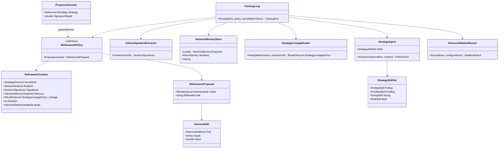

# Wip.Tholdem Continual Harness Transfer Requirements

> Evaluation of which Continual Harness capabilities (Karten et al., arXiv:2605.09998, `github.com/sethkarten/continual-harness`) can be brought into the Tholdem learning loop, with implementation-ready, behavior-proof requirements. The target is data-only, offline, deterministic refinement under the existing frozen statistical gate; the gate remains the only promotion authority, and no poker-strength or unbounded-self-improvement claim is made.
>
> **Superseded for LLM mode:** the LLM-exclusion decisions in this document (notably "Why the headline mechanism is not an LLM refiner" and the prompt/meta-tool rejections) are replaced by `harness/requirements/Wip.Tholdem.ModelHarness.md`. The deterministic R-01–R-12 requirements remain the offline substrate and control arm.

---

## Executive Summary

**Verdict.** Eight capabilities transfer (three adopted, five adapted), three are rejected for this system, two are deferred, and one is not applicable. The highest-value transfer is not an LLM refiner. It is the structural loop the paper wraps around its model: read the trajectory, name the failures, edit bounded harness components, remember what failed, bootstrap the next run, and ablate what actually helped.

| Finding | Consequence |
|---|---|
| Tholdem already owns a statistically gated loop with content-addressed strategies, a hash-chained ledger, a frozen manifest and a fresh-holdout meta gate | The expensive trust machinery is already present; the missing piece is the refinement input and the persistent harness state |
| The learning loop reads only six aggregate numbers from the training match and never feeds its own ledger, reports or memory into the proposal | The proposer has no action-level signal, so its one-parameter nudges are blind to why a hand was lost |
| `StrategyGenome.PromptText` is never read by `StrategyAgent` and is excluded from `BehaviorEquals` | Online prose-prompt optimization has no landing zone today; the transferable equivalent is data-only policy and skill refinement |
| `MatchSimulator` already builds a canonical `HandRecord` per hand, but discards it unless `HistoryDirectory` is set | Trajectory-grounded refinement can be added without changing the simulator's public contract |
| The default proposer's ±0.02 nudges were behaviourally inert in observed runs (0.000 mean over 24-50 paired seeds) | The first requirement is to make proposals non-inert and explainable, not to add more search |
| Continual Harness gains depend on model capability and its main loop assumes an LLM refiner | Tholdem should keep the refiner deterministic; adding an LLM refiner would reintroduce the A9 prompt-injection surface and a capability floor |

**Recommended sequence.** Deliver T1 (R-01 to R-08) first: trajectory capture, failure signatures, memory, lineage, a refinement-policy boundary, bootstrap modes, guards and safety controls. Then deliver T2 (R-09 to R-12): deterministic skill decomposition, skill-aware refinement, an ablation runner, and evolution of the refinement policy itself under the unchanged meta gate.

**Explicit non-claims.** This plan does not claim a stronger poker agent, a general-purpose RSI system, model-weight training, online LLM self-modification, or any CI result. It claims a better-instrumented, data-only refinement loop whose proposals and components can be measured, reproduced and falsified.

---

## Sources and Method

| Source | What it contributes | How it is used here |
|---|---|---|
| Continual Harness paper, [arXiv:2605.09998](https://arxiv.org/abs/2605.09998) | Four harness components, reset-free Refiner, CRUD edits over a trajectory window, bootstrap variants, online process-reward co-learning, capability-dependent gains | Capability inventory and the mechanism names used in the fit matrix |
| Continual Harness repository, [sethkarten/continual-harness](https://github.com/sethkarten/continual-harness) | `evolve_harness`, `--enable-prompt-optimization`, `memory.json`/`skills.json`/`subagents.json` bootstrap, ablation sections | Concrete mechanism shapes and the distinction between frozen and updating bootstrap |
| `harness/requirements/bones-learning-enhancement.md` | A prior transfer of the same source into the Bones co-learning loop, including multi-match context, lineage memory, process rewards, skills, sub-agents, prompt optimization and curriculum | Precedent for the requirement format and for what a same-source, different-target transfer looks like |
| `WIP/Wip.Bones.Agents/Knowledge` and `Agents/Skills`, `Agents/Delegation`, `Agents/Enhance` | Working implementations of long-context memory, lineage, process rewards, skill composition, sub-agent delegation and meta-prompt optimization | Borrowable semantics; not copied because Bones uses wall-clock/GUID values that Tholdem's determinism contract forbids |
| `WIP/Wip.Tholdem.Agents/Learning` | The current loop, proposer, artifact format, gate, verifier, meta-loop and frozen manifest | The current-state audit and every fit verdict |
| `docs/tholdem/rsi.md`, `rsi-threat-model.md`, `known-limits.md`, `agentic-process.md` | Bound RSI claims, A1-A15 threat model, documented limits, component walkthrough | Constraints that any transfer must preserve |
| `docs/goal-tholdem/` and `docs/goal-rsi/` | Closed goal scope, residuals and evidence conventions | Scope boundaries and the "no new claim" rule |

**Method.** (1) Inventory the paper's mechanisms and the repository's concrete implementations. (2) Audit the Tholdem learning loop, runtime agent, artifacts and threat model against each mechanism. (3) Assign a verdict (Adopt, Adapt, Defer, Reject, Not applicable) with the landing requirement or the reason it cannot land. (4) Write requirement statements with executable acceptance criteria. (5) Derive the xUnit plan and falsify every factual claim against source.

**Tree state.** The evaluation is of the working tree on branch `WIP`; the `WIP/Wip.Tholdem*` projects and `docs/tholdem/` are untracked at the time of writing, as recorded in `docs/goal-tholdem/state.md:38`. No source file was modified to produce this document. The Tholdem agents project builds locally with 0 warnings and 0 errors (`dotnet build WIP/Wip.Tholdem.Agents/Wip.Tholdem.Agents.csproj -c Release`).

---

## Current-State Audit

| Area | Observed today | Evidence | Consequence for the transfer |
|---|---|---|---|
| Harness state | A `StrategyGenome` is four numeric parameters plus a prompt string; the prompt is data the agent never reads | `WIP/Wip.Tholdem.Agents/Learning/StrategyGenome.cs:8-40`, `StrategyAgent.cs:25-82` | "Prompt" is a label, not a policy; prompt optimization cannot be evaluated until the policy surface becomes behavioural |
| Artifact identity | `StrategyArtifact` is content-addressed over version, parent, iteration, four parameters and `promptText`; no clock or GUID in the identity | `StrategyArtifact.cs:19-98` | Any new always-emitted field changes every hash; new fields must be emitted only when present |
| Loop | Self-play, analyze, propose, evaluate, gate, verify, persist; the proposer nudges exactly one parameter | `TrainingLoop.cs:104-224`, `StrategyProposer.cs:30-61` | A refinement loop exists, but its input is six aggregates and its edit surface is one scalar |
| Analysis | `SessionAnalysis` carries hands, win rate, bb/100, aggression factor, showdown rate and a hard-coded VPIP zero | `SessionAnalysis.cs:9-15`, `StrategyAnalyzer.cs:22-41` | No action-level or street-level failure signal exists |
| Trajectories | `MatchSimulator` builds a canonical `HandRecord` for every hand, hashes it and optionally writes it; `SimulationReport` exposes only the report JSON and metrics | `MatchSimulator.cs:173-246`, `SimulationReport.cs:4-10` | The trajectory data needed by a Refiner is produced and then discarded; capturing it requires no engine change |
| Memory | No cross-iteration or cross-run memory in the learning layer; the runtime agent has only session-scoped chat memory | `WIP/Wip.Runtime/Runtime/ArtifactAgentMemory.cs:10-80`; no memory type under `Learning` | CH's "unstick blocked routes" function has no counterpart |
| Lineage | `parentId` links artifacts and the ledger records outcomes, but nothing walks the chain or feeds it back | `StrategyArtifact.cs:28-37`, `TrainingLoop.cs:400-436` | The data for lineage exists; the reader does not |
| Gate | Promote only when `LowerBoundBbPer100 > MarginBbPer100` and `Seeds >= MinSeeds`; the verifier re-derives both from the report | `PromotionPolicy.cs:21-47`, `PromotionVerifier.cs:20-59` | The gate must not be touched by this work |
| Meta-loop | Evolves a four-field `ProposerGenome`; freezes five gate components; requires a pre-registered hit-rate improvement and a fresh-holdout ratchet | `MetaLoop.cs:302-556`, `FrozenComponents.cs:89-96` | The meta-loop is already a refiner-of-the-refiner; it needs a richer refiner policy, not new gate logic |
| Skills | `StrategyAgent` is one if/else decision order; the runtime agent exposes exactly four fixed tools | `StrategyAgent.cs:33-81`, `TholdemToolCatalog.cs:10-54` | "Skill creation" has no landing zone without a deterministic decomposition |
| Seat count | Engine and simulator support 2-6 seats; the learning loop runs two agents only | `MatchSimulator.cs:48-64`, `known-limits.md:11-16` | Curriculum across seat counts is blocked on a multiway evaluator, not on this document |
| Safety scan | Every `Learning` source is scanned for `Process`, `HttpClient`, `git `, `Assembly.Load`, `Compile`, `CSharpScript` and `CodeDom` | `LearningSourceSafetyTests.cs:12-19` | New refinement code must avoid these tokens; a class named `ProcessReward` in `Learning` would fail the scan |

### Baseline Gate

| Check | Status | Detail |
|---|---|---|
| `dotnet build WIP/Wip.Tholdem.Agents/Wip.Tholdem.Agents.csproj -c Release` | Passed | 0 warnings, 0 errors |
| `dotnet run --project tools/HarnessSync -- --check` | Passed | exit code 0 |
| `dotnet test WIP/Wip.Tholdem.Tests` | Not run | Local VSTest aborts with `Win32Exception (5)`, a documented machine limitation |
| Recorded Tholdem suite | 317/317 in `docs/tholdem/rsi-threat-model.md` | Not re-executed for this evaluation; no CI claim is made |

---

## Capability Transfer Matrix

Verdicts: **Adopt** = build it close to the paper's shape; **Adapt** = keep the mechanism and change its substrate to data-only deterministic Tholdem primitives; **Defer** = valuable but blocked on another goal or on a threat-model amendment; **Reject** = incompatible with Tholdem's constraints; **N/A** = the precondition does not exist.

**Component mapping.** The paper's four harness components do not map one-to-one onto Tholdem, and saying so is part of the evaluation:

| Continual Harness component | Tholdem substrate | Transfer status |
|---|---|---|
| `p` system prompt | `StrategyGenome.Skills` — compiled deterministic modules with bounded data parameters | Partial: prose rejected, behavioural policy via R-09 |
| `G` sub-agents | None in the training loop; the runtime agent's four tools are fixed | Deferred; dynamic creation rejected |
| `K` skills | `PreflopSkill`, `PostflopSkill`, `SizingSkill`, `BluffSkill` | Adopted via R-09 and R-10 |
| `M` memory | `HarnessMemoryStore` under the run data directory | Adopted via R-03 |

| # | Continual Harness capability | Mechanism in the paper/repo | Tholdem today | Verdict | Landing requirement |
|---|---|---|---|---|---|
| 1 | Trajectory-window failure analysis | Refiner reads the last F steps and names failure signatures (loops, tool failures, stalls, missed exploration) before editing | Six aggregate metrics; hand records discarded | **Adopt** | R-01, R-02 |
| 2 | Four-component CRUD refinement | Rewrite prompt, create/edit/delete sub-agents, codify/repair skills, add/update/demote memories | One parameter nudge per iteration | **Adapt** | R-05, R-07 |
| 3 | Long-context memory | Persistent store of facts, patterns and failed approaches; demote stale areas | None | **Adopt** | R-03 |
| 4 | Reset-free bootstrapped runs | `bootstrap frozen` and `bootstrap updating`; persistent state compounds across runs | Champion and proposer pointers persist; no harness state | **Adapt** | R-06 |
| 5 | Skill creation and revision | Codify successful sequences, repair failing routines, revise skill data | Monolithic `StrategyAgent` | **Adapt** | R-09, R-10 |
| 6 | Mechanism attribution / ablation | Ablations attribute gains to pathfinding, skill debugging, sub-agent handoffs and memory reuse | None | **Adopt** | R-11 |
| 7 | Meta-refinement | The same loop can refine the refiner policy | Mini-RSI evolves `ProposerGenome` only | **Adapt** | R-12 |
| 8 | Sub-agent creation and delegation | `define_agent` and orchestrator handoffs to specialized modules | Runtime agent has four fixed analytic tools | **Defer** | Not in this scope; dynamic creation rejected, static advisory sub-agent needs a threat-model amendment |
| 9 | Meta-tools (`define_agent`, `run_code`, `process_memory`) | The model edits its own harness through a tool API | No meta-tools; tools are fixed at construction | **Reject** | Violates data-only/no-execution; `process_memory` is replaced by the operator-owned memory store in R-03 |
| 10 | Online prose-prompt optimization | Refiner rewrites the system prompt against observed failures | Prompt is inert; a prompt-only change is rejected as behaviourally inert | **Reject for now** | A9's residual says feeding the prompt to an LLM makes injection live; revisit only behind a validated rule DSL |
| 11 | Process-reward co-learning (PRM, teacher relabeling, soft SFT) | Score rollouts, relabel low-reward windows, update model weights | No model training, no network, no model on the training path | **Reject** | Adds a training stack and a network/model dependency that the goal constraints forbid; advisory signals are covered by R-02 |
| 12 | Curriculum / difficulty progression | Start with simpler variants and graduate | Multiway engine exists; learning loop is heads-up | **Defer** | Blocked on a multiway evaluator; belongs to a future multiway-learning goal |
| 13 | Capability-dependent gating | CH gains scale with model capability; Flash-Lite falls below baseline | The refiner is deterministic, so there is no model-capability floor | **N/A** | Revisit only if an LLM refiner is ever introduced; then gate it with a capability probe |
| 14 | Compounding refinement within an episode | Failure signatures accumulate monotonically; later edits see earlier ones | Iterations are discrete and the ledger is an audit log | **Adapt** | R-03/R-04 persist the accumulated evidence across iterations; mid-hand updates stay out of scope because they would break the held-out evaluation boundary |

### Why the headline mechanism is not "an LLM refiner"

Continual Harness's Refiner is an LLM that rewrites prompts and code mid-episode. Tholdem's promotion authority is a frozen statistical test over held-out paired deals, and the learning layer is deliberately scanned to contain no model call, no network and no code execution (`LearningSourceSafetyTests.cs:12-19`; A9 in `rsi-threat-model.md:172-191`). Replacing the deterministic proposer with an LLM Refiner would (a) make every proposal non-reproducible unless the model output is captured as data, (b) reintroduce the A9 injection surface the current architecture avoids, and (c) add a capability floor that the paper itself documents. The transferable value is the **loop shape** — trajectory, failure signatures, bounded data edits, memory, bootstrap, ablation — not the LLM.

### Why prompt optimization is rejected rather than adapted

The paper's prompt component assumes the system prompt is the agent's policy. In Tholdem, `StrategyAgent` never reads `StrategyGenome.PromptText`, `ProposerGenome.BehaviorEquals` explicitly excludes the template, and the meta-loop refuses a prompt-only candidate before evaluation (`StrategyGenome.cs:35-40`, `ProposerGenome.cs:59-63`, `docs/tholdem/rsi.md:262-263`). Optimizing prose would produce elegant artifacts with zero behavioural effect and would make the A9 residual live if the text were ever fed to the runtime agent. The safe version of the same idea is R-09: make the policy surface explicit, bounded, deterministic data, then refine that. A full rule/interpreter DSL is deliberately deferred beyond T2 because it is a larger change than the rest of this plan.

### Why sub-agents, meta-tools and model co-learning are out

- **Dynamic sub-agents and meta-tools** give model output authority over the tool list or executable content. Tholdem's runtime agent fixes `_tools` in its constructor and the learning layer forbids `Assembly.Load`, `Compile` and `CSharpScript` (`TholdemRuntimeAgent.cs:56-77`, `LearningSourceSafetyTests.cs:12-19`). A static, tool-less advisory sub-agent could be safe, but it would duplicate the four existing analytic tools and would need its own A9/A10 analysis; defer it.
- **Model-weight co-learning** needs a training pipeline, a teacher model, network access and a GPU. Tholdem is offline by contract, and the frozen gate cannot validate a weight update. Reject.
- **Process rewards** as gate inputs would create a second objective that the statistical verifier cannot re-derive. Keep any process signal advisory, as a signature in R-02, never as a promotion input.

---

## Requirements

### Tier Plan

| Tier | Scope | Requirements | Rationale |
|---|---|---|---|
| T1 | Trajectory-grounded refinement foundation | R-01 to R-08 | Makes the proposer see what happened, remember what failed, and bootstrap the next run without touching the gate |
| T2 | Real components and measurement | R-09 to R-12 | Expands the editable surface from four scalars to named skills, and measures which component actually helps |

T1 is a hard prerequisite for T2. Every requirement below is opt-in behind `HarnessRefinement` mode; with the mode off, the existing loop, artifacts and ledger must remain byte-identical.

| Work package | Impact | Effort | Main risk | Recommendation |
|---|---|---|---|---|
| R-01, R-02 trajectory capture and signatures | High: the proposer finally sees why hands were lost | M | Low: no engine change, existing history writer | Do first |
| R-03, R-04 memory and lineage | High: stops repeated dead ends and explains the current champion | M | Medium: poisoning, staleness, forged ancestry | Do first, bounded and hashed |
| R-05, R-06 policy boundary and bootstrap | High: turns a nudge into a refinement pass; carries state across runs | L | Medium: abstraction churn in `TrainingLoop` | After R-03 |
| R-07, R-08 guards and safety | Mandatory: the new surface must not weaken the gate | S | Low if written with the feature | Continuous |
| R-09, R-10 deterministic skills | High: expands the editable surface beyond four scalars | L | High: behavioural regression at defaults | Only with the equivalence corpus green |
| R-11 ablation | Medium: makes the benefit measurable and falsifiable | M | Low: scratch directories only | Before making the mode default |
| R-12 refiner-policy evolution | Medium: lets the meta-loop improve the refiner itself | S once R-05 exists | Low: same frozen gate and fresh holdout | Last |

**What success looks like.** Success is not a promotion. It is: (a) at least one proposal traceable to a named signature and to a memory or lineage entry, (b) a documented inert rate below the current all-inert baseline, (c) an ablation report that either attributes an effect to a component or states that it found none, and (d) the unchanged gate still refusing an unjustified promotion. A result that promotes more often by weakening the gate is a failure, not a success.

### Requirement Statements

| ID | Requirement (shall) | Tier | Acceptance criterion | Depends on |
|---|---|---|---|---|
| R-01 | The loop shall capture every training-match hand as a canonical `HandRecord` through a bounded scratch directory, without changing `MatchSimulator`'s public contract, report bytes or session identity, and shall delete the scratch copy after extraction | T1 | Captured count equals `TrainingHands`; legacy mode creates no scratch artifacts; the session manifest and report hash are unchanged | — |
| R-02 | A deterministic extractor shall turn recorded hands into a bounded `SessionSignatures` value (at most 12 named signals) with counts, samples, rates and directions only — no seeds, cards, opponent names or free text — covering at minimum fold-to-raise, call-with-weak-hand, missed-value, aggression-by-street, showdown-loss and stack-off-loss | T1 | Same records produce byte-identical signature JSON; a seeded losing session produces the expected fold-to-raise and missed-value signals; the output contains no seed or card token | R-01 |
| R-03 | A canonical harness-memory store shall persist `pattern`, `failed-approach` and `dead-end` entries under the data directory, keyed by iteration and bounded in size, with a content hash and no clock, GUID, seed or card identity | T1 | Three rejections of the same approach produce a dead-end; the 65th entry exercises deterministic eviction; a tampered file is refused on load | R-02 |
| R-04 | A lineage reader shall resolve the active champion's parent chain from content-addressed artifacts and join the hash-chained ledger for outcomes, with a depth cap and stable refusals for a missing parent, a cycle or a broken chain | T1 | A three-link chain returns entries in version order with outcomes; a missing parent and a cycle each return a stable error code and no partial list | — |
| R-05 | The loop shall accept an `IRefinementPolicy` that receives `RefinementContext` (incumbent, analysis, signatures, memory snapshot, lineage, iteration, mode) and returns a data-only `RefinementProposal`; the legacy proposer shall remain available through an adapter that is byte-identical when refinement is off | T1 | A signature context yields an edit to the implicated parameter; an empty context falls back to the legacy session-driven nudge; legacy-mode artifacts and ledger are byte-identical to today | R-02, R-03, R-04 |
| R-06 | Training options shall support `None`, `Frozen` and `Updating` bootstrap modes that load champion, memory and lineage from a prior data directory or memory snapshot; the run result shall record the mode and the loaded and final memory hashes | T1 | Frozen bootstrap leaves the memory bytes unchanged; updating bootstrap changes them; a tampered snapshot is refused; the same inputs reproduce the same artifact hashes | R-03, R-05 |
| R-07 | Every proposal shall pass a guard that rejects frozen-gate edits, out-of-domain values, behaviourally inert strategy edits, oversized proposals and illegal memory writes; memory-only proposals shall not trigger an evaluation | T1 | An inert skill edit is refused before any evaluation file exists; a gate-component edit is rejected; a memory-only edit writes memory and no report; nine edits are refused | R-05 |
| R-08 | No refinement path shall call a model, open a network socket, start a process, load or compile code, or change tool permissions; all new artifacts shall be canonical UTF-8 JSON without BOM, with invariant numbers, no clock and no GUID | T1 | The extended source scan passes; injection text is stored as inert data; a poisoned "promote" memory cannot move the pointer; two fresh directories produce identical hashes | R-03, R-05 |
| R-09 | `StrategyAgent` shall decompose into named deterministic skills (`PreflopSkill`, `PostflopSkill`, `SizingSkill`, `BluffSkill`) with bounded data parameters on an optional `StrategyGenome.Skills`; absent or default skills shall reproduce today's decisions byte-for-byte, and the canonical writer shall emit skills only when present | T2 | The recorded seeded corpus produces identical actions and hand hashes with default skills; a preflop parameter changes only preflop decisions; an illegal skill action falls back legally; an absent-skills artifact keeps its old hash | R-05 |
| R-10 | The refinement policy shall be able to propose skill-parameter and skill-enable edits while the evaluator, promotion policy, verifier and seed derivation remain unchanged and unfrozen-manifest-compatible | T2 | A skill-edit proposal is evaluated by the unchanged gate and verifier; the frozen manifest hash is unchanged; the champion pointer moves only on a verified promotion | R-07, R-09 |
| R-11 | A bounded ablation runner shall run the same seed and iterations under named configurations (`none`, `signatures`, `memory`, `lineage`, `skills`, `all`) in scratch directories and emit a canonical `tholdem.ablation.v1` report without writing the champion or proposer pointer | T2 | Six configurations produce one canonical report; a repeat run is byte-identical; the active-champion file is untouched; a budget overflow is refused | R-06, R-10 |
| R-12 | `ProposerGenome` shall gain a bounded `RefinementStrategy` (`SessionDriven`, `SignatureDriven`, `MemoryDriven`) and optional `SignatureWeight` that the existing meta-loop can evolve without changing the frozen gate, the hit-rate criterion or the fresh-holdout ratchet | T2 | The default genome remains behaviourally identical to today; a signature-driven candidate differs behaviourally; a candidate that wins meta seeds and loses fresh seeds is refused | R-11 |

### Design Constraints

- **Data only.** No `HarnessEdit` carries code, a prompt to execute, a URL or a tool permission. The only executable content in the system remains the compiled `StrategyAgent` and the fixed tool catalog.
- **No clock, no GUID, no culture.** Memory and signature timestamps are iteration indices. Temporary file names, if any, are derived from content, not `Guid.NewGuid()`.
- **Canonical emission preserves history.** New fields (`skills`, `signatures`, `memoryHash`) are emitted only when present; an absent field must leave existing artifact and hand-history hashes untouched.
- **The gate is frozen.** `EvaluationCriteria`, `PromotionPolicy`, `PromotionVerifier`, `MatchEvaluator` and `SeedDerivation` remain in `FrozenComponents.ComponentNames` (`FrozenComponents.cs:89-96`). The refiner and memory are deliberately outside the frozen set because they are the objects being refined.
- **Opt-in.** `HarnessRefinement` is off by default for the first delivery; the ablation runner is the evidence gate for making it default.
- **Bounded.** At most 12 signatures, 64 memory entries, 8 edits per iteration, 4 memory writes per iteration, 6 ablation configurations, 10 ablation iterations and a wall-clock cap.

---

## Functionality Worktree

### Verification Policy

- Non-negotiable: every checklist item maps to executable runtime assertions, not to a document or a symbol name.
- Metadata-only assertions are supporting evidence only; a test that only reflects over a type cannot satisfy an item.
- Persistence items must round-trip real files and compare bytes or hashes; refusal items must prove no side effect (no evaluation file, no pointer write, no memory mutation).
- Determinism items must run the same inputs twice, in two fresh directories, and compare canonical bytes.
- Security items must attempt the attack (injection text, poisoned memory, forged lineage) and assert the unchanged gate verdict or the stable refusal.

### Coverage Inputs

| Input | Value |
|---|---|
| CsProject | `Wip.Tholdem.Agents` |
| AnalysisSource | Continual Harness paper and repository, cross-referenced with `harness/requirements/bones-learning-enhancement.md`, the Bones implementations, and a source audit of `WIP/Wip.Tholdem.Agents` |
| MandatoryItems | Enforce absolute behavior-proof verification for every planned integration test [mandatory - behavior-proof policy] |
| PlanType | requirements |
| OutputPath | `harness/requirements/Wip.Tholdem.ContinualHarness.md` |
| FeatureMode | `HarnessRefinement` (opt-in; legacy mode unchanged) |

### Class Diagram

### Completeness Checklist

- [ ] R-01: Capture every training-match hand as a canonical record through a bounded scratch directory, leaving the simulator contract and report bytes unchanged [T1 foundation]
- [ ] R-02: Extract bounded, deterministic failure signatures from the captured records without seeds, cards or free text [T1 foundation] [depends on R-01]
- [ ] R-03: Persist canonical harness memory with pattern, failed-approach and dead-end entries, bounded size and a content hash [T1 foundation] [depends on R-02]
- [ ] R-04: Resolve the champion lineage from artifacts and the hash-chained ledger with stable refusals for missing, cyclic or broken chains [T1 foundation]
- [ ] R-05: Add the `IRefinementPolicy` and `RefinementContext` boundary, with a legacy adapter that is byte-identical when refinement is off [T1 foundation] [depends on R-02, R-03, R-04]
- [ ] R-06: Support `None`, `Frozen` and `Updating` bootstrap modes with recorded memory hashes and deterministic artifacts [T1 foundation] [depends on R-03, R-05]
- [ ] R-07: Guard every proposal against frozen-gate edits, inert edits, out-of-domain values and oversized writes; memory-only edits must not evaluate [T1 foundation] [depends on R-05]
- [ ] R-08: Prove no model, network, process, dynamic load or permission change on any refinement path, and canonical deterministic artifacts [T1 foundation] [depends on R-03, R-05]
- [ ] R-09: Decompose `StrategyAgent` into four deterministic skills with bounded data parameters, byte-identical at defaults and hash-preserving when absent [T2 expansion] [depends on R-05]
- [ ] R-10: Allow skill edits through the refinement policy while the evaluator, gate, verifier and frozen manifest remain unchanged [T2 expansion] [depends on R-07, R-09]
- [ ] R-11: Add the bounded ablation runner and its canonical report, with no champion or proposer pointer writes [T2 expansion] [depends on R-06, R-10]
- [ ] R-12: Extend `ProposerGenome` with a bounded refinement strategy that the existing meta-loop can evolve under the same gate and fresh-holdout ratchet [T2 expansion] [depends on R-11]
- [ ] Enforce absolute behavior-proof verification for every planned integration test [mandatory - behavior-proof policy]

### Checklist to Runtime-Proof Matrix

| Checklist Item | Primary Runtime Proof Path | Minimum Evidence |
|---|---|---|
| R-01 Trajectory capture | Persistence: run a real training loop in refinement mode and count parsed records | `TrainingHands` canonical records read back; legacy run leaves no scratch directory; report hash unchanged |
| R-02 Failure signatures | API dispatch: extractor over synthetic and real records | Named counts and rates match an independent recomputation; byte-identical canonical output contains no seed or card |
| R-03 Harness memory | Persistence + negative: record three rejections, reload in a new process | Dead-end status, deterministic eviction, tamper hash mismatch refusal, no side effect on refusal |
| R-04 Lineage | API dispatch + negative: real artifact chain plus a forged cycle | Ordered entries with ledger outcomes; stable refusal and no partial list on cycle |
| R-05 Refinement policy | API dispatch: policy returns edits from a real context | Implicated-parameter edit; legacy adapter produces byte-identical artifacts and ledger |
| R-06 Bootstrap | Persistence: two directories, frozen versus updating | Memory hashes recorded and files byte-identical or changed as configured; tamper refused |
| R-07 Guards | Negative path: inert, frozen-component, memory-only and oversized proposals | No evaluation file on refused proposals; memory-only writes memory and no report |
| R-08 Safety and determinism | Negative path + reproducibility: injection, poisoned memory, two-directory run | Scan passes; pointer unchanged; identical hashes; no model or network call |
| R-09 Skills | API dispatch: agent decisions over a seeded corpus | Byte-identical default decisions and hand hashes; only the targeted street changes; legal fallback |
| R-10 Skill refinement | API dispatch: evaluation and gate on a skill-edit report | Same verdict formula and frozen manifest; pointer only on verified promotion |
| R-11 Ablation | Persistence + negative: six configurations and a repeated run | Canonical report; identical repeat; champion pointer untouched; budget refusal |
| R-12 Refiner evolution | API dispatch: meta-loop over a refiner candidate | Same frozen manifest and gate; fresh-holdout refusal reached |
| M1 Behavior-proof policy | Test-plan compliance | Every item has named executable tests; no metadata-only sole evidence |

---

## Test Plan

### Trajectory capture and failure signatures — R-01 and R-02

1. `Run_GivenHarnessRefinementMode_ExpectedEveryTrainingHandCaptured`
   *Assumption*: A training run in refinement mode captures exactly `TrainingHands` canonical records from the training match, each record parses through `HandRecordJson`, and the scratch directory is removed after extraction.

2. `Run_GivenLegacyMode_ExpectedNoTrajectoryScratchArtifacts`
   *Assumption*: A legacy-mode run creates no trajectory scratch directory and its session report hash and ledger bytes equal the pre-change baseline.

3. `Extract_GivenKnownHands_ExpectedBoundedSignatureCounts`
   *Assumption*: The extractor returns at most twelve named signals whose counts, samples and rates match an independent recomputation over the same records.

4. `Extract_GivenLosingSession_ExpectedFoldToRaiseAndMissedValueSignals`
   *Assumption*: A seeded session engineered to fold to raises and check strong hands produces non-zero `fold-to-raise` and `missed-value` signals with the expected direction.

5. `Extract_GivenRecords_ExpectedNoSeedOrCardIdentityInOutput`
   *Assumption*: The canonical signature JSON contains no session seed, hand seed, card token or opponent name.

### `HarnessMemoryStore` — R-03

1. `Record_GivenRejectedChallenger_ExpectedFailedApproachEntry`
   *Assumption*: A rejected challenger appends one failed-approach entry carrying the iteration index, reason code and aggregate evidence, and the reloaded store returns it.

2. `Record_GivenThirdRejectionOfSameApproach_ExpectedDeadEndStatus`
   *Assumption*: The third rejection with the same key marks the entry `dead-end` and subsequent proposals can exclude it by key.

3. `Record_GivenEntriesAboveCap_ExpectedDeterministicEvictionAndStableHash`
   *Assumption*: At 64 entries, adding one evicts the lowest `lastIteration` entry, the file hash is stable across two runs, and the evicted key is absent on reload.

4. `Load_GivenTamperedMemoryFile_ExpectedHashMismatchRefusal`
   *Assumption*: Editing one persisted entry causes `Load` to refuse with the memory-hash error and to mutate no file.

### `StrategyLineageReader` — R-04

1. `Read_GivenChampionArtifactChain_ExpectedEntriesWithLedgerOutcomes`
   *Assumption*: A champion with three parent-linked artifacts returns three entries in version order, each joined to its ledger reason and metrics.

2. `Read_GivenMissingParent_ExpectedStableRefusal`
   *Assumption*: A champion whose `parentId` has no artifact returns the missing-parent error code and no partial lineage list.

3. `Read_GivenCycle_ExpectedCycleRefusal`
   *Assumption*: Two artifacts whose `parentId` values form a cycle return the cycle error code before any unbounded walk.

### `IRefinementPolicy` — R-05

1. `Propose_GivenStrongestSignature_ExpectedImplicatedParameterEdit`
   *Assumption*: A context whose strongest signature is fold-to-raise returns exactly one edit to the parameter that controls calling and a rationale code, without mutating the incumbent.

2. `Propose_GivenNoSignatures_ExpectedLegacySessionDrivenNudge`
   *Assumption*: An empty signature set and a profitable session produce the same parameter and direction as `DeterministicStrategyProposer`.

3. `Run_GivenLegacyAdapter_ExpectedByteIdenticalArtifactsAndLedger`
   *Assumption*: A run through the legacy adapter with refinement off writes the same bytes for every strategy, evaluation and ledger file as the current loop.

### `TrainingOptions` bootstrap — R-06

1. `Run_GivenBootstrapUpdating_ExpectedLoadedAndUpdatedMemoryHashes`
   *Assumption*: An updating bootstrap records the loaded memory hash, appends at least one entry after a rejection, and records the new hash.

2. `Run_GivenBootstrapFrozen_ExpectedMemoryBytesUnchanged`
   *Assumption*: A frozen bootstrap leaves `memory.json` byte-identical while still reading the patterns into the context.

3. `Run_GivenTamperedBootstrapMemory_ExpectedStableRefusal`
   *Assumption*: A copied bootstrap directory with a modified memory file is refused before any strategy artifact or pointer is written.

### `RefinementGuard` — R-07

1. `Propose_GivenInertSkillEdit_ExpectedRefusalBeforeEvaluation`
   *Assumption*: A skill edit that changes no decision on the probe corpus produces a refusal row and no evaluation file.

2. `Propose_GivenFrozenComponentEdit_ExpectedRejection`
   *Assumption*: An edit whose target is a frozen gate component is rejected with the frozen-target error and does not reach the evaluator.

3. `Propose_GivenMemoryOnlyEdit_ExpectedNoEvaluationAndMemoryWrite`
   *Assumption*: A memory-only proposal writes the memory entry, creates no evaluation file and leaves the strategy artifact set unchanged.

4. `Propose_GivenNineEdits_ExpectedBoundRefusal`
   *Assumption*: A proposal with nine edits is refused as oversized before any file is written.

### Safety and determinism — R-08

1. `LearningSources_GivenRefinementSources_ExpectedNoExecutionNetworkOrModelCall`
   *Assumption*: The extended scan over every new `Learning` source finds none of `Process`, `HttpClient`, `Socket`, `Assembly.Load`, `Compile`, `CSharpScript` or `CodeDom`, and finds no chat-model or network reference.

2. `Memory_GivenInjectionText_ExpectedInertStorageAndNoPermissionChange`
   *Assumption*: An injection string in a signature or memory value is stored as inert text, and a subsequent agent turn's tool list and permission descriptors are unchanged.

3. `Memory_GivenPoisonedPromoteInstruction_ExpectedGateVerdictUnchangedAndNoPointerMove`
   *Assumption*: A memory entry instructing the loop to promote cannot change the report, the verifier verdict or the champion pointer; the always-promote control still fails.

4. `Artifacts_GivenSameInputsTwoDirectories_ExpectedIdenticalHashes`
   *Assumption*: Two fresh directories, the same seed and the same refinement options produce identical SHA-256 for memory, signatures, strategies, evaluations and ledger.

### `StrategyAgent` skills — R-09

1. `Agent_GivenAbsentSkills_ExpectedByteIdenticalDecisionsAcrossSeededCorpus`
   *Assumption*: With `Skills` absent, the agent returns the same actions and the same hand hashes as the current implementation over the recorded seeded corpus.

2. `Agent_GivenPreflopSkillParameter_ExpectedOnlyPreflopDecisionsChange`
   *Assumption*: Changing only a preflop skill parameter changes decisions only on preflop streets and leaves postflop decisions on the same corpus identical.

3. `Agent_GivenIllegalSkillAction_ExpectedLegalFallback`
   *Assumption*: A skill that returns an action outside `LegalActionKinds` is rejected and the composed pipeline returns a legal fallback rather than an illegal action.

4. `Artifact_GivenAbsentSkills_ExpectedLegacyCanonicalHashPreserved`
   *Assumption*: A strategy artifact created without skills serializes exactly the legacy payload and keeps the hash of the current pinned example.

### Skill-aware refinement — R-10

1. `Run_GivenSkillParameterEdit_ExpectedGateAndVerifierVerdictUnchanged`
   *Assumption*: A skill-edit challenge is evaluated by the same `MatchEvaluator` and its report yields the same `StatisticalPromotionPolicy` and `PromotionVerifier` verdict as a numeric-parameter challenge with the same report.

2. `MetaLoop_GivenSkillEditingRefiner_ExpectedFrozenManifestUnchanged`
   *Assumption*: A refiner policy that edits skills does not change `FrozenComponents.Pinned` or the manifest hash captured by the meta-loop.

3. `Run_GivenSkillEditPromotion_ExpectedPointerOnlyOnVerifiedPromotion`
   *Assumption*: The champion pointer changes only after a verified promotion; a rejected skill edit leaves `active-champion.json` byte-identical.

### `HarnessAblationRunner` — R-11

1. `Run_GivenSixConfigurations_ExpectedCanonicalReportAndNoPointerWrite`
   *Assumption*: Six configurations produce one canonical `tholdem.ablation.v1` report and leave both `active-champion.json` and `meta/active-proposer.json` untouched.

2. `Run_GivenSameSeedTwice_ExpectedIdenticalReports`
   *Assumption*: Two ablation runs with the same seed and options produce byte-identical reports in two fresh directories.

3. `Run_GivenBudgetExceeded_ExpectedStableRefusal`
   *Assumption*: A configuration count or iteration count above the documented bound is refused before any simulation starts.

### `ProposerGenome` refinement strategy — R-12

1. `Genome_GivenSignatureDrivenStrategy_ExpectedBehaviorInequalityFromDefault`
   *Assumption*: A `SignatureDriven` genome is behaviourally unequal to the default genome and its canonical meta artifact hash differs.

2. `Genome_GivenDefaultStrategy_ExpectedBehaviorAndArtifactHashUnchanged`
   *Assumption*: The default genome's behaviour equals today's default and its canonical meta artifact bytes equal the recorded baseline.

2. `MetaLoop_GivenRefinerCandidate_ExpectedSameFrozenManifestGateAndFreshHoldout`
   *Assumption*: A meta-run over a refiner candidate captures the same pinned manifest, applies the same hit-rate and promotion criteria, and runs the fresh-holdout comparison.

3. `MetaLoop_GivenCandidateWinsMetaButLosesFresh_ExpectedRefusal`
   *Assumption*: A refiner candidate that wins on meta seeds and loses on fresh seeds is refused with the fresh-regression reason and no pointer move.

### Absolute Behavior-Proof Compliance Gate

1. `BehaviorProofCompliance_GivenChecklistItems_RequiresExecutableRuntimeProofForEachItem`
   *Assumption*: Every checklist item is compliant only when backed by executable runtime assertions (real loop run, real file round-trip, real gate verdict or deterministic refusal).

2. `BehaviorProofCompliance_GivenMetadataOnlyAssertions_RejectsPlanAsNonCompliant`
   *Assumption*: A checklist item whose only evidence is a type name, a document or a symbol reflection fails compliance.

3. `BehaviorProofCompliance_GivenApiFocusedCoverage_RequiresOwnerSemanticsBusinessSemanticsLifetimeCorrelationIsolationAndNegativeContracts`
   *Assumption*: A policy, evaluator or persistence API test is compliant only when it proves owner resolution (the correct champion or store), business semantics (the actual edit, report or entry), lifetime or ordering (iteration order, version order), isolation (no pointer write on refusal) and the negative contract.

---

## Threat Model Delta

The existing A1-A15 analysis is in `docs/tholdem/rsi-threat-model.md`. The table records only what changes; A3, A6, A8 and A13 are unchanged because the gate, the fresh holdout, the promote confirmation and the pre-registered metric are untouched.

| Threat | New surface | Control | Residual |
|---|---|---|---|
| A1 Reward hacking | Signatures and memory are new proposal inputs | They never reach `StatisticalPromotionPolicy`; the verdict still comes from the paired held-out report | The proxy gap remains exactly as documented in A1; this work does not narrow it |
| A2 Seed mining | Trajectory scratch files contain the hand seed and both hole cards | Scratch lives under the run data directory, is deleted after extraction, and is excluded from memory and signatures | A local operator can read the scratch directory while a run is active; unchanged from the operator's existing access |
| A4 Ledger tampering | Lineage joins the ledger to artifacts | The reader verifies the hash chain and the artifact content hash before returning entries | A re-chainer can still recompute the public chain (A4 residual) |
| A5 Self-comparison | A refiner can propose an identical genome | The existing inert-proposal guard and the meta-loop's self-comparison refusal remain in force | Behavioural equivalence over sampled deals remains statistical (A5 residual) |
| A7 Inert proposals | Skill and memory edits add new inert shapes | The guard checks skill edits against a fixed probe corpus before evaluation; memory-only edits do not evaluate | A probe corpus is finite; a skill that changes no probe decision but changes a rare line is still possible |
| A9 Prompt injection | Memory and signature text could carry instructions | Text is generated from a fixed vocabulary, bounded, never executed, never sent to a model; the learning source scan remains | If a future feature feeds policy text to the runtime LLM, A9 becomes live; this plan forbids that feed |
| A10 Runaway compute | Trajectory capture and ablation add work | Per-iteration cap, scratch deletion, at most six ablation configurations and a wall-clock cap | A single large simulation is still not interrupted mid-call, as in A10 |
| A11 Weak-seed amplification | Trajectory capture increases the data available in one run | The 2^40 guard and weak-seed caps are unchanged; captured files are scratch-only | An opted-in weak seed remains inferable, as documented |
| A12 Reproducibility drift | Memory and signatures add new persisted data | Canonical JSON, invariant numbers, iteration indices, no clock or GUID; two-directory test | Bootstrap from a mutated directory is reproducible only via the recorded memory hash or snapshot |
| A14 Frozen-component tamper | A refiner could try to edit the gate | `FrozenComponents.ComponentNames` is unchanged and the guard rejects gate-targeted edits; the meta-loop re-captures the manifest | The refiner is intentionally outside the frozen set; its behavior is bounded by the same gate, not by the manifest |
| A15 Meta-overfitting | A refiner policy is a new search dimension | It is evaluated by the existing meta seeds, hit-rate interval and fresh-holdout ratchet | The finite fresh holdout remains re-usable across campaigns, as in A15 |
| N1 Memory poisoning | An attacker writes a pattern that steers the proposer | Memory is advisory only, editable only through the guarded store, hashed on load, and cannot alter the gate or pointer | A poisoned but well-formed pattern can waste evaluation budget, not force a promotion |
| N2 Lineage forgery | An attacker fabricates a parent chain | Artifact content hashes and the ledger chain are verified; a missing parent or cycle is refused | A full re-hash of a forged chain is the same residual as A4 |
| N3 Trajectory leak | Captured hands contain hidden cards | Scratch is per-run, deleted after extraction, and excluded from all persisted refinement artifacts | The operator already has replay artifacts with the same information |
| N4 Ablation pointer write | A measurement tool accidentally promotes | The runner uses scratch directories and a read-only pointer path; a test asserts both pointers are unchanged | None identified |

---

## Scope and Constraints

| Item | Decision |
|---|---|
| In scope | New files under `WIP/Wip.Tholdem.Agents/Learning/`, new tests under `WIP/Wip.Tholdem.Tests/`, `docs/tholdem/**`, and this requirements document |
| Out of scope | Engine, history format, `MatchSimulator` public contract, `MatchEvaluator`, `PromotionPolicy`, `PromotionVerifier`, `SeedDerivation`, `Wip.Bones*`, `Wip.Shell*`, `Wip.Runtime`, new projects, publish or deployment |
| Trajectory capture | Reuses the existing `SimulationOptions.HistoryDirectory`; no simulator change is required or permitted by R-01 |
| Default behavior | `HarnessRefinement` off; legacy mode must remain byte-identical, including every recorded artifact hash |
| Test expectations | No existing test may be weakened, skipped or deleted; every changed expectation must be listed with its justification |
| Network, model, process | None on the training path; the live-model gate and the runtime agent are untouched |
| Release | No merge, tag, publish or deploy; local build and the supplementary runner only |
| CI | Not executable from this machine (no `gh`, no token); no CI-green claim is made |
| Governance | This document recommends R-01 to R-12 for a future goal; it does not reopen the closed `goal-rsi` scope or authorize implementation by itself |

---

## Falsification Log

A source-level falsification pass checked each claim against the cited source and attempted a counterexample at the alternate call sites; the claims below are the load-bearing facts of this evaluation. Every row is Supported, so the document reports zero Falsified rows.

| # | Claim | Evidence | Status |
|---|---|---|---|
| C1 | `StrategyAgent.ActAsync` never reads `StrategyGenome.PromptText`, and `BehaviorEquals` ignores it | `StrategyAgent.cs:25-82`, `StrategyGenome.cs:35-40` | Supported |
| C2 | The proposal input is only the six `SessionAnalysis` aggregates; the loop never reads the ledger, earlier reports or memory into the proposal | `TrainingLoop.cs:116-128`, `SessionAnalysis.cs:9-15`, `StrategyAnalyzer.cs:22-41` | Supported |
| C3 | `MatchSimulator` builds a `HandRecord` per hand but exposes none on `SimulationReport`; records are written only with `HistoryDirectory` | `MatchSimulator.cs:173-182`, `:240-246`, `SimulationReport.cs:4-10` | Supported |
| C4 | The gate is `LowerBoundBbPer100 > MarginBbPer100` and `Seeds >= MinSeeds`, re-derived by the verifier | `PromotionPolicy.cs:34-45`, `PromotionVerifier.cs:30-58` | Supported |
| C5 | The artifact hash covers version, parent, iteration, four parameters and `promptText`; an always-emitted field changes every hash | `StrategyArtifact.cs:52-98` | Supported |
| C6 | The meta-loop freezes the five gate components, excludes the prompt template from `BehaviorEquals`, and uses a hit-rate and fresh-holdout ratchet | `FrozenComponents.cs:89-96`, `ProposerGenome.cs:59-63`, `MetaLoop.cs:455-524` | Supported |
| C7 | The learning loop is heads-up; the engine and simulator support 2-6 seats | `TrainingLoop.cs:116-120`, `MatchSimulator.cs:48-64`, `known-limits.md:11-16` | Supported |
| C8 | Bones implements long-context memory, lineage, process rewards, skill composition, sub-agent delegation and meta-prompt optimization | `WIP/Wip.Bones.Agents/Knowledge/*.cs`, `Skills/*.cs`, `Delegation/*.cs`, `Enhance/BonesMetaPromptOptimizer.cs` | Supported |
| C9 | The learning source scan forbids the listed execution, network and code-generation tokens | `LearningSourceSafetyTests.cs:12-19` | Supported |
| C10 | The runtime agent takes a fixed tool array and session chat memory; it has no long-term memory, sub-agent tool or meta-tool | `TholdemRuntimeAgent.cs:56-77`, `:109-131`, `TholdemToolCatalog.cs:10-54` | Supported |
| C11 | Continual Harness defines four harness components, an `evolve_harness` Refiner loop and bootstrap artifacts | Paper §2.2 and §3.2; repository README "Continual Harness Scaffold" | Supported |
| C12 | Continual Harness gains are capability-dependent | Paper abstract and §4.4; repository README "Caveats" | Supported |
| C13 | A9 says the prompt is data-only today and would become an injection surface if fed to the runtime agent | `docs/tholdem/rsi-threat-model.md:172-191` | Supported |
| C14 | The shipped proposer's nudges were inert in observed runs, with 0.000 means recorded | `docs/tholdem/rsi.md:265-279`, `docs/tholdem/known-limits.md:101-113` | Supported |
| C15 | No `FailureSignature*`, `HarnessMemory*`, `RuleSet*`, `RefinementPolicy*`, `HarnessBootstrap*` or `Ablation*` type exists under `WIP` | Repository-wide source search | Supported |
| C16 | The Bones requirements already derive the same Continual Harness capabilities for a different target | `harness/requirements/bones-learning-enhancement.md:90-124` | Supported |
| C17 | A `ProcessReward*` type in `Learning` would fail the source scan | `LearningSourceSafetyTests.cs:12-19` | Supported |

*No claim was left unverified; the attempted counterexamples were the alternate call sites, the artifact reader, the meta-loop promote path and the source scan.*

---

## Format Gate Results

| # | Rule | Status | Violations |
|---|---|---|---|
| 1 | Heading structure and separators | ✅ Pass | One H1; H2 sections separated; no level skips |
| 2 | Scope statement under H1 | ✅ Pass | Blockquote immediately follows the H1 |
| 3 | Pipe tables present | ✅ Pass | Multiple tables with alignment rows |
| 4 | Checklists with dependency tags | ✅ Pass | Every item carries a bracketed tier tag; dependency tags appear where a dependency exists |
| 5 | Mermaid diagrams (conditional) | ✅ Pass | One `mermaid` class diagram under the Class Diagram heading |
| 6 | Verification gate evidence | ✅ Pass | Falsification log has 17 Supported rows and the closing line is present |
| 7 | Closing verification line | ✅ Pass | Italicised "Zero Falsified" line in the last five lines |
| 8 | Numbered test plan items | ✅ Pass | Every test is numbered, backticked and carries an `*Assumption*:` line |

**PASS** — document conforms to plan format.

---

## Absolute Behavior Verification Compliance Check

| Condition | Result | Evidence |
|---|---|---|
| Every checklist item maps to named tests | ✅ Pass | 13 checklist rows (R-01 to R-12 plus M1) map to 43 named tests across twelve sections |
| Behavior-proof assertions present for every item | ✅ Pass | Each assumption names a real loop run, file round-trip, gate verdict or deterministic refusal |
| Metadata-only tests absent as sole evidence | ✅ Pass | No item relies on a type name or document alone; the source scan is paired with behavioral injection and pointer tests |
| API-focused items include absolute integration gates | ✅ Pass | R-05, R-07 and R-10 assert owner resolution, report semantics, ordering, isolation and the negative contract |

---

*All claims checked against source and attempted counterexamples; Zero Falsified rows. The requirements are plans, not implementation claims.*
